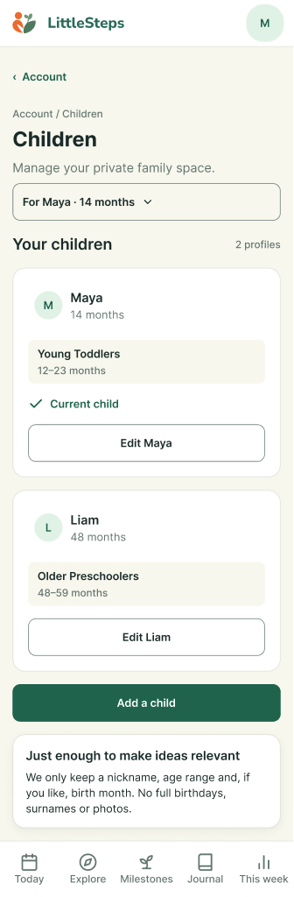
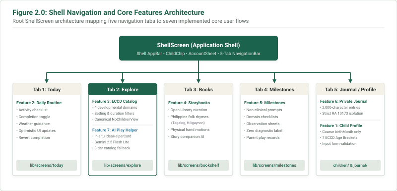
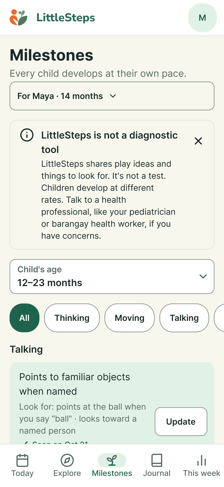
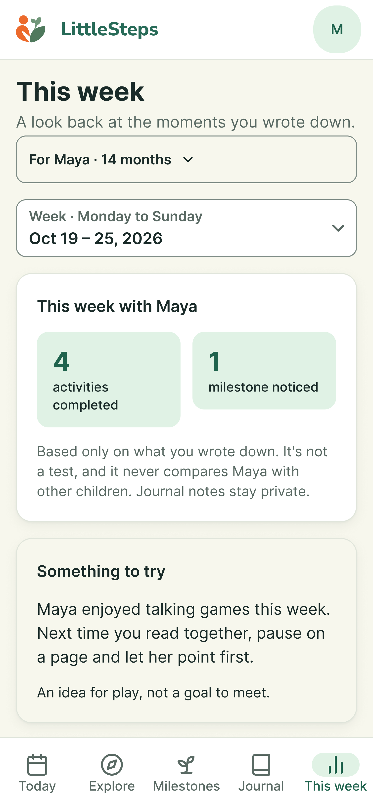

# CC 207B — Software Documentation: LittleSteps

**Course:** CC 207B — Applications Development and Emerging Technologies  
**Institution:** West Visayas State University — College of Information and Communications Technology  
**Submitted By:** Acebuche, Nherie C.; Ardeña, Justin Ace D.; Benjamin, Mae Daniella Faith C.; Cadangin, Mark Alvin C.; Tamaño, Vincent John A. (BSIT-3A — Thesis Titans)  
**Submitted To:** John Cristopher Mateo  
**Base Framework:** Flutter 3.47.9 (Dart SDK `^3.13.5`)  
**Primary Repository:** `Thesis-Titans/CC-207B_26-27_Final-Project` (`BSIT-3A/LittleSteps`)  
**Related Specifications:** [CC 207B Final Project Requirements](CC207B_Final_Project_Requirements.md), [AI Feature Specification](ai-feature-specification.md)

---

## i. Overview and Introduction

### 1. App Name

**LittleSteps** — Play Planning and Observation Companion for Caregivers of Young Children.

### 2. Purpose and Target Users

Parents and caregivers of children aged 0 to 5 years frequently turn to smartphones or tablets to keep toddlers occupied during household routines. Although guidance from the World Health Organization (WHO), the American Academy of Pediatrics (AAP), and the Philippine Early Childhood Care and Development (ECCD) Council advises against passive screen exposure in early childhood, busy caregivers rarely have time to look up age-appropriate, screen-free play ideas that work with ordinary household items.

LittleSteps addresses this gap as a caregiver-facing mobile application rather than a child-facing screen game. The primary target users are parents, guardians, and household caregivers of infants, toddlers, and preschoolers (ages 0–5) across Western Visayas and broader Philippine households; community ECCD facilitators and daycare workers serve as secondary users who can recommend home-based play routines to families. Design decisions are grounded in published WHO, AAP, and Philippine ECCD early-learning frameworks and informal parent walkthrough feedback.

The application lets an adult select a short, safe, screen-free activity in under a minute and then set the device aside. It organizes daily play across four developmental domains (Cognitive, Motor, Language, and Socio-Emotional), matches available household items to reviewed activities through an AI-assisted Idea Helper, provides regional action rhymes and storybooks in English, Filipino, and Hiligaynon, and records private, non-diagnostic observations and weekly summaries.

  
*Fig. 1. LittleSteps system architecture linking the Flutter client, Node.js/Express proxy, Gemini REST API, ECCD catalog, and Cloud Firestore.*

### 3. Technology Stack

*Table 1. System Technology Stack and Versions*

| Layer | Technology | Version | Architectural Role |
|---|---|---|---|
| Client Framework | Flutter SDK | `3.47.9` (stable) | Cross-platform Material 3 client targeting Android, iOS, and Web |
| Client Language | Dart SDK | `^3.13.5` (tested `3.13.7`) | Null-safe application logic, data models, UI components, and automated unit/widget test suites (`flutter test`) |
| Client State | Built-in Flutter state (`StatefulWidget`, `ChangeNotifier`, `InheritedWidget`) | Flutter SDK built-in | Lightweight reactive session and active-child state management without external state libraries |
| Backend Proxy API | Node.js / Express / TypeScript / Zod | Node `22`, Express `^5.1.0`, TS `^5.9.2`, Zod `^4.1.0` | Shared Firebase Cloud Functions gateway (`firebase-functions ^6.4.0`) enforcing authentication, CORS, hourly rate limits, and schema validation |
| Database & Auth | Firebase Auth & Cloud Firestore | `firebase-admin ^13.5.0` | Caregiver authentication, user-isolated cloud storage (profiles, plans, milestones, journals, saved books), and global catalog collections (`catalog_activities`, `catalog_milestones`, `catalog_rhymes`) |
| AI Service | Google Gemini REST API (`v1beta`) | Server-pinned via `GEMINI_MODEL` (e.g., `gemini-3.5-flash-lite`; avoids floating `-latest` aliases in production) | Server-side JSON play selection, book companions, and activity adaptations called via Node 22 `fetch` |
| Weather Service | Open-Meteo Forecast API | REST v1 | Optional indoor/outdoor play guidance using coordinates rounded to 2 decimal places (~1.1 km) |

---

## ii. Functional Requirements

### 1. Libraries and Packages Used

The Flutter application keeps third-party dependencies to six runtime packages to preserve compact build sizes and clear maintainability.

  
*Fig. 2. Flutter client package dependencies declared in `pubspec.yaml`.*

*Table 2. Flutter Packages and Purpose*

| Package | Version | Scope | Purpose |
|---|---|---|---|
| `flutter` (`material.dart`) | SDK `3.47.9` | Core SDK | Material 3 layout, navigation bar, forms, cards, chips, and accessibility semantics |
| `http` | `^1.6.0` | Runtime | Authenticated JSON REST requests, Firebase bearer-token headers, and 10-second timeouts (`AppMotion.apiRequestTimeout`) |
| `intl` | `^0.20.3` | Runtime | Formatting observation dates, journal dates, and Monday–Sunday weekly summary date ranges |
| `flutter_svg` | `^2.5.0` | Runtime | Rendering scalable SVG brand marks, wordmarks, and parent-child onboarding artwork |
| `share_plus` | `^13.3.1` | Runtime | Opening the native share sheet for caregiver account data export |
| `url_launcher` | `^6.3.3` | Runtime | Opening verified external citation portals (ECCD Council, DepEd MATATAG, WHO, CDC, AAP, Open-Meteo) in the system browser |
| `cupertino_icons` | `^1.0.8` | Runtime | Standard iOS/Cupertino icon glyphs complementing Material icons |
| `flutter_lints` | `^6.0.0` | Dev | Strict Effective Dart static analysis (`public_member_api_docs`, `comment_references`, `directives_ordering`) verified via `flutter analyze --fatal-infos` (0 issues) |
| `flutter_test` | SDK | Dev | Automated unit and widget test runner covering models, utilities, services, offline states, and screens (`flutter test`) |

### 2. Low- and High-Fidelity Prototypes

The interface progressed from low-fidelity Figma wireframes prioritizing one-handed ergonomics to high-fidelity Material 3 screens. Colors, spacing, corner radii, and touch-target dimensions are managed through a shared design token system (Table 3).

| Low-Fidelity Wireframe | High-Fidelity Prototype |
|:---:|:---:|
|  |  |
|  |  |

*Fig. 3. Low-fidelity wireframes to high-fidelity prototypes for child onboarding and the Today dashboard.*

*Table 3. Visual Design System Tokens*

| Design Category | Primary Values | Purpose |
|---|---|---|
| Brand & Surfaces | Forest green `#1F634D`, warm cream `#F4F2E8`, canvas `#F7F7ED`, white card `#FFFFFF`, soft green `#E0F2E5` | Primary actions, low-glare caregiver reading canvas, cards, and completion highlights |
| Status & Accents | Sage `#8DAF98`, warning orange `#EC6A2C`, error `#853029`, advisory yellow `#FAE8A8`, offline slate `#F1F5F9` | Secondary highlights, accessible error feedback, advisory notices, and offline banners |
| Typography Ink | Primary ink `#1A2B29`, secondary `#5A6A64`, tertiary `#7E8C86` | High-contrast WCAG 2.2 AA readable body text and muted metadata labels |
| Spacing & Targets | 4–32 dp spacing scale; 4/6/10/16/20 dp radii (`skeleton`, `badge`, `control`, `card`, `chip`, `sheet`); 48 dp minimum touch target; `AppTypography` & `AppMotion` tokens | Consistent 8pt layout rhythm, standardized motion/debounce timings, and comfortable one-handed touch targets |

### 3. Implemented Core Features

A five-member team requires at least six core user-facing features (excluding login, registration, splash, About, and Settings). LittleSteps implements seven core features organized across its five bottom navigation tabs, top-bar child profile switcher, and AI Idea Helper flow.

  
*Fig. 4. Application navigation hierarchy mapping the five bottom tabs, child profile management, and the AI Idea Helper.*

**1. Child Profile and Age-Band Management.** Caregivers register one or more children using only a nickname and one of seven canonical age bands (`0–5m`, `6–11m`, `12–23m`, `24–35m`, `36–47m`, `48–59m`, or `60–71m`, optionally derived from birth month), without providing exact birthdates, legal names, or photos. Inline form validation prevents empty or overly long nicknames and prevents duplicate submissions while saving to the cloud. Selecting a child from the top profile switcher updates all child-dependent tabs; when no child is registered yet, those tabs display a guided onboarding prompt.

**2. Today's Play Plan, Completion Tracking, and Offline Reading.** Displays the active child's scheduled activities for the current day alongside symmetric quick filters (`Under 10 mins`, `No materials needed`, `Indoor`, `Outdoor`), live Firestore milestone cues, and an optional Open-Meteo weather hint banner whose action routes directly to the AI Idea Helper with `"Where will you play?"` preselected (`Indoor`, `Outdoor`, or `Indoor or outdoor`). Caregivers can mark activities complete or undo completion with immediate feedback. Previously loaded child profiles, daily plans, saved storybooks, and public catalog datasets (`activities`, `milestones`, `rhymes`, `books`) are cached in memory for offline reading with an offline status banner, while write actions are safely disabled until connectivity returns.

**3. Early Learning Activity Catalog and Cultural Rhymes/Storybooks.** Provides a searchable, filterable library of source-checked screen-free activities, Open Library children's storybooks, and traditional Philippine action rhymes in English, Filipino, and Hiligaynon (including Western Visayas *Ili-Ili Tulog Anay*) served directly from Cloud Firestore (`catalog_activities`, `catalog_rhymes`) and the backend book proxy with zero hardcoded catalog lists in the Flutter binary. Caregivers can filter by developmental domain (Cognitive, Motor, Language, Socio-Emotional), indoor or outdoor setting, and time available, view preparation steps and safety notes, and add any activity directly to Today's play plan.

**4. Developmental Milestone Observations.** Presents age-appropriate observational prompts across six age bands (`0–11 months` through `60–71 months` DepEd MATATAG Kindergarten) loaded from Firestore (`GET /api/v1/catalog/milestones`), grouped by developmental domain, and lets caregivers log dated notes through a quick entry sheet. Every view carries an observational advisory notice and avoids clinical scores, pass/fail grades, or developmental delay labels.

     
*Fig. 5. Core features 1–4: Child profile management, Today play plan, activity catalog, and milestone observations.*

**5. Private Caregiver Journal.** Lets caregivers record chronological reflections and play preferences in a private notebook stored in user-isolated cloud storage. Journal entries are excluded from local offline caching for privacy and are never sent to any AI service.

**6. Weekly Reflection Summary.** Aggregates completed play activities, milestone observations, and journal entry counts across selectable Monday–Sunday weeks, presenting factual domain breakdowns and supportive empty states for quiet weeks.

**7. AI-Powered Idea Helper.** Accessible from a prompt card inside the Explore tab and directly from Today's Weather Hint banner (which preselects `"Where will you play?"` for `Indoor`, `Outdoor`, or `Indoor or outdoor`), the Idea Helper collects available household materials, time window (10, 15, 30, or 45 minutes), setting, language, and age band. It displays a loading state while querying the backend AI service, presents matched reviewed activities labeled `"Suggested by AI"` (or guardrailed `"Material adaptation"` cards with safety notes when custom household items have no catalog match) alongside a non-diagnostic disclaimer, groups 30-to-45-minute requests into toddler-paced Play Blocks, provides `"Add to today's plan"`, `"Another idea"`, and `"Edit preferences"` actions, and falls back to reviewed catalog picks whenever the device is offline or the AI service is unavailable.

    
*Fig. 6. Core features 5–7: Private caregiver journal, weekly reflection summary, and AI Idea Helper.*

### 4. Topic Coverage Matrix

*Table 4. CC 207B Topic Coverage Matrix (`BSIT-3A/LittleSteps`)*

| Course topic | Where applied (file and widget/class) | Brief description |
|---|---|---|
| Layout widgets | `lib/screens/shell_screen.dart` — `ShellScreen` `lib/screens/shell_navigation_sidebar.dart` — `ShellNavigationSidebar` `lib/widgets/responsive_layout.dart` — `AppWindowSize`, `ResponsiveContentBox`, `AdaptiveTwoPane` `lib/widgets/horizontal_scroll_fade.dart` — `HorizontalScrollFade` `lib/screens/today/today_screen.dart` — `TodayScreen` `lib/screens/today/widgets/today_activity_card.dart` — `TodayActivityCard` `lib/screens/explore/widgets/explore_activity_card.dart` — `ExploreActivityCard` `lib/widgets/no_children_view.dart` — `NoChildrenView` `lib/widgets/brand_logo.dart` — `BrandLogo`, `GrowthSymbol` `lib/widgets/screen_header.dart` — `ScreenHeader` | Composes adaptive Material 3 layouts using `Scaffold`, `AppBar`, `LayoutBuilder`, `Column`, `Row`, `Wrap`, `ListView.builder`, `SliverGridDelegateWithMaxCrossAxisExtent`, `Card`, `Padding`, and `SafeArea` with shared spacing/breakpoint tokens and 48 dp touch targets. |
| Navigation and routing | `lib/routing/app_router.dart` — `AppRouter` `lib/screens/shell_screen.dart` — `_ShellScreenState` `lib/widgets/account_menu_sheet.dart` — `AccountMenuSheet` | Named routing (`onGenerateRoute`) across splash, auth, `/home`, `/ai-suggest`, `/children`, `/children/add`, `/activity-detail`, and account views, paired with a 5-tab `NavigationBar` and `IndexedStack`. |
| Forms and validation | `lib/screens/children/add_child_screen.dart` — `AddChildScreen` `lib/screens/auth/sign_in_screen.dart` — `SignInScreen` `lib/screens/auth/register_screen.dart` — `RegisterScreen` `lib/screens/milestones/observation_form_sheet.dart` — `ObservationFormSheet` `lib/screens/journal/journal_note_screen.dart` — `JournalNoteScreen` `lib/models/journal_validators.dart` — `validateJournalContent`, `validateEntryDate` | Uses `Form`, `GlobalKey<FormState>`, `TextEditingController`, `TextFormField`, and `DropdownButtonFormField` with inline validation errors, submit locking, and clear error feedback. |
| Asynchronous operations / API calls | `lib/services/api_client.dart` — `ApiClient` `lib/services/ai_service.dart` — `AiService` `lib/services/plan_service.dart` — `PlanService` `lib/widgets/state_views.dart` — `LoadingView`, `EmptyStateView`, `ErrorView`, `InlineErrorCard`, `OfflineBanner`, `OfflineStatusCard` | Non-blocking `async`/`await` calls via `package:http` with 10-second timeouts, typed exceptions (`NoConnectionApiException`, `TimeoutApiException`, `AuthApiException`, `NotFoundApiException`, `ServerApiException`), `mounted` guards, and explicit state views. |
| Data persistence | `lib/services/children_service.dart` — `ChildrenService` `lib/services/plan_service.dart` — `PlanService` `lib/services/milestones_service.dart` — `MilestonesService` `lib/services/journal_service.dart` — `JournalService` `lib/services/local_cache.dart` — `LocalDataCache` | Persists caregiver-scoped child profiles, plans, milestone observations, and journals to Cloud Firestore via REST API, with in-memory whitelisted read caching cleared on sign-out. |
| AI-powered feature | `lib/screens/ai/ai_suggestions_screen.dart` — `AiSuggestionsScreen` `lib/screens/ai/widgets/ai_suggestion_card.dart` — `AiSuggestionCard` `lib/screens/ai/widgets/ai_play_block_banner.dart` — `AiPlayBlockBanner` `lib/services/ai_service.dart` — `AiService` `littlesteps-api/src/ai/` (`ai-service.ts`, `gemini.ts`, `prompt.ts`, `validate-output.ts`) | Hybrid catalog-first Idea Helper proxying requests to Google Gemini with zero client API keys, 3-layer safety and 33-term non-diagnostic validation, `"Suggested by AI"` and `"Material adaptation"` labeling, Play Blocks, and deterministic catalog fallback. |

**Code Organization & Standards (Technical Requirement f).** The Flutter codebase under `BSIT-3A/LittleSteps/lib/` is organized strictly by architectural layer: `config/` (`AppConfig` with release-build HTTPS enforcement and centralized `AppLinks`/`ProvenanceLinkInfo`), `theme/` (`AppColors`, `AppSpacing`, `AppRadius`, `AppSizes`, `AppTypography`, `AppMotion`, and Material 3 `AppTheme`), `models/` (`@immutable` data models and validators with uniform `fromJson`/`toJson`), `services/` (API, auth, and caching services), `utils/` (`accessibility.dart`, `date_formatting.dart`, `domain_labels.dart`, `plan_errors.dart`, `url_helper.dart`), `routing/` (`AppRoutes`, `AppRouter`), `widgets/` (shared `AuthScope`, `AdvisoryBanner`, `StateViews`, `BrandLogo`, `BookCard`, `ChildChip`, `ChildAgeHeader`, `ScreenHeader`, `NoChildrenView`, `AccountMenuSheet`, `WeatherHintBanner`, `HorizontalScrollFade`, and adaptive layout primitives `AppWindowSize`, `ResponsiveContentBox`, `AdaptiveTwoPane`), and `screens/` where all five primary tabs (`today/`, `explore/`, `milestones/`, `journal/`, `reflection/`) and `ai/` extract reusable presentation components into dedicated `widgets/` subfolders. Every public declaration carries Effective Dart `///` API documentation enforced by `public_member_api_docs: true` (`flutter analyze --fatal-infos`, 0 issues), backed by automated Flutter unit/widget tests (`flutter test`) and backend API/OpenAPI contract tests (`npm test`).

### 5. AI Feature Specification

*Full schemas, sample JSON payloads, and evaluation tables appear in [ai-feature-specification.md](ai-feature-specification.md).*

  
*Fig. 7. AI selection pipeline, output validation, and deterministic fallback architecture.*

LittleSteps implements a hybrid **catalog-first + guardrailed AI generation** pipeline rather than an open-ended chatbot. All AI requests travel from the Flutter client through the shared Node.js/Express backend proxy on Firebase Cloud Functions to the Google Gemini REST API (`v1beta`) using Node 22's built-in `fetch`—no third-party Gemini SDK package is used, and the API key never enters the mobile binary or repository. The active model is configured dynamically on the server via `GEMINI_MODEL` and pinned to an explicit stable version (e.g., `gemini-3.5-flash-lite`) rather than a floating `-latest` alias or client-supplied parameter to prevent unexpected schema drift in production. Payloads are validated with `zod` (`^4.1.0`), and the Flutter client communicates via `package:http` (`^1.6.0`) using Firebase Auth bearer tokens across three backend endpoints (`/api/v1/ai/recommendations`, `/api/v1/ai/story-activity`, and `/api/v1/ai/adapt`).

Strict input validation accepts only non-identifying fields—age band, indoor or outdoor setting, duration (5–120 minutes), up to 10 household materials (max 40 characters each), language (`en`, `fil`, `hil`), optional domain, suggestion count (1–3), and optional `allowCustom` flag—rejecting extra or personal fields with HTTP `400`. When reviewed catalog activities match the caregiver's materials, Gemini ranks and explains those reviewed IDs (`source: "ai"`, `reviewed: true`). When materials have zero catalog overlap, a **3-layer defense-in-depth** pipeline applies: Layer 1 (`sanitize.ts`) blocks extreme dangers (`bleach`, `knife`, `fire`, `medicine`) while letting typos and Filipino/Hiligaynon terms reach Gemini; Layer 2 (`prompt.ts` & `gemini.ts`) requires Gemini to normalize and evaluate every item in `materialAssessments` under pediatric safety principles before generating a `"Material adaptation"` card (`source: "ai_custom"`, `reviewed: false`, zero fabricated citations, plus a calm `materialNote` derived from actual card materials); and Layer 3 (`validate-output.ts`) deterministically checks the normalized output and fails closed to Tier 3 catalog fallback on any hazard or diagnostic slip.

Every model reply passes schema validation, candidate-ID verification, HTML/URL stripping, and a 33-term English and Filipino non-diagnostic wording filter before reaching the client. Tier 1 responses carry `source: "ai"`, a `"Suggested by AI"` badge, and the standard observational disclaimer; Tier 3 fallback responses carry `source: "catalog_fallback"` and `"Catalog picks · not AI"` (with zero AI labels and a `"Using our activity list"` banner). Runtime safeguards enforce an 8,000 ms timeout, a 64 KB response byte cap, a circuit breaker (opening for 60 s after 3 consecutive failures), and hourly rate limits (10 requests per user in Firestore and 30 per IP, returning HTTP `429` with a wait notice alongside non-AI catalog picks). Any timeout, service error, open circuit, or validation rejection automatically falls back to deterministic reviewed catalog ranking (or rule-based adaptation on `/api/v1/ai/adapt`), and if no catalog items can be loaded offline, the mobile app renders a clear empty recovery card rather than blank space.

Static database filters match structured fields well but struggle with informal household item descriptions (*"empty delivery box, clean sock"*). Constraining Gemini to catalog-grounded selection provides semantic matching without the clinical hallucination risks of an open chatbot. Under the Philippine Data Privacy Act of 2012 (RA 10173), child profiles store only a nickname and age band, prompts exclude child names and caregiver IDs, private journals are never read by AI endpoints, weather coordinates are rounded to ~1.1 km, and caregivers can edit or override every suggestion. Automated backend CI tests across a 46-case benchmark verify 0.0% false-block rate on ordinary play (0/21) and 0.0% unsafe or clinical answer rate across medical, hazardous, prompt-injection, and off-topic probes (0/25).

---

## iii. Future Enhancements and Roadmap

### 1. Known Limitations

Four technical constraints remain in the current release. First, offline read caching is retained in memory only for the active session rather than persisting to device storage across full app restarts, and offline writes remain disabled (`"Reconnect to save changes"`). Second, live Gemini material matching requires network connectivity to the backend API, although cached catalog browsing and fallback picks work offline. Third, regional Philippine action rhymes display text lyrics and parent hand-motion guides without audio recordings, and caregiver journals omit photo attachments to keep storage and rural mobile data consumption low. Fourth, the non-diagnostic wording filter covers 27 English and 6 Filipino clinical terms; Hiligaynon terms still require native-speaker review.

### 2. Planned Features and Improvements

*Table 5. Planned Post-Course Enhancements*

| Phase | Planned Improvement | Benefit to Caregivers |
|---|---|---|
| Phase 2 (Q1 2027) | Persistent on-device storage (SQLite / Drift) with queued offline plan sync | Retains cached plans across restarts and syncs completed activities automatically upon reconnection |
| Phase 2 (Q1 2027) | Native Hiligaynon and Tagalog audio tracks for action rhymes | Allows caregivers to hear traditional melodies while playing hands-free |
| Phase 2 (Q1 2027) | Printable PDF summary export from weekly reflections | Extends native sharing so caregivers can optionally share non-diagnostic play summaries |
| Phase 3 (Q2 2027) | Hiligaynon wording filter review and expanded Western Visayas activity pool | Broadens regional language safety containment and local activity coverage |
| Phase 3 (Q2 2027) | Multi-caregiver household access | Shares daily play routines across parents and guardians while keeping personal journals isolated |

---

## iv. AI Usage Log (Appendix)

*Records Generative AI use under the CC 207B AI Use Policy. Verified rows are synchronized with `BSIT-3A/LittleSteps/docs/ai-usage-log.md` and the group Software Documentation.*

*Table 6. AI Usage Log*

| Member | Date | AI tool | What it was used for / prompt summary | What was generated | What the member changed |
|---|---|---|---|---|---|
| Tamaño, Vincent John A. | 2026-11-20 | Antigravity (Gemini 3.8 Flash) | Sample data & testing: Generate synthetic milestone observation prompts for 4 ECCD domains (12–23m) and automated test assertion loop for banned clinical words (#6) | 4 `MilestonePrompt` objects with non-diagnostic provenance label; `testWidgets` loop checking banned words list | Reviewed wording against non-diagnostic requirements; integrated prompts and enum into `lib/models/milestone.dart`; built `MilestonesScreen` and verified test execution |
| Ardeña, Justin Ace D. | 2026-11-20 | Antigravity (Gemini 3.8 Flash) | Environment setup, Git synchronization, and troubleshooting local Firebase emulator & Flutter Web startup | Terminal commands, emulator configuration steps, and environment scripts for running Flutter Web with local Firebase emulators | Resolved merge conflicts, configured local emulator ports, executed `flutter run -d chrome`, and validated web build |
| Benjamin, Mae Daniella Faith C. | 2026-11-21 | Antigravity (Gemini 3.8 Flash) | Structure hooks, callbacks, and fallback states to connect with pending sign-in (#1) and shared app state (#13) | Constructor parameters and callback interfaces on `ShellScreen`, `AccountMenuSheet`, and `SettingsScreen`, plus unauthenticated fallback messages | Designed decoupling architecture so account screens function independently before #1 and #13 landed; verified snackbars and empty states in browser |
| Cadangin, Mark Alvin C. | 2026-11-23 | Antigravity (Gemini 3.8 Flash) | Testing: Widget test assertions for shell child onboarding state and about screen sources | Widget test cases for `NoChildrenView` rendering on shell tabs and about page source citations | Added test cases to `test/widget_test.dart` and `test/account_screens_test.dart`; verified navigation flow in browser |
| Cadangin, Mark Alvin C. | 2026-11-23 | Antigravity (Gemini 4 Neon) | Theme contrast sync: Align `AppColors.textSecondary` to `#5A6A64` for WCAG 2.2 AA compliance across surfaces (ref Issue #10 / React PR #65) | Updated `AppColors.textSecondary` hex constant in `lib/theme/app_tokens.dart` from `0xFF63756E` to `0xFF5A6A64` | Verified contrast sync against `DESIGN.md` and ran `flutter analyze` and `flutter test` |
| Tamaño, Vincent John A. | 2026-11-23 | Antigravity (Gemini 3.8 Flash) | UI layout scaffolding & test fixtures for Weekly Summary reflection (#8) | Initial `WeeklySummaryScreen` layout structure, Monday–Sunday picker scaffold, and sample data fixtures | Reviewed and styled UI with design tokens, wired domain breakdown cards, integrated with Shell navigation, and verified non-diagnostic copy |
| Benjamin, Mae Daniella Faith C. | 2026-11-24 | OpenAI Codex | Accessibility: Make the Explore no-results state announced by screen readers when it appears; curate Philippine nursery rhymes and fallback storybook metadata (#12) | Optional live-region announcement for empty state; 5 Philippine rhymes with domain mappings and fallback book definitions | Integrated into Explore and Read & Sing Together shelf with `toActivity` conversion; tested shelf switcher, keyboard focus, and plan integration |
| Acebuche, Nherie C. | 2026-11-24 | Claude Code (Claude Opus 5.5) | Issue #3 child profiles & Issue #7 private observation journal: validators, search/date filters, and widget tests | Form validators, journal list states, edit/delete confirmation, and widget tests in `test/journal_screen_test.dart` | Planned each step, reviewed every change, and verified `flutter analyze` and `flutter test` |
| Tamaño, Vincent John A. | 2026-11-24 | Antigravity (Gemini 3.8 Flash) | Weekly summary live sync & ISO-8601 math fix (#8), CI formatting (#10), and Track D QA testing (#38) | ISO-8601 week helper, DB past-weeks query, Express CORS regex, `dart format` cleanup, and TC-16–TC-21 test verification report | Fixed W48 calculation bug, wired Explore navigation, validated tests across Child Profiles/Journal, and confirmed 0 log leakage (RA 10173) |
| Ardeña, Justin Ace D. | 2026-11-24 | Antigravity (Gemini 3.8 Flash) | Track B QA cross-testing (TC-06 to TC-10: Explore catalog, Bookshelf, Weather settings, Account citations, and Auth session reset); edge-case code inspection and test automation | Comprehensive automated widget test suite in `test/track_b_qa_test.dart` covering TC-06 to TC-10, narrow viewport (`360x800`) checks, and QA bug-bash report template | Ran and verified automated tests in `flutter test`, performed manual browser validation on mobile viewports (`393x852` & `360x800`), and submitted the Track B QA report |
| Cadangin, Mark Alvin C. | 2026-11-25 to 2026-11-26 | Antigravity | Bug fixes, Weather Hint UX, Hybrid AI UI, adaptive Sign-in polish & physical Android QA (PRs #42–#51, #38) | `TodayScreen`/`WeeklySummaryScreen` child-switch & weather-city refresh guards, `AiSuggestionsScreen` fallback recovery, offline copy & hybrid `Material adaptation` cards, adaptive `SignInScreen`, Weather Hint indoor filter, Play Block fix, and widget tests | Reviewed every diff, ran physical Android 16 QA (`TC-01`, `TC-02`, `TC-05`, `TC-14` at 200% font scale, `TC-15`), verified `flutter analyze` (0 issues) and `flutter test` |
| Ardeña, Justin Ace D. | 2026-11-25 | Antigravity (Gemini 4 Argon) | AI suggestion helper verification (ADR-008), offline connectivity debugging on child profile creation, Google Gemini API key integration, and CRUD/database architecture review | Diagnostics for 3-tier safe fallback, Gemini API integration scripts for `littlesteps-api`, CORS configurations, and architectural breakdown of Firestore schemas | Verified live AI generation on story activities, tested emulator endpoints, and prepared architectural defense for professor presentation |
| Cadangin, Mark Alvin C. | 2026-11-27 | Antigravity (Gemini 4 Neon) | Codebase audit, modular refactoring, Effective Dart standardization, UX polish, adaptive Material 3 layout primitives, and API-driven catalog migration (PR #52) | Extracted feature `widgets/` across all 5 main tabs (`today`, `explore`, `milestones`, `journal`, `reflection`) and `ai`; centralized tokens (`AppSizes`, `AppRoutes`, `PlaySetting`, `AppDomains`, `AppLanguages`, `plan_errors.dart`); fixed `HorizontalScrollFade` scroll-position reset; wired symmetric `WeatherHintBanner` CTA into `/ai-suggest` with auto-selected `"Where will you play?"` and renamed `"Change answers"` to `"Edit preferences"`; modularized Material 3 adaptive primitives (`AppWindowSize`, `ResponsiveContentBox`, `AdaptiveTwoPane`) across screens; removed hardcoded `lib/data/` and milestone cues in favor of live Firestore/API catalogs; enabled strict `public_member_api_docs` lints | Directed phase-by-phase refactoring, decided to remove hardcoded catalog/milestone lists in favor of live Firestore API endpoints and standardize adaptive layout wrappers, reviewed all diffs, verified `dart format`, `flutter analyze --fatal-infos` (0 issues), `flutter test`, and rebuilt production release APK |

---

## v. Individual Reflections (Appendix)

*Academic Integrity Policy: Per the CC 207B AI Use Policy, AI tools may not be used to write Individual Reflections. Each member must replace their section below with roughly half a page in their own words covering what they built, one bug they fixed and how, and what they would do differently.*

### 1. Cadangin, Mark Alvin C.
- **What I built:** I built the Idea Helper screen in Flutter and connected it to our backend recommendation service so parents can get safe play ideas based on their child's age band, available time, indoor or outdoor setting, and items at home. To make the suggestions practical and safe for young children, I added clear notices whenever unsafe household items are skipped, grouped longer 30-to-45-minute requests into shorter play blocks that match toddler attention spans, and set up an automatic fallback that loads reviewed catalog activities with clear non-AI labels when offline. Aside from the Idea Helper, I also took time to reorganize and refactor our Flutter project. Earlier in development, several of our screens had become very long with the layout, logic, and subcomponents all crammed into single files, which made it difficult to find things and fix bugs. I cleaned this up by breaking those large screens down into smaller, reusable widget files across our five tabs (Today, Explore, Milestones, Journal, and Reflection). I also moved common helpers like date formatting, status cards, and error views into shared folders, and removed old hardcoded mock data so the app strictly uses our live API and database. This made our project much cleaner, well-organized, and easier for the team to maintain and debug.
- **One bug I fixed and how:** I fixed a bug where switching between child profiles updated the child's name in the top bar but left the previous child's daily plans visible on the Today screen. Because our main navigation shell keeps all five tabs mounted in the background, the Today screen did not automatically refresh when a parent selected another child. I solved this by tracking the loaded child ID in the screen lifecycle, immediately clearing the old plans and quick filters upon switching, and adding a check to discard any delayed network responses from the previous child.
- **What I would do differently:** I would set up an offline-first local database like SQLite from the beginning instead of relying mainly on temporary in-memory state and basic key-value caching. Storing plans, milestones, and journal notes directly on the device would let parents open the app and switch between their children's records right away, even with a weak or missing internet connection. It would also make saving new notes and syncing updates in the background much more reliable once the phone goes back online.

### 2. Ardeña, Justin Ace D.
- **What I built:** I built the caregiver authentication system, the protected API transport client, the Today screen, and the app's offline caching layer. In authentication, I implemented caregiver sign-in, registration with Philippine Data Privacy Act (RA 10173) notices, and in-memory session management (AuthSessionState) that prevents storing plain-text credentials on device. I created the centralized ApiClient that automatically attaches Firebase Bearer tokens, retries expired sessions on 401 responses, and manages memory caching (LocalCache) for catalog items. On the Today screen, I implemented daily play activity planning, completion toggles with celebratory feedback, and integrated localized Philippine weather hints using the Open-Meteo API so parents receive indoor or outdoor play suggestions based on real-time city conditions.
- **One bug I fixed and how:** I fixed a bug where signing out did not clear cached responses, causing stale child and session data to persist when a different caregiver logged in. Network drops during writes also caused unhandled exceptions that froze form screens. I resolved this by binding clearCache() directly to the sign-out and session expiry lifecycle in AuthSessionState to immediately purge all memory caches. I also added NoConnectionApiException handling in ApiClient so network drops fail safely, preserving typed form inputs on-screen and showing an offline notice instead of crashing.
- **What I would do differently:** What I would do differently is implement an optimistic offline write queue using local persistent storage (like SQLite) instead of rejecting writes while offline with an error notice. In our current architecture, if a parent loses cellular data while playing with their child a frequent scenario in rural Philippine barangays they cannot save a new child profile or record a completed activity until they reconnect. Setting up a local database with background synchronization from day one would allow caregivers to schedule and check off activities completely offline, automatically syncing their progress to Cloud Firestore once an internet connection is re-established.

### 3. Tamaño, Vincent John A.
- **What I built:** I built the Milestones and Weekly Summary screens in the Flutter app. The milestones screen displays the developmental milestones for each age group across thinking, moving, talking, and feelings, allowing caregivers to log observations with non-diagnostic notes and proper source citations from CDC and ECCD. The weekly summary screen shows the activities completed and milestones observed for the child during that week. It also pulls recorded past weeks directly from the database and includes a shortcut to jump straight to the Explore tab to find new activity ideas.
- **One bug I fixed and how:** One bug I fixed was the ISO-8601 week calculation on the weekly summary screen. The original code was subtracting January 4 directly, which created an off-by-one week error and made the screen show the previous week (Week 47) instead of the current week (Week 48). Because of this, the milestone I added on November 24 was not appearing in the summary. I fixed it by calculating the true start of week 1 using the Monday of the week of January 4, which correctly mapped November 24 to Week 48 (Nov 23 to 29). I also updated the Express backend CORS settings with a localhost regex so Flutter Web's random dev ports would not get blocked or falsely push the app into offline mode.
- **What I would do differently:** What I would do differently is check and test the live backend connection before building and committing things. For a while, my backend was actually not accepting requests because of the random port used by Flutter Web, but I did not notice right away because the app was falling back to synthetic placeholder data. This led to a lot of backtracking and wasted time debugging the UI while looking at fake data instead of real database records. Next time, I will make sure the live API and database connection are verified first so I know everything is working with real data from the start.

### 4. Benjamin, Mae Daniella Faith C.
- **What I built:** I built the Explore catalog and the Family Bookshelf for LittleSteps. In Explore, I implemented the activity browser with instant search, age and domain filtering, and the "Add to today's plan" action. For milestone M2, I created the Storybooks section featuring three shelves: Open Library picture books, saved books parents have at home, and traditional Filipino nursery rhymes like Bahay Kubo. Both sections link directly into the child's daily schedule through an interactive play companion dialog.
- **One bug I fixed and how:** While connecting the "Add to today's plan" button to the child's schedule, newly scheduled items would not appear when switching back to the Today tab. Because our navigation shell keeps tabs alive in the background to preserve scroll position, the Today screen never rebuilt or re-fetched updated plans from the API. I fixed this by adding a refresh trigger and using `didUpdateWidget` in the Today screen to detect when a new plan was added, reloading the daily schedule automatically without needing a manual refresh.
- **What I would do differently:** If I were to redo this project, I would break the Explore and Storybooks screens into smaller component widgets from the beginning rather than keeping the layouts inside large screen files. With search bars, filter chips, shelves, and book cards all in one place, debugging layout constraints and test failures took longer than necessary. Building each component in its own file and writing widget tests alongside the UI would have caught viewport and layout issues much earlier.

### 5. Acebuche, Nherie C.
- **What I built:** During the project, I worked on several development tasks, including shared application state (#13), child profiles (#3), and the private journal feature (#7). For child profiles, I wrote the age-band logic covering seven age groups from 0 to 71 months, along with the validators, their tests, and the first version of the add-child form, while using AI assistance for saving, editing, the children list, and the offline notice. For the private journal, I wrote the validators and parts of the journal list while using AI assistance for other components, including list states, search and date filtering, the note form, editing and deleting functionalities, and widget tests. I reviewed the generated changes, checked them against the requirements, and ran the analysis and tests. I also reviewed Mark's PR #36, checked the documentation against the actual implementation in issue #16, and participated in QA Track E (#38). These tasks helped me gain more experience in Dart development, widget testing, code review, and quality assurance.
- **One bug I fixed and how:** One challenging issue I encountered was during the journal widget testing at 200% text scaling. Two interactions failed: a tap missed its target because the screen had not finished scrolling to it, and the "Save note" button could not be found because it was below the screen and the `ListView` builds its items lazily. I worked through the failures with AI assistance and learned to use `pumpAndSettle` after scrolling so the interface could finish moving before the tap, and `scrollUntilVisible` to scroll until the target widget appeared. This helped me get the widget tests working, with all 12 tests passing in the end. This experience taught me to investigate the actual cause of a problem instead of immediately assuming that the code itself was incorrect.
- **What I would do differently:** If I could do the project again, I would improve my communication and coordination with teammates, especially when working on overlapping features. For example, my implementation of `SessionController` and `ActiveChildController` in issue #13 became unnecessary after the sign-in work (#1) introduced `AuthSessionState` and `AuthScope`. I would coordinate with teammates earlier to avoid duplicating work and make sure our implementations are aligned. I would also be more careful when handling Git merge conflicts, inspecting files before committing, and checking environment configurations before running tests. In addition, I would consistently format my code, verify AI-generated suggestions against the actual project, and run the necessary analysis and tests before considering a task complete. Overall, I learned that successful software development requires not only technical skills but also communication, careful verification, and responsibility for the code I contribute.
