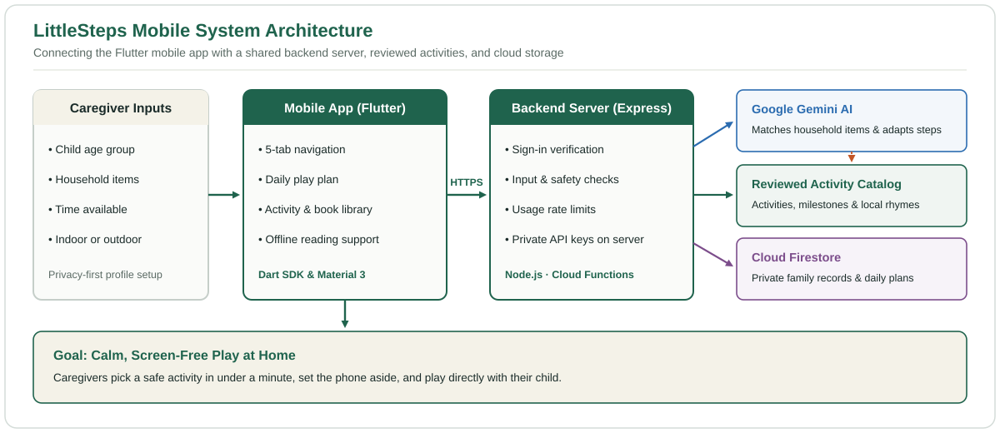
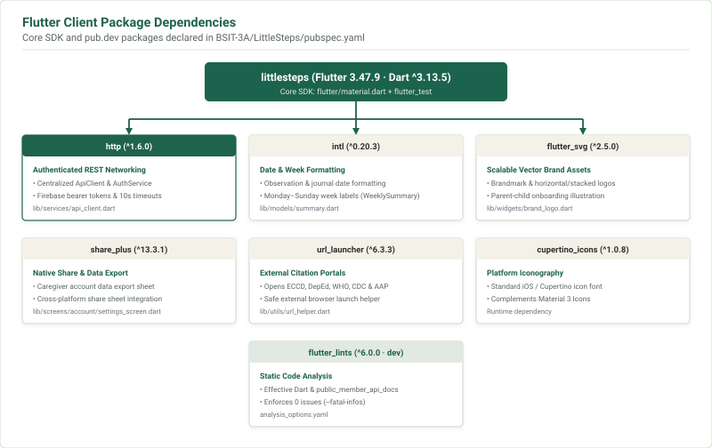
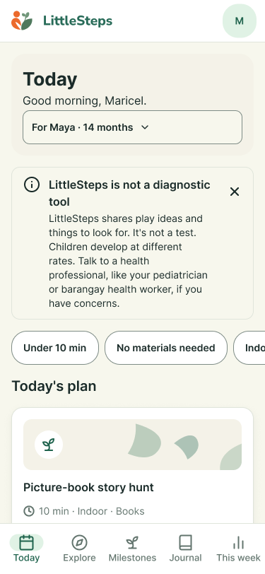
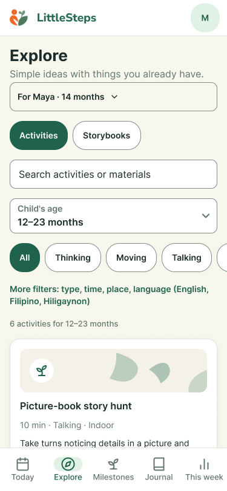
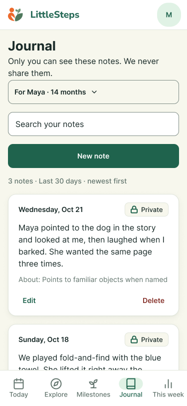
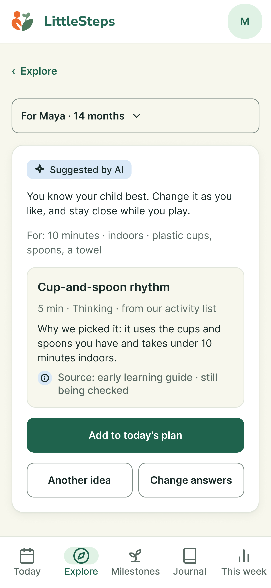

# CC 207B — Software Documentation: LittleSteps

**Course:** CC 207B — Applications Development and Emerging Technologies  
**Institution:** West Visayas State University — College of Information and Communications Technology  
**Submitted By:** Acebuche, Nherie C.; Ardeña, Justin Ace D.; Benjamin, Mae Daniella Faith C.; Cadangin, Mark Alvin C.; Tamaño, Vincent John A. (BSIT-3A — Thesis Titans)  
**Submitted To:** John Cristopher Mateo  
**Base Framework:** Flutter 3.47.9 (Dart SDK `^3.13.5`)  
**Primary Repository:** `Thesis-Titans/CC-207B_26-27_Final-Project` (`BSIT-3A/LittleSteps`)  
**Related Specifications:** [CC 207B Final Project Requirements](CC207B_Final_Project_Requirements.md), [AI Feature Specification](ai-feature-specification.md)

---

## i. Overview and Introduction

### 1. App Name

**LittleSteps** — Play Planning and Observation Companion for Caregivers of Young Children.

### 2. Purpose and Target Users

Parents and caregivers of children aged 0 to 5 years frequently turn to smartphones or tablets to keep toddlers occupied during household routines. Although guidance from the World Health Organization (WHO), the American Academy of Pediatrics (AAP), and the Philippine Early Childhood Care and Development (ECCD) Council advises against passive screen exposure in early childhood, busy caregivers rarely have time to look up age-appropriate, screen-free play ideas that work with ordinary household items.

LittleSteps addresses this gap as a caregiver-facing mobile application rather than a child-facing screen game. The primary target users are parents, guardians, and household caregivers of infants, toddlers, and preschoolers (ages 0–5) across Western Visayas and broader Philippine households; community ECCD facilitators and daycare workers serve as secondary users who can recommend home-based play routines to families. Design decisions are grounded in published WHO, AAP, and Philippine ECCD early-learning frameworks and informal parent walkthrough feedback.

The application lets an adult select a short, safe, screen-free activity in under a minute and then set the device aside. It organizes daily play across four developmental domains (Cognitive, Motor, Language, and Socio-Emotional), matches available household items to reviewed activities through an AI-assisted Idea Helper, provides regional action rhymes and storybooks in English, Filipino, and Hiligaynon, and records private, non-diagnostic observations and weekly summaries.

  
*Fig. 1. LittleSteps system architecture linking the Flutter client, Node.js/Express proxy, Gemini REST API, ECCD catalog, and Cloud Firestore.*

### 3. Technology Stack

*Table 1. System Technology Stack and Versions*

| Layer | Technology | Version | Architectural Role |
|---|---|---|---|
| Client Framework | Flutter SDK | `3.47.9` (stable) | Cross-platform Material 3 client targeting Android, iOS, and Web |
| Client Language | Dart SDK | `^3.13.5` (tested `3.13.7`) | Null-safe application logic, data models, UI components, and 158 automated tests across 24 test files |
| Client State | Built-in Flutter state (`StatefulWidget`, `ChangeNotifier`, `InheritedWidget`) | Flutter SDK built-in | Lightweight reactive session and active-child state management without external state libraries |
| Backend Proxy API | Node.js / Express / TypeScript / Zod | Node `22`, Express `^5.1.0`, TS `^5.9.2`, Zod `^4.1.0` | Shared Firebase Cloud Functions gateway (`firebase-functions ^6.4.0`) enforcing authentication, CORS, hourly rate limits, and schema validation |
| Database & Auth | Firebase Auth & Cloud Firestore | `firebase-admin ^13.5.0` | Caregiver authentication and user-isolated cloud storage for profiles, plans, milestones, and journals |
| AI Service | Google Gemini REST API (`v1beta`) | Server-pinned via `GEMINI_MODEL` (e.g., `gemini-3.5-flash-lite`; avoids floating `-latest` aliases in production) | Server-side JSON play selection, book companions, and activity adaptations called via Node 22 `fetch` |
| Weather Service | Open-Meteo Forecast API | REST v1 | Optional indoor/outdoor play guidance using coordinates rounded to 2 decimal places (~1.1 km) |

---

## ii. Functional Requirements

### 1. Libraries and Packages Used

The Flutter application keeps third-party dependencies to six runtime packages to preserve compact build sizes and clear maintainability.

  
*Fig. 2. Flutter client package dependencies declared in `pubspec.yaml`.*

*Table 2. Flutter Packages and Purpose*

| Package | Version | Scope | Purpose |
|---|---|---|---|
| `flutter` (`material.dart`) | SDK `3.47.9` | Core SDK | Material 3 layout, navigation bar, forms, cards, chips, and accessibility semantics |
| `http` | `^1.6.0` | Runtime | Authenticated JSON REST requests, Firebase bearer-token headers, and 8-second timeouts |
| `intl` | `^0.20.3` | Runtime | Formatting observation dates, journal dates, and Monday–Sunday weekly summary date ranges |
| `flutter_svg` | `^2.5.0` | Runtime | Rendering scalable SVG brand marks, wordmarks, and parent-child onboarding artwork |
| `share_plus` | `^13.3.1` | Runtime | Opening the native share sheet for caregiver account data export |
| `url_launcher` | `^6.3.3` | Runtime | Opening verified external citation portals (ECCD Council, WHO, CDC, AAP, Open-Meteo) in the system browser |
| `cupertino_icons` | `^1.0.8` | Runtime | Standard iOS/Cupertino icon glyphs complementing Material icons |
| `flutter_lints` | `^6.0.0` | Dev | Effective Dart static analysis rules verified via `flutter analyze` (0 issues) |
| `flutter_test` | SDK | Dev | Automated unit and widget test runner executing 158 tests across 24 test files covering models, services, offline states, and screens |

### 2. Low- and High-Fidelity Prototypes

The interface progressed from low-fidelity Figma wireframes prioritizing one-handed ergonomics to high-fidelity Material 3 screens. Colors, spacing, corner radii, and touch-target dimensions are managed through a shared design token system (Table 3).

| Low-Fidelity Wireframe | High-Fidelity Prototype |
|:---:|:---:|
|  |  |
|  |  |

*Fig. 3. Low-fidelity wireframes to high-fidelity prototypes for child onboarding (`Node 306:52` → `Node 119:6106`) and the Today dashboard (`Node 306:68` → `Node 73:214`).*

*Table 3. Visual Design System Tokens*

| Design Category | Primary Values | Purpose |
|---|---|---|
| Brand & Surfaces | Forest green `#1F634D`, warm cream `#F4F2E8`, canvas `#F7F7ED`, white card `#FFFFFF`, soft green `#E0F2E5` | Primary actions, low-glare caregiver reading canvas, cards, and completion highlights |
| Status & Accents | Sage `#8DAF98`, warning orange `#EC6A2C`, error `#853029`, advisory yellow `#FAE8A8`, offline slate `#F1F5F9` | Secondary highlights, accessible error feedback, advisory notices, and offline banners |
| Typography Ink | Primary ink `#1A2B29`, secondary `#5A6A64`, tertiary `#7E8C86` | High-contrast WCAG 2.2 AA readable body text and muted metadata labels |
| Spacing & Targets | 4–32 dp spacing scale; 10/16/20 dp radii; 48 dp minimum touch target | Consistent 8pt layout rhythm and comfortable one-handed touch targets |

### 3. Implemented Core Features

A five-member team requires at least six core user-facing features (excluding login, registration, splash, About, and Settings). LittleSteps implements seven core features organized across its five bottom navigation tabs, top-bar child profile switcher, and AI Idea Helper flow.

  
*Fig. 4. Application navigation hierarchy mapping the five bottom tabs, child profile management, and the AI Idea Helper.*

**1. Child Profile and Age-Band Management.** Caregivers register one or more children using only a nickname and one of seven canonical age bands (`0–5m`, `6–11m`, `12–23m`, `24–35m`, `36–47m`, `48–59m`, or `60–71m`, optionally derived from birth month), without providing exact birthdates, legal names, or photos. Inline form validation prevents empty or overly long nicknames and prevents duplicate submissions while saving to the cloud. Selecting a child from the top profile switcher updates all child-dependent tabs; when no child is registered yet, those tabs display a guided onboarding prompt.

**2. Today's Play Plan, Completion Tracking, and Offline Reading.** Displays the active child's scheduled activities for the current day alongside an optional indoor or outdoor weather hint. Caregivers can mark activities complete or undo completion with immediate feedback. Previously loaded child profiles, catalog activities, and daily plans are cached in memory for offline reading with an offline status banner, while write actions are safely disabled until connectivity returns.

**3. Early Learning Activity Catalog and Cultural Rhymes/Storybooks.** Provides a searchable, filterable library of reviewed screen-free activities, children's storybooks, and traditional Philippine action rhymes in English, Filipino, and Hiligaynon. Caregivers can filter by developmental domain (Cognitive, Motor, Language, Socio-Emotional), indoor or outdoor setting, and time available, view preparation steps and safety notes, and add any activity directly to Today's play plan.

**4. Developmental Milestone Observations.** Presents age-appropriate observational prompts grouped by developmental domain and lets caregivers log dated notes through a quick entry sheet. Every view carries an observational advisory notice and avoids clinical scores, pass/fail grades, or developmental delay labels.

     
*Fig. 5. Core features 1–4: Child profile management, Today play plan, activity catalog, and milestone observations.*

**5. Private Caregiver Journal.** Lets caregivers record chronological reflections and play preferences in a private notebook stored in user-isolated cloud storage. Journal entries are excluded from local offline caching for privacy and are never sent to any AI service.

**6. Weekly Reflection Summary.** Aggregates completed play activities, milestone observations, and journal entry counts across selectable Monday–Sunday weeks, presenting factual domain breakdowns and supportive empty states for quiet weeks.

**7. AI-Powered Idea Helper.** Accessible directly from a prompt card inside the Explore tab, the Idea Helper collects available household materials, time window (10, 15, 30, or 45 minutes), indoor or outdoor setting, language, and age band. It displays a loading state while querying the backend AI service, presents matched reviewed activities labeled `"Suggested by AI"` alongside a non-diagnostic disclaimer, lets caregivers add suggestions directly to Today's plan, and falls back to reviewed catalog picks whenever the device is offline or the AI service is unavailable.

    
*Fig. 6. Core features 5–7: Private caregiver journal, weekly reflection summary, and AI Idea Helper.*

### 4. Topic Coverage Matrix

*Table 4. CC 207B Topic Coverage Matrix (`BSIT-3A/LittleSteps`)*

| Course topic | Where applied (file and widget/class) | Brief description |
|---|---|---|
| Layout widgets | `lib/screens/shell_screen.dart` — `ShellScreen` `lib/screens/today/today_screen.dart` — `TodayScreen` `lib/widgets/activity_card.dart` — `ActivityCard` `lib/widgets/idea_helper_card.dart` — `IdeaHelperCard` `lib/widgets/no_children_view.dart` — `NoChildrenView` `lib/widgets/brand_logo.dart` — `BrandLogo`, `GrowthSymbol` `lib/widgets/screen_header.dart` — `ScreenHeader` | Composes responsive Material 3 layouts using `Scaffold`, `AppBar`, `Column`, `Row`, `Wrap`, `ListView.builder`, `Card`, `Padding`, and `SafeArea` with shared spacing tokens and 48 dp touch targets. |
| Navigation and routing | `lib/routing/app_router.dart` — `AppRouter` `lib/screens/shell_screen.dart` — `_ShellScreenState` `lib/widgets/account_menu_sheet.dart` — `AccountMenuSheet` | Named routing (`onGenerateRoute`) across splash, auth, `/home`, `/ai-suggest`, `/children`, `/children/add`, `/activity-detail`, and account views, paired with a 5-tab `NavigationBar` and `IndexedStack`. |
| Forms and validation | `lib/screens/children/add_child_screen.dart` — `AddChildScreen` `lib/screens/auth/sign_in_screen.dart` — `SignInScreen` `lib/screens/auth/register_screen.dart` — `RegisterScreen` `lib/screens/milestones/observation_form_sheet.dart` — `ObservationFormSheet` `lib/screens/journal/journal_note_screen.dart` — `JournalNoteScreen` `lib/models/journal_validators.dart` — `validateJournalContent`, `validateEntryDate` | Uses `Form`, `GlobalKey<FormState>`, `TextEditingController`, `TextFormField`, and `DropdownButtonFormField` with inline validation errors, submit locking, and clear error feedback. |
| Asynchronous operations / API calls | `lib/services/api_client.dart` — `ApiClient` `lib/services/ai_service.dart` — `AiService` `lib/services/plan_service.dart` — `PlanService` `lib/widgets/state_views.dart` — `LoadingView`, `EmptyStateView`, `ErrorView`, `OfflineBanner` | Non-blocking `async`/`await` calls via `package:http` with 8-second timeouts, typed exceptions (`NoConnectionApiException`, `UnauthorizedApiException`, `RateLimitApiException`), `mounted` guards, and explicit state views. |
| Data persistence | `lib/services/children_service.dart` — `ChildrenService` `lib/services/plan_service.dart` — `PlanService` `lib/services/milestones_service.dart` — `MilestonesService` `lib/services/journal_service.dart` — `JournalService` `lib/services/local_cache.dart` — `LocalDataCache` | Persists caregiver-scoped child profiles, plans, milestone observations, and journals to Cloud Firestore via REST API, with in-memory whitelisted read caching cleared on sign-out. |
| AI-powered feature | `lib/screens/ai/ai_suggestions_screen.dart` — `AiSuggestionsScreen` `lib/widgets/idea_helper_card.dart` — `IdeaHelperCard` `lib/services/ai_service.dart` — `AiService` `littlesteps-api/src/ai/` (`ai-service.ts`, `gemini.ts`, `prompt.ts`, `validate-output.ts`) | Catalog-grounded Idea Helper proxying requests to Google Gemini with zero client API keys, Zod + 33-term non-diagnostic wording filter, `"Suggested by AI"` labeling, and deterministic catalog fallback. |

### 5. AI Feature Specification

*Full schemas, sample JSON payloads, and evaluation tables appear in [ai-feature-specification.md](ai-feature-specification.md).*

  
*Fig. 7. AI selection pipeline, output validation, and deterministic fallback architecture.*

LittleSteps implements a hybrid **catalog-first + guardrailed AI generation** pipeline rather than an open-ended chatbot. All AI requests travel from the Flutter client through the shared Node.js/Express backend proxy on Firebase Cloud Functions to the Google Gemini REST API (`v1beta`) using Node 22's built-in `fetch`—no third-party Gemini SDK package is used, and the API key never enters the mobile binary or repository. The active model is configured dynamically on the server via `GEMINI_MODEL` and pinned to an explicit stable version (e.g., `gemini-3.5-flash-lite`) rather than a floating `-latest` alias or client-supplied parameter to prevent unexpected schema drift in production. Payloads are validated with `zod` (`^4.1.0`), and the Flutter client communicates via `package:http` (`^1.6.0`) using Firebase Auth bearer tokens across three backend endpoints (`/api/v1/ai/recommendations`, `/api/v1/ai/story-activity`, and `/api/v1/ai/adapt`).

Strict input validation accepts only non-identifying fields—age band, indoor or outdoor setting, duration (5–120 minutes), up to 10 household materials (max 40 characters each), language (`en`, `fil`, `hil`), optional domain, suggestion count (1–3), and optional `allowCustom` flag—rejecting extra or personal fields with HTTP `400`. When reviewed catalog activities match the caregiver's materials, Gemini ranks and explains those reviewed IDs (`source: "ai"`, `reviewed: true`). When materials have zero catalog overlap, a **3-layer defense-in-depth** pipeline applies: Layer 1 (`sanitize.ts`) blocks extreme dangers (`bleach`, `knife`, `fire`, `medicine`) while letting typos and Filipino/Hiligaynon terms reach Gemini; Layer 2 (`prompt.ts` & `gemini.ts`) requires Gemini to normalize and evaluate every item in `materialAssessments` under pediatric safety principles before generating a `"Material adaptation"` card (`source: "ai_custom"`, `reviewed: false`, zero fabricated citations, plus a calm `materialNote` derived from actual card materials); and Layer 3 (`validate-output.ts`) deterministically checks the normalized output and fails closed to Tier 3 catalog fallback on any hazard or diagnostic slip.

Every model reply passes schema validation, candidate-ID verification, HTML/URL stripping, and a 33-term English and Filipino non-diagnostic wording filter before reaching the client. Tier 1 responses carry `source: "ai"`, a `"Suggested by AI"` badge, and the standard observational disclaimer; Tier 3 fallback responses carry `source: "catalog_fallback"` and `"Catalog picks · not AI"` (with zero AI labels and a `"Using our activity list"` banner). Runtime safeguards enforce an 8,000 ms timeout, a 64 KB response byte cap, a circuit breaker (opening for 60 s after 3 consecutive failures), and hourly rate limits (10 requests per user in Firestore and 30 per IP, returning HTTP `429` with a wait notice alongside non-AI catalog picks). Any timeout, service error, open circuit, or validation rejection automatically falls back to deterministic reviewed catalog ranking (or rule-based adaptation on `/api/v1/ai/adapt`), and if no catalog items can be loaded offline, the mobile app renders a clear empty recovery card rather than blank space.

Static database filters match structured fields well but struggle with informal household item descriptions (*"empty delivery box, clean sock"*). Constraining Gemini to catalog-grounded selection provides semantic matching without the clinical hallucination risks of an open chatbot. Under the Philippine Data Privacy Act of 2012 (RA 10173), child profiles store only a nickname and age band, prompts exclude child names and caregiver IDs, private journals are never read by AI endpoints, weather coordinates are rounded to ~1.1 km, and caregivers can edit or override every suggestion. Automated backend CI tests across a 46-case benchmark verify 0.0% false-block rate on ordinary play (0/21) and 0.0% unsafe or clinical answer rate across medical, hazardous, prompt-injection, and off-topic probes (0/25).

---

## iii. Future Enhancements and Roadmap

### 1. Known Limitations

Four technical constraints remain in the current release. First, offline read caching is retained in memory only for the active session rather than persisting to device storage across full app restarts, and offline writes remain disabled (`"Reconnect to save changes"`). Second, live Gemini material matching requires network connectivity to the backend API, although cached catalog browsing and fallback picks work offline. Third, regional Philippine action rhymes display text lyrics and parent hand-motion guides without audio recordings, and caregiver journals omit photo attachments to keep storage and rural mobile data consumption low. Fourth, the non-diagnostic wording filter covers 27 English and 6 Filipino clinical terms; Hiligaynon terms still require native-speaker review.

### 2. Planned Features and Improvements

*Table 5. Planned Post-Course Enhancements*

| Phase | Planned Improvement | Benefit to Caregivers |
|---|---|---|
| Phase 2 (Q1 2027) | Persistent on-device storage (SQLite / Drift) with queued offline plan sync | Retains cached plans across restarts and syncs completed activities automatically upon reconnection |
| Phase 2 (Q1 2027) | Native Hiligaynon and Tagalog audio tracks for action rhymes | Allows caregivers to hear traditional melodies while playing hands-free |
| Phase 2 (Q1 2027) | Printable PDF summary export from weekly reflections | Extends native sharing so caregivers can optionally share non-diagnostic play summaries |
| Phase 3 (Q2 2027) | Hiligaynon wording filter review and expanded Western Visayas activity pool | Broadens regional language safety containment and local activity coverage |
| Phase 3 (Q2 2027) | Multi-caregiver household access | Shares daily play routines across parents and guardians while keeping personal journals isolated |

---

## iv. AI Usage Log (Appendix)

*Records Generative AI use under the CC 207B AI Use Policy. Verified rows come from `BSIT-3A/LittleSteps/docs/ai-usage-log.md`; pending rows require member confirmation before final LMS submission.*

*Table 6. AI Usage Log*

| Member | Date | AI tool | What it was used for / prompt summary | What was generated | What the member changed |
|---|---|---|---|---|---|
| Tamaño, Vincent John A. | 2026-11-21 | Antigravity (Gemini 3.8 Flash) | Sample data & testing: Generate synthetic milestone observation prompts for 4 ECCD domains (12–23m) and automated test assertion loop for banned clinical words (#6) | 4 `MilestonePrompt` objects with non-diagnostic provenance label; `testWidgets` loop checking banned words list | Reviewed wording against non-diagnostic requirements; integrated prompts and enum into `lib/models/milestone.dart`; built `MilestonesScreen` and verified test execution |
| Benjamin, Mae Daniella Faith C. | 2026-11-21 | Antigravity (Gemini 3.8 Flash) | Structure hooks, callbacks, and fallback states to connect with pending sign-in (#1) and shared app state (#13) | Constructor parameters and callback interfaces on `ShellScreen`, `AccountMenuSheet`, and `SettingsScreen`, plus unauthenticated fallback messages | Designed decoupling architecture so account screens function independently before #1 and #13 landed; verified snackbars and empty states in browser |
| Tamaño, Vincent John A. | 2026-11-23 | Antigravity (Gemini 3.8 Flash) | Sample data & testing: Generate synthetic `WeeklySummary` fixtures and widget test assertions for populated/empty weeks (#8) | Synthetic `sampleWeeklySummaries` fixture map and widget test scaffold | Built `WeeklySummaryScreen` UI, Monday–Sunday week picker, domain breakdown, and non-diagnostic reflection cards |
| Cadangin, Mark Alvin C. | 2026-11-23 | Antigravity (Gemini 3.8 Flash) | Testing: Widget test assertions for shell child onboarding state and about screen sources | Widget test cases for `NoChildrenView` rendering on shell tabs and about page source citations | Added test cases to `test/widget_test.dart` and `test/account_screens_test.dart`; verified navigation flow in browser |
| Cadangin, Mark Alvin C. | 2026-11-23 | Antigravity (Gemini 4 Neon) | Theme contrast sync: Align `AppColors.textSecondary` to `#5A6A64` for WCAG 2.2 AA compliance across surfaces (ref Issue #10 / React PR #65) | Updated `AppColors.textSecondary` hex constant in `lib/theme/app_tokens.dart` from `0xFF63756E` to `0xFF5A6A64` | Verified contrast sync against `DESIGN.md` and ran `flutter analyze` and `flutter test` |
| Benjamin, Mae Daniella Faith C. | 2026-11-24 | OpenAI Codex | Accessibility: Make the Explore no-results state announced by screen readers when it appears | Added an optional live-region announcement for the empty-state title and explanation, without making them keyboard stops | Requested the focused accessibility change; will verify it with a screen reader. Clear filters remains a separate keyboard-focusable button |
| Acebuche, Nherie C. | 2026-11-24 | Claude (Claude Code) | Issue #3 child profiles: debugging, code review and coding support | Syntax and bug fixes in form, validators and tests; drafted code for saving, editing, the children list and the offline notice; helped merge with main | Assisted in writing the age bands, validators, tests and first form; planned each step, reviewed and tested every change |
| Benjamin, Mae Daniella Faith C. | 2026-11-24 | OpenAI Codex | Sample data: Curate Philippine nursery rhymes and fallback storybook metadata (#12) | 5 Philippine rhymes with domain mappings and fallback book definitions | Integrated into Read & Sing Together shelf with `toActivity` conversion; tested shelf switcher and plan integration |
| Acebuche, Nherie C. | 2026-11-24 | Claude Code (Claude Opus 5.5) | Code assist & testing: Private observation journal (#7) | Journal list states, search and date filter, note form with edit and delete confirmation, and widget tests in `test/journal_screen_test.dart` | Assisted in writing the note and date validators and parts of the list; reviewed the code and ran `flutter analyze` and `flutter test` |
| Ardeña, Justin Ace D. | *[Confirm date]* | *[Confirm tool or None]* | *[Record any AI snippets/tests used for PRs #19, #24, or #26]* | *[Summary of generated output]* | *[What was reviewed and modified]* |

---

## v. Individual Reflections (Appendix)

*Academic Integrity Policy: Per the CC 207B AI Use Policy, AI tools may not be used to write Individual Reflections. Each member must replace their section below with roughly half a page in their own words covering what they built, one bug they fixed and how, and what they would do differently.*

### 1. Cadangin, Mark Alvin C.
- What I built: *[To be written by Mark Alvin C. Cadangin]*
- One bug I fixed and how: *[To be written by Mark Alvin C. Cadangin]*
- What I would do differently: *[To be written by Mark Alvin C. Cadangin]*

### 2. Ardeña, Justin Ace D.
- What I built: *[To be written by Justin Ace D. Ardeña]*
- One bug I fixed and how: *[To be written by Justin Ace D. Ardeña]*
- What I would do differently: *[To be written by Justin Ace D. Ardeña]*

### 3. Tamaño, Vincent John A.
- What I built: *[To be written by Vincent John A. Tamaño]*
- One bug I fixed and how: *[To be written by Vincent John A. Tamaño]*
- What I would do differently: *[To be written by Vincent John A. Tamaño]*

### 4. Benjamin, Mae Daniella Faith C.
- What I built: *[To be written by Mae Daniella Faith C. Benjamin]*
- One bug I fixed and how: *[To be written by Mae Daniella Faith C. Benjamin]*
- What I would do differently: *[To be written by Mae Daniella Faith C. Benjamin]*

### 5. Acebuche, Nherie C.
- What I built: *[To be written by Nherie C. Acebuche]*
- One bug I fixed and how: *[To be written by Nherie C. Acebuche]*
- What I would do differently: *[To be written by Nherie C. Acebuche]*
