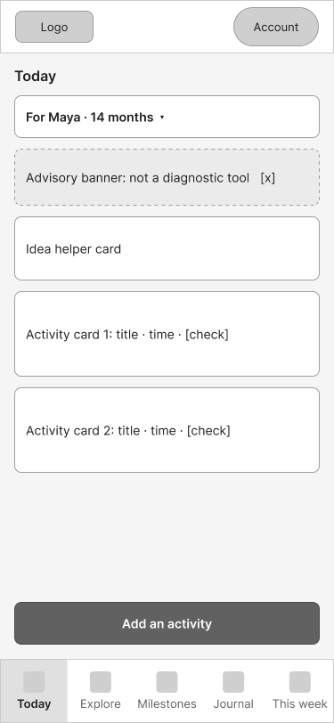
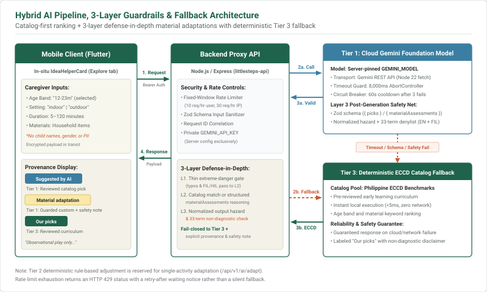

# CC 207B — Software Documentation: LittleSteps

**Course:** CC 207B — Applications Development and Emerging Technologies  
**Institution:** West Visayas State University — College of Information and Communications Technology  
**Submitted By:** Acebuche, Nherie C.; Ardeña, Justin Ace D.; Benjamin, Mae Daniella Faith C.; Cadangin, Mark Alvin C.; Tamaño, Vincent John A. (BSIT-3A — Thesis Titans)  
**Submitted To:** John Cristopher Mateo  
**Base Framework:** Flutter 3.47.9 (Dart SDK `^3.13.5`)  
**Related Specifications:** [CC 207B Final Project Requirements](CC207B_Final_Project_Requirements.md), [AI Feature Specification](ai-feature-specification.md)

---

## i. Overview and Introduction

### 1. App Name

**LittleSteps** — Play Planning and Observation Companion for Caregivers of Young Children.

### 2. Purpose and Target Users

Parents and caregivers of children aged 0 to 5 years often turn to phones or tablets to keep young children busy during daily chores. Guidance from the World Health Organization (WHO), the American Academy of Pediatrics (AAP), and the Philippine Early Childhood Care and Development (ECCD) Council recommends interactive, screen-free play instead. In practice, busy adults rarely have time to look up safe, age-appropriate activities using simple items already at home.

LittleSteps is a mobile companion built for caregivers—not a screen game for children. Its main users are parents, guardians, and household caregivers of children aged 0 to 5 years in Western Visayas and across the Philippines, along with community ECCD workers who share home play routines with families.

The app helps an adult choose a short, safe play activity in less than a minute and then set the phone aside. Activities cover four early learning areas (**Cognitive**, **Motor**, **Language**, and **Socio-Emotional**). Caregivers can match household items with help from an AI Idea Helper, browse English activities across all age bands alongside selected Filipino and Hiligaynon cultural activities and rhymes, view picture books, log private milestone notes, and read calm weekly summaries.

  
*Fig. 1. LittleSteps mobile system architecture linking the Flutter app, Express backend server, AI selection, activity catalog, and Cloud Firestore.*

### 3. Technology Stack

*Table 1. System Technology Stack and Versions*

| Layer | Technology | Version | Role |
|---|---|---|---|
| Mobile Framework | Flutter SDK | `3.47.9` | Cross-platform Material 3 user interface |
| App Language | Dart SDK | `^3.13.5` | Null-safe models, services, validation, and screens |
| State Management | Flutter built-in state | SDK built-in | Manages sign-in state and the selected child profile |
| Backend Server | Node.js & Express | Node `22`, Express `^5.1.0` | Shared API gateway enforcing sign-in checks, rate limits, and input validation |
| Database & Auth | Firebase Auth & Cloud Firestore | `firebase-admin ^13.5.0` | Caregiver accounts, private family records, and shared activity catalogs |
| AI Service | Google Gemini REST API | Server-configured model | Picks reviewed activities, adapts steps, and suggests safe household play |
| Weather Service | Open-Meteo API | REST v1 | Optional indoor or outdoor play hint using coarse city coordinates |

---

## ii. Functional Requirements

### 1. Libraries and Packages Used

The mobile app uses six runtime packages to stay lightweight, responsive, and easy to maintain.

  
*Fig. 2. Flutter runtime packages used in the LittleSteps mobile app.*

*Table 2. Flutter Packages and Purpose*

| Package | Version | Purpose |
|---|---|---|
| `flutter` (`material.dart`) | SDK `3.47.9` | Core Material 3 widgets, navigation bar, cards, forms, and accessibility |
| `http` | `^1.6.0` | Sends authenticated JSON requests to the backend server with 10-second timeouts |
| `intl` | `^0.20.3` | Formats milestone dates, journal dates, and Monday–Sunday weekly date ranges |
| `flutter_svg` | `^2.5.0` | Displays crisp SVG brand logos and caregiver-child illustrations |
| `share_plus` | `^13.3.1` | Opens the phone's share sheet when exporting caregiver data from Settings |
| `url_launcher` | `^6.3.3` | Opens trusted ECCD, DepEd, WHO, CDC, AAP, and Open Library references in the browser |
| `cupertino_icons` | `^1.0.8` | Standard iOS icon glyphs complementing Material icons |

### 2. Low- and High-Fidelity Prototypes

Screens evolved from early wireframes focused on comfortable one-handed mobile use into high-fidelity Material 3 screens. Colors, spacing, rounded corners, and 48 dp touch targets are shared across the app (Table 3).

| Low-Fidelity Wireframe | High-Fidelity Prototype |
|:---:|:---:|
|  |  |
|  |  |

*Fig. 3. Early wireframes alongside final screens for child onboarding and the Today dashboard.*

*Table 3. Visual Design System Tokens*

| Category | Key Values | Purpose |
|---|---|---|
| Brand & Surfaces | Forest green `#1F634D`, warm cream `#F4F2E8`, canvas `#F7F7ED`, white `#FFFFFF`, soft green `#E0F2E5` | Primary buttons, warm low-glare reading background, and completion highlights |
| Status & Accents | Sage `#8DAF98`, warning orange `#EC6A2C`, error `#853029`, advisory yellow `#FAE8A8`, offline `#F1F5F9` | Gentle alerts, readable error states, and clear offline banners |
| Text Colors | Primary `#1A2B29`, secondary `#5A6A64`, muted `#7E8C86` | High-contrast text meeting WCAG AA readability standards |
| Spacing & Targets | 4–32 dp spacing scale; 48 dp minimum button height | Clean layout rhythm and comfortable mobile tapping |

### 3. Implemented Core Features

LittleSteps provides seven core caregiver features across five main bottom tabs, the top-bar child profile switcher, and the Idea Helper flow (Fig. 4).

  
*Fig. 4. Five-tab navigation structure, child profile switcher, and the seven core features.*

**1. Child Profile and Age-Band Management.** Caregivers add children using only a nickname and an age band (`0–5` through `60–71` months), without storing exact birthdates or photos. Form validation checks nickname length and prevents duplicate submissions. Switching the active child updates every screen across the app.

**2. Today's Play Plan and Offline Reading.** Shows the child's scheduled activities for today with quick filter chips (`Under 10 mins`, `No materials needed`, `Indoor`, `Outdoor`), age-appropriate milestone cues, and an optional weather banner that opens the Idea Helper preset to indoor or outdoor play. Caregivers can mark activities complete with an instant undo option, and previously loaded plans, activities, and books stay readable offline.

**3. Early Learning Activity Catalog, Adaptation, and Books.** Offers searchable English activities across all seven age bands alongside selected Filipino and Hiligaynon cultural activities, Open Library storybooks, and traditional Philippine rhymes (such as *Bahay Kubo* and *Ili-Ili Tulog Anay*) loaded live from the backend. Caregivers can filter by play area, setting, or age, open an activity's detail screen to review steps and safety notes, adjust an activity (`Shorter`, `Easier`, `Extra challenge`, or `Missing a material`), or add any original or adapted idea to Today's plan.

**4. Developmental Milestone Observations.** Displays everyday cues to watch for during play across early childhood age bands (`0–11` months through Kindergarten), grouped by play area. Caregivers can log simple dated notes under a clear notice stating these are personal reminders rather than medical tests or scores.

     
*Fig. 5. Core features 1–4: Child profile switcher, Today plan, Explore catalog, and Milestones.*

**5. Private Caregiver Journal.** Lets parents record personal reflections about their child's play moments. Notes are stored strictly per account, kept out of temporary offline caches, and never sent to AI tools.

**6. Weekly Reflection Summary.** Summarizes completed activities, noticed milestones, and play areas across selectable Monday–Sunday weeks, paired with calm encouragement on quiet weeks.

**7. AI-Powered Idea Helper.** Available from Explore and Today's weather banner, the Idea Helper takes available household items, time (`10`, `15`, `30`, or `45` minutes), indoor/outdoor setting, and language. It groups longer `30–45` minute sessions into shorter play blocks, suggests matching reviewed ideas (`Suggested by AI`) or safe custom household ideas (`Material adaptation`), and switches to reviewed catalog picks (`Our picks`) whenever offline or when inputs look unsafe.

    
*Fig. 6. Core features 5–7: Private Journal, This Week summary, and AI Idea Helper.*

### 4. Topic Coverage Matrix

*Table 4. CC 207B Topic Coverage Matrix*

| Course Topic | Where Applied (File and Class) | Brief Description |
|---|---|---|
| Layout widgets | `lib/screens/shell_screen.dart` — `ShellScreen` `lib/widgets/responsive_layout.dart` — `ResponsiveContentBox`, `AdaptiveTwoPane` `lib/screens/today/today_screen.dart` — `TodayScreen` | Uses `Scaffold`, `LayoutBuilder`, `Column`, `Row`, `Wrap`, `Card`, `ListView`, and `SafeArea` for phones and wide tablets with 48 dp touch targets. |
| Navigation & routing | `lib/routing/app_router.dart` — `AppRouter` `lib/screens/shell_screen.dart` — `_ShellScreenState` `lib/screens/explore/activity_detail_screen.dart` — `ActivityDetailScreen` | Named routes connect splash, sign-in, the 5-tab home shell, child profiles, Idea Helper, activity adaptation, and account screens. |
| Forms & validation | `lib/screens/children/add_child_screen.dart` — `AddChildScreen` `lib/screens/auth/register_screen.dart` — `RegisterScreen` `lib/screens/journal/journal_note_screen.dart` — `JournalNoteScreen` | Validates inputs with `Form`, `GlobalKey<FormState>`, inline field messages, privacy consent checks, and submit locks. |
| Async calls & API handling | `lib/services/api_client.dart` — `ApiClient` `lib/services/ai_service.dart` — `AiService` `lib/widgets/state_views.dart` — `LoadingView`, `EmptyStateView`, `InlineErrorCard`, `OfflineBanner` | Executes non-blocking REST calls over `http` with 10-second timeouts, typed error handling, and clear loading, empty, error, and offline views. |
| Data persistence | `lib/services/children_service.dart` — `ChildrenService` `lib/services/plan_service.dart` — `PlanService` `lib/services/local_cache.dart` — `LocalDataCache` | Saves caregiver records to Cloud Firestore via the backend API and keeps session-scoped read caches cleared on sign-out. |
| AI-powered feature | `lib/screens/ai/ai_suggestions_screen.dart` — `AiSuggestionsScreen` `lib/screens/explore/activity_detail_screen.dart` — `ActivityDetailScreen` `lib/services/ai_service.dart` — `AiService` | Connects Idea Helper, storybook play ideas, and single-activity adaptations to Google Gemini via the backend with clear labels and automatic catalog fallback. |

**Code Organization & Standards.** The mobile codebase is organized cleanly by responsibility: `config/` (app configuration and reference URLs), `theme/` (colors, spacing, radii, and Material 3 theme tokens), `models/` (immutable data models and validators), `services/` (REST API and caching services), `utils/` (date, domain, material, and accessibility helpers), `routing/`, `widgets/` (shared banners, state cards, responsive wrappers), and feature subfolders under `screens/`. All public classes and methods carry Effective Dart `///` doc comments.

### 5. AI Feature Specification

*Full request schemas, prompts, safety rules, and sample outputs are detailed in [ai-feature-specification.md](ai-feature-specification.md).*

  
*Fig. 7. How the mobile app connects to Google Gemini through the backend safety checks and falls back to reviewed activities.*

LittleSteps uses a **catalog-first AI approach** rather than an open chat window. The mobile app sends caregiver selections (age band, indoor/outdoor space, minutes available, language, and optional household items) to the shared Node.js/Express backend server, which calls the Google Gemini API. No AI keys are ever stored in the mobile app.

Three server-side safety checks protect families whenever household items are entered: obvious dangers (such as bleach, knives, or medicine) are rejected first, Gemini checks everyday items for toddler safety before creating a `"Material adaptation"` card, and a final filter blocks unsafe items or diagnostic/medical wording. If the network is offline, slow, or blocked by a safety check, the app automatically falls back to reviewed catalog activities labeled `"Our picks"` (or rule-based tweaks when adjusting an individual activity). Under the Philippine Data Privacy Act (RA 10173), child names, caregiver IDs, and private journal notes are never sent to AI services.

---

## iii. Future Enhancements and Roadmap

### 1. Known Limitations

- **Session-only offline reading:** Cached activities, plans, and books stay available during temporary signal drops, but edits wait until connectivity returns and caches reset when the app closes.
- **Internet required for live AI:** Custom household item ideas and activity tweaks need an active connection; offline users receive reviewed backup picks from the local session cache instead.
- **Regional language scope:** The Idea Helper recognizes Filipino and Hiligaynon household item words and replies in the selected language (`English`, `Filipino`, or `Hiligaynon`). While English catalog activities cover all seven age bands, dedicated reviewed Filipino and Hiligaynon activities do not yet span every age band, so catalog fallback automatically falls back to age-matched reviewed activities when a regional age band has no dedicated entry.
- **Text-only rhymes and notes:** Traditional Philippine rhymes include lyrics and movement guides without audio files, and journals focus on text notes to keep mobile data usage low.

### 2. Planned Features and Improvements

*Table 5. Planned Post-Course Enhancements*

| Phase | Planned Improvement | Benefit to Caregivers |
|---|---|---|
| Phase 2 | On-device persistent storage with offline edit sync | Saves plans and notes locally and syncs automatically once back online |
| Phase 2 | Audio recordings for Filipino and Hiligaynon rhymes | Lets caregivers listen and sing along hands-free |
| Phase 2 | Printable PDF weekly reflection export | Makes sharing non-diagnostic play logs with family members easy |
| Phase 3 | Expanded Filipino & Hiligaynon activity catalog across all age bands | Ensures dedicated regional activities match every age group without English fallback |
| Phase 3 | Shared household access for co-parents | Coordinates daily play schedules while keeping private journals separate |

---

## iv. AI Usage Log (Appendix)

*Records Generative AI use under the CC 207B AI Use Policy.*

*Table 6. AI Usage Log*

| Member | Date | AI tool | What it was used for / prompt summary | What was generated | What the member changed |
|---|---|---|---|---|---|
| Tamaño, Vincent John A. | 2026-11-20 | Antigravity (Gemini 3.8 Flash) | Sample data & testing: Generate sample milestone observation prompts for 4 ECCD domains (12–23m) and an automated check for clinical words | 4 `MilestonePrompt` objects with non-diagnostic labels and a widget check for clinical terms | Reviewed wording against non-diagnostic guidelines, integrated prompts into `MilestonePrompt`, and built `MilestonesScreen` |
| Ardeña, Justin Ace D. | 2026-11-20 | Antigravity (Gemini 3.8 Flash) | Environment setup, Git synchronization, and running Flutter Web alongside local Firebase emulators | Terminal commands and emulator configuration steps | Resolved merge conflicts, configured emulator ports, and validated the local web build |
| Benjamin, Mae Daniella Faith C. | 2026-11-21 | Antigravity (Gemini 3.8 Flash) | Decoupling hooks, callbacks, and fallback states between account screens and shared app state | Constructor callbacks and unauthenticated fallback messages on account and settings screens | Designed clean callbacks so account views work independently and verified notices in the browser |
| Cadangin, Mark Alvin C. | 2026-11-23 | Antigravity (Gemini 3.8 Flash) | Testing: Widget assertions for empty child onboarding state and About page source citations | Widget test cases for `NoChildrenView` and citation links | Integrated tests into `widget_test.dart` and `account_screens_test.dart` and checked flows in the browser |
| Cadangin, Mark Alvin C. | 2026-11-23 | Antigravity (Gemini 4 Neon) | Theme contrast sync: Align secondary text color to `#5A6A64` for WCAG AA compliance | Updated `AppColors.textSecondary` constant in `app_tokens.dart` | Verified contrast compliance and ran static analysis and widget tests |
| Tamaño, Vincent John A. | 2026-11-23 | Antigravity (Gemini 3.8 Flash) | UI layout scaffolding and sample fixtures for the Weekly Summary screen | Initial layout structure for `WeeklySummaryScreen` and Monday–Sunday week picker | Styled the UI with design tokens, wired domain breakdown cards, and verified calm non-diagnostic wording |
| Benjamin, Mae Daniella Faith C. | 2026-11-24 | OpenAI Codex | Screen-reader announcements on Explore and curation of Philippine nursery rhymes and fallback book items | Live-region empty state announcement and five traditional rhymes with action cues | Integrated rhymes and Read & Sing Together shelf into Explore and verified plan scheduling |
| Acebuche, Nherie C. | 2026-11-24 | Claude Code (Claude Opus 5.5) | Child profile validators, date filtering, edit/delete confirmation, and journal widget tests | Form validation helpers, journal filter controls, and widget tests | Planned each step, reviewed every diff, and verified analyzer and test checks |
| Tamaño, Vincent John A. | 2026-11-24 | Antigravity (Gemini 3.8 Flash) | ISO-8601 week calculation fix, past-week history query, CORS localhost matching, and QA verification | True week-start calculation for Monday–Sunday boundaries and formatting cleanup | Fixed off-by-one week mapping, verified multi-week summaries, and confirmed zero private journal leakage |
| Ardeña, Justin Ace D. | 2026-11-24 | Antigravity (Gemini 3.8 Flash) | Cross-feature QA checks across Explore catalog, Bookshelf, Weather settings, citations, and auth reset | Automated widget checks for narrow phone viewports (`360x800`) | Verified mobile viewports manually and compiled QA findings |
| Cadangin, Mark Alvin C. | 2026-11-25 | Antigravity (Gemini 4 Neon) | Child-switch refresh fixes on Today and This Week, weather hint routing, and adaptive sign-in polish | Draft state-reset fixes on child switching and weather-to-AI setting preselection | Edited diffs directly, tested on an Android phone at 200% text scaling, and ran analyzer and test suites |
| Ardeña, Justin Ace D. | 2026-11-25 | Antigravity (Gemini 4 Argon) | AI fallback verification, offline handling during child creation, Gemini setup, and Firestore review | Diagnostic scripts for fallback verification and CORS configuration review | Verified live AI story companions, checked emulator endpoints, and prepared architecture walkthrough notes |
| Cadangin, Mark Alvin C. | 2026-11-27 | Antigravity (Gemini 4 Neon) | Codebase modularization, adaptive layout helpers, API-backed catalogs, and documentation comments | Extracted sub-widgets across main tabs, shared responsive layout helpers, and Dart doc comments | Removed hardcoded catalog lists in favor of live API endpoints, verified checks, and rebuilt the release APK |

---

## v. Individual Reflections (Appendix)

*Academic Integrity Policy: Per the CC 207B AI Use Policy, AI tools may not be used to write Individual Reflections. Each member has written approximately half a page in their own words covering what they built, one bug they fixed and how, and what they would do differently.*

### 1. Cadangin, Mark Alvin C.
- **What I built:** I built the Idea Helper screen in Flutter and connected it to our backend recommendation service so parents can get safe play ideas based on their child's age band, available time, indoor or outdoor setting, and items at home. To make the suggestions practical and safe for young children, I added clear notices whenever unsafe household items are skipped, grouped longer 30-to-45-minute requests into shorter play blocks that match toddler attention spans, and set up an automatic fallback that loads reviewed catalog activities with clear non-AI labels when offline. Aside from the Idea Helper, I also took time to reorganize and refactor our Flutter project. Earlier in development, several of our screens had become very long with the layout, logic, and subcomponents all crammed into single files, which made it difficult to find things and fix bugs. I cleaned this up by breaking those large screens down into smaller, reusable widget files across our five tabs (Today, Explore, Milestones, Journal, and Reflection). I also moved common helpers like date formatting, status cards, and error views into shared folders, and removed old hardcoded mock data so the app strictly uses our live API and database. This made our project much cleaner, well-organized, and easier for the team to maintain and debug.
- **One bug I fixed and how:** I fixed a bug where switching between child profiles updated the child's name in the top bar but left the previous child's daily plans visible on the Today screen. Because our main navigation shell keeps all five tabs mounted in the background, the Today screen did not automatically refresh when a parent selected another child. I solved this by tracking the loaded child ID in the screen lifecycle, immediately clearing the old plans and quick filters upon switching, and adding a check to discard any delayed network responses from the previous child.
- **What I would do differently:** I would set up an offline-first local database like SQLite from the beginning instead of relying mainly on temporary in-memory state and basic key-value caching. Storing plans, milestones, and journal notes directly on the device would let parents open the app and switch between their children's records right away, even with a weak or missing internet connection. It would also make saving new notes and syncing updates in the background much more reliable once the phone goes back online.

### 2. Ardeña, Justin Ace D.
- **What I built:** I built the caregiver authentication system, the protected API transport client, the Today screen, and the app's offline caching layer. In authentication, I implemented caregiver sign-in, registration with Philippine Data Privacy Act (RA 10173) notices, and in-memory session management (AuthSessionState) that prevents storing plain-text credentials on device. I created the centralized ApiClient that automatically attaches Firebase Bearer tokens, retries expired sessions on 401 responses, and manages memory caching (LocalCache) for catalog items. On the Today screen, I implemented daily play activity planning, completion toggles with celebratory feedback, and integrated localized Philippine weather hints using the Open-Meteo API so parents receive indoor or outdoor play suggestions based on real-time city conditions.
- **One bug I fixed and how:** I fixed a bug where signing out did not clear cached responses, causing stale child and session data to persist when a different caregiver logged in. Network drops during writes also caused unhandled exceptions that froze form screens. I resolved this by binding clearCache() directly to the sign-out and session expiry lifecycle in AuthSessionState to immediately purge all memory caches. I also added NoConnectionApiException handling in ApiClient so network drops fail safely, preserving typed form inputs on-screen and showing an offline notice instead of crashing.
- **What I would do differently:** What I would do differently is implement an optimistic offline write queue using local persistent storage (like SQLite) instead of rejecting writes while offline with an error notice. In our current architecture, if a parent loses cellular data while playing with their child a frequent scenario in rural Philippine barangays they cannot save a new child profile or record a completed activity until they reconnect. Setting up a local database with background synchronization from day one would allow caregivers to schedule and check off activities completely offline, automatically syncing their progress to Cloud Firestore once an internet connection is re-established.

### 3. Tamaño, Vincent John A.
- **What I built:** I built the Milestones and Weekly Summary screens in the Flutter app. The milestones screen displays the developmental milestones for each age group across thinking, moving, talking, and feelings, allowing caregivers to log observations with non-diagnostic notes and proper source citations from CDC and ECCD. The weekly summary screen shows the activities completed and milestones observed for the child during that week. It also pulls recorded past weeks directly from the database and includes a shortcut to jump straight to the Explore tab to find new activity ideas.
- **One bug I fixed and how:** One bug I fixed was the ISO-8601 week calculation on the weekly summary screen. The original code was subtracting January 4 directly, which created an off-by-one week error and made the screen show the previous week (Week 47) instead of the current week (Week 48). Because of this, the milestone I added on November 24 was not appearing in the summary. I fixed it by calculating the true start of week 1 using the Monday of the week of January 4, which correctly mapped November 24 to Week 48 (Nov 23 to 29). I also updated the Express backend CORS settings with a localhost regex so Flutter Web's random dev ports would not get blocked or falsely push the app into offline mode.
- **What I would do differently:** What I would do differently is check and test the live backend connection before building and committing things. For a while, my backend was actually not accepting requests because of the random port used by Flutter Web, but I did not notice right away because the app was falling back to synthetic placeholder data. This led to a lot of backtracking and wasted time debugging the UI while looking at fake data instead of real database records. Next time, I will make sure the live API and database connection are verified first so I know everything is working with real data from the start.

### 4. Benjamin, Mae Daniella Faith C.
- **What I built:** I built the Explore catalog and the Family Bookshelf for LittleSteps. In Explore, I implemented the activity browser with instant search, age and domain filtering, and the "Add to today's plan" action. For milestone M2, I created the Storybooks section featuring three shelves: Open Library picture books, saved books parents have at home, and traditional Filipino nursery rhymes like Bahay Kubo. Both sections link directly into the child's daily schedule through an interactive play companion dialog.
- **One bug I fixed and how:** While connecting the "Add to today's plan" button to the child's schedule, newly scheduled items would not appear when switching back to the Today tab. Because our navigation shell keeps tabs alive in the background to preserve scroll position, the Today screen never rebuilt or re-fetched updated plans from the API. I fixed this by adding a refresh trigger and using `didUpdateWidget` in the Today screen to detect when a new plan was added, reloading the daily schedule automatically without needing a manual refresh.
- **What I would do differently:** If I were to redo this project, I would break the Explore and Storybooks screens into smaller component widgets from the beginning rather than keeping the layouts inside large screen files. With search bars, filter chips, shelves, and book cards all in one place, debugging layout constraints and test failures took longer than necessary. Building each component in its own file and writing widget tests alongside the UI would have caught viewport and layout issues much earlier.

### 5. Acebuche, Nherie C.
- **What I built:** During the project, I worked on several development tasks, including shared application state (#13), child profiles (#3), and the private journal feature (#7). For child profiles, I wrote the age-band logic covering seven age groups from 0 to 71 months, along with the validators, their tests, and the first version of the add-child form, while using AI assistance for saving, editing, the children list, and the offline notice. For the private journal, I wrote the validators and parts of the journal list while using AI assistance for other components, including list states, search and date filtering, the note form, editing and deleting functionalities, and widget tests. I reviewed the generated changes, checked them against the requirements, and ran the analysis and tests. I also reviewed Mark's PR #36, checked the documentation against the actual implementation in issue #16, and participated in QA Track E (#38). These tasks helped me gain more experience in Dart development, widget testing, code review, and quality assurance.
- **One bug I fixed and how:** One challenging issue I encountered was during the journal widget testing at 200% text scaling. Two interactions failed: a tap missed its target because the screen had not finished scrolling to it, and the "Save note" button could not be found because it was below the screen and the `ListView` builds its items lazily. I worked through the failures with AI assistance and learned to use `pumpAndSettle` after scrolling so the interface could finish moving before the tap, and `scrollUntilVisible` to scroll until the target widget appeared. This helped me get the widget tests working, with all 12 tests passing in the end. This experience taught me to investigate the actual cause of a problem instead of immediately assuming that the code itself was incorrect.
- **What I would do differently:** If I could do the project again, I would improve my communication and coordination with teammates, especially when working on overlapping features. For example, my implementation of `SessionController` and `ActiveChildController` in issue #13 became unnecessary after the sign-in work (#1) introduced `AuthSessionState` and `AuthScope`. I would coordinate with teammates earlier to avoid duplicating work and make sure our implementations are aligned. I would also be more careful when handling Git merge conflicts, inspecting files before committing, and checking environment configurations before running tests. In addition, I would consistently format my code, verify AI-generated suggestions against the actual project, and run the necessary analysis and tests before considering a task complete. Overall, I learned that successful software development requires not only technical skills but also communication, careful verification, and responsibility for the code I contribute.
