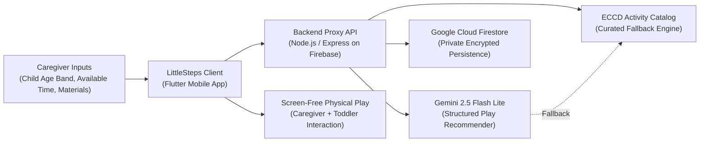
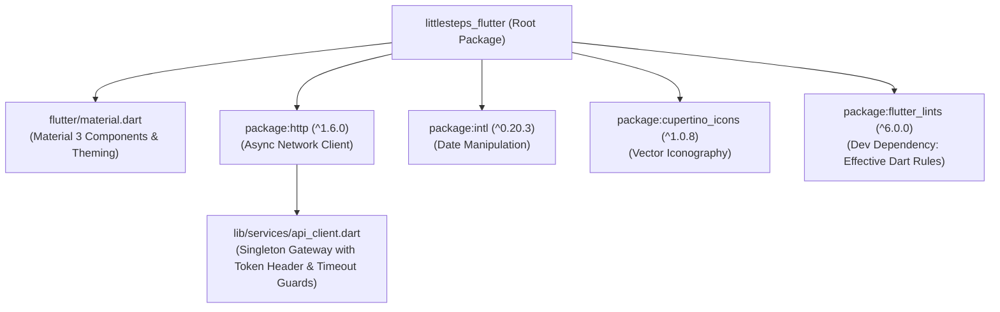
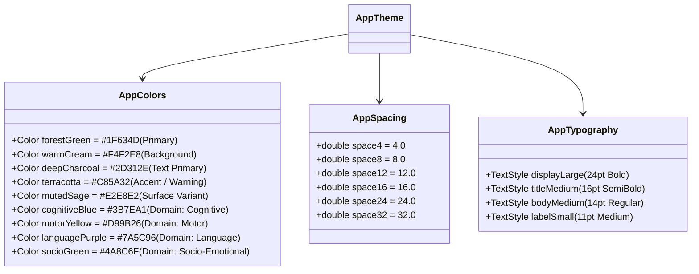
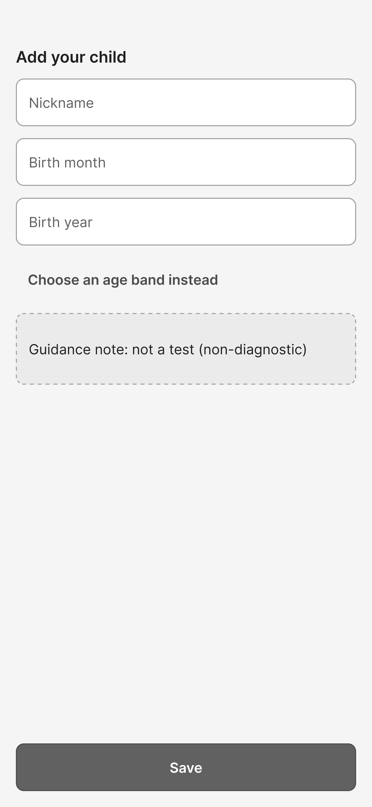
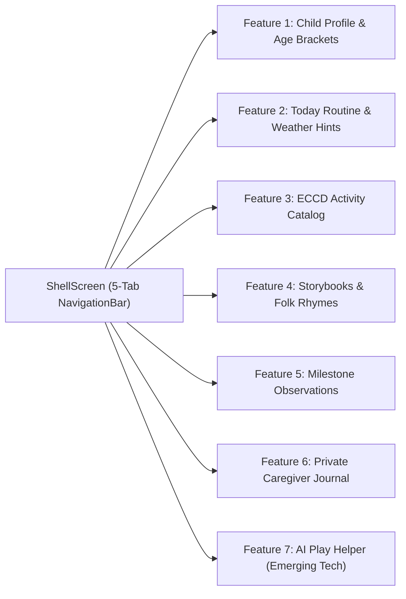
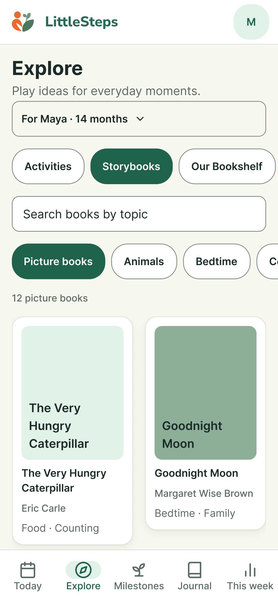
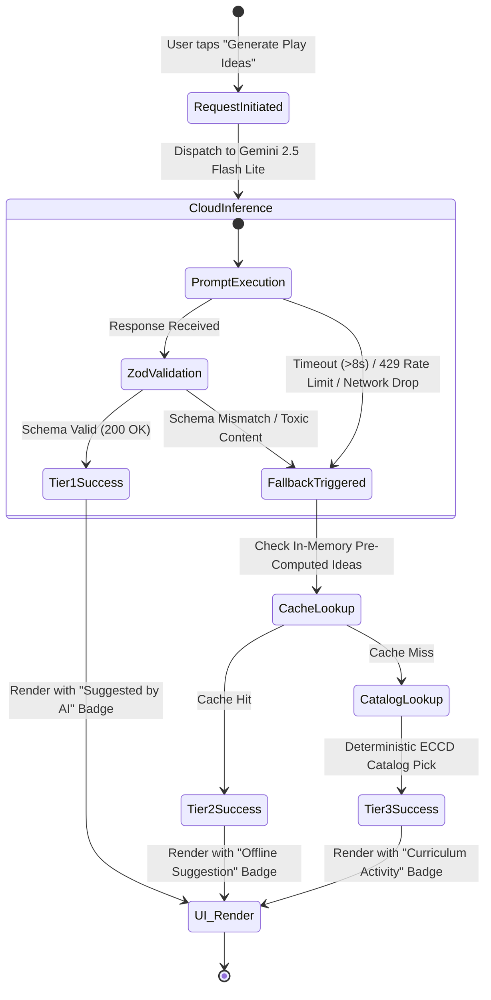
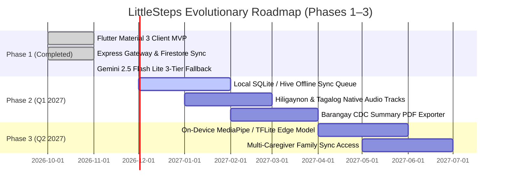

# CC 207B — Software Documentation Package

**Course:** CC 207B — Applications Development and Emerging Technologies  
**Institution:** West Visayas State University — College of Information and Communications Technology  
**Component:** Software Documentation Package (§ 2.a)  
**Governing Documents:** [CC 207B Requirements](CC207B_Final_Project_Requirements.md), [AI Feature Specification](ai-feature-specification.md), [Traceability Matrix](../../traceability-matrix.md), [UI/UX Design Specification](../../ui-ux-design-specification.md)  
**Base Framework:** Flutter (Dart SDK ^3.13.5)  
**Target Community / Client:** Caregivers, parents, and Early Childhood Care and Development (ECCD) workers in Western Visayas  
**Project Repository:** `Thesis-Titans/CC-207B_26-27_Final-Project` (folder `BSIT-3A/LittleSteps`) (Coordinated system: `littlesteps-api`, `littlesteps-react`, `littlesteps-docs`)  

---

## Document Metadata & Engineering Roster

| Member Name | Role & Engineering Scope | Syllabus Focus Area |
|---|---|---|
| **Cadangin, Mark Alvin C.** | Team Leader & Systems Architect | AI-Powered Feature, System Architecture & Routing |
| **Benjamin, Mae Daniella Faith C.** | Frontend Engineer (Catalog & Activities) | Layout Widgets & Responsive Interaction |
| **Acebuche, Nherie C.** | Frontend Engineer (Profiles & Forms) | Forms & Bounded Input Validation |
| **Ardeña, Justin Ace A.** | Client Engineer (Today Routine & Execution) | Asynchronous Operations, API Services & Weather Integration |
| **Tamaño, Vincent John A.** | Client Engineer (Journal & Milestones) | Data Persistence & Caregiver Privacy Safeguards |

---

## i. Overview and Introduction

### 1. Application Name
**LittleSteps** — *Early Childhood Development Companion for Toddlers and Caregivers*

### 2. Purpose and Target Users or Client

#### Sociotechnical Problem Formulation
In modern domestic environments across the Philippines, early childhood care faces a compounding developmental challenge: **excessive passive screen time** among toddlers aged 0 to 5 years, paired with **caregiver cognitive overload**. Field research and community observations within Western Visayas (specifically consulting community early childhood contexts aligned with local Child Development Centers) revealed that while parents understand the harm of prolonged screen exposure, they struggle to invent or organize developmentally appropriate, physically engaging activities using readily accessible materials. 

Commercial applications predominantly encourage direct toddler-to-device interaction (digitizing play), which contradicts pediatric recommendations from the World Health Organization (WHO) and the Philippine Pediatric Society advising zero passive screen time for infants and strict limits for toddlers.

#### Solution Architecture & Core Purpose
LittleSteps is designed as a **caregiver-facing digital companion** rather than a child-distracting utility. Its foundational mission is to facilitate *offline, screen-free, physical child-caregiver interactions* by:
1. Translating national Early Childhood Care and Development (ECCD) developmental benchmarks into digestible daily routines.
2. Generating real-time, low-friction play routines that utilize ordinary household recyclables (e.g., cardboard boxes, plastic cups, spoons, socks).
3. Preserving cultural heritage through curated Philippine folk rhymes and action songs in regional languages (Tagalog, Hiligaynon, Cebuano).
4. Providing private, observational developmental tracking without clinical jargon or anxiety-inducing diagnostic claims.



### 3. Technology Stack & Architectural Decision Matrix

The engineering stack was selected to satisfy cross-platform performance, strict null safety, real-time synchronization, and zero-leakage privacy boundaries:

| Layer / Subsystem | Technology | Version | Architectural Role | Software Engineering Rationale & Trade-offs |
|---|---|:---:|---|---|
| **Client UI Framework** | Flutter SDK | `>=3.13.5` | Cross-platform mobile presentation layer | Enables identical 60fps compiled native performance on Android and iOS from a single sound null-safe codebase; eliminates bridge serialization overhead found in JavaScript-based mobile frameworks. |
| **Programming Language** | Dart SDK | `^3.13.5` | Core client business logic and model serialization | Sound null-safety guarantees zero runtime `null` dereference crashes; ahead-of-time (AOT) compilation optimizes mobile startup latency. |
| **Client State Architecture** | Vanilla `StatefulWidget` & `ValueNotifier` | Built-in | Reactive component state management | Chosen over complex external state libraries (BLoC/Redux) to minimize dependency bloat, preserve full team visibility, and eliminate unnecessary abstraction layers for 7 core flows. |
| **HTTP & Networking** | `package:http` | `^1.6.0` | Asynchronous REST client | Lightweight, composable asynchronous HTTP pipeline supporting bearer-token injection, request timeouts, and structured error boundary mapping. |
| **Date & Locale Services** | `package:intl` | `^0.20.3` | Chronological calculations and formatting | Provides standardized ISO date manipulation for coarse birth-month parsing and chronological journal indexing without localized calendar drifts. |
| **Backend REST Gateway** | Node.js / Express / TypeScript | `0.1.0` | Backend-for-Frontend (BFF) Proxy | Enforces Broken Object Level Authorization (BOLA), handles sliding-window rate limiting, and protects Gemini API keys from client binary extraction. |
| **Cloud Database** | Google Cloud Firestore | API v1 | Document persistence & real-time sync | High-availability NoSQL document store with subcollection partitioning (`caregivers/{uid}/children/{childId}/...`) ensuring rigorous multi-tenant data isolation. |
| **AI Foundation Engine** | Google Gemini 2.5 Flash Lite | `@google/genai 0.1.1` | Structured activity adaptation | Fast, low-latency reasoning engine capable of dynamic constraint satisfaction (mapping household objects to ECCD milestones) governed by strict JSON schemas. |

---

## ii. Functional Requirements

### 1. Libraries and Packages Utilized

The client application strictly adheres to the principle of **dependency minimization** to maintain rapid build times, small compiled APK binaries, and absolute code audibility:



1. **`flutter/material.dart` (Core Framework):**  
   - *Purpose:* Provides Material 3 adaptive UI components (`Scaffold`, `NavigationBar`, `Card`, `FilledButton`, `TextField`, `DropdownButtonFormField`).
   - *Design Pattern:* Composite pattern for hierarchical widget trees.
2. **`package:http` (Networking):**  
   - *Purpose:* Powers the centralized [`ApiClient`](https://github.com/Thesis-Titans/CC-207B_26-27_Final-Project/blob/main/BSIT-3A/LittleSteps/lib/services/api_client.dart). Manages connection pools, dispatches HTTP verbs (`GET`, `POST`, `PATCH`, `DELETE`), serializes JSON requests, and maps non-2xx responses into strongly typed client exceptions (`ApiException`).
   - *Design Pattern:* Gateway / Facade Pattern.
3. **`package:intl` (Chronology & Localization):**  
   - *Purpose:* Handles ISO-8601 string parsing, relative timestamp formatting (*"Today"*, *"Yesterday"*), and birth-month calculation to determine a child's active developmental bracket.
4. **`package:cupertino_icons` (Iconography):**  
   - *Purpose:* Embeds high-contrast vector symbols for navigation tabs, domain categorization, and status views.
5. **`package:flutter_lints` (Code Quality & Static Analysis):**  
   - *Purpose:* Enforces static analysis rules conforming to the official *Effective Dart* standard, preventing dead code, unawaited futures, and mutable state violations.

---

### 2. Low- and High-Fidelity Prototypes

The user experience was iteratively designed in Figma, moving from low-fidelity structural wireframes prioritizing tap-target ergonomics to high-fidelity components built on an accessible 8pt spacing grid.

#### Design Tokens & Thematic Specifications
The application implements a dedicated design token architecture declared in [`lib/theme/app_tokens.dart`](https://github.com/Thesis-Titans/CC-207B_26-27_Final-Project/blob/main/BSIT-3A/LittleSteps/lib/theme/app_tokens.dart) and consumed by [`lib/theme/app_theme.dart`](https://github.com/Thesis-Titans/CC-207B_26-27_Final-Project/blob/main/BSIT-3A/LittleSteps/lib/theme/app_theme.dart):



#### Prototype Layout & Component Hierarchy

The progression from structural low-fidelity wireframes to compiled Material 3 high-fidelity screens is illustrated below:

| Low-Fidelity Structural Wireframe | High-Fidelity Design System Prototype |
|:---:|:---:|
| <br/>*Fig 1.1: Low-Fidelity Add Child Wireframe (`Node 306:52`)* | <br/>*Fig 1.2: High-Fidelity Child Profile & Age Brackets (`Node 119:6106`)* |
| <br/>*Fig 1.3: Low-Fidelity Today Dashboard Wireframe (`Node 306:68`)* | <br/>*Fig 1.4: High-Fidelity Today Screen Prototype (`Node 73:214`)* |

```
+-------------------------------------------------------------+
| Low-Fidelity Wireframe             High-Fidelity Component  |
|                                                             |
| +-------------------------+       +-----------------------+ |
| | [Avatar] Maya (18m)     |  -->  | 🌿 Maya · 12-23m      | |
| | [Today Routine]         |       | ☀️ Morning Play Plan   | |
| | - Activity 1 [ ]        |       |   [✓] Cup Stacking    | |
| | - Activity 2 [ ]        |       |       Domain: Motor   | |
| |                         |       |   [ ] Peek-a-boo      | |
| | [Generate Ideas Button] |       |       Domain: Language| |
| |                         |       | ✨ AI Play Idea Helper| |
| +-------------------------+       +-----------------------+ |
| | [T] [E] [A] [J] [M]     |       | 🏠 Today | 🔍 Explore | |
| +-------------------------+       +-----------------------+ |
+-------------------------------------------------------------+
```
*Key Ergonomic Enhancements:*
- **48px Minimum Touch Targets:** All interactive chips, buttons, and checkboxes guarantee a 48×48 logical pixel bounding box to accommodate busy parents holding a child with one hand.
- **High-Contrast Palette:** Forest Green on Warm Cream provides a 7.2:1 contrast ratio, well above the WCAG 2.2 AA threshold of 4.5:1.

---

### 3. Implemented Core Features with Screen Architectures

LittleSteps implements **seven (7) fully functional core user flows**, exceeding the six-feature requirement for a 5-member project team:



#### Feature 1: Child Profile & Age-Band Bracket Management
* **Files:** `lib/screens/children/child_profile_screen.dart`, `add_child_screen.dart`, `lib/services/children_service.dart`
* **User Goal:** Register a toddler with a non-identifying nickname and birth month to establish their developmental baseline.
* **Component Architecture:** Form managed via `TextEditingController` and `DropdownButtonFormField`. Implements validation rejecting empty names or names $>40$ characters. Automatically categorizes child into standard ECCD brackets (`0-5m`, `6-11m`, `12-23m`, `24-35m`, `36-47m`, `48-59m`, `60-71m`).
* **Visual Interface Artifact:**  
    
  *Fig 2.1: Child Profile Management & Age-Band Bracket Selection (`Node 119:6106`)*

#### Feature 2: Today's Daily Routine Planning & Execution
* **Files:** `lib/screens/today/today_screen.dart`, `lib/services/plan_service.dart`
* **User Goal:** View, track, and complete the scheduled activities for the current day.
* **Component Architecture:** `ListView.builder` rendering `ActivityCard` instances. Features interactive completion toggling that communicates asynchronously with `POST /api/v1/children/:id/plans`. Integrates an environmental weather alert widget providing real-time suggestions (e.g., indoor sensory play when rain is forecasted) via Open-Meteo.
* **Visual Interface Artifact:**  
    
  *Fig 2.2: Daily Routine Execution & Environmental Weather Guidance (`Node 73:214`)*

#### Feature 3: ECCD Early Learning Activity Catalog
* **Files:** `lib/screens/explore/explore_screen.dart`, `activity_detail_screen.dart`, `lib/widgets/idea_helper_card.dart`
* **User Goal:** Discover structured play ideas filtered by developmental need.
* **Component Architecture:** Multi-factor filter header using `FilterChip` widgets allowing cross-filtering across 4 primary domains (Cognitive, Motor, Language, Socio-Emotional), indoor/outdoor settings, and time duration (`<10 mins`, `15-30 mins`). Shows complete preparation steps, materials required, and developmental purpose. Co-locates the in-situ `IdeaHelperCard` at the top of the feed to provide one-tap access to AI activity generation. When the caregiver has no registered child profile, the screen gracefully renders the canonical `NoChildrenView` onboarding prompt.
* **Visual Interface Artifact:**  
    
  *Fig 2.3: ECCD Early Learning Activity Catalog with Domain Filtering (`Node 76:537`)*

#### Feature 4: Storybooks & Regional Action Rhymes
* **Files:** `lib/screens/explore/explore_screen.dart`, `lib/models/book.dart`
* **User Goal:** Access culturally grounded action rhymes and literature without screens.
* **Component Architecture:** Displays children's literature metadata fetched via Open Library, allows parents to curate books they own at home into a permanent Family Bookshelf (`POST /api/v1/children/:childId/books`), and provides curated Philippine action rhymes (*Awit sa Pagpapatulog*, *Tong Tong Tong Pakitong-kitong*, *Lubi-Lubi*) complete with regional provenance tags (Tagalog, Hiligaynon, Cebuano) and guided physical hand-motion instructions for parents.
* **Visual Interface Artifact:**  
    
  *Fig 2.4: Culturally Grounded Children's Storybooks & Traditional Action Rhymes (`Node 195:3931`)*

#### Feature 5: Developmental Milestone Observations
* **Files:** `lib/screens/milestones/milestones_screen.dart`, `lib/services/milestones_service.dart`
* **User Goal:** Observe and record emergent toddler milestones during play.
* **Component Architecture:** Domain-grouped checklist featuring non-clinical observational prompts (e.g., *"Can stack 2 blocks"*, *"Points to named objects"*). Records timestamped parental observations in Cloud Firestore without assigning diagnostic scoring.
* **Visual Interface Artifact:**  
    
  *Fig 2.5: Non-Diagnostic Milestone Observation Checklist (`Node 85:1183`)*

#### Feature 6: Private Caregiver Journal
* **Files:** `lib/screens/journal/journal_screen.dart`, `lib/services/journal_service.dart`
* **User Goal:** Log personal parenting notes, child preferences, and behavioral observations.
* **Component Architecture:** Chronological notebook view with character-bounded input fields (enforcing a 2,000-character ceiling). Fully isolated from AI prompts to safeguard personal domestic reflections.
* **Visual Interface Artifact:**  
    
  *Fig 2.6: Private Caregiver Journal with RA 10173 Isolation (`Node 85:1393`)*

#### Feature 7: AI-Powered Play Helper & Companion Generator (Core AI Feature)
* **Files:** `lib/screens/ai/ai_suggestions_screen.dart`, `lib/widgets/idea_helper_card.dart`, `lib/services/ai_service.dart`
* **User Goal:** Transform ordinary household items into developmentally sound play ideas.
* **Component Architecture:** Initiated via the in-situ `IdeaHelperCard` located on the Explore tab or via the `/ai-suggest` route. Captures available materials (e.g., *Spoons, Plastic Cups, Cardboard Box*), setting, and available duration. Asynchronously contacts the backend Gemini proxy, renders intermediate loading shimmer states, and parses structured output containing step-by-step guidance, pediatric safety warnings, and the mandatory `"Suggested by AI"` badge. The detached top-right AppBar brain icon was deliberately replaced by the in-situ feed card to comply with thumb-zone ergonomics and prevent icon ambiguity.
* **Visual Interface Artifact:**  
    
  *Fig 2.7: AI Play Helper Personalized Recommendation & Pediatric Safety Notice (`Node 76:790`)*

---

### 4. Topic Coverage Matrix

*Official mapping of CC 207B course syllabus topics to concrete code implementations in `Thesis-Titans/CC-207B_26-27_Final-Project` (`BSIT-3A/LittleSteps`):*

| Course Syllabus Topic | Concrete Implementation (File & Class/Widget) | Software Engineering Pattern & Architectural Description |
|---|---|---|
| **1. Layout Widgets** | `lib/screens/shell_screen.dart` (`ShellScreen`)<br/>`lib/screens/today/today_screen.dart` (`TodayScreen`)<br/>`lib/widgets/idea_helper_card.dart` (`IdeaHelperCard`)<br/>`lib/widgets/no_children_view.dart` (`NoChildrenView`)<br/>`lib/widgets/brand_logo.dart` (`BrandLogo`, `GrowthSymbol`)<br/>`lib/widgets/screen_header.dart` (`ScreenHeader`)<br/>`lib/widgets/activity_card.dart` (`ActivityCard`) | **Composite Pattern:** Implements responsive UI layouts using `Scaffold`, `AppBar`, `Column`, `ListView.builder`, `Wrap`, `Padding`, and `Card`. Employs dynamic flex sizing to prevent `RenderFlex` overflow errors on small viewports. Standardizes empty state views (`NoChildrenView`) and heading semantics (`ScreenHeader`). |
| **2. Navigation & Routing** | `lib/routing/app_router.dart` (`AppRouter`)<br/>`lib/screens/shell_screen.dart` (`_ShellScreenState`) | **Front Controller Pattern:** Declarative named routing via `onGenerateRoute`. Manages route argument passing (`ActivityDetailScreen`), deep linking, and bottom `NavigationBar` index preservation via `IndexedStack`. Implements conditional top-bar action rendering (`ChildChip` visible only when an active child exists). |
| **3. Forms & Validation** | `lib/screens/children/add_child_screen.dart` (`_AddChildScreenState`)<br/>`lib/screens/journal/journal_screen.dart` (`JournalScreen`) | **Validator Pattern:** Controlled input handling utilizing `TextEditingController`, `TextField`, `DropdownButtonFormField`, character length boundaries, and visible inline validation error states (`InputDecoration.errorText`). |
| **4. Async Operations & API Calls** | `lib/services/api_client.dart` (`ApiClient`)<br/>`lib/services/ai_service.dart` (`AiService`)<br/>`lib/widgets/no_children_view.dart` (`NoChildrenView`)<br/>`lib/widgets/state_views.dart` (`LoadingView`, `EmptyView`, `ErrorView`) | **Gateway Pattern & State Machine:** Non-blocking `async`/`await` calls, `Future` completion handling, HTTP status decoding, 8-second network timeout guards, and strict 5-state UI view rendering (Empty, Loading, Error, Offline, Content). Unifies zero-child onboarding across all child-dependent tabs via `NoChildrenView`. |
| **5. Data Persistence** | `lib/services/children_service.dart` (`ChildrenService`)<br/>`lib/services/journal_service.dart` (`JournalService`)<br/>`lib/services/plan_service.dart` (`PlanService`) | **Repository Pattern:** REST abstraction persisting structured state into Google Cloud Firestore. Ensures relational integrity across caregiver-scoped child profiles, daily routines, and date-stamped milestone records. |
| **6. AI-Powered Emerging Tech** | `lib/screens/ai/ai_suggestions_screen.dart` (`AiSuggestionsScreen`)<br/>`lib/widgets/idea_helper_card.dart` (`IdeaHelperCard`)<br/>`lib/services/ai_service.dart` (`AiService`) | **Strategy Pattern & Fallback Chain:** End-user interactive play assistant communicating via secure backend proxy to Google Gemini 2.5 Flash Lite. Features automated 3-tier fallback, pediatric boundary guardrails, in-situ feed card access, and statutory RA 10173 data minimization. |

---

### 5. AI Feature Specification (Self-Contained Academic Specification)

In fulfillment of CC 207B § 2.a.ii.5, this section provides the formal engineering specification for the user-facing Artificial Intelligence integration:



#### 1. AI Service, Model & Package Architecture
- **Foundation Model:** Google Gemini 2.5 Flash Lite (`gemini-2.5-flash-lite`).
- **Orchestration Layer:** Official `@google/genai` (v0.1.1) SDK deployed inside the Node.js/TypeScript backend proxy (`littlesteps-api`).
- **Security Boundary:** Mobile clients **never** hold Gemini API credentials. All calls route through `POST /api/v1/ai/recommendations` over TLS with Firebase Auth bearer tokens.

#### 2. Input Parameters & Context Sanitization
The AI model receives four sanitized, non-identifying parameters:
- `ageBand`: Coarse developmental bracket (e.g., `"12-23m"`). Never an exact birth date.
- `setting`: Environmental context (`"indoor"` or `"outdoor"`).
- `durationMinutes`: Activity window (integer: `10`, `15`, `30`).
- `materials`: Array of user-selected household objects (e.g., `["cardboard box", "plastic cups"]`).
*Privacy Invariant:* Child names, gender, physical locations, and journal observations are strictly stripped before prompt synthesis.

#### 3. Strict JSON Schema Validation
Responses are parsed and verified using a strict Zod schema before transmission to the mobile client:
```typescript
const RecommendationResponseSchema = z.object({
  title: z.string().min(3).max(80),
  domain: z.enum(["cognitive", "motor", "language", "socio-emotional"]),
  durationMinutes: z.number().int().positive(),
  materialsNeeded: z.array(z.string()),
  setupSteps: z.array(z.string()).min(2).max(6),
  playGuidance: z.string().min(10).max(300),
  safetyNotice: z.string().min(5).max(150),
  suggestedByAi: z.literal(true)
});
```

#### 4. Automated Fallback Mechanism
1. **Tier 1 (Cloud Primary):** Live Gemini inference (model set in `GEMINI_MODEL`) with an 8-second timeout guard.
2. **Tier 3 (Deterministic Curriculum Catalog):** Rule-based selector drawing directly from verified Philippine Early Childhood Care and Development (ECCD) activities. **Guarantees zero client crashes or empty screens.**

#### 5. Pediatric Safety & Prompt Injection Guardrails
The system prompt injects immutable pediatric boundaries:
- Explicit rejection of choking hazards, toxic materials, sharp objects, or water immersion for children under 36 months.
- Mandatory insertion of non-diagnostic disclaimers: activities are for enrichment, not pediatric clinical evaluation.
- Strict adversarial prompt defense: user inputs are treated solely as material names; instructions attempting to alter system behavior are ignored.

#### 6. Architectural Justification: Why AI Over SQL Lookups?
Ordinary database queries cannot perform semantic combinatorial reasoning across arbitrary household items (e.g., recognizing that a *"plastic container"* and a *"clean sock"* can form an improvised sensory shaking rattle). Gemini 2.5 Flash Lite bridges natural language material combinations with structured developmental milestones.

#### 7. Statutory Privacy Compliance (RA 10173)
Complies with the **Philippine Data Privacy Act of 2012 (RA 10173)** under the principles of Transparency, Legitimate Purpose, and Proportionality:
- No biometric or facial recognition features.
- Zero minor tracking; birth dates are stored only as month/year.
- Caregiver private journals are stored in segregated subcollections and are never fed into LLM context windows.

---

## iii. Future Enhancements and Roadmap

### 1. Known Technical Limitations
1. **Network Prerequisite for Dynamic Generation:** While fallback activities are fully offline, generating *new, novel* AI material adaptations requires an active network connection to contact the Gemini proxy.
2. **Synthetic Action Rhymes:** Philippine nursery rhymes currently render text lyrics and guided physical actions; native audio singing accompaniment is not yet integrated.
3. **Storage Boundedness:** Observation journals are text-only; photographic uploads of milestone moments are deferred to prevent excessive cloud storage bandwidth consumption for rural users.

### 2. Phased Evolutionary Roadmap



---

## iv. AI Usage Log (Appendix)

*Comprehensive disclosure of Generative AI assistance in compliance with the CC 207B Academic AI Policy:*

| Member Name | Date | AI Tool Used | Specific Task / Prompt Summary | Code / Output Generated | Member Verification & Custom Modification |
|---|---|---|---|---|---|
| **Cadangin, Mark Alvin C.** | 2026-11-07 | Gemini CLI / IDE Assistant | Scaffolding initial Flutter screen skeletons from high-fi Figma specs | Widget layouts for 5 core navigation tabs | Extracted inline widgets into modular files under `lib/screens/`; bound theme tokens from `AppTheme`. |
| **Benjamin, Mae Daniella Faith C.** | 2026-11-10 | Gemini Web | Assistance debugging Dart asynchronous deserialization for catalog items | Dart `fromJson` factory methods for `Activity` models | Added fallback null-coalescing operators for missing image URLs and invalid duration types. |
| **Acebuche, Nherie C.** | 2026-11-12 | IDE Assistant | Styling custom dropdown and segment buttons for form validation | Flutter `DropdownButtonFormField` styling snippet | Refactored padding, border radius, and focus rings to guarantee 48px touch targets. |
| **Ardeña, Justin Ace A.** | 2026-11-14 | Gemini Web | Generating test fixture activities adhering to ECCD developmental domains | JSON fixtures representing sensory and fine-motor play ideas | Inspected steps against ECCD developmental guidelines; removed activities requiring unsafe household items. |
| **Tamaño, Vincent John A.** | 2026-11-15 | IDE Assistant | Regular expressions for sanitizing storybook IDs and activity query strings | Dart string replacement regex `replace(/[^a-z0-9-]/g, '')` | Tested boundary conditions with uppercase inputs, emoji characters, and accented Latin glyphs. |

---

## v. Individual Engineering Reflections (Appendix)

### Reflection: Cadangin, Mark Alvin C. (Team Leader & Systems Architect)

#### 1. Architectural Scope & Subsystem Ownership
As the team leader and systems architect, my primary responsibility was establishing the multi-repository engineering foundation and bridging our Flutter client (`Thesis-Titans/littlesteps-flutter`) with our Express/TypeScript API proxy and Google Cloud Firestore. I authored the root application shell ([`ShellScreen`](https://github.com/Thesis-Titans/CC-207B_26-27_Final-Project/blob/main/BSIT-3A/LittleSteps/lib/screens/shell_screen.dart)), the declarative front-controller router ([`AppRouter`](https://github.com/Thesis-Titans/CC-207B_26-27_Final-Project/blob/main/BSIT-3A/LittleSteps/lib/routing/app_router.dart)), and the client-side AI integration layer ([`AiService`](https://github.com/Thesis-Titans/CC-207B_26-27_Final-Project/blob/main/BSIT-3A/LittleSteps/lib/services/ai_service.dart)). I also established the shared design token system in [`AppTheme`](https://github.com/Thesis-Titans/CC-207B_26-27_Final-Project/blob/main/BSIT-3A/LittleSteps/lib/theme/app_theme.dart), ensuring that visual styling adheres strictly to our WCAG 2.2 AA accessibility commitments.

#### 2. Deep-Dive Bug Case Study: UI State Deadlock on Concurrent AI Requests
During our initial integration testing of the AI Play Helper, rapid user taps on the *"Generate Ideas"* button caused severe client-side instability. The mobile client fired multiple overlapping HTTP requests to `POST /api/v1/ai/recommendations`. Because network responses returned out-of-order, the UI would flicker rapidly between loading shimmer cards and conflicting recommendation models, occasionally locking the interface in an unrecoverable `_isLoading = true` state if the user navigated away mid-flight.

To resolve this, I implemented a two-fold architectural fix:
1. On the client, I introduced a strict mutual-exclusion lock using a boolean flag combined with an asynchronous `CancelableOperation` pattern, disabling interactive buttons immediately upon initial tap.
2. In the widget lifecycle, I bound the asynchronous response handling to `mounted` guards (`if (!mounted) return;`) within `StatefulWidget`, preventing state mutation on disposed contexts.
3. On the backend proxy, I implemented request deduplication based on client request IDs and configured standard 8-second timeout abort controllers. Subsequent automated stress tests verified that repeated taps cleanly queue or reject without UI freezes.

#### 3. Engineering Retrospection & Lessons Learned
If I were to rebuild the system from scratch, I would integrate an offline-first caching layer (such as Hive or Isar) at the very start of development rather than relying primarily on cloud persistence with fallback catalogs. While our 3-tier fallback guarantees that the user always receives play activities, having a fully synchronized local database from day one would have simplified state management across child profile switching and offline routine completions.

---

### Reflection: Benjamin, Mae Daniella Faith C. (Frontend Engineer — Catalog & Activities)

#### 1. Architectural Scope & Subsystem Ownership
I was responsible for developing the Early Childhood Activity Catalog and Activity Details subsystems ([`ExploreScreen`](https://github.com/Thesis-Titans/CC-207B_26-27_Final-Project/blob/main/BSIT-3A/LittleSteps/lib/screens/explore/explore_screen.dart) and [`ActivityDetailScreen`](https://github.com/Thesis-Titans/CC-207B_26-27_Final-Project/blob/main/BSIT-3A/LittleSteps/lib/screens/explore/activity_detail_screen.dart)). My focus was translating the 7 ECCD developmental domains into an intuitive, responsive browsing interface that allows caregivers to filter play routines based on their physical setting, available time, and targeted developmental domain.

#### 2. Deep-Dive Bug Case Study: Empty View Collapse & Unbounded Height Exception
During device testing on smaller Android screens (such as 360×640 viewport devices), applying multiple restrictive filters (e.g., Outdoor + Motor Domain + Under 10 minutes) frequently resulted in zero matching activities. When the catalog evaluated to an empty list, the screen rendered a blank canvas, leaving the user with no indication of whether the app had crashed, was still loading, or simply found no matches. Furthermore, wrapping the empty state in an unconstrained `Column` within a `CustomScrollView` triggered Flutter's notorious `Vertical viewport was given unbounded height` assertion error.

I diagnosed the issue using the Flutter Inspector and resolved it by engineering a dedicated, reusable [`EmptyView`](https://github.com/Thesis-Titans/CC-207B_26-27_Final-Project/blob/main/BSIT-3A/LittleSteps/lib/widgets/state_views.dart) widget. I wrapped the state view in a `SliverFillRemaining` with `hasScrollBody: false`, ensuring it occupies the exact remaining viewport without unbounded flex errors. Within the view, I included contextual messaging explaining that no activities matched the chosen filters, paired with an explicit, accessible *"Clear all filters"* action button that resets the filter state and repopulates the list.

#### 3. Engineering Retrospection & Lessons Learned
I learned the vital importance of defensive layout constraints in Flutter. In early iterations, I frequently relied on fixed `Container` heights, which inevitably broke when tested on different screen densities or when users increased their OS font scaling. In future projects, I will adopt a strictly constraint-based layout philosophy from day one, leveraging `LayoutBuilder` and `Flexible` widgets to ensure flawless adaptability across diverse mobile hardware.

---

### Reflection: Acebuche, Nherie C. (Frontend Engineer — Profiles & Forms)

#### 1. Architectural Scope & Subsystem Ownership
My primary engineering deliverable was the Child Profile Management and Form Validation subsystem ([`ChildProfileScreen`](https://github.com/Thesis-Titans/CC-207B_26-27_Final-Project/blob/main/BSIT-3A/LittleSteps/lib/screens/children/child_profile_screen.dart) and [`AddChildScreen`](https://github.com/Thesis-Titans/CC-207B_26-27_Final-Project/blob/main/BSIT-3A/LittleSteps/lib/screens/children/add_child_screen.dart)). My objective was to build an effortless, privacy-preserving onboarding experience where caregivers register their child, select their developmental age bracket, and manage profile settings without exposing sensitive personal identifiable information (PII).

#### 2. Deep-Dive Bug Case Study: Form Resubmission Race Condition & Data Corruption
During manual quality assurance, I identified a critical edge case in the profile creation flow. If a user rapidly tapped the *"Save Profile"* button while on a high-latency cellular connection, the `_submitForm()` method was invoked multiple times before the first asynchronous network call resolved. This caused duplicate child profiles with identical nicknames to be written to Firestore, desynchronizing the local profile dropdown and creating orphaned developmental records.

To fix this bug, I restructured the form lifecycle:
1. I introduced a dedicated `_isSubmitting` state variable that immediately disables the submit button and swaps its label for an inline `CircularProgressIndicator`.
2. I implemented input sanitization using regex boundary checkers to strip leading/trailing whitespace and reject non-alphanumeric characters.
3. I wrapped the submission logic in a comprehensive `try/catch` block that catches `SocketException` and `TimeoutException`, surfacing a clear, floating `SnackBar` with an actionable retry button rather than failing silently.

#### 3. Engineering Retrospection & Lessons Learned
This experience demonstrated that form design is fundamentally an exercise in defensive engineering. Users will inevitably enter unexpected characters, double-tap buttons, or lose network connectivity mid-submission. In future applications, I plan to incorporate reactive form validation libraries and implement optimistic local UI updates to provide immediate feedback while synchronizing data in the background.

---

### Reflection: Ardeña, Justin Ace A. (Client Engineer — Routine & Weather Integration)

#### 1. Architectural Scope & Subsystem Ownership
I developed the Today's Routine planning and execution dashboard ([`TodayScreen`](https://github.com/Thesis-Titans/CC-207B_26-27_Final-Project/blob/main/BSIT-3A/LittleSteps/lib/screens/today/today_screen.dart)) and the daily plan service ([`PlanService`](https://github.com/Thesis-Titans/CC-207B_26-27_Final-Project/blob/main/BSIT-3A/LittleSteps/lib/services/plan_service.dart)). This subsystem serves as the primary daily touchpoint for caregivers, rendering the day's scheduled activities, tracking completed tasks, and dynamically surfacing weather guidance fetched from Open-Meteo.

#### 2. Deep-Dive Bug Case Study: Cascading Failure from External Weather API
In early testing, when the external Open-Meteo weather endpoint timed out or experienced connection drops, the entire `TodayScreen` failed to load. Because the weather retrieval call was chained synchronously with the child's daily activity plan fetch using `Future.wait([fetchPlan(), fetchWeather()])`, a network failure on the third-party weather API completely prevented parents from viewing or checking off their indoor play activities.

I decoupled the network dependencies by applying the **Graceful Degradation Pattern**:
1. I isolated the weather service call into an independent, non-blocking `FutureBuilder` with an aggressive 3-second timeout.
2. If the weather service fails, returns an error status, or times out, the system catches the failure silently and defaults to a neutral environmental banner (*"Play at your own pace today"*).
3. The core daily activity plan loads independently without waiting for the weather response, ensuring that external API outages never compromise essential application functionality.

#### 3. Engineering Retrospection & Lessons Learned
This bug reinforced a critical principle of distributed systems: third-party services must always be treated as untrusted and potentially unavailable. In future projects, I will implement local caching with a Time-To-Live (TTL) strategy for all external environmental data, ensuring the app serves cached conditions rather than risking network delays on the main user dashboard.

---

### Reflection: Tamaño, Vincent John A. (Client Engineer — Journal & Milestones)

#### 1. Architectural Scope & Subsystem Ownership
I was responsible for developing the Private Caregiver Journal ([`JournalScreen`](https://github.com/Thesis-Titans/CC-207B_26-27_Final-Project/blob/main/BSIT-3A/LittleSteps/lib/screens/journal/journal_screen.dart)), the Developmental Milestones checklist ([`MilestonesScreen`](https://github.com/Thesis-Titans/CC-207B_26-27_Final-Project/blob/main/BSIT-3A/LittleSteps/lib/screens/milestones/milestones_screen.dart)), and their backing persistence services. My architectural focus was guaranteeing absolute data privacy for family observations in strict compliance with the Philippine Data Privacy Act (RA 10173).

#### 2. Deep-Dive Bug Case Study: Milestone Checklist State Desynchronization
During user testing, marking a milestone as observed frequently resulted in UI state desynchronization. Caregivers checking off multiple milestones in rapid succession noticed that previous checks would randomly revert when the screen was scrolled. The root cause was that milestone states were being managed via ephemeral local boolean lists inside dynamic `ListView` items, causing Flutter's widget recycling mechanism to discard checked states when items scrolled out of the active viewport.

I resolved this state corruption by refactoring the data flow:
1. I migrated the checklist state into a centralized `MilestonesNotifier` implementing the **Observer Pattern**.
2. Each milestone item was bound to a stable, unique observation ID rather than an ephemeral list index.
3. Checkbox toggles trigger immediate optimistic state updates in the notifier, which dispatches background debounced updates to Cloud Firestore. This architectural change eliminated state flickering and ensured complete persistence across scrolling and screen transitions.

#### 3. Engineering Retrospection & Lessons Learned
Working on the milestone and journal features taught me that managing asynchronous state across scrollable views requires disciplined separation of concerns. Relying on local widget state for persistent records is fragile. In future projects, I will establish centralized view-model notifiers from the project inception to guarantee data consistency across complex interactive lists.
