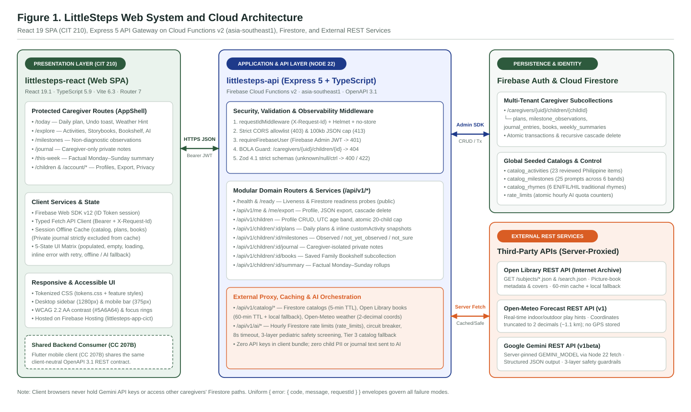

# CIT 210 — System Documentation: LittleSteps

**Course:** CIT 210 — Web Systems and Technologies  
**Institution:** West Visayas State University — College of Information and Communications Technology  
**Submitted By:** Acebuche, Nherie C.; Ardeña, Justin Ace D.; Benjamin, Mae Daniella Faith C.; Cadangin, Mark Alvin C.; Tamaño, Vincent John A. (BSIT-3A — Thesis Titans)  
**Submitted To:** Angelica Grace Simbran  
**Base Stack:** React 19 (TypeScript, Vite), Node.js 22 / Express 5, Cloud Firestore  
**Related Specifications:** [CIT 210 Final Project Requirements](CIT210_Final_Project_Requirements.md), [API Reference](../../api-reference.md)

---

## Abstract

Parents and caregivers of children aged 0 to 5 years often rely on phones or tablets to keep toddlers busy during daily routines, even though pediatric guidelines encourage active, screen-free play. Existing parenting websites are frequently commercial, region-locked, or framed around clinical scoring that causes unnecessary worry. This paper documents **LittleSteps**, a responsive web companion built for caregivers using **React 19**, **TypeScript**, and a shared **Node.js / Express 5** backend hosted on **Firebase Cloud Functions** with **Firebase Authentication** and **Cloud Firestore**. The web system connects private caregiver planning, milestone reminders, journal notes, and weekly reflections with three live external REST APIs: **Open Library** for picture books and a saved Family Bookshelf, **Open-Meteo** for coarse indoor or outdoor weather hints, and **Google Gemini** for safe play suggestions and activity adaptations. Strict request validation, ownership isolation, automatic fallbacks, and accessible responsive layouts ensure reliable performance across desktop and mobile browsers under the Philippine Data Privacy Act (RA 10173).

**Keywords:** React web application, REST API integration, Express 5, Cloud Firestore, Open Library API, Open-Meteo API, generative AI safety, early childhood play, WCAG 2.2 AA.

---

## 1. Introduction

### 1.1 System Name and Background

**LittleSteps** — Play Planning and Observation Companion for Caregivers of Young Children.

The first five years of life are vital for a child's thinking, movement, language, and social growth. Guidance from the World Health Organization (WHO, 2019), the American Academy of Pediatrics (AAP, 2016), and the Philippine Early Childhood Care and Development (ECCD) System Act (Republic Act No. 12199, 2025) highlights warm adult-child interaction and screen-free play using everyday objects. In practice, families often lack quick activity ideas using items already at home and struggle to keep track of simple play notes.

Many commercial parenting websites fail to meet local caregivers' needs: they assume imported toys, present development milestones as pass/fail tests, or offer unguarded chatbots that can return unsafe suggestions. LittleSteps solves this by letting an adult pick a safe activity in under a minute, set the screen aside to play, and optionally jot down a private note afterward.

### 1.2 Objectives

The web system was designed to satisfy five core goals aligned with CIT 210:

1. **External & Custom API Integration:** Connect a responsive React web client to a custom Express 5 REST backend alongside Open Library, Open-Meteo, and Google Gemini using server-side caching and reliable fallbacks.
2. **Responsive, Accessible Web Interface:** Deliver an intuitive React 19 application that adapts smoothly between desktop (`1280px`) and mobile (`375px–414px`) viewports while meeting WCAG 2.2 AA contrast and keyboard accessibility standards.
3. **Organized Server-Side Data Handling:** Isolate each caregiver's child profiles, daily plans, milestone observations, saved books, and private journal entries inside Cloud Firestore, while serving reviewed early-learning catalogs from the database.
4. **Input Validation & Resilient Error Recovery:** Validate incoming JSON payloads with Zod schemas, prevent unauthorized cross-account access, and show calm loading, empty, error, and offline states across every screen.
5. **Privacy-by-Design & Non-Diagnostic Framing:** Follow RA 10173 data minimization by avoiding exact birthdates and photos, keeping private journal entries out of offline caches and AI prompts, and letting caregivers export or permanently delete their account data.

### 1.3 Scope and Delimitations

Within **CIT 210**, the system covers the **React web application**, the **Express REST backend**, **Firebase Authentication and Cloud Firestore storage**, and **three external API integrations** across six core features:

- **Child Profiles & Milestones:** Caregiver-managed child profiles using only a nickname and age band, paired with non-diagnostic developmental reminders.
- **Daily Play Planning:** A scheduled daily play view (`Today`), one-tap activity completion with undo, and optional weather hints.
- **Private Caregiver Journal:** Account-isolated observation notes that caregivers can create, edit, filter by date, and delete.
- **Play Library, Books & Rhymes:** Reviewed English activities across all age bands alongside selected Filipino and Hiligaynon activities, Open Library book search, a saved Family Bookshelf, and traditional Philippine rhymes.
- **Weekly Reflection Summary:** A calm Monday–Sunday activity and milestone summary (`This week`) with no clinical scores or streaks.
- **Safe AI Idea Helper:** Structured household-item suggestions, storybook play companions, and activity adaptations with automatic catalog fallback.

**Delimitations:** LittleSteps is part of a coordinated three-course BSIT-3A capstone project at West Visayas State University. This document covers the React web platform and shared backend API; the companion Flutter mobile app and deployment management plan are documented under their respective courses. Academic demonstrations use sample caregiver data, and all prompts remain strictly observational rather than medical or diagnostic.

---

## 2. Methods

### 2.1 System Architecture and Technology Stack

LittleSteps separates the browser interface from external credentials and database logic using a centralized Express 5 backend on Firebase Cloud Functions. Every private request from the React browser client carries a verified Firebase ID token over HTTPS. Fig. 1 outlines the web architecture, and Table 1 summarizes the runtime stack.

  
*Fig. 1. Architecture connecting the React web client, Express backend API, Cloud Firestore, and external REST services.*

*Table 1. System Technology Stack and Versions*

| Layer | Technology | Version | Role |
|---|---|---|---|
| Web Frontend | `react`, `react-dom`, `react-router-dom` | React `^19.1.1`, Router `^7.18.5` | Single-page web app with protected routing and responsive navigation |
| Language & Bundler | `typescript`, `vite` | TypeScript `~5.9.2`, Vite `^6.3.5` | Type-safe UI components and fast production builds |
| Authentication SDK | `firebase` (Web SDK) | `^12.2.1` | Email/password sign-in, password reset, and session tokens |
| Styling System | CSS3 Custom Properties | CSS3 | Shared color, spacing, and contrast rules without runtime overhead |
| Backend Server | Node.js, `express`, `firebase-functions` | Node `22`, Express `^5.1.0`, Functions `^6.4.0` | Cloud gateway handling routing, auth checks, caching, and error envelopes |
| Security & Validation | `zod`, `helmet`, `cors` | `^4.1.0`, `^8.1.0`, `^2.8.5` | Payload schema checks, HTTP security headers, and origin restrictions |
| Database & Admin | `firebase-admin` | `^13.5.0` | Server-side token verification and Cloud Firestore persistence |
| External REST APIs | Open Library, Open-Meteo, Google Gemini | REST / JSON | Picture books, local weather hints, and AI play ideas |

### 2.2 Custom REST API Endpoints

Public routes (`/health`, `/ready`, and public catalogs) can be read without signing in, while all caregiver, child, plan, journal, bookshelf, and AI endpoints verify the caregiver's Firebase token and confirm record ownership. Missing or unauthorized resource IDs return `404` so account data cannot be guessed or enumerated. Table 2 lists the active REST endpoints.

*Table 2. LittleSteps REST API Endpoints*

| Feature Area | Method & Endpoint | Auth | Purpose |
|---|---|---|---|
| Health Probes | `GET /health`, `GET /ready` | Public | Server liveness and database readiness checks |
| Caregiver Account | `GET /api/v1/me`, `GET /api/v1/me/export`, `DELETE /api/v1/me` | Required | Account lookup, portable JSON export, and full account deletion |
| Child Profiles | `GET`, `POST /api/v1/children`; `GET`, `PATCH`, `DELETE /api/v1/children/:id` | Required | Manage child profiles with a 20-child cap and clean delete |
| Daily Plans | `GET`, `POST /api/v1/children/:id/plans`; `PATCH`, `DELETE .../plans/:planId` | Required | Schedule activities (including adapted/story activities) and toggle completion |
| Milestones | `GET`, `POST /api/v1/children/:id/milestones`; `PATCH .../milestones/:id` | Required | Record observational milestone status and caregiver notes |
| Private Journal | `GET`, `POST /api/v1/children/:id/journal`; `PATCH`, `DELETE .../journal/:id` | Required | Store, edit, filter, and delete private reflections |
| Family Bookshelf | `GET`, `POST /api/v1/children/:id/books`; `DELETE .../books/:bookId` | Required | Save favorite picture books from Open Library |
| Weekly Summary | `GET /api/v1/children/:id/summary/weekly` | Required | Summarize Monday–Sunday activity and milestone counts |
| Public Catalogs | `GET /api/v1/catalog/activities`, `/milestones`, `/rhymes` | Public | Serve reviewed activities, milestone prompts, and local rhymes |
| External Proxies | `GET /api/v1/catalog/books`, `/books/search`, `/weather` | Public | Cached Open Library book search and Open-Meteo weather hint |
| AI Assistant | `POST /api/v1/ai/recommendations`, `/story-activity`, `/adapt` | Required | Rate-limited play ideas, story companions, and activity tweaks |

### 2.3 External API Integration and Safety Flow

A primary goal of CIT 210 is integrating outside web services reliably even when external servers slow down or go offline. Fig. 2 shows how all three external services run safely behind the backend API.

  
*Fig. 2. How Open Library, Open-Meteo, and Google Gemini operate behind backend caching, safety checks, and fallbacks.*

- **Open Library Books & Family Bookshelf:** Book browse and search calls proxy Open Library and normalize titles, authors, covers, and subjects, caching results for 60 minutes. If Open Library times out, a curated local book list loads automatically so browsing never breaks. Caregivers can bookmark books into a child's Family Bookshelf, generate a matching screen-free game (`POST /api/v1/ai/story-activity`), and add it straight into Today's plan.
- **Open-Meteo Weather Context:** Coordinates are rounded to two decimal places (~1.1 km) before querying Open-Meteo with a 3-second timeout and 60-minute cache. Location history is never stored. If the weather service is unavailable, the Today banner stays hidden without showing errors.
- **Google Gemini Play Ideas & Three Safety Stages:** All AI calls execute on the server with an 8-second timeout, a circuit breaker, and hourly rate limits (10 requests/hour per user, 30/hour per IP). Obvious hazards are blocked upfront, Gemini checks custom household items (`allowCustom: true`) before generating `"Material adaptation"` cards, and a final filter blocks hazards or medical wording—switching cleanly to reviewed catalog picks (`"Our picks"`) whenever a check fails.

### 2.4 Data Storage, Privacy, and Web Architecture

Caregiver data lives under user-isolated Cloud Firestore collections (`/caregivers/{uid}/children/{childId}/...`), separated from global read-only catalogs (`catalog_activities`, `catalog_milestones`, `catalog_rhymes`). Express applies strict JSON size caps, security headers, origin allowlists, and `Cache-Control: no-store` on private routes. Under RA 10173, `GET /api/v1/me/export` downloads all family records as JSON, and `DELETE /api/v1/me` deletes all Firestore subcollections and removes the auth account.

On the client side, React modules are grouped cleanly by feature (`today`, `explore`, `milestones`, `journal`, `this-week`, `children`, `account`, `auth`, `ai`, `catalog`) with shared UI components (`SegmentedTabs`, `FilterChips`, `TwoColumnLayout`, `ScreenHeader`, `ModalDialog`, `AuthBrandPanel`) and shared services (`api`, `firebase`, `offline`, `weather`). A unified `1160 px` desktop grid (and `720 px` single-column layout for Account and Children) adapts smoothly down to mobile screens with a sticky bottom bar, 48 px touch targets, visible focus outlines, and WCAG 2.2 AA contrast. Every screen handles loading, empty, error with Retry, and offline states cleanly while keeping private journal notes out of browser caches.

### 2.5 Verification Approach

System reliability and usability were verified through automated API security checks, React component and page flow tests, informal parent walkthroughs evaluating key tasks, and an independent five-evaluator Nielsen heuristic and accessibility review across desktop and mobile viewports.

---

## 3. Results

### 3.1 Implemented Web Screens and Capabilities

All six functional requirements and account privacy controls are live in the React web application (Table 3).

*Table 3. Implemented React Screens and Connected Endpoints*

| Route | Screen | Key Caregiver Capabilities | Primary Endpoints |
|---|---|---|---|
| `/today` | `TodayScreen` | Child switcher, planned activities (including custom story/adapted items), quick filters, 1-tap complete with Undo, Weather Hint link to Idea Helper | `GET/POST/PATCH/DELETE /children/:id/plans`, `GET /catalog/weather` |
| `/explore` | `ExploreScreen` | Segmented tabs (`Activities`, `Storybooks`, `Our Bookshelf`, `Read & Sing Together`), compact Idea Helper banner, age/domain filters, direct `"Adapt"` shortcut, and Story Companion | `GET /catalog/*`, `GET/POST/DELETE /children/:id/books`, `POST /ai/*` |
| `/milestones` | `MilestonesScreen` | Age-band play cues grouped by play area with simple status logging (`Seen on`, `Not seen yet`, `Not sure`) | `GET /catalog/milestones`, `GET/POST/PATCH /children/:id/milestones` |
| `/journal` | `JournalScreen` | Side-by-side composer and feed for private notes; create, edit, filter by date, and delete safely | `GET/POST/PATCH/DELETE /children/:id/journal` |
| `/this-week` | `ThisWeekScreen` | Weekly completed/observed counts, 2×2 play area breakdown, and supportive reflection card | `GET /children/:id/summary/weekly` |
| `/children` | `ChildrenScreen`, `EditChildScreen` | Multi-child creation, editing, and permanent profile removal | `GET/POST/PATCH/DELETE /children` |
| `/account` | `AccountScreen`, `Settings`, `Privacy`, `About`, `Help` | Account menu, RA 10173 privacy notice, one-click data export, account deletion, and password reset | `GET /me`, `GET /me/export`, `DELETE /me` |

### 3.2 Error Handling and Edge-Case Behavior

Every backend error maps to a consistent JSON format (`{ error: { code, message, requestId } }`) and calm user feedback (Table 4).

*Table 4. HTTP Error Handling and Client Recovery*

| HTTP Status | Condition | Client Behavior |
|---|---|---|
| `400` / `422` | Invalid fields, out-of-range dates, or > 20 child profiles | Shows clear field-level guidance without wiping typed inputs |
| `401` | Missing or expired sign-in token | Redirects cleanly to the Sign-In screen |
| `403` | Request from an unapproved browser origin | Blocked at server origin policy before reaching app data |
| `404` | Missing record or record belonging to another account | Displays a neutral not-found state without leaking other users' IDs |
| `413` | Request payload larger than allowed | Prompts the user to shorten the note |
| `429` | Hourly AI request limit reached | Shows a calm cooldown message and reviewed catalog browsing |
| `500` / `503` | Server or upstream service outage | Displays an inline Retry button and preserves form inputs |

### 3.3 Usability and Layout Improvements

Feedback from walkthroughs and the five-member heuristic audit led to targeted web improvements:

- **Contrast and Accessibility:** Adjusted secondary text color to `#5A6A64` for 4.5:1 WCAG AA contrast, added keyboard focus management inside modal dialogs, and cleared harsh outline boxes on headings after route changes.
- **Navigation and Layout Consistency:** Aligned `Explore` onto four top-level tabs matching the mobile app, collapsed the Idea Helper behind a compact banner unless opened from a weather hint, added direct `"Adapt"` shortcuts on cards, balanced `Today`, `Milestones`, `Journal`, and `This week` into clean two-column desktop layouts, and unified Sign-In and Create Account on a shared split-screen layout with a branded favicon.
- **Honest Offline & Child-Switch States:** Keyed child-scoped pages by the selected child ID so unsaved drafts never leak across profiles, and displayed clear offline notices while keeping private journal notes uncached.

---

## 4. Discussion

### 4.1 Design Trade-offs

1. **Centralized Backend vs. Direct Browser Database Calls:** Routing data through Express adds one network step compared to direct browser database queries, but keeps AI keys hidden, validates every payload in one place, and lets the web and mobile clients share identical endpoints.
2. **Guided Forms vs. Open Free-Text Chat:** Using structured inputs (`ageBand`, `setting`, `timeMinutes`, `materials`, `language`) keeps activity searches under a minute, avoids clinical chatbot risks, and enforces RA 10173 data minimization.
3. **Book Cards + Local Rhymes vs. Full-Text Hosting:** Showing Open Library book metadata and Family Bookshelf entries supports screen-free reading of physical books while respecting copyright, and in-app Filipino and Hiligaynon rhymes serve families without books nearby.

### 4.2 Known Limitations and Next Steps

- **Session-Scoped Offline Cache:** Cached plans, activities, and saved books help during brief signal drops, while full offline write syncing across browser restarts is planned for a future update.
- **Language Coverage:** English activities span all seven age bands, whereas dedicated Filipino and Hiligaynon activities cover selected age groups alongside traditional rhymes. The AI Idea Helper recognizes regional household item words, writes AI suggestions and explanations in the selected language (`English`, `Filipino`, or `Hiligaynon`), checks Filipino and Hiligaynon clinical wording, and falls back to age-matched reviewed activities when a regional age band lacks a dedicated item. Static navigation labels and settings text remain in English.
- **Future Enhancements:** Planned next steps include persistent browser offline storage (`IndexedDB`), full Filipino and Hiligaynon catalog coverage and interface translations, and formal specialist review ahead of community deployment.

In summary, **LittleSteps** pairs an accessible React 19 interface with a secure Express 5 API, Firestore storage, and resilient Open Library, Open-Meteo, and Google Gemini integrations to give caregivers calm, practical support for everyday screen-free play.

---

## References

American Academy of Pediatrics Council on Communications and Media. (2016). Media and young minds. *Pediatrics*, 138(5), e20162591. https://doi.org/10.1542/peds.2016-2591

Express.js. (2025). *Express 5 API reference*. OpenJS Foundation. https://expressjs.com/en/5x/api.html

Google Firebase. (2025). *Cloud Functions for Firebase (2nd generation) and Cloud Firestore documentation*. https://firebase.google.com/docs

Google AI for Developers. (2025). *Gemini API REST reference (v1beta)*. https://ai.google.dev/api

Internet Archive. (2025). *Open Library Developer Center: Subjects and Search REST APIs*. https://openlibrary.org/developers/api

International Organization for Standardization. (2018). *Ergonomics of human-system interaction — Part 11: Usability: Definitions and concepts* (ISO Standard No. 9241-11:2018).

Nielsen, J. (1994). *10 usability heuristics for user interface design*. Nielsen Norman Group. https://www.nngroup.com/articles/ten-usability-heuristics/

OpenAPI Initiative. (2021). *OpenAPI Specification v3.1.0*. Linux Foundation. https://spec.openapis.org/oas/v3.1.0

Open-Meteo. (2025). *Weather Forecast API documentation (CC BY 4.0)*. https://open-meteo.com/en/docs

OWASP Foundation. (2023). *OWASP API Security Top 10:2023 — API1:2023 Broken Object Level Authorization*. https://owasp.org/API-Security/

React Team. (2025). *React 19 documentation*. Meta Platforms, Inc. https://react.dev/

Republic of the Philippines. (2012). *Data Privacy Act of 2012* (Republic Act No. 10173). Official Gazette of the Republic of the Philippines.

Republic of the Philippines. (2025). *Early Childhood Care and Development (ECCD) System Act* (Republic Act No. 12199). Official Gazette of the Republic of the Philippines.

World Health Organization. (2019). *Guidelines on physical activity, sedentary behaviour and sleep for children under 5 years of age*. World Health Organization. https://www.who.int/publications/i/item/9789241550536

World Wide Web Consortium (W3C). (2023). *Web Content Accessibility Guidelines (WCAG) 2.2*. https://www.w3.org/TR/WCAG22/
