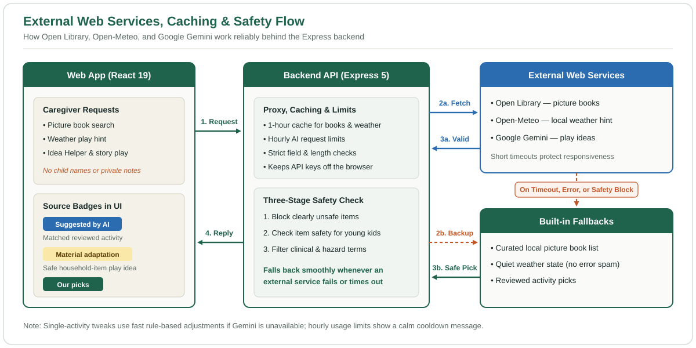

# CIT 210 — System Documentation: LittleSteps

**Course:** CIT 210 — Web Systems and Technologies  
**Institution:** West Visayas State University — College of Information and Communications Technology  
**Submitted By:** Acebuche, Nherie C.; Ardeña, Justin Ace D.; Benjamin, Mae Daniella Faith C.; Cadangin, Mark Alvin C.; Tamaño, Vincent John A. (BSIT-3A — Thesis Titans)  
**Submitted To:** Angelica Grace Simbran  
**Base Stack:** React 19.1 (`vite ^6.3.5`, TypeScript `~5.9.2`), Node.js 22 / Express 5.1, Cloud Firestore  
**Primary Repositories:** `Thesis-Titans/littlesteps-react`, `Thesis-Titans/littlesteps-api`  
**Related Specifications:** [CIT 210 Final Project Requirements](CIT210_Final_Project_Requirements.md), [API Reference](../../api-reference.md), [Demonstration Environment & Rehearsal Plan](demo-environment-and-rehearsal.md)

---

## Abstract

Caregivers of children aged 0 to 5 years frequently rely on smartphones to occupy toddlers during household routines despite guidance from the World Health Organization (WHO), the American Academy of Pediatrics (AAP), and the Philippine Early Childhood Care and Development (ECCD) Council recommending screen-free interactive play. Existing baby-tracking web applications are largely foreign, commercialized, or framed around clinical milestone scoring that induces parental anxiety. This documentation presents the design, implementation, and verification of **LittleSteps** — Play Planning and Observation Companion for Caregivers of Young Children — developed for **CIT 210 (Web Systems and Technologies)**. The web system pairs a **React 19 + TypeScript + Vite** single-page application (`littlesteps-react`) with a modular **Node.js 22 / Express 5** REST API gateway (`littlesteps-api`) hosted on **Firebase Cloud Functions (2nd Gen, asia-southeast1)** and backed by **Firebase Authentication** and **Cloud Firestore**. The API unifies caregiver-scoped CRUD operations with three external REST integrations: the **Open Library REST API** (proxied with a 60-minute TTL cache and deterministic local fallback for picture-book discovery and a saved Family Bookshelf), the **Open-Meteo Forecast API** (privacy-safe indoor/outdoor play hints using coordinates rounded to two decimal places), and the **Google Gemini REST API** (structured play recommendations, storybook companions, and activity adaptations protected by hourly rate limits, a circuit breaker, a three-layer pediatric safety pipeline, and deterministic catalog fallback). Security enforces Firebase ID Bearer tokens, strict Zod 4.1 schema validation, uniform error envelopes, and Broken Object Level Authorization (BOLA) protection returning `404` on unowned resources in alignment with the Philippine Data Privacy Act (RA 10173). Verification through automated unit, DOM, Supertest, and Firebase Emulator integration suites, an informal parent walkthrough, a five-evaluator Nielsen heuristic audit, and cloud deployment (`littlesteps-app-cict`) demonstrates stable client-server execution across desktop and mobile browser viewports.

**Keywords:** React web application, REST API integration, Express 5, Cloud Firestore, Open Library API, Open-Meteo API, guardrailed generative AI, early childhood care and development (ECCD), BOLA security, WCAG 2.2 AA.

---

## 1. Introduction

### 1.1 System Name and Background

**LittleSteps** — Play Planning and Observation Companion for Caregivers of Young Children.

Early childhood from birth to five years represents a critical period for cognitive, motor, language, and socio-emotional growth. Guidance from the World Health Organization (WHO, 2019), the American Academy of Pediatrics (AAP, 2016), and the Philippine Early Childhood Care and Development System Act (Republic Act No. 12199, 2025) emphasizes responsive adult-child interaction and active, screen-free play using everyday surroundings. In practice, parents and household caregivers in Western Visayas and across the Philippines often face two overlapping barriers: limited time to prepare age-appropriate home activities using ordinary household items, and paper notebooks or handouts that are easily misplaced.

Commercial parenting web portals and mobile apps rarely solve this problem cleanly for local families. Many target Western household routines, monetize child behavioral data, or present developmental checklists as pass/fail clinical scores that risk alarming caregivers. Others offer unconstrained chatbots that can return unsafe material suggestions or unverified medical advice.

LittleSteps addresses this gap by functioning as a **caregiver-facing planning and observation companion** rather than a child-facing screen game. An adult opens the web application on a phone or desktop browser, picks a short screen-free activity in under a minute, sets the device aside to play with the child, and optionally logs a private, non-diagnostic note afterwards.

### 1.2 Objectives

The LittleSteps web system was designed and built to meet five measurable engineering objectives aligned with the CIT 210 evaluation rubric:

1. **Dynamic REST API Integration:** Build a contract-first Express 5 REST API documented in OpenAPI 3.1 that integrates multi-tenant Cloud Firestore records with live external REST services (Open Library, Open-Meteo, and Google Gemini) using server-side proxying, TTL caching, and deterministic fallbacks.
2. **Responsive, Accessible React Interface:** Deliver an intuitive React 19 single-page application that adapts cleanly across desktop (`1280px`) and mobile (`375px–414px`) viewports, supports interactive search, multi-factor filtering, and dynamic rendering, and complies with WCAG 2.2 Level AA contrast and keyboard standards.
3. **Structured Server-Side Data Processing:** Enforce layered Express routing, Firestore multi-tenant data isolation (`/caregivers/{uid}/children/{childId}/...`), seeded Firestore catalog collections, and atomic transactions for quota and capacity limits.
4. **Strict Validation and Resilient Error Handling:** Validate all request payloads at the boundary with Zod 4.1, protect caregiver ownership against Broken Object Level Authorization (BOLA), and return uniform `{ error: { code, message, requestId } }` JSON envelopes paired with a five-state client UI matrix.
5. **Privacy-by-Design and Non-Diagnostic Framing:** Uphold the Philippine Data Privacy Act of 2012 (RA 10173) by minimizing child personal data, excluding private caregiver journal text from AI prompts and offline caches, supporting caregiver data export and permanent cascade deletion, and keeping all developmental records strictly observational rather than clinical.

### 1.3 Scope and Delimitations

Within **CIT 210 (Web Systems and Technologies)**, the system scope covers the **React web application** (`littlesteps-react`), the **shared Express REST API gateway** (`littlesteps-api`), the **Cloud Firestore data model and Firebase Authentication setup**, and the **three server-proxied external REST integrations** across six canonical caregiver capabilities:

- **FR-01:** Child profile management and non-diagnostic milestone observations.
- **FR-02:** Daily play planning (`Today`), one-tap completion with undo, and optional weather play hints.
- **FR-03:** Caregiver-isolated private observation journal.
- **FR-04:** Reviewed Philippine learning activity library, Open Library picture-book search, saved Family Bookshelf, and English/Filipino/Hiligaynon traditional rhymes.
- **FR-05:** Factual Monday–Sunday weekly reflection summary (`This week`).
- **FR-06:** Structured, guardrailed AI Idea Helper, storybook play companion, and activity adaptation with deterministic fallback.

**Delimitations and Course Boundaries:** LittleSteps is developed as a coordinated three-course capstone suite at West Visayas State University (WVSU-CICT). This CIT 210 documentation covers the React web client and shared Node.js/Express API. The companion Flutter mobile client is documented separately under **CC 207B**, and a simulated six-to-twelve-month municipal deployment management plan is documented separately under **CIT 246**. The system uses synthetic demo caregiver accounts during academic evaluation, does not store child photographs or exact birth dates, and does not provide clinical screening or medical diagnosis.

---

## 2. Methods

### 2.1 System Architecture and Technology Stack

LittleSteps employs a decoupled client-gateway-database architecture in which the React browser application communicates exclusively over HTTPS JSON with a centralized Express 5 API deployed on Firebase Cloud Functions (2nd Gen, `asia-southeast1`). Direct browser-to-Firestore reads and writes are avoided for business records so that schema validation, ownership checks, rate limits, and third-party API keys remain strictly enforced on the server. Fig. 1 illustrates the end-to-end web system and cloud topology, and Table 1 records the verified runtime and development dependencies from `littlesteps-react/package.json` and `littlesteps-api/package.json`.

  
*Fig. 1. LittleSteps web system architecture linking the React 19 client (`littlesteps-react`), Express 5 Cloud Functions gateway (`littlesteps-api`), Firebase Auth and Cloud Firestore, and server-proxied external REST APIs.*

*Table 1. System Technology Stack and Versions*

| Layer | Technology / Package | Version | Architectural Role |
|---|---|---|---|
| Web UI Framework | `react`, `react-dom` | `^19.1.1` | Component-based single-page application in `littlesteps-react` |
| Client Routing | `react-router-dom` | `^7.18.5` | Nested `ProtectedRoute`, `AppShell`, and `ChildGate` route hierarchy |
| Web Language & Bundler | `typescript`, `vite`, `@vitejs/plugin-react` | `~5.9.2`, `^6.3.5`, `^4.7.0` | Static type checking (`tsc -b`) and production ES module bundling |
| Client Auth SDK | `firebase` (Web SDK) | `^12.2.1` | Caregiver email/password sign-in and Bearer ID token lifecycle |
| Styling System | Plain CSS + Custom Properties | CSS3 (`tokens.css`) | Design-token variables, responsive layouts, and zero runtime CSS overhead |
| Backend Runtime & HTTP | Node.js, `express`, `firebase-functions` | Node `22`, `^5.1.0`, `^6.4.0` | Serverless HTTP gateway deployed in `asia-southeast1` |
| Validation & Security | `zod`, `helmet`, `cors` | `^4.1.0`, `^8.1.0`, `^2.8.5` | Strict request schema validation, HTTP security headers, and origin allowlisting |
| Persistence & Auth Admin | `firebase-admin` | `^13.5.0` | Server-side JWT verification and Cloud Firestore transactional CRUD |
| External Data & Weather | Open Library REST API; Open-Meteo REST v1 | Public REST JSON | Picture-book metadata proxy (60-min TTL) and coarse indoor/outdoor weather hints |
| External AI Service | Google Gemini REST API (`v1beta`) | `GEMINI_MODEL` env pin | Server-side structured JSON inference via Node 22 built-in `fetch` |
| Automated Verification | `vitest`, `@testing-library/react`, `supertest`, `firebase-tools` | `^3.2.7` / `^3.2.4`, `^16.3.3`, `^7.1.4`, `^14.12.0` | Unit, DOM, HTTP contract, and Auth/Firestore Emulator test execution |

### 2.2 Custom REST API Design and OpenAPI 3.1 Contract

The backend API is governed by a contract-first OpenAPI 3.1 specification (`littlesteps-api/openapi/openapi.yaml`) and mounted in `littlesteps-api/src/app.ts` as modular Express routers. Public probes (`/health`, `/ready`) and public catalog reads (`/api/v1/catalog/*`) require no token, while every caregiver, child, and AI endpoint passes through `requireFirebaseUser` to verify the `Authorization: Bearer <Firebase_ID_Token>` header via the Firebase Admin SDK. Table 2 summarizes the active endpoint catalog.

*Table 2. Canonical LittleSteps REST API Endpoints (`littlesteps-api`)*

| Domain | Method & Path | Auth | Primary Purpose |
|---|---|---|---|
| System Probes | `GET /health`, `GET /ready` | Public | Liveness check (`200`) and Firestore readiness verification (`200` / `503`) |
| Caregiver Account | `GET /api/v1/me`, `GET /api/v1/me/export`, `DELETE /api/v1/me` | Bearer | Authenticated UID lookup, full JSON account export, and permanent cascade deletion |
| Child Profiles | `GET`, `POST /api/v1/children`; `GET`, `PATCH`, `DELETE /api/v1/children/:childId` | Bearer | Multi-child CRUD, UTC age-band derivation on read, atomic 20-child cap, recursive delete |
| Daily Plans | `GET`, `POST /api/v1/children/:childId/plans`; `PATCH`, `DELETE .../plans/:planId` | Bearer | Daily scheduling with optional inline `customActivity` snapshots and status transitions |
| Milestones | `GET`, `POST /api/v1/children/:childId/milestones`; `PATCH .../milestones/:milestoneId` | Bearer | Non-diagnostic observations (`observed`, `not_yet_observed`, `not_sure`) |
| Private Journal | `GET`, `POST /api/v1/children/:childId/journal`; `PATCH`, `DELETE .../journal/:entryId` | Bearer | Caregiver-isolated qualitative reflections excluded from AI and offline caches |
| Family Bookshelf | `GET`, `POST /api/v1/children/:childId/books`; `DELETE .../books/:bookId` | Bearer | Child-scoped physical/favorite picture books saved from Open Library |
| Weekly Summary | `GET /api/v1/children/:childId/summary/weekly` | Bearer | Factual Monday–Sunday planned/completed totals and domain counts |
| Public Catalogs | `GET /api/v1/catalog/activities`, `/milestones`, `/rhymes` | Public | Seeded Firestore catalogs with 5-minute TTL caching and age/domain/language filters |
| External Proxies | `GET /api/v1/catalog/books`, `/catalog/books/search`, `/catalog/weather` | Public | Open Library picture-book browse/search (60-min cache) and Open-Meteo weather hint |
| Guardrailed AI | `POST /api/v1/ai/recommendations`, `/ai/story-activity`, `/ai/adapt` | Bearer + Rate Limit | Catalog-first play ideas, custom material adaptations, storybook companions, and tweaks |

### 2.3 External API Integration and Guardrailed AI Pipeline

A central requirement of CIT 210 is integrating external REST services in a way that enhances user efficiency while remaining resilient to upstream latency, rate limits, or outages. Fig. 2 traces all three external integrations implemented in `littlesteps-api`.

  
*Fig. 2. Server-side integration pipelines for Open Library, Open-Meteo, and Google Gemini with three-layer pediatric safety screening and deterministic fallbacks.*

#### Open Library REST API and Closed-Loop Family Bookshelf

In `src/catalog/catalog-service.ts`, the server proxies queries to the Internet Archive's Open Library REST API (`openlibrary.org/subjects/{subject}.json` and `openlibrary.org/search.json?q={query}`), passing an ASCII-sanitized `User-Agent` header and normalizing cover image URLs, author arrays, and subject tags into a consistent `BookItem` payload. Responses are cached in memory for **60 minutes** (`CACHE_TTL_MS = 3,600,000 ms`, capped at 100 entries to prevent memory exhaustion from arbitrary queries). If Open Library times out or returns an upstream error, the proxy serves a curated local fallback list (`books.fallback.ts`) with a short **60-second** TTL so recovery happens promptly once upstream connectivity returns. Caregivers can save books they own into the child's Firestore `books` subcollection (`Family Bookshelf`), request a screen-free play companion via `POST /api/v1/ai/story-activity`, and schedule that companion straight into `Today` with an inline `customActivity` snapshot.

#### Open-Meteo Forecast API (Privacy-Safe Weather Context)

In `src/catalog/weather-service.ts`, `GET /api/v1/catalog/weather` queries `api.open-meteo.com/v1/forecast` with a **3-second** abort timeout and a **60-minute** in-memory cache (up to 100 grid cells, defaulting to Iloilo City at `10.72, 122.56`). Before any upstream call or cache lookup, latitude and longitude are rounded to **two decimal places** (`roundCoordinate`, roughly 1.1 km precision), and no location history is ever stored in Firestore. The server maps WMO weather codes, 6-hour precipitation probability, and heat threshold (`>= 35 °C`) into a concise indoor or outdoor play hint. If Open-Meteo is unreachable, the service returns `NEUTRAL_WEATHER_FALLBACK` (`condition: "unavailable"`, `hint: null`) so the React `Today` screen stays calm without error clutter.

#### Google Gemini REST API and Three-Layer Pediatric Guardrails

All generative requests execute server-side through Node 22's built-in `fetch` against the Google Gemini REST API (`v1beta` `generateContent` endpoint) with a pinned environment model (`GEMINI_MODEL`) and an **8-second** abort timeout—no third-party Gemini SDK is installed, and `GEMINI_API_KEY` never enters the React client bundle. Requests are bounded by dual hourly rate limits in `src/ai/rate-limit.ts` (**10 requests/hour per authenticated user** backed by atomic Firestore transactions in `rate_limits/{uid}_{bucket}`, plus a **30 requests/hour per-IP** cap) and protected by `CircuitBreakerProvider` (`src/ai/providers/circuit-breaker.ts`), which opens for **60 seconds** after **3 consecutive provider failures** and probes recovery via a single half-open trial call.

When caregivers provide household materials outside the reviewed catalog (`allowCustom: true`), three defense-in-depth safety layers protect the child:

1. **Layer 1 — Thin Input Gate (`sanitize.ts`):** Rejects extreme dangers (such as bleach, knives, fire, and medicine) and prompt-injection probes while letting ordinary items, misspellings, and Filipino/Hiligaynon terms pass cleanly.
2. **Layer 2 — Structured Model Assessment (`prompt.ts` & `gemini.ts`):** Requires Gemini to evaluate every submitted item in a structured `materialAssessments` JSON array using pediatric safety rules before generating any play card, returning `source: "ai_custom"` with zero fabricated citations.
3. **Layer 3 — Deterministic Output Validator (`validate-output.ts`):** Validates catalog IDs against approved Firestore items and screens normalized output text against hazard keywords and a 33-term non-diagnostic denylist. Any validation slip, timeout, missing key, or open circuit breaker fails closed into **Tier 3 deterministic catalog fallback** (`fallback.ts`), returning reviewed activities labeled `"Our picks"` (while `/api/v1/ai/adapt` falls back to rule-based Tier 2 adaptations).

### 2.4 Data Persistence, Security, and Error-Handling Methodology

Cloud Firestore stores all caregiver-owned data under a multi-tenant subcollection hierarchy:

```text
/caregivers/{uid}
  └─ /children/{childId}
       ├─ /plans/{planId}
       ├─ /milestone_observations/{observationId}
       ├─ /journal_entries/{entryId}
       ├─ /books/{bookId}
       └─ /weekly_summaries/{weekStart}
```

Global educational catalogs (`catalog_activities` with 23 reviewed Philippine activities, `catalog_milestones` with 25 prompts across 6 age bands, and `catalog_rhymes` with 6 English, Filipino, and Hiligaynon traditional rhymes) are seeded into Firestore and cached in-process for 5 minutes. Every `children/:childId/*` route derives `uid` exclusively from the verified Firebase ID token and checks ownership under `/caregivers/{uid}/children/{childId}`. Following OWASP API1:2023 guidance on Broken Object Level Authorization (BOLA), missing IDs, malformed IDs, and another caregiver's child IDs all return the identical **`404 RESOURCE_NOT_FOUND`** envelope rather than `403`, preventing cross-account enumeration.

Express middleware in `src/app.ts` applies defense-in-depth controls globally: `requestIdMiddleware` attaches a traceable `X-Request-Id` header, `helmet()` hardens response headers, `Cache-Control: no-store` prevents sensitive caching on private routes, CORS enforces an explicit origin allowlist (`403 ORIGIN_NOT_ALLOWED`), and `express.json({ limit: "100kb", strict: true })` blocks oversized or malformed payloads (`413` / `400`). Strict Zod 4.1 schemas reject unrecognized fields, `null` values, Unicode control characters, and out-of-range dates (`422 UNPROCESSABLE_ENTITY`) prior to database lookup. Under RA 10173, `GET /api/v1/me/export` returns a portable JSON archive of the caregiver's records, and `DELETE /api/v1/me` executes recursive Firestore deletion before removing the Firebase Auth user.

### 2.5 Client-Side React Architecture and Usability Design

The React frontend (`littlesteps-react`) is structured by feature module (`src/features/{account,children,explore,journal,milestones,this-week,today}`) with shared layout primitives (`AppShell`, `ProtectedRoute`, `ChildGate`) and centralized client services (`src/services/api.ts`, `firebase.ts`, `offline.ts`, `weather.ts`). All authenticated requests pass through a typed Fetch wrapper that attaches the active Firebase Bearer token, propagates `X-Request-Id`, and normalizes server errors into calm caregiver messages.

Visual presentation is governed strictly by tokenized CSS custom properties (`src/styles/tokens.css` and per-feature stylesheets) with zero hardcoded hex colors or pixel magic numbers outside the token layer. The layout adapts responsively between a persistent desktop sidebar (`1280px`) and a 72 px mobile bottom navigation bar (`375px–414px`), meeting WCAG 2.2 AA requirements: darkened secondary ink (`#5A6A64` clearing 4.5:1 contrast), 48 × 48 px primary touch targets, visible 2 px `:focus-visible` outlines, polite `aria-live` status updates, and `prefers-reduced-motion` support. Every data-driven screen implements a complete **five-state UI matrix**: populated, empty, loading skeleton, inline error with Retry, and offline or AI fallback. A session-scoped offline cache (`offline.ts`) keeps recently fetched catalog items, plans, and saved books readable during connectivity drops while strictly excluding private journal notes.

### 2.6 Verification and Evaluation Methodology

System correctness and usability were evaluated through four complementary layers:

1. **Automated API and Security Testing:** Vitest and Supertest suites validate Zod boundary rejections, BOLA `404` non-leakage, atomic 20-child cap transactions, hourly rate limits, circuit-breaker state transitions, three-layer AI safety screening, journal-to-AI isolation, and live Firebase Auth + Firestore Emulator round-trips.
2. **Automated React Frontend Testing:** Vitest, jsdom, and React Testing Library verify route gating, Explore/Storybooks/Family Bookshelf flows, Today plan completion and Undo toast recovery, milestone and journal forms, weekly summary rendering, offline cache exclusions, and CSS token invariants.
3. **Informal Caregiver Walkthrough (ISO 9241-11):** An exploratory two-participant parent walkthrough on synthetic data (logged in Docs Issue #15) evaluated task completion across sign-in, activity selection, Undo recovery, observation logging, journal deletion, AI fallback comprehension, weekly totals, and storybook companions.
4. **Five-Evaluator Nielsen Heuristic & Accessibility Audit:** All five BSIT-3A members independently audited the React and Flutter clients across Nielsen's 10 usability heuristics and WCAG 2.2 AA checklists prior to final submission.

---

## 3. Results

### 3.1 Implemented Web Modules and Route Traceability

All six canonical functional requirements (FR-01..06) and supporting account/privacy workflows are implemented and routed inside `littlesteps-react/src/App.tsx`. Table 3 maps each implemented React route to its interactive capabilities and backend REST endpoints.

*Table 3. Implemented React Web Routes Mapped to Capabilities and REST Endpoints*

| Route | Screen Component | Key Interactive Capabilities | Primary REST Endpoints |
|---|---|---|---|
| `/today` | `TodayScreen` | Active child switcher, daily planned activities, 1-tap completion with 10 s Undo toast, symmetric indoor/outdoor Weather Hint CTA routing to Idea Helper | `GET/POST/PATCH/DELETE /children/:id/plans`, `GET /catalog/weather` |
| `/explore` | `ExploreScreen` | Symmetric quick filters (`Under 10 mins`, `No materials needed`, `Indoor`, `Outdoor`), search, 3-shelf Storybooks (`Open Library`, `Our Bookshelf`, `Read & Sing Together`), structured AI Idea Helper & Story Companion | `GET /catalog/activities`, `/catalog/rhymes`, `/catalog/books*`, `GET/POST/DELETE /children/:id/books`, `POST /ai/*` |
| `/milestones` | `MilestonesScreen` | Age-band developmental prompts grouped by play kind (`Thinking`, `Moving`, `Talking`, `Feelings`), status logging (`Seen on`, `Not seen yet`, `Not sure`) | `GET /catalog/milestones`, `GET/POST/PATCH /children/:id/milestones` |
| `/journal` | `JournalScreen` | Caregiver-only private reflections with clear privacy notice, create/edit/delete with named confirmation dialog, excluded from offline cache & AI | `GET/POST/PATCH/DELETE /children/:id/journal` |
| `/this-week` | `ThisWeekScreen` | Factual Monday–Sunday planned/completed counts, domain activity breakdown, recent observations, calm reflection prompt (zero scores or streaks) | `GET /children/:id/summary/weekly` |
| `/children`, `/children/:childId/edit` | `ChildrenScreen`, `EditChildScreen` | Multi-child creation and editing via nickname + birth month (`YYYY-MM`) or coarse age band, atomic 20-child limit, cascade delete | `GET/POST/PATCH/DELETE /children` |
| `/account`, `/account/*` | `AccountScreen`, `Settings`, `Privacy`, `About`, `Help` | Caregiver profile overview, RA 10173 privacy disclosure, one-click JSON data export, permanent account deletion, help and sign-out | `GET /me`, `GET /me/export`, `DELETE /me` |

### 3.2 API Integration and AI Fallback Outcomes

End-to-end client-server integration operates cleanly across all custom and external REST flows:

- **Open Library & Closed-Loop Bookshelf:** Searching `"food"` or browsing picture books on `/explore` invokes `GET /api/v1/catalog/books/search`, returns normalized cover cards cached for 60 minutes, persists selected physical books into `/caregivers/{uid}/children/{childId}/books`, generates a screen-free play companion via `POST /api/v1/ai/story-activity`, and adds the resulting activity directly into `/today` as a completable plan with an inline `customActivity` snapshot. Simulated upstream failures cleanly serve `books.fallback.ts` with a 60-second retry TTL without UI errors.
- **Open-Meteo Weather Context:** Requesting `/api/v1/catalog/weather` rounds coordinates to two decimal places, caches per grid cell for 60 minutes, and surfaces a calm indoor or outdoor banner on `/today` whose action opens the Idea Helper with `"Where will you play?"` preselected to match current weather. Upstream timeouts (`> 3 s`) return neutral unavailable metadata and silently hide the banner.
- **Guardrailed AI & Tier 3 Fallback:** Valid requests to `/api/v1/ai/recommendations` return catalog-matched suggestions (`source: "ai"`, badge `"Suggested by AI"`) or safety-screened custom material adaptations (`source: "ai_custom"`, badge `"Material adaptation"` with zero invented citations). Submitting hazardous items (e.g., `"bleach"`) or triggering timeout/unconfigured-key conditions deterministically falls back to reviewed Firestore catalog picks (`source: "fallback"`, badge `"Our picks"`).

### 3.3 Server-Side Validation, Security, and Error-Handling Outcomes

Automated security and boundary verification confirmed zero unauthenticated bypasses, zero cross-account BOLA disclosures, and consistent JSON error envelopes across every failure status. Table 4 summarizes the verified HTTP error contract and React client handling.

*Table 4. Standardized HTTP Error Envelope and Client Recovery Matrix*

| HTTP Status | Error Code | Trigger Condition | Client Recovery Behavior |
|---|---|---|---|
| `400` | `INVALID_INPUT` / `INVALID_JSON` | Malformed JSON, extra unknown fields, `null` values, control characters | Displays inline field-level feedback without clearing typed form input |
| `401` | `UNAUTHENTICATED` | Missing, expired, or invalid Firebase Bearer ID token | Redirects caregiver cleanly to sign-in via `ProtectedRoute` |
| `403` | `ORIGIN_NOT_ALLOWED` | Request sent from an origin outside `CORS_ORIGINS` | Blocked at Express CORS middleware before route execution |
| `404` | `RESOURCE_NOT_FOUND` | Missing route, malformed ID, missing child, or another caregiver's child (BOLA) | Shows calm not-found state without revealing cross-account existence |
| `413` | `PAYLOAD_TOO_LARGE` | JSON request body exceeds `100kb` server limit | Prompts caregiver to shorten input cleanly |
| `422` | `UNPROCESSABLE_ENTITY` | Birth month in future / > 71 months ago, > 20 children, observation date > UTC+1 day | Shows clear plain-language rule message next to the offending field |
| `429` | `RATE_LIMITED` | Exceeds 10 AI requests/hour per user or 30/hour per IP (`Retry-After` header set) | Displays calm cooldown notice and offers immediate reviewed catalog browsing |
| `500` / `503` | `INTERNAL_ERROR` / `SERVICE_UNAVAILABLE` | Unexpected failure, Firestore contention (`Retry-After: 1`), or failed `/ready` ping | Shows inline Retry action while preserving user form state; never leaks stack traces |

### 3.4 Usability, Accessibility, and Heuristic Evaluation Outcomes

The M0 caregiver walkthrough and five-evaluator Nielsen heuristic audit produced concrete, verified refinements across `littlesteps-react`:

1. **WCAG 2.2 AA Contrast Compliance:** Darkened secondary ink from `#63756E` to `#5A6A64` in `tokens.css` so all body and metadata text clears the 4.5:1 contrast threshold.
2. **Header Affordance Cleanup (ADR-014):** Removed the false-alert `.today-hero` callout banner and redundant greeting labels, folding the calm time-of-day greeting cleanly into the screen header subtitle.
3. **Standardized Iconography and Plain Voice:** Replaced informal emoji glyphs on user-facing screens with tokenized SVG icons (`src/assets/icons/`) and removed technical or clinical jargon (`catalog`, `assessment`, `analytics`, `score`, `streak`) from visible labels.
4. **Closed-Loop Task Efficiency:** Connected Open Library search, Family Bookshelf, and the Today Weather Hint directly into activity planning and Idea Helper preselection, reducing multi-step navigation friction.
5. **Honest Offline States:** Dropping browser connectivity displays a calm offline banner, serves session-cached plans/catalog/books, disables unsafe mutations without falsely claiming persistence, and leaves private journal notes uncached.

### 3.5 Cloud Deployment and Local Demonstration Verification

The web system runs cleanly in both orchestrated local demonstration and live cloud environments:

- **Live Cloud Deployment (`littlesteps-app-cict`):** `littlesteps-react` is deployed to Firebase Hosting (`https://littlesteps-app-cict.web.app`), communicating with `littlesteps-api` on Firebase Cloud Functions v2 (`asia-southeast1`) backed by seeded Cloud Firestore catalog collections (`catalog_activities`, `catalog_milestones`, `catalog_rhymes`) and verified via `/health` and `/ready`.
- **Deterministic Classroom Demo Orchestration:** A cross-platform launcher (`scripts/demo-cli/run-demo.mjs`) starts Firebase Auth, Firestore, and Functions emulators alongside Vite, runs `seed-catalog.mjs --emulator`, and populates a deterministic synthetic caregiver account (`littlesteps@demo.com` with sample child `Maya`, age band `12-23m`) so live presentation demos are immune to classroom Wi-Fi instability.

---

## 4. Discussion

### 4.1 Architectural Trade-offs

Three deliberate design trade-offs shaped the web system's stability and security:

1. **Centralized Express Gateway vs. Direct Browser-to-Firestore/AI Calls:** Routing all business operations through `littlesteps-api` adds one HTTP hop compared to direct client Firestore SDK queries, yet it delivers three decisive advantages: a single client-neutral REST contract shared across React (CIT 210) and Flutter (CC 207B), strict server-side isolation of Gemini credentials and BOLA checks, and consistent Zod validation + uniform error envelopes across every client.
2. **Structured AI Form vs. Open Free-Text Chatbot:** Constraining the Idea Helper to bounded form inputs (`ageBand`, `setting`, `timeMinutes`, `materials`, `language`) prevents prompt sprawl, enforces RA 10173 data minimization by schema, keeps selection under five seconds for busy caregivers, and allows deterministic Layer 1–3 safety validation with clean Tier 3 fallback.
3. **Bibliographic Open Library Cards + Local Rhymes vs. Hosting Full-Text Books:** Serving Open Library bibliographic metadata, covers, and saved Family Bookshelf entries respects external copyright while reinforcing screen-free shared reading of physical or library books, whereas six in-app traditional English, Filipino, and Hiligaynon rhymes support families who have no physical book on hand.

### 4.2 Known Limitations

Several operational boundaries remain transparently documented for evaluation:

- **Session-Only Web Offline Cache:** `littlesteps-react` caches catalog items, daily plans, and saved books in memory/session scope for temporary drops; full persistent offline mutation queuing across browser restarts is deferred.
- **Synthetic-Only Evaluation Boundary:** Academic demonstrations and free-tier Gemini API testing use strictly synthetic caregiver data (`littlesteps@demo.com`); onboarding real households requires a paid zero-data-retention AI tier and formal Data Protection Officer (DPO) sign-off.
- **Content Governance Sign-Off:** Catalog activities, milestones, and rhymes are source-checked against published WHO, AAP, and Philippine ECCD references, while formal faculty/ECCD adviser sign-off (`Docs Issue #3`) remains open prior to public release.
- **UI Chrome Language:** While catalog activities and rhymes support English, Filipino, and Hiligaynon (`en`, `fil`, `hil`), static web navigation labels and settings copy are currently English-only.

### 4.3 Future Enhancements and Conclusion

Planned post-course enhancements include persistent IndexedDB offline caching with background sync reconciliation, complete Filipino and Hiligaynon UI chrome localization, formal ECCD adviser sign-off on an expanded catalog, and a paid Gemini API tier with DPO privacy review ahead of any community pilot.

In conclusion, **LittleSteps** fulfills the CIT 210 Web Systems and Technologies objectives by uniting an accessible React 19 interface with a secure, contract-verified Express 5 REST API, multi-tenant Cloud Firestore storage, and three resilient external REST integrations (Open Library, Open-Meteo, and Google Gemini). Through strict server-side validation, BOLA protection, deterministic fallbacks, and calm non-diagnostic UX, the platform demonstrates how modern web architecture can serve early-childhood caregivers safely and reliably.

---

## References

American Academy of Pediatrics Council on Communications and Media. (2016). Media and young minds. *Pediatrics*, 138(5), e20162591. https://doi.org/10.1542/peds.2016-2591

Express.js. (2025). *Express 5 API reference*. OpenJS Foundation. https://expressjs.com/en/5x/api.html

Google Firebase. (2025). *Cloud Functions for Firebase (2nd generation) and Cloud Firestore documentation*. https://firebase.google.com/docs

Google AI for Developers. (2025). *Gemini API REST reference (v1beta)*. https://ai.google.dev/api

Internet Archive. (2025). *Open Library Developer Center: Subjects and Search REST APIs*. https://openlibrary.org/developers/api

International Organization for Standardization. (2018). *Ergonomics of human-system interaction — Part 11: Usability: Definitions and concepts* (ISO Standard No. 9241-11:2018).

Nielsen, J. (1994). *10 usability heuristics for user interface design*. Nielsen Norman Group. https://www.nngroup.com/articles/ten-usability-heuristics/

OpenAPI Initiative. (2021). *OpenAPI Specification v3.1.0*. Linux Foundation. https://spec.openapis.org/oas/v3.1.0

Open-Meteo. (2025). *Weather Forecast API documentation (CC BY 4.0)*. https://open-meteo.com/en/docs

OWASP Foundation. (2023). *OWASP API Security Top 10:2023 — API1:2023 Broken Object Level Authorization*. https://owasp.org/API-Security/

React Team. (2025). *React 19 documentation*. Meta Platforms, Inc. https://react.dev/

Republic of the Philippines. (2012). *Data Privacy Act of 2012* (Republic Act No. 10173). Official Gazette of the Republic of the Philippines.

Republic of the Philippines. (2025). *Early Childhood Care and Development (ECCD) System Act* (Republic Act No. 12199). Official Gazette of the Republic of the Philippines.

World Health Organization. (2019). *Guidelines on physical activity, sedentary behaviour and sleep for children under 5 years of age*. World Health Organization. https://www.who.int/publications/i/item/9789241550536

World Wide Web Consortium (W3C). (2023). *Web Content Accessibility Guidelines (WCAG) 2.2*. https://www.w3.org/TR/WCAG22/
