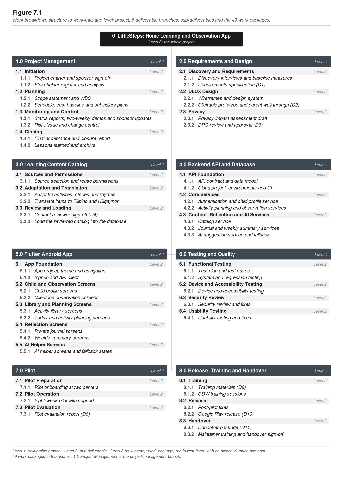
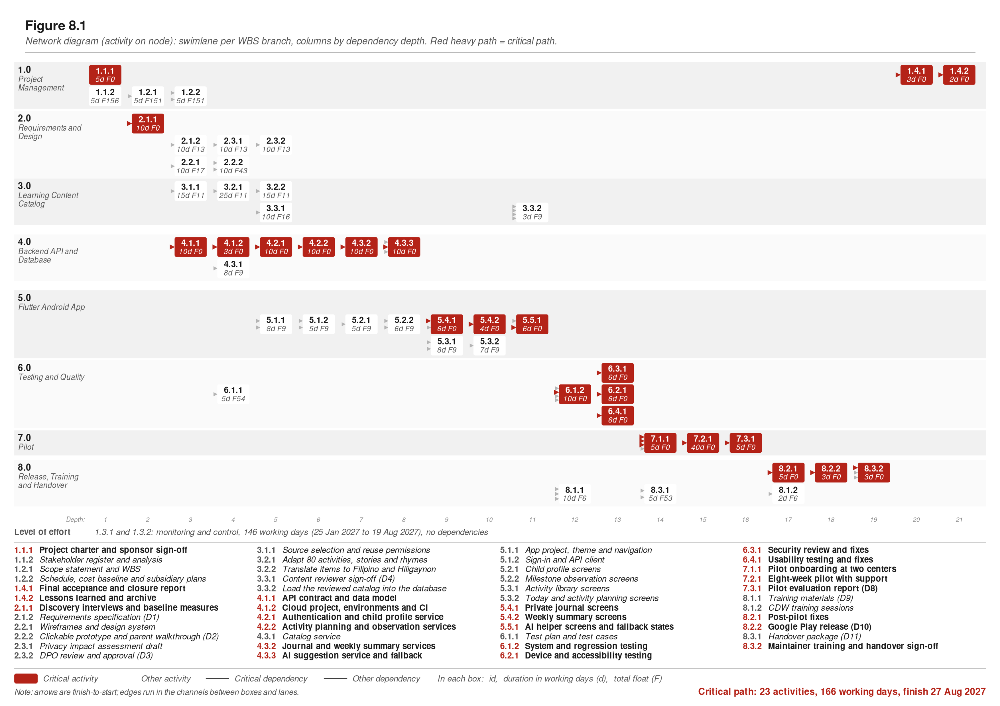
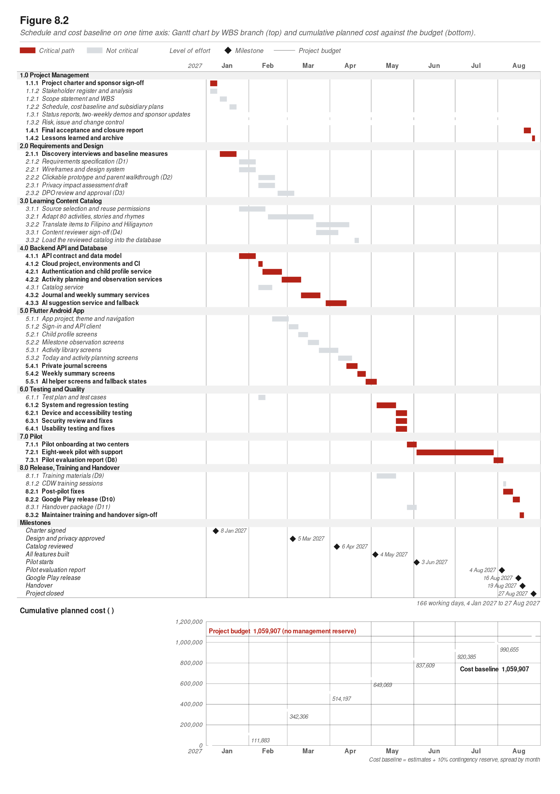
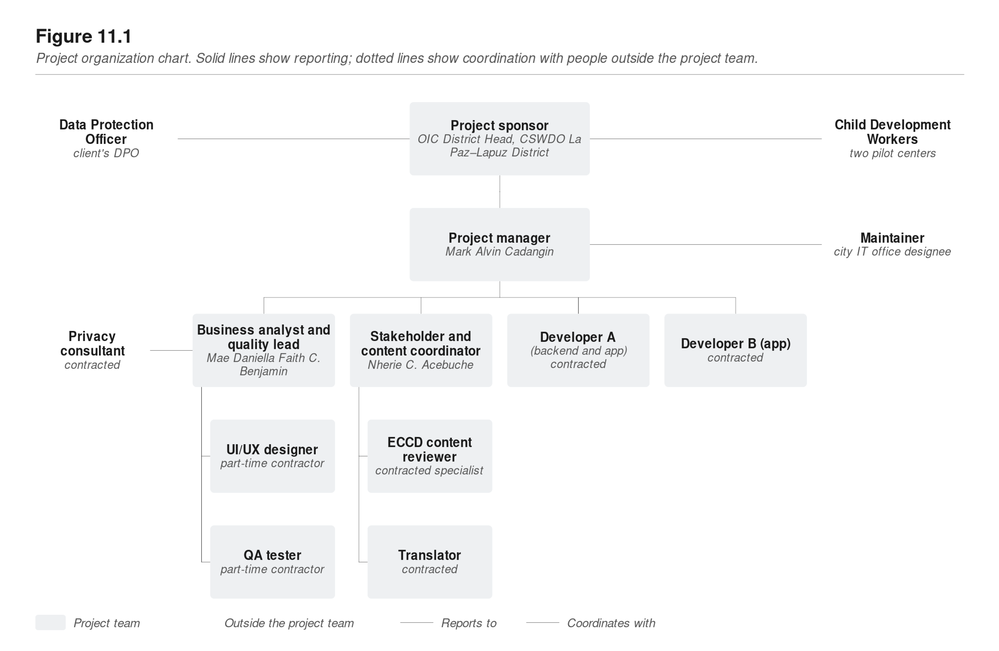
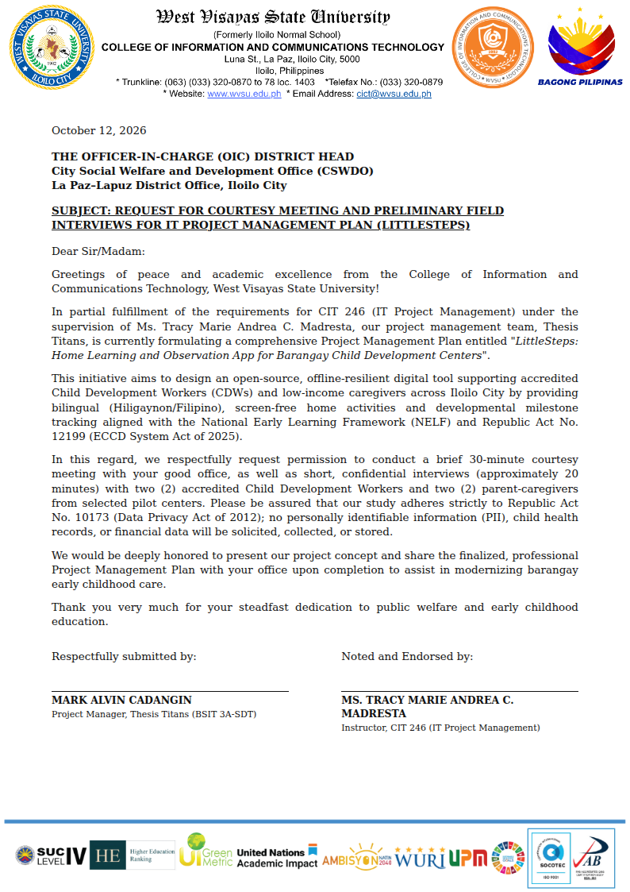

# LittleSteps: Home Learning and Observation App for Barangay Child Development Centers

## Project Management Plan

**Client Organization**  
Iloilo City Social Welfare and Development Office (CSWDO)  
La Paz–Lapuz District Office, Iloilo City

**Submitted by**  
Thesis Titans  
Mark Alvin Cadangin  
Mae Daniella Faith C. Benjamin  
Nherie C. Acebuche  
BSIT 3A-SDT

**Submitted to**  
Ms. Tracy Marie Andrea C. Madresta  
Instructor, CIT 246 IT Project Management  
College of Information and Communications Technology, West Visayas State University

The OIC District Head  
CSWDO La Paz–Lapuz District Office  
Project Sponsor

**Date of Submission**  
2 December 2026

## Table of Contents

1. Title Page
2. Executive Summary
3. Project Background and Business Case
4. Project Charter
5. Stakeholder Register and Analysis
6. Scope Statement
7. Work Breakdown Structure
8. Schedule
9. Cost Estimate and Budget
10. Quality Management Plan
11. Resource and Responsibility Plan
12. Communications Plan
13. Risk Register
14. Procurement Plan
15. Change Control and Closing Plan
16. Conclusion
17. Appendices (A. Client Contact; B. Documents From the Current Process; C. Individual Contribution Statement; D. Schedule and Cost Data; E. References)

## List of Figures

| Figure | Title | Section |
|---|---|---|
| 7.1 | Work breakdown structure to work-package level | 7.1 |
| 8.1 | Network diagram with the critical path | 8.3 |
| 8.2 | Gantt chart and cumulative cost baseline | 8.4 |
| 11.1 | Project organization chart | 11.1 |

## Abbreviations

| Term | Meaning |
|---|---|
| AI | Artificial intelligence; here, a large language model service used only to suggest catalog activities |
| API | Application programming interface: the server the app talks to |
| BAC | Bids and Awards Committee of the local government |
| CDC | Child Development Center, run by the barangay |
| CDW | Child Development Worker |
| CSWDO | City Social Welfare and Development Office |
| DASMO | Data Assessment and Systems Management Office, Iloilo City's IT office |
| DPO | Data Protection Officer under the Data Privacy Act of 2012 |
| ECCD | Early childhood care and development |
| EMV | Expected monetary value: probability × cost impact of a risk |
| FTE | Full-time equivalent; 1 FTE is one person working full time |
| LGU | Local government unit |
| NELF | National Early Learning Framework of the ECCD Council |
| NPV, ROI | Net present value; return on investment |
| OIC | Officer-in-charge |
| PERT | Program Evaluation and Review Technique (three-point estimate) |
| QA | Quality assurance |
| RACI | Responsible, Accountable, Consulted, Informed |
| RA | Republic Act |
| ROM | Rough order of magnitude (estimate) |
| SUS | System Usability Scale, a standard 10-question usability survey scored 0–100 |
| WBS | Work breakdown structure |
| WCAG | Web Content Accessibility Guidelines |

# 2. Executive Summary

**The problem.** Parents in Iloilo City's La Paz and Lapuz districts get learning-at-home ideas from their Child Development Center through printed handouts, notebooks and group chats. Home records get lost, parents run out of low-cost activity ideas, and popular baby apps are foreign and often show diagnostic-style scores. We estimate each center loses about 8 children's home records a year, and each Child Development Worker (CDW) spends about 80 hours a school year preparing handouts.

**The proposed system.** LittleSteps is a free Flutter app (one codebase, piloted on Android) for parents and other caregivers of children aged 0–5. They keep a private record of what they notice, plan screen-free activities from 80 reviewed Philippine activities, stories and rhymes, see a factual weekly summary, and ask an AI helper for ideas that fit their materials. It never scores or labels a child, and journal notes never leave the parent's account.

**The cost.** A cost baseline of **₱1,059,907**: ₱963,552 estimated bottom-up from 49 work packages plus a 10% contingency reserve of ₱96,355. Running costs after handover are about ₱5,000 a month.

**The duration.** Eight months, **4 January to 27 August 2027** (166 working days), including an eight-week pilot at two Child Development Centers in La Paz from 3 June to 28 July 2027.

**What the organization gains.** Parents keep their child's home record and get ideas using what they have. CDWs spend less time on handouts: across the district's 37 centers, at most about 2,960 CDW hours and ₱166,500 in printing a year, with a project target of a 50% cut in handout time. The office gets a tested tool, reviewed for data privacy, that supports the city's duties under the ECCD System Act of 2025 and can extend to other districts. The charter sets eight measurable success criteria, including 30 pilot households and a usability score of at least 70. If the city extends the app to all its centers, the five-year net present value is about ₱668,000 (ROI 41%, payback in about 3.1 years); the district alone does not repay the cost, so the pilot is the first step of a citywide rollout (Section 3.6).

**What we ask.** The OIC District Head is asked to approve the charter, budget and schedule, commit CDWs' time for the pilot, and have a maintainer named by May 2027.

*Per-center figures are from the October 2026 interviews (Appendix A).*

# 3. Project Background and Business Case

## 3.1 The Organization

The client is the **Iloilo City Social Welfare and Development Office (CSWDO), La Paz–Lapuz District office**, which supervises the barangay Child Development Centers (CDCs) and their Child Development Workers (CDWs) in the La Paz and Lapuz districts. The project pilots at **two CDCs in La Paz barangays** chosen with the office. CDCs run the early childhood care and development (ECCD) program for children below five under Republic Act No. 12199, the ECCD System Act of 2025.

**The district.** La Paz has 25 barangays (population 58,098 in 2024) and Lapuz has 12 (31,603), so the office serves 37 barangays and about 89,700 people. With roughly one center per barangay, the district has **37 centers**.

**The city.** Iloilo City has 7 districts, 180 barangays and about 474,000 people (2024), and reports **more than 200 operating ECCD centers** (January 2026). 

**The legal setting.** The implementing rules of RA 12199, signed on 5 August 2026, require every city to set up a local **ECCD office** and keep child care facilities running. ECCD may be funded from local funds, the Special Education Fund and the Gender and Development Fund. The new city ECCD office is the natural owner of any citywide rollout.

**The workforce.** Nationally there are about 89,000 child development workers against an estimated need of 240,000, and many lack up-to-date training, so a tool must save CDW time.

**How the center handles the problem today.** Each center runs daily early-learning sessions and tracks each child with the ECCD Checklist. Home-learning ideas reach parents through printed handouts, notebooks and group chats, and home observations live in paper notebooks and loose sheets. There is no record a caregiver can keep or bring to a pediatrician or health worker.

## 3.2 The Problem

Parents of children aged 0–5, and the grandparents or guardians who help some of them, want to support learning at home, but their tools are scattered and easy to lose:

1. **Observation records are fragmented and get lost.** Notebooks and loose sheets are misplaced, so neither parent nor CDW has a continuous picture of the child.
2. **Parents run out of low-cost, screen-free ideas.** Without age-appropriate activities using household materials, families fall back on phone or TV time.
3. **Available apps are unsafe or misleading.** Popular baby-tracking apps are rarely in Filipino or Hiligaynon, may monetize children's data, and often show pseudo-clinical scores that cause anxiety without being valid screening tools.

### Quantifying the problem

Figures are per-center values reported in the October 2026 interviews (Appendix A).

| Measure | Per-center figure |
|---|---|
| Children enrolled at each pilot CDC | 30 across two sessions (60 across both pilot centers) |
| Families with an Android smartphone | 70% of enrolled families |
| Home-learning notebooks lost or not brought back per school year | 1 in 4 families |
| CDW time preparing and sharing home-activity handouts | 2 hours a week |
| Printing cost of handouts | ₱150 per family per school year |
| Parents who lack activity ideas at least once a week | 1 in 2 |

At these estimates, one CDC loses about 8 children's home records a year, a CDW spends about 80 hours a school year (40 weeks × 2 hours) on handouts, and printing costs about ₱4,500 a year per center. Across the district's 37 centers, that is roughly 296 lost records, 2,960 CDW hours and ₱166,500 in printing every school year. For the city's 200 or more centers: roughly 1,600 lost records, 16,000 CDW hours and ₱900,000 a year.

## 3.3 Options Considered

| Option | What it means | One-time cost (rough) | Main drawback |
|---|---|---|---|
| **A. Do nothing** | Keep notebooks, handouts, group chats | ₱0 | Every problem in §3.2 continues |
| **B. Improve the paper process** | A printed booklet with an activity bank and observation log | About ₱40,000 to design, plus about ₱4,500 a year per center to print (₱900,000 a year for 200 centers) | Still lost or damaged; no search; reprinted yearly; ideas not tailored to a family's materials |
| **C. Recommend an existing commercial app** | Point parents to a free foreign baby app | ₱0 to the center | Not Philippine content or languages; unclear data use under the Data Privacy Act of 2012 (RA 10173); diagnostic-style scores |
| **D. Build LittleSteps (recommended)** | A Flutter app with a reviewed Philippine activity catalog, private observation journal and constrained AI activity helper | About ₱1.17 million over 8 months (§3.5); refined bottom-up in Section 9 | Highest cost; needs a maintainer |

### Weighted scoring

Scores run from 1 (poor) to 10 (strong); the team's criteria will be re-weighted with the sponsor (§3.7).

| Criterion | Weight | A. Do nothing | B. Paper booklet | C. Commercial app | D. LittleSteps |
|---|---|---|---|---|---|
| Lasting, private record for each family | 25% | 2 | 4 | 6 | 9 |
| Philippine, low-cost, age-banded content | 20% | 3 | 7 | 3 | 9 |
| Data protection (RA 10173), no diagnostic labels | 20% | 6 | 8 | 3 | 9 |
| Cost to the organization | 20% | 10 | 6 | 9 | 3 |
| Fits parents' phones, time, languages | 15% | 4 | 6 | 5 | 8 |
| **Weighted score** | **100%** | **4.90** | **6.10** | **5.25** | **7.65** |

## 3.4 Recommendation

**Build LittleSteps (Option D).** It scores highest because it alone gives parents a record they keep, Philippine activity content searchable by materials at hand, and protection against diagnostic labels and misuse of children's data. Option B is the fallback: if the sponsor cannot fund Option D, the reviewed catalog can be printed as a booklet.

The project is justified on cost-effectiveness, not revenue. The measures in §3.2 are the benefit baseline: the project succeeds if the pilot reduces lost records and CDW handout time and caregivers use the app weekly (see the charter's success criteria).

## 3.5 Cost and Benefit Summary

**Rough order-of-magnitude estimate (−50% to +100%)**, made before the WBS existed. Section 9 replaces it with a definitive, bottom-up estimate of **₱1,059,907**, 9.2% lower and inside this range.

| Cost item | Amount |
|---|---|
| Project manager (1 × 8 months × ₱40,000) | ₱320,000 |
| Flutter and backend developers (2 × 7 months × ₱30,000) | ₱420,000 |
| UI/UX designer (half time × 4 months × ₱30,000) | ₱60,000 |
| QA tester (half time × 4 months × ₱25,000) | ₱50,000 |
| ECCD content reviewer honorarium | ₱60,000 |
| Data privacy review | ₱50,000 |
| Cloud and AI services (6 × ₱5,000) | ₱30,000 |
| Three Android test phones | ₱30,000 |
| Pilot and training logistics | ₱40,000 |
| Google Play developer registration | ₱1,500 |
| **Subtotal** | **₱1,061,500** |
| Contingency reserve (10%) | ₱106,150 |
| **Total** | **₱1,167,650** |

**Benefits (upper bounds, if the app fully replaces handouts):** per center, about 80 CDW hours and ₱4,500 in printing a year, and 8 fewer lost records. The charter targets a 50% cut in CDW handout time, about 40 hours per center. Section 3.6 values these benefits over five years.

**Running cost after handover:** about ₱5,000 a month for cloud and AI services at pilot scale, plus a maintainer's time (named in Section 15).

## 3.6 Financial Analysis

The analysis uses the bottom-up cost of ₱1,059,907 (Section 9) as the year-0 investment, a five-year horizon and a 10% discount rate, the hurdle rate the NEDA Board set for public investments in 2016. ROI is (discounted benefits − discounted costs) ÷ discounted costs.

**Basis of the figures.** Two benefits are counted in pesos: printing no longer needed by the 70% of families with Android phones (₱4,500 × 70% = ₱3,150 per center a year), and 40 CDW hours a year per center (the charter's 50% target) valued at ₱30 an hour, the rate implied by the roughly ₱5,000 monthly pay of non-permanent CDWs reported by UNICEF. That is ₱4,350 per center a year. Fewer lost records, better home activities and data protection are not priced. Running costs rise with the number of centers, and onboarding each new center costs ₱1,500 for a CDW orientation and printed guides.

**Rollout scenario.** The district's 37 centers use the app in year 1; the city ECCD office extends it to 100 centers in year 2 and to all 200 in year 3.

| Year | Centers | Benefits | Costs | Net cash flow | Discount factor (10%) | Cumulative net (undiscounted) |
|---|---:|---:|---:|---:|---:|---:|
| 0 (2027) | 2 (pilot) | ₱0 | ₱1,059,907 | −₱1,059,907 | 1.0000 | −₱1,059,907 |
| 1 (2028) | 37 | ₱160,950 | ₱60,000 | ₱100,950 | 0.9091 | −₱958,957 |
| 2 (2029) | 100 | ₱435,000 | ₱184,500 | ₱250,500 | 0.8264 | −₱708,457 |
| 3 (2030) | 200 | ₱870,000 | ₱270,000 | ₱600,000 | 0.7513 | −₱108,457 |
| 4 (2031) | 200 | ₱870,000 | ₱120,000 | ₱750,000 | 0.6830 | ₱641,543 |
| 5 (2032) | 200 | ₱870,000 | ₱120,000 | ₱750,000 | 0.6209 | ₱1,391,543 |

Year-2 and year-3 costs include training the 63 and 100 new centers (₱94,500 and ₱150,000).

| Measure | Result |
|---|---|
| Discounted benefits | ₱2,293,889 |
| Discounted costs | ₱1,626,259 |
| **Net present value** | **₱667,630** |
| **Return on investment** | **41.1%** |
| **Payback period** | **About 3.1 years** (during 2031) |

**Sensitivity.** If the app stays in the district's 37 centers, the five-year NPV is about −₱700,000 and the project never pays back in money. Valuing CDW time at the Western Visayas minimum wage instead of CDW pay raises the citywide NPV; delaying each rollout step by a year lowers it to about ₱156,000. The project is therefore justified as the tested first stage of a citywide service, which is why the city ECCD office is engaged as a future owner (Section 5) and the maintainer comes from the city's IT office (Section 15). Its non-financial benefits (children's records kept, privacy protected, no diagnostic labels) carry most of the weight in the weighted scoring in §3.3.

## 3.7 Basis of This Case

- **Client contact.** The team wrote to the district office on 12 October 2026, met the OIC District Head on 27 October and interviewed two CDWs and two parents on 28 and 29 October. The District Head wants a no-fee solution run by existing staff and a monthly summary report; the office has not committed funding, pilot centers or dates (Appendix A, Section 17).
- **Sourced:** city and district size, ECCD center numbers, the legal setting and workforce figures (Appendix E). **Estimated:** the per-center figures in §3.2, the district's center count, the cost rates in §3.5 and the option scores in §3.3.
- **Confirmation:** in discovery interviews in the first two weeks (WBS 2.1.1, January 2027), confirm the sponsor, pilot centers and funding source (local funds, the two funds above or a grant), and re-score the options with the sponsor's weights. Re-run the financial analysis with the confirmed figures.

# 4. Project Charter

| Field | Entry |
|---|---|
| **Project title** | LittleSteps: Home Learning and Observation App for Barangay Child Development Centers |
| **Client organization** | Iloilo City Social Welfare and Development Office (CSWDO), La Paz–Lapuz District office; pilot at two Child Development Centers in La Paz |
| **Authorization date** | On sponsor sign-off (target: 8 January 2027, the end of work package 1.1.1) |
| **Project start date** | 4 January 2027 (charter preparation; no spending before sign-off other than the team's time) |
| **Projected finish date** | 27 August 2027 (8 months) |
| **Budget** | ₱1,059,907 cost baseline: ₱963,552 in estimates plus a 10% contingency reserve of ₱96,355 (Section 9) |
| **Project manager** | Mark Alvin Cadangin, Thesis Titans, WVSU College of Information and Communications Technology, Luna St., La Paz, Iloilo City; markalvin.cadangin@wvsu.edu.ph |

## 4.1 Key Schedule Milestones

| Milestone | Target date |
|---|---|
| Charter signed | 8 January 2027 |
| Design and privacy impact assessment approved | 5 March 2027 |
| 80 catalog items reviewed | 6 April 2027 |
| Features built; testing starts | 4–5 May 2027 |
| Pilot at two Child Development Centers in La Paz | 3 June–28 July 2027 |
| Pilot evaluation report | 4 August 2027 |
| App published on Google Play | 16 August 2027 |
| CDW training complete; handover | 19 August 2027 |
| Project closed; lessons learned | 27 August 2027 |

## 4.2 Project Objectives

1. Give parents and other caregivers of children aged 0–5 a free Flutter app (Android for the pilot) that keeps a private record of home observations and suggests low-cost, screen-free activities.
2. Build a reviewed catalog of Philippine early-learning activities, stories and rhymes.
3. Protect data under the Data Privacy Act of 2012 (RA 10173), with no diagnostic scores or labels.
4. Hand over a running system, trained CDWs and a maintainer.

## 4.3 Success Criteria

The project succeeds when all criteria are met by the finish date, within budget plus or minus 10% and schedule plus or minus two weeks:

| # | Criterion | Measure | Measured by |
|---|---|---|---|
| 1 | Adoption | At least 30 households across two centers install the app and create a child profile | App records (no names) |
| 2 | Weekly use | At least 60% of pilot households use the app in 4 or more of the 8 weeks | Anonymous usage counts |
| 3 | Records kept | At least 70% of households record 4 or more observations or activities | App records (no names) |
| 4 | Usability | System Usability Scale (SUS) average of 70 or higher; 85% task success on five core tasks | SUS survey, test sheets |
| 5 | Content | At least 80 catalog items covering four domains and every age band, each with source and reviewer sign-off; none unreviewed | Catalog review log |
| 6 | Privacy, security | Privacy impact assessment approved by the Data Protection Officer; no open high-severity security findings | Signed assessment, review report |
| 7 | CDW workload | CDW handout time falls at least 50% against the Section 3 baseline | CDW time log |
| 8 | Handover | A named maintainer can deploy an update unaided after training | Signed handover checklist |

## 4.4 Approach

- **Kick off.** Hold a kick-off meeting in the week after the charter is signed, with the sponsor, team, CDW representatives and, once contracted, the developers, to agree objectives, roles and how the project communicates (Section 12).
- **Discover first.** In the first two weeks, interview the OIC District Head, CDWs and parents to confirm the Section 3 baseline.
- **Privacy by design.** Approve a privacy impact assessment before collecting real data. Store only a nickname, an age band or birth month and year, and caregiver records. Never send journal text or child identifiers to the AI service.
- **Content only.** The reviewer approves every catalog item before parents see it.
- **Iterative build.** Build in two-week iterations, each ending with a district office demo, using synthetic data until the pilot.
- **Pilot before launch.** Run an 8-week pilot, measure the criteria and fix top issues before publishing.
- **Plan the handover early.** Name the maintainer by May 2027 and involve them in the last two iterations.

## 4.5 Roles and Responsibilities

| Role | Name | Responsibility |
|---|---|---|
| Project sponsor | OIC District Head, CSWDO La Paz–Lapuz (by role) | Approves charter, budget and major changes; accepts deliverables |
| Project manager | Mark Alvin Cadangin | Controls scope, schedule, cost, risk; reports to the sponsor; chairs change control |
| Business analyst and quality lead | Mae Daniella Faith C. Benjamin | Requirements, acceptance, testing |
| Stakeholder and content coordinator | Nherie C. Acebuche | Stakeholder engagement, CDW and parent sessions, content review, training |
| Flutter and backend developers (2), UI/UX designer, QA tester | To be contracted | Build, design and test |
| ECCD content reviewer | To be identified | Signs off every catalog item |
| Data Protection Officer | To be identified | Reviews the privacy impact assessment |
| Child Development Workers | Pilot center staff | Recommend the app, onboard parents |
| Maintainer | To be named by May 2027 | Runs and updates the system after handover |

## 4.6 Sign-off

| Name | Role | Signature | Date |
|---|---|---|---|
| | Project sponsor | | |
| Mark Alvin Cadangin | Project manager | | |
| Mae Daniella Faith C. Benjamin | Business analyst and quality lead | | |
| Nherie C. Acebuche | Stakeholder and content coordinator | | |

## 4.7 Stakeholder Comments

At the meeting on 27 October 2026 the OIC District Head wanted a no-fee solution run by existing staff, asked who answers parents' complaints and who maintains the system, and asked for a monthly summary report (Appendix A.5). Comments on the charter will be recorded at its review with the sponsor and CDWs. Expected concerns:

- CDWs will ask whether the app adds reporting work. It does not; they only recommend it and run onboarding (Section 5).
- The Data Protection Officer must approve how children's data is stored before the pilot (success criterion 6).

# 5. Stakeholder Register and Analysis

## 5.1 Stakeholder Register

Influence is how much the stakeholder can change the project's direction, funding or adoption; interest is how much the outcome affects them.

| # | Stakeholder | Relationship to the project | What they want | Influence | Why this influence level | Interest |
|---|------------------------------|------------------------------|------------------------------------------|------------|------------------------------------------|------------|
| 1 | OIC District Head, CSWDO La Paz–Lapuz District office | **Project sponsor**; supervises the district's centers and CDWs | Home help for families without extra CDW work; evidence it works before going citywide | High | Approves charter, budget and changes; chooses pilot centers; assigns CDWs' time | High |
| 2 | CSWDO city head office | Oversees all district offices and the city's 200+ centers | Fit with the city's ECCD program, data protection, sustainable cost | High | Can overrule the district on funds and policy; its endorsement decides adoption elsewhere | Medium |
| 3 | Punong Barangay and Barangay Council | Funds and hosts the barangay center | Visible benefit at low cost; no data or reputation problems; may prefer funds go elsewhere | High | Controls the center's budget line | Low |
| 4 | CDWs at the pilot centers | Recommend the app, onboard parents | Less handout work; no extra reporting; trusted content | Medium | No control of funding, but caregivers adopt what CDWs recommend | High |
| 5 | Parents of enrolled children, and other caregivers (grandparents, relatives, guardians) | **Primary users** are parents; other caregivers are secondary users | Simple, free, private help in their language; ideas using what they have; no judgement | Medium | Individually low, but adoption (criteria 1–3) depends on them | High |
| 6 | Data Protection Officer (barangay or city) | Reviews the privacy impact assessment | RA 10173 compliance: minimal data, clear consent, defined retention | High | Can stop the pilot if data handling is not approved (criterion 6) | Medium |
| 7 | ECCD content reviewer | Signs off catalog content | Accurate, age-appropriate, sourced activities; no milestone claims as screening | Medium | No catalog item reaches caregivers without sign-off | Medium |
| 8 | Barangay Health Workers and rural health unit nurse | Receive parents who have concerns about a child | Parents referred to them when worried, not alarmed by an app | Low | No formal role, but their advice affects caregivers' trust | Medium |
| 9 | Senior CDW who prefers the paper system | Experienced pilot-center CDW; **may prefer the project did not happen** | Keep paper checklist and handouts; avoid a new tool and measurement by app usage | Medium | Respected by CDWs and parents; if they discourage families, uptake falls (§5.3) | High |
| 10 | Contracted developers, designer, QA tester | Build and test the system | Clear requirements, stable scope, prompt payment | Low | Replaceable; affect quality, not direction | Medium |
| 11 | Project team (Mark Alvin Cadangin, Mae Daniella Faith C. Benjamin, Nherie C. Acebuche) | Core team | Deliver on scope, time and budget; a plan the sponsor approves | Medium | Run the plan but answer to the sponsor | High |
| 12 | WVSU CICT faculty adviser (course instructor) | Reviews the plan before it goes to the client | A complete, defensible plan that follows the standard formats | Medium | Approves the plan for submission; review feedback can change it | Medium |
| 13 | Iloilo City ECCD office (required by the RA 12199 rules) | Likely sponsor or co-sponsor once set up; plans and funds city ECCD | Tools showing the city meets its ECCD duties; low cost | High | Will control ECCD planning and funds (including the Special Education and Gender and Development Funds) and decide citywide rollout | High |
| 14 | DILG, Iloilo City field office | Monitors city ECCD compliance (Seal of Good Local Governance) | Evidence that ECCD services keep improving | Low | No say over the project; shapes how the city values ECCD tools | Low |

## 5.2 Power/Interest Grid

High influence means High in §5.1; higher interest means High or Medium.

| | Low interest | Higher interest |
|---|---|---|
| **High influence** | **Keep satisfied:** Barangay Council (3) | **Manage closely:** District Head (1), city office (2), DPO (6), city ECCD office (13) |
| **Lower influence** | **Monitor:** DILG (14) | **Keep informed:** CDWs (4), parents (5), reviewer (7), health workers (8), senior CDW (9), contractors (10), team (11), faculty adviser (12) |

## 5.3 Managing the Stakeholder Who Prefers the Project Did Not Happen

The shortage of CDWs and their uneven pay and training (Section 3.1) make resistance to extra work likely. The senior CDW (stakeholder 9) has probably run home-learning support on paper for years and may see the app as extra work and a way to judge CDWs by usage. Because families listen to them, their quiet resistance could stall the pilot. The team will meet them in the first two weeks, before the charter review, to hear their concerns and ask them to co-review the activity catalog. The plan will state in writing that app usage is never used to evaluate CDWs and that the app adds no reporting duty. The paper process stays available for families without smartphones. The sponsor will invite them to co-lead one parent onboarding session, and the project manager will check their view at each two-week demo and raise unresolved concerns with the sponsor rather than work around them.

## 5.4 Next Steps

- Stakeholders are identified by role. The District Head (1), two CDWs (4) and two parents (5) were consulted in October 2026 (Appendix A); the rest is the team's analysis.
- In the first two weeks, confirm the sponsor, whether the city ECCD office (13) exists, and whether a pilot CDW holds the view described for stakeholder 9; adjust §5.3 accordingly.
- Carry engagement levels into the Communications Plan (Section 12).

# 6. Scope Statement

**Scope statement version 1.2, 21 November 2026**

## 6.1 Project Title and Justification

**LittleSteps: Home Learning and Observation App for Barangay Child Development Centers.** Parents of children aged 0–5 lose home notebooks, run out of low-cost ideas, and are offered apps that may misuse data or show diagnostic-style scores. Section 3 recommends building LittleSteps.

## 6.2 Product Scope Description

LittleSteps is a free **Flutter app**, one codebase for Android, iOS and the web, used by parents and other caregivers, backed by a small **Node.js/TypeScript API** with **Firebase Authentication** and **Cloud Firestore**. It has six features:

| # | Feature | What the parent can do |
|---|---|---|
| 1 | Child profile and milestone observations | Add a child by nickname and birth month and year (or age band); record "observed" or "not yet observed" for age-appropriate prompts, with date and note. No scores or labels. |
| 2 | Daily activity planning | Plan today's activities, mark them complete, undo a mistaken tap. |
| 3 | Private observation journal | Write dated notes only the writer can see; never sent to the AI service, analytics or error logs. |
| 4 | Learning activity library | Search reviewed activities, stories and rhymes by age band, domain, language and materials. |
| 5 | Weekly summary | See a factual count of activities and observations, with no judgement. |
| 6 | AI activity helper | Describe time and materials; get suggestions from the reviewed catalog only, with a rule-based fallback if the AI service fails. |

"Caregiver" means the signed-in account holder. Supporting functions: sign-in, settings, privacy notice, help pages. The interface is in English and Filipino; catalog items are also in Hiligaynon where reviewed.

## 6.3 Deliverables

**Project management deliverables:** the other sections of this plan, status reports, change log, pilot evaluation report and lessons-learned report.

| # | Deliverable | User acceptance criteria | Accepted by |
|---|---|---|---|
| D1 | Requirements specification | Covers all features; every requirement testable; signed by sponsor | Sponsor |
| D2 | UI design and clickable prototype | All screens and their error and offline states; tested with at least 5 parents and 2 CDWs; top findings resolved | Sponsor, CDW representative |
| D3 | Privacy impact assessment | Data items, purposes and retention listed; consent and deletion flows defined; approved before the pilot | Data Protection Officer |
| D4 | Reviewed activity catalog | At least 80 items across four domains (cognitive, motor, language, social-emotional) and every age band, each with source, reviewer and date | ECCD content reviewer |
| D5 | Backend API and database | Every request authenticated; no caregiver can read or change another's data (tested); automated tests pass | PM, QA tester |
| D6 | Flutter app (Android release for the pilot) | Runs on Android 10+ with 3 GB of RAM; all six features pass tests; core screens load within 3 seconds on 4G; WCAG 2.2 AA contrast; touch targets of at least 48 pixels | Sponsor after QA sign-off |
| D7 | Test reports | Functional, device, security and usability results; no open high-severity defects | Quality lead |
| D8 | Pilot evaluation report | Pilot results against charter criteria 1–4 and 7 | Sponsor |
| D9 | Training materials | CDW guide and parent quick-start sheet in English, Filipino and Hiligaynon; every pilot CDW trained | OIC District Head |
| D10 | Google Play release | Listing with privacy notice; release signed with the client's key | Sponsor |
| D11 | Handover package | Repositories, runbook, admin guide and credentials transferred; maintainer deploys one update unaided | Maintainer, sponsor |

## 6.4 Not Included

Explicitly **outside** the project:

- Apple App Store release; public web version.
- Dashboards or reports showing individual families' data to CDWs, the barangay or the welfare office.
- Developmental screening, diagnosis, scores, pass/fail labels or comparisons between children.
- Replacing the official ECCD Checklist, or integration with government or barangay systems.
- Sharing records between caregivers or with a CDW.
- Offline saving and syncing.
- Push notifications, reminders, messaging or chat; photo, video or audio uploads; payments.
- Creating new early-learning content beyond adapting existing sources; buying phones or data plans.
- Hosting and maintenance after handover (the maintainer's budget).

## 6.5 Constraints

- **Budget:** a cost baseline of ₱1,059,907 (₱963,552 in estimates plus a ₱96,355 contingency reserve); changes above ₱50,000 need the sponsor's approval (Section 15).
- **Duration:** 4 January to 27 August 2027 (166 working days).
- **Law and policy:** the Data Privacy Act of 2012 (RA 10173); the ECCD System Act of 2025 (RA 12199) and its rules signed on 5 August 2026.
- **Platform:** pilot released on Android, on entry-level phones with intermittent data.
- **Content:** no item is shown to parents until the reviewer approves it with a recorded source and reuse permission.
- **AI service:** the paid Gemini tier or Vertex AI is required before real parents use the AI helper, because the free tier lets Google use prompts.
- **Team:** two contracted developers; part-time design and QA.

## 6.6 Assumptions

- The district office names two pilot centers in La Paz, and their CDWs attend two training sessions and the two-weekly demos.
- At least 30 pilot households have an Android phone with weekly data or Wi-Fi (Section 3.2).
- ECCD Council and DepEd materials can be adapted with attribution, subject to the reviewer's check.
- A Data Protection Officer reviews the privacy impact assessment within two weeks.
- Cloud and AI prices stay within 20% of October 2026 levels.
- A maintainer (Section 15) is available from the project midpoint.

## 6.7 References to Supporting Documents

- Business case and project charter (Sections 3 and 4) for the justification, objectives and success criteria.
- Data Privacy Act of 2012 (RA 10173) and the National Privacy Commission's rules, for deliverable D3.
- ECCD System Act of 2025 (RA 12199) and its implementing rules, for the client's duties.
- ECCD Council's National Early Learning Framework and ECCD Checklist, the reference for catalog domains and age bands (D4).
- WCAG 2.2 (Web Content Accessibility Guidelines), level AA, for the app's accessibility criteria (D6).
- Google Play developer policies, for the store release (D10).

# 7. Work Breakdown Structure

## 7.1 WBS (indented list)

Level 1 is a deliverable branch, level 2 a sub-deliverable and level 3 a work package, the lowest level, which has an owner, a duration and a cost. Every deliverable in the scope statement (D1–D11) appears in a work package, and nothing falls outside the scope (the 100% rule).

**0. LittleSteps: Home Learning and Observation App** (the whole project)

- **1.0 Project Management**
  - **1.1 Initiation**
    - 1.1.1 Project charter and sponsor sign-off
    - 1.1.2 Stakeholder register and analysis
  - **1.2 Planning**
    - 1.2.1 Scope statement and WBS
    - 1.2.2 Schedule, cost baseline and subsidiary plans
  - **1.3 Monitoring and Control**
    - 1.3.1 Status reports, two-weekly demos and sponsor updates
    - 1.3.2 Risk, issue and change control
  - **1.4 Closing**
    - 1.4.1 Final acceptance and closure report
    - 1.4.2 Lessons learned and archive
- **2.0 Requirements and Design**
  - **2.1 Discovery and Requirements**
    - 2.1.1 Discovery interviews and baseline measures
    - 2.1.2 Requirements specification (D1)
  - **2.2 UI/UX Design**
    - 2.2.1 Wireframes and design system
    - 2.2.2 Clickable prototype and parent walkthrough (D2)
  - **2.3 Privacy**
    - 2.3.1 Privacy impact assessment draft
    - 2.3.2 DPO review and approval (D3)
- **3.0 Learning Content Catalog**
  - **3.1 Sources and Permissions**
    - 3.1.1 Source selection and reuse permissions
  - **3.2 Adaptation and Translation**
    - 3.2.1 Adapt 80 activities, stories and rhymes
    - 3.2.2 Translate items to Filipino and Hiligaynon
  - **3.3 Review and Loading**
    - 3.3.1 Content reviewer sign-off (D4)
    - 3.3.2 Load the reviewed catalog into the database
- **4.0 Backend API and Database**
  - **4.1 API Foundation**
    - 4.1.1 API contract and data model
    - 4.1.2 Cloud project, environments and CI
  - **4.2 Core Services**
    - 4.2.1 Authentication and child profile service
    - 4.2.2 Activity planning and observation services
  - **4.3 Content, Reflection and AI Services**
    - 4.3.1 Catalog service
    - 4.3.2 Journal and weekly summary services
    - 4.3.3 AI suggestion service and fallback
- **5.0 Flutter Android App**
  - **5.1 App Foundation**
    - 5.1.1 App project, theme and navigation
    - 5.1.2 Sign-in and API client
  - **5.2 Child and Observation Screens**
    - 5.2.1 Child profile screens
    - 5.2.2 Milestone observation screens
  - **5.3 Library and Planning Screens**
    - 5.3.1 Activity library screens
    - 5.3.2 Today and activity planning screens
  - **5.4 Reflection Screens**
    - 5.4.1 Private journal screens
    - 5.4.2 Weekly summary screens
  - **5.5 AI Helper Screens**
    - 5.5.1 AI helper screens and fallback states
- **6.0 Testing and Quality**
  - **6.1 Functional Testing**
    - 6.1.1 Test plan and test cases
    - 6.1.2 System and regression testing
  - **6.2 Device and Accessibility Testing**
    - 6.2.1 Device and accessibility testing
  - **6.3 Security Review**
    - 6.3.1 Security review and fixes
  - **6.4 Usability Testing**
    - 6.4.1 Usability testing and fixes
- **7.0 Pilot**
  - **7.1 Pilot Preparation**
    - 7.1.1 Pilot onboarding at two centers
  - **7.2 Pilot Operation**
    - 7.2.1 Eight-week pilot with support
  - **7.3 Pilot Evaluation**
    - 7.3.1 Pilot evaluation report (D8)
- **8.0 Release, Training and Handover**
  - **8.1 Training**
    - 8.1.1 Training materials (D9)
    - 8.1.2 CDW training sessions
  - **8.2 Release**
    - 8.2.1 Post-pilot fixes
    - 8.2.2 Google Play release (D10)
  - **8.3 Handover**
    - 8.3.1 Handover package (D11)
    - 8.3.2 Maintainer training and handover sign-off

*Figure 7.1. WBS chart: the project, 8 branches, level-2 groups and all 49 work packages.*

## 7.2 WBS Dictionary

Six work packages: the riskiest and those on the critical path. Each entry gives what is included and not included, the owner, the output, the duration, the cost and how it is accepted.

### 2.2.2 Clickable prototype and parent walkthrough (D2)

| Field | Entry |
|---|---|
| Included | Clickable prototype of every screen and its empty, loading, error and offline states; a walkthrough with at least five parents and two CDWs; a findings log; fixes to the design. |
| Not included | Building the app; visual design of marketing material. |
| Owner | UI/UX designer, with the business analyst |
| Output | Approved prototype (D2) and walkthrough findings |
| Duration | 10 working days, 8–19 February 2027 |
| Cost | ₱24,300 |
| Acceptance | Sponsor and a CDW representative approve it in writing; no severity 1–2 finding open |

### 3.2.1 Adapt 80 activities, stories and rhymes

| Field | Entry |
|---|---|
| Included | Adapting 80 activities, stories and rhymes from permitted sources into the catalog format: age band, domain, materials, steps, duration and source. |
| Not included | Writing new early-learning content; translation (3.2.2); review (3.3.1). |
| Owner | Stakeholder and content coordinator |
| Output | 80 draft catalog items with source records |
| Duration | 25 working days, 15 February–19 March 2027 |
| Cost | ₱38,700 |
| Acceptance | All 80 items have every catalog field and a source record, checked by the business analyst before review |

### 4.3.3 AI suggestion service and fallback

| Field | Entry |
|---|---|
| Included | Server-side AI suggestion endpoint using the paid Gemini tier; prompts with non-identifying constraints only; schema validation against approved catalog IDs; rule-based fallback; rate limits; tests. |
| Not included | Any AI use of journal text or child identifiers; model training. |
| Owner | Developer A |
| Output | AI suggestion service with tests |
| Duration | 10 working days, 29 March–12 April 2027 |
| Cost | ₱13,650 |
| Acceptance | In 100% of test cases suggestions come only from approved catalog items; the fallback answers when the AI service is off; no child identifier appears in any prompt (test log) |

### 6.4.1 Usability testing and fixes

| Field | Entry |
|---|---|
| Included | Moderated tests of the five core tasks with six parents; System Usability Scale; fixing the top usability issues. |
| Not included | The pilot itself (7.2.1). |
| Owner | Business analyst and quality lead |
| Output | Usability test report and fixes |
| Duration | 6 working days, 19–26 May 2027 |
| Cost | ₱16,380 |
| Acceptance | SUS of 70 or higher and at least 85% task success; report accepted by the project manager |

### 7.2.1 Eight-week pilot with support

| Field | Entry |
|---|---|
| Included | Eight weeks of use by at least 30 households at two La Paz centers; weekly check-ins with CDWs; support and small fixes; anonymous usage counts; CDW handout-time log. |
| Not included | Recruiting beyond the two pilot centers; marketing. |
| Owner | Stakeholder and content coordinator |
| Output | Pilot data for the evaluation report |
| Duration | 40 working days, 3 June–28 July 2027 |
| Cost | ₱80,080 |
| Acceptance | Usage counts and CDW time logs complete for all eight weeks and at least 30 households |

### 8.3.2 Maintainer training and handover sign-off

| Field | Entry |
|---|---|
| Included | Paired sessions in which the maintainer deploys an update, rotates credentials and restores a backup; handover of accounts and the signing key; signed handover checklist. |
| Not included | Maintenance after the handover date. |
| Owner | Project manager, with Developer A |
| Output | Signed handover checklist (success criterion 8) |
| Duration | 3 working days, 17–19 August 2027 |
| Cost | ₱5,925 |
| Acceptance | The maintainer deploys one update unaided; checklist signed by the maintainer and the sponsor |

# 8. Schedule

## 8.1 Software and Calendar

- **Software:** Project scheduling, critical path analysis (CPM forward and backward passes), and resource leveling are maintained using ProjectLibre / Microsoft Project and standardized project management workbooks. Schedule baseline tracking, milestone logs, network diagrams, and cost-loaded Gantt charts are synchronized directly from this schedule baseline model.
- **Calendar:** 4 Jan 2027 to 27 Aug 2027, 166 working days (Monday to Friday). Holidays excluded: Maundy Thursday (25 March), Good Friday (26 March), Araw ng Kagitingan (9 April) and Iloilo City Charter Day (25 August). Holidays set by proclamation are not in the calendar; a weekday proclamation may move later dates by a day without changing the order of work.
- **Resources:** two developers. Developer A builds the backend (4.1.2–4.3.3), then the journal, weekly summary and AI helper screens (5.4–5.5). Developer B builds the catalog service (4.3.1), then the remaining screens (5.1–5.3). The schedule never needs more than two developers on the same day.

## 8.2 Activity List

Each activity is a WBS work package; all dates are in 2027. Basis of the duration estimate: Analog. (analogous, from the team's 2026 prototype of the same app), Param. (parametric, from a unit count and rate), Expert (expert judgment), LOE (level of effort) and Fixed (set by the pilot design). Float is the number of working days an activity can slip without delaying the finish; zero-float activities form the critical path (**bold**). Work packages 1.3.1 and 1.3.2 run from the end of planning to the start of closing and have no float.

| WBS | Activity | Days | Basis | Predecessors | Start | Finish | Float | Cost (₱) |
|---------|------------------------------------------------|-----:|---------|------------------|---------|---------|-----:|-----------:|
| **1.1.1** | **Project charter and sponsor sign-off** | 5 | Analog. | — | 4 Jan | 8 Jan | 0 | 12,512 |
| 1.1.2 | Stakeholder register and analysis | 5 | Analog. | — | 4 Jan | 8 Jan | 156 | 6,375 |
| 1.2.1 | Scope statement and WBS | 5 | Analog. | 1.1.1 | 11 Jan | 15 Jan | 151 | 7,280 |
| 1.2.2 | Schedule, cost baseline and subsidiary plans | 5 | Analog. | 1.2.1, 1.1.2 | 18 Jan | 22 Jan | 151 | 7,280 |
| 1.3.1 | Status reports, two-weekly demos and sponsor updates | 146 | LOE | — | 25 Jan | 19 Aug | — | 79,716 |
| 1.3.2 | Risk, issue and change control | 146 | LOE | — | 25 Jan | 19 Aug | — | 53,144 |
| **1.4.1** | **Final acceptance and closure report** | 3 | Analog. | 8.3.2 | 20 Aug | 24 Aug | 0 | 7,508 |
| **1.4.2** | **Lessons learned and archive** | 2 | Analog. | 1.4.1 | 26 Aug | 27 Aug | 0 | 6,280 |
| **2.1.1** | **Discovery interviews and baseline measures** | 10 | Param. | 1.1.1 | 11 Jan | 22 Jan | 0 | 30,040 |
| 2.1.2 | Requirements specification (D1) | 10 | Param. | 2.1.1 | 25 Jan | 5 Feb | 13 | 13,650 |
| 2.2.1 | Wireframes and design system | 10 | Analog. | 2.1.1 | 25 Jan | 5 Feb | 17 | 17,745 |
| 2.2.2 | Clickable prototype and parent walkthrough (D2) | 10 | Analog. | 2.2.1, 2.1.2 | 8 Feb | 19 Feb | 43 | 24,300 |
| 2.3.1 | Privacy impact assessment draft | 10 | Expert | 2.1.2 | 8 Feb | 19 Feb | 13 | 60,465 |
| 2.3.2 | DPO review and approval (D3) | 10 | Expert | 2.3.1 | 22 Feb | 5 Mar | 13 | 1,820 |
| 3.1.1 | Source selection and reuse permissions | 15 | Param. | 2.1.1 | 25 Jan | 12 Feb | 11 | 19,125 |
| 3.2.1 | Adapt 80 activities, stories and rhymes | 25 | Param. | 3.1.1 | 15 Feb | 19 Mar | 11 | 38,700 |
| 3.2.2 | Translate items to Filipino and Hiligaynon | 15 | Param. | 3.2.1 | 22 Mar | 14 Apr | 11 | 53,738 |
| 3.3.1 | Content reviewer sign-off (D4) | 10 | Param. | 3.2.1 | 22 Mar | 6 Apr | 16 | 63,825 |
| 3.3.2 | Load the reviewed catalog into the database | 3 | Analog. | 3.3.1, 3.2.2, 4.3.1, 5.3.2 | 19 Apr | 21 Apr | 9 | 2,048 |
| **4.1.1** | **API contract and data model** | 10 | Analog. | 2.1.1 | 25 Jan | 5 Feb | 0 | 27,300 |
| **4.1.2** | **Cloud project, environments and CI** | 3 | Analog. | 4.1.1 | 8 Feb | 10 Feb | 0 | 14,095 |
| **4.2.1** | **Authentication and child profile service** | 10 | Analog. | 4.1.2 | 11 Feb | 24 Feb | 0 | 13,650 |
| **4.2.2** | **Activity planning and observation services** | 10 | Analog. | 4.2.1 | 25 Feb | 10 Mar | 0 | 13,650 |
| 4.3.1 | Catalog service | 8 | Analog. | 4.1.1 | 8 Feb | 17 Feb | 9 | 10,920 |
| **4.3.2** | **Journal and weekly summary services** | 10 | Analog. | 4.2.2 | 11 Mar | 24 Mar | 0 | 13,650 |
| **4.3.3** | **AI suggestion service and fallback** | 10 | Analog. | 4.3.2, 4.3.1, 2.3.2 | 29 Mar | 12 Apr | 0 | 13,650 |
| 5.1.1 | App project, theme and navigation | 8 | Analog. | 2.2.1, 4.3.1 | 18 Feb | 1 Mar | 9 | 10,920 |
| 5.1.2 | Sign-in and API client | 5 | Analog. | 5.1.1, 4.2.1 | 2 Mar | 8 Mar | 9 | 6,825 |
| 5.2.1 | Child profile screens | 5 | Analog. | 5.1.2 | 9 Mar | 15 Mar | 9 | 6,825 |
| 5.2.2 | Milestone observation screens | 6 | Analog. | 5.2.1, 4.2.2 | 16 Mar | 23 Mar | 9 | 8,190 |
| 5.3.1 | Activity library screens | 8 | Analog. | 5.2.2, 4.3.1 | 24 Mar | 6 Apr | 9 | 10,920 |
| 5.3.2 | Today and activity planning screens | 7 | Analog. | 5.3.1 | 7 Apr | 16 Apr | 9 | 9,555 |
| **5.4.1** | **Private journal screens** | 6 | Analog. | 4.3.3, 5.1.2 | 13 Apr | 20 Apr | 0 | 8,190 |
| **5.4.2** | **Weekly summary screens** | 4 | Analog. | 5.4.1 | 21 Apr | 26 Apr | 0 | 5,460 |
| **5.5.1** | **AI helper screens and fallback states** | 6 | Analog. | 5.4.2, 2.2.2 | 27 Apr | 4 May | 0 | 8,190 |
| 6.1.1 | Test plan and test cases | 5 | Param. | 2.1.2 | 8 Feb | 12 Feb | 54 | 5,675 |
| **6.1.2** | **System and regression testing** | 10 | Param. | 5.3.2, 5.5.1, 3.3.2, 6.1.1 | 5 May | 18 May | 0 | 25,000 |
| **6.2.1** | **Device and accessibility testing** | 6 | Param. | 6.1.2 | 19 May | 26 May | 0 | 39,267 |
| **6.3.1** | **Security review and fixes** | 6 | Expert | 6.1.2 | 19 May | 26 May | 0 | 9,282 |
| **6.4.1** | **Usability testing and fixes** | 6 | Param. | 6.1.2 | 19 May | 26 May | 0 | 16,380 |
| **7.1.1** | **Pilot onboarding at two centers** | 5 | Param. | 6.2.1, 6.3.1, 6.4.1, 8.1.1 | 27 May | 2 Jun | 0 | 29,105 |
| **7.2.1** | **Eight-week pilot with support** | 40 | Fixed | 7.1.1 | 3 Jun | 28 Jul | 0 | 80,080 |
| **7.3.1** | **Pilot evaluation report (D8)** | 5 | Analog. | 7.2.1 | 29 Jul | 4 Aug | 0 | 9,555 |
| 8.1.1 | Training materials (D9) | 10 | Param. | 3.3.1, 5.3.2, 5.5.1 | 5 May | 18 May | 6 | 36,845 |
| 8.1.2 | CDW training sessions | 2 | Param. | 7.3.1 | 5 Aug | 6 Aug | 6 | 3,642 |
| **8.2.1** | **Post-pilot fixes** | 5 | Expert | 7.3.1 | 5 Aug | 11 Aug | 0 | 16,488 |
| **8.2.2** | **Google Play release (D10)** | 3 | Analog. | 8.2.1 | 12 Aug | 16 Aug | 0 | 4,640 |
| 8.3.1 | Handover package (D11) | 5 | Analog. | 6.3.1, 6.4.1 | 27 May | 2 Jun | 53 | 8,872 |
| **8.3.2** | **Maintainer training and handover sign-off** | 3 | Param. | 8.2.2, 8.3.1, 8.1.2 | 17 Aug | 19 Aug | 0 | 5,925 |

### Three-point estimates

The three activities whose length depends most on people outside the team were also estimated with the three-point (PERT) formula, expected duration = (O + 4M + P) ÷ 6, in working days. Each expected value is the duration used in the schedule.

| Activity | Optimistic (O) | Most likely (M) | Pessimistic (P) | Expected | Standard deviation (P − O) ÷ 6 |
|---|---:|---:|---:|---:|---:|
| 2.3.2 DPO review and approval (D3) | 6 | 9 | 18 | 10 | 2.0 |
| 3.3.1 Content reviewer sign-off (D4) | 7 | 9 | 17 | 10 | 1.7 |
| 8.2.1 Post-pilot fixes | 3 | 5 | 7 | 5 | 0.7 |

## 8.3 Network Diagram and Critical Path

Activity-on-node diagram: each box shows the WBS number and duration, and arrows are finish-to-start dependencies.

*Figure 8.1. Network diagram by WBS branch (rows) and dependency depth (columns). Red boxes and heavy arrows are the critical path; levels of effort 1.3.1 and 1.3.2 are shown as a bar outside the network.*

**Critical path:** 1.1.1 → 2.1.1 → 4.1.1 → 4.1.2 → 4.2.1 → 4.2.2 → 4.3.2 → 4.3.3 → 5.4.1 → 5.4.2 → 5.5.1 → 6.1.2 → (6.2.1, 6.3.1 and 6.4.1 in parallel) → 7.1.1 → 7.2.1 → 7.3.1 → 8.2.1 → 8.2.2 → 8.3.2 → 1.4.1 → 1.4.2 = 166 working days.

**Why this is the critical path.** The longest chain runs through Developer A's work: the API contract, cloud setup, the four backend services, then the journal, weekly summary and AI helper screens. The AI service (4.3.3) cannot start until the Data Protection Officer approves the privacy impact assessment and the journal service exists. Testing, the fixed eight-week pilot, its evaluation, release and handover then follow in sequence. The catalog and screen path (3.x and 5.1–5.3) has 9–11 days of float (16 for reviewer sign-off) and the design path 13–17 days (43 for the clickable prototype). A delay there moves the finish date only if it exceeds that float. A slip is most likely to hurt in the backend services and at the pilot start, so these get the closest weekly tracking (Section 12).

**Schedule compression.** If a critical activity slips, the project manager first uses **crashing**: Developer B joins Developer A on the backend services (4.2.2–4.3.3) for up to 9 days, the float on Developer B's screen path (5.1–5.3), so the screens do not become critical; extra developer days cost ₱1,365 each and come from the contingency reserve. If that is not enough, **fast tracking**: the journal and summary screens (5.4.1–5.4.2) start against the agreed API contract before 4.3.3 is finished, accepting some rework if the API changes. The eight-week pilot (7.2.1) is never shortened, because success criteria 1–3 are measured over it.

## 8.4 Gantt Chart

*Figure 8.2. Gantt chart (red bars are on the critical path; diamonds are milestones) with the cumulative cost baseline (S-curve, including the contingency reserve) and the project budget on the same time axis.*

## 8.5 Milestones

Each milestone has zero duration and is met only when the named person confirms it in writing.

| Milestone | Date | Marks the end of | Confirmed in writing by |
|---|---|---|---|
| Charter signed | 8 Jan 2027 | 1.1.1 Project charter and sponsor sign-off | Sponsor |
| Design and privacy approved | 5 Mar 2027 | 2.3.2 DPO review and approval (D3) | Data Protection Officer; sponsor for the prototype |
| Catalog reviewed | 6 Apr 2027 | 3.3.1 Content reviewer sign-off (D4) | ECCD content reviewer |
| All features built | 4 May 2027 | 5.5.1 AI helper screens and fallback states | Quality lead |
| Pilot starts | 3 Jun 2027 | 7.1.1 Pilot onboarding at two centers; first day of 7.2.1 | Sponsor |
| Pilot evaluation report | 4 Aug 2027 | 7.3.1 Pilot evaluation report (D8) | Sponsor |
| Google Play release | 16 Aug 2027 | 8.2.2 Google Play release (D10) | Sponsor |
| Handover | 19 Aug 2027 | 8.3.2 Maintainer training and handover sign-off | Maintainer and sponsor |
| Project closed | 27 Aug 2027 | 1.4.2 Lessons learned and archive | Sponsor |

# 9. Cost Estimate and Budget

All amounts are in Philippine pesos.

## 9.1 Estimating Method

The method is **bottom-up** for every work package: duration × the share of each role assigned × that role's daily rate, plus any quoted non-labour cost, rolled up through levels 2 and 1 to the baseline. Durations were set **parametrically** (for example 80 catalog items at about 3 hours each), **by analogy** with the team's 2026 prototype of the same app, or by **expert judgment** (Section 8.2). Monitoring and control (1.3) is a level-of-effort cost over the whole execution period.

| Role | Daily rate | Basis |
|---|---|---|
| Project manager | ₱1,820 | ₱40,000/month ÷ 22 working days, rounded |
| Business analyst and quality lead | ₱1,365 | ₱30,000/month ÷ 22, rounded |
| Stakeholder and content coordinator | ₱1,275 | ₱28,000/month ÷ 22, rounded |
| Flutter and backend developer, each | ₱1,365 | ₱30,000/month ÷ 22, rounded |
| UI/UX designer | ₱1,365 | ₱30,000/month ÷ 22, rounded |
| QA tester | ₱1,135 | ₱25,000/month ÷ 22, rounded |

## 9.2 Cost Estimate by WBS Item

Each level-1 branch is shown with the work packages that carry non-labour costs. The cost of all 49 work packages is in the activity table in Section 8.2, and its labour and other-cost split is in Appendix D.1 and sums to these branch totals.

| WBS | Item | Method | Labour | Other costs | Total |
|---|---|---|---:|---:|---:|
| **1.0** | **Project Management** | Analogous; level of effort | ₱180,095 | ₱0 | ₱180,095 |
| **2.0** | **Requirements and Design** | Parametric; analogous; expert judgment | ₱90,100 | ₱50,000 | ₱140,100 |
| 2.3.1 | Privacy impact assessment draft (consultant) | Expert judgment | ₱10,465 | ₱50,000 | ₱60,465 |
| **3.0** | **Learning Content Catalog** | Parametric | ₱62,611 | ₱108,000 | ₱170,611 |
| 3.2.2 | Translate items to Filipino and Hiligaynon (160 × ₱300) | Parametric | ₱5,738 | ₱48,000 | ₱53,738 |
| 3.3.1 | Content reviewer sign-off (80 items × ₱750) | Parametric | ₱3,825 | ₱60,000 | ₱63,825 |
| **4.0** | **Backend API and Database** | Analogous | ₱96,915 | ₱10,000 | ₱106,915 |
| 4.1.2 | Cloud project, environments and CI (2 months × ₱5,000) | Analogous | ₱4,095 | ₱10,000 | ₱14,095 |
| **5.0** | **Flutter Android App** | Analogous | ₱75,075 | ₱0 | ₱75,075 |
| **6.0** | **Testing and Quality** | Parametric; expert judgment | ₱65,604 | ₱30,000 | ₱95,604 |
| 6.2.1 | Device and accessibility testing (three Android phones) | Parametric | ₱9,267 | ₱30,000 | ₱39,267 |
| **7.0** | **Pilot** | Parametric; analogous | ₱78,740 | ₱40,000 | ₱118,740 |
| 7.1.1 | Pilot onboarding at two centers (printing, venue, snacks) | Parametric | ₱9,105 | ₱20,000 | ₱29,105 |
| 7.2.1 | Eight-week pilot with support (cloud and AI, 4 months × ₱5,000) | Parametric | ₱60,080 | ₱20,000 | ₱80,080 |
| **8.0** | **Release, Training and Handover** | Parametric; analogous; expert judgment | ₱54,912 | ₱21,500 | ₱76,412 |
| 8.1.1 | Training materials, D9 (printing) | Parametric | ₱16,845 | ₱20,000 | ₱36,845 |
| 8.2.2 | Google Play release, D10 (registration, US5) | Analogous | ₱3,140 | ₱1,500 | ₱4,640 |
| | **Subtotal** | | **₱704,052** | **₱259,500** | **₱963,552** |
| | **Contingency reserve (10% of subtotal)** | | | | **₱96,355** |
| | **Cost baseline (project budget)** | | | | **₱1,059,907** |

The bottom-up total of **₱1,059,907** is a definitive estimate (−5% to +10%). It is 9.2% below the business case's rough order-of-magnitude estimate of ₱1,167,650, inside that estimate's −50% to +100% range, and replaces it in the charter.

## 9.3 Cost Baseline

Each work package's cost is spread evenly over its working days, and monthly figures are rounded to add up to the estimate. The contingency reserve is part of the cost baseline and is spread in proportion to the monthly estimate, so the project manager can draw on it as risks occur (§13.4). No management reserve is included; one for unknown risks would sit outside the baseline and is the sponsor's decision.

| Month | Estimated cost | Contingency (10%) | Cost baseline | Cumulative cost baseline |
|---|---:|---:|---:|---:|
| January 2027 | ₱101,712 | ₱10,171 | ₱111,883 | ₱111,883 |
| February 2027 | ₱209,475 | ₱20,948 | ₱230,423 | ₱342,306 |
| March 2027 | ₱156,265 | ₱15,626 | ₱171,891 | ₱514,197 |
| April 2027 | ₱122,611 | ₱12,261 | ₱134,872 | ₱649,069 |
| May 2027 | ₱171,400 | ₱17,140 | ₱188,540 | ₱837,609 |
| June 2027 | ₱75,251 | ₱7,525 | ₱82,776 | ₱920,385 |
| July 2027 | ₱63,882 | ₱6,388 | ₱70,270 | ₱990,655 |
| August 2027 | ₱62,956 | ₱6,296 | ₱69,252 | ₱1,059,907 |
| **Total** | **₱963,552** | **₱96,355** | **₱1,059,907** | |

**Project budget** = cost baseline ₱1,059,907 + management reserve ₱0 = **₱1,059,907**.

The cumulative cost baseline (S-curve) is drawn under the Gantt chart in Figure 8.2 (Section 8.4).

## 9.4 Assumptions

- Daily rates come from monthly pay of ₱25,000–₱40,000 for contracted staff in Iloilo City and 22 working days a month.
- The three project-team roles are costed as if paid, so the budget shows the full cost of the project.
- The content reviewer is paid ₱750 per catalog item and the translator ₱300 per item per language (80 items, 2 languages).
- The privacy consultant's fixed fee is ₱50,000.
- Cloud and AI services cost about ₱5,000 a month for 6 months of testing, pilot and release, at pilot scale and October 2026 prices.
- Three entry-level Android phones cost about ₱10,000 each. The Google Play registration is US$25 (about ₱1,500).
- No office space, computers or internet are costed: the team uses its own equipment, and sessions are held at the pilot centers.
- Costs after the handover date, such as hosting and maintenance, are outside the budget (see the scope statement).
- The 10% contingency reserve covers known risks in the risk register and matches their expected monetary value (§13.4); it is inside the cost baseline. A management reserve for unknown risks is the sponsor's decision and is not included.

# 10. Quality Management Plan

## 10.1 Quality Objectives

LittleSteps is acceptable when parents can use it easily on an entry-level phone, it never misleads them about their child's development, and children's data is protected. The quality lead (Mae Daniella Faith C. Benjamin) owns this plan. Each deliverable has one named acceptor, who signs only when its measures are met; the person who produced a deliverable never accepts it.

## 10.2 Acceptance Criteria for the Main Deliverables

| Deliverable | Measurable acceptance | Accepted by |
|---|---|---|
| D1 Requirements specification | Every requirement has an ID, an owner and a test case (traceability check) | Sponsor |
| D2 Prototype | All screens and their empty, loading, error and offline states; at least 5 parents and 2 CDWs complete the five core tasks; no severity 1–2 finding open | Sponsor and a CDW representative |
| D3 Privacy impact assessment | Every stored data item has a purpose, legal basis and retention period; consent and deletion flows defined | Data Protection Officer |
| D4 Activity catalog | At least 80 items covering every age band and all four domains; 100% with source, reviewer and review date; 0 with diagnostic wording | ECCD content reviewer |
| D5 Backend API | 100% of endpoints reject unauthenticated requests; 0 cross-account access in tests; automated tests pass; median response under 500 ms | Project manager, after QA |
| D6 Flutter app | All test cases pass on Android 10+ phones with 3 GB RAM; core screens load in 3 seconds on 4G; contrast at least 4.5:1; touch targets at least 48 px; 0 open severity 1–2 defects | Sponsor, after QA |
| D7 Test reports | Every requirement traced to a passed test or an accepted known issue | Quality lead |
| D8 Pilot evaluation | Reports success criteria 1–4 and 7 with figures and method | Sponsor |
| D9 Training materials | In English, Filipino and Hiligaynon; every pilot CDW trained; a parent can install and sign in using only the quick-start sheet | Sponsor |
| D10 Google Play release | Listing approved; privacy notice linked; app signed with the client's key | Sponsor |
| D11 Handover package | The maintainer deploys one update unaided using the runbook | Maintainer and sponsor |

Defect severity: **1** blocks use or exposes data; **2** breaks a core task with no workaround; **3** breaks a task with a workaround; **4** cosmetic.

## 10.3 Quality Assurance (during the work)

Every code change is reviewed by the other developer before merging, every catalog item by the content reviewer, and every document by one other team member. Work follows the UI/UX design specification, the Data Privacy Act of 2012 and the catalog's source-recording rules. No screen or catalog item may use words such as "delayed", "behind", "normal", "score" or "at risk"; the quality lead checks this before each release. Each feature is tested when finished (Section 8.1), and the two-weekly demos (Section 12) catch misunderstandings early. At the midpoint (end of April 2027) the quality lead audits that reviews, test records and the change log are kept.

## 10.4 Quality Control (at the end)

System and regression testing (6.1.2, about 60 test cases, run twice); device and accessibility testing on three entry-level Android phones (6.2.1); the security review (6.3.1); usability testing with six parents using the System Usability Scale (6.4.1); and the pilot measures (7.2.1–7.3.1). Defects are logged on a **checksheet** by screen and cause, and a **Pareto chart** of causes shows which few causes to fix first; screen-load times from device testing are plotted on a **control chart** against the 3-second limit. Results go into the test reports (D7). A deliverable that fails is returned to its owner with the failed items listed and checked again before acceptance.

## 10.5 Quality Metrics Tracked

| Metric | Target | Reported |
|---|---|---|
| Open severity 1–2 defects | 0 at release | Weekly during testing |
| Test cases passed | 100%, or accepted known issues | Each test cycle |
| Catalog items fully reviewed | 100% of published items | Weekly during 3.0 |
| Usability: task success | At least 85% | After 6.4.1 |
| Usability: SUS score | 70 or higher | After 6.4.1 and the pilot |
| Weekly active pilot households | At least 60% in 4 of 8 weeks | Weekly during the pilot |

# 11. Resource and Responsibility Plan

## 11.1 Project Organizational Chart

*Figure 11.1. Solid lines: reporting. Dotted lines: coordination with people outside the project team.*

## 11.2 Responsibility Assignment Matrix (RACI)

**R** responsible, **A** accountable (one per row), **C** consulted, **I** informed. Rows cover every level-2 WBS item in Section 7; 5.1–5.3 and 5.4–5.5 are combined because they share the same people.

| WBS | Sponsor | PM (Mark) | BA/QA lead (Faith) | Coordinator (Nherie) | Dev A | Dev B | UX | QA tester | Content reviewer | DPO |
|---|---|---|---|---|---|---|---|---|---|---|
| 1.1 Initiation | A | R | C | R | | | | | | I |
| 1.2 Planning | I | A/R | R | C | C | C | | | | |
| 1.3 Monitoring and control | I | A/R | R | C | I | I | I | I | | |
| 1.4 Closing | A | R | R | C | I | I | | | | |
| 2.1 Discovery and requirements | C | A | R | R | C | C | C | C | | |
| 2.2 UI/UX design | C | I | A | C | C | C | R | | | |
| 2.3 Privacy | I | A | R | | C | | | | | R |
| 3.1 Sources and permissions | | I | C | A/R | | | | | C | |
| 3.2 Adaptation and translation | | I | C | A/R | | | | | C | |
| 3.3 Review and loading | | I | | A | R | | | | R | |
| 4.1 API foundation | | A | C | | R | R | | | | |
| 4.2 Core services | | A | C | | R | | | C | | |
| 4.3 Content, reflection and AI services | | A | C | C | R | R | | C | | C |
| 5.1–5.3 App foundation, child, library and planning screens | | A | C | | | R | C | C | | |
| 5.4–5.5 Reflection and AI helper screens | | A | C | | R | | C | C | | |
| 6.1 Functional testing | | I | A | | R | R | | R | | |
| 6.2 Device and accessibility testing | | I | A | | C | C | R | R | | |
| 6.3 Security review | I | A | C | | R | | | C | | C |
| 6.4 Usability testing | I | I | A/R | C | R | | R | | | |
| 7.1 Pilot preparation | C | A | C | R | | | | | | I |
| 7.2 Pilot operation | I | A | C | R | R | | | | | |
| 7.3 Pilot evaluation | A | R | R | C | | | | | | |
| 8.1 Training | I | C | C | A/R | | | R | | | |
| 8.2 Release | A | R | C | | R | C | | R | | |
| 8.3 Handover | A | R | C | C | R | C | | | | |

## 11.3 Resource Loading

| Resource | Allocation | When |
|---|---|---|
| Project manager | 30–100% (40% average) | Whole project |
| Business analyst and quality lead | 50–100% | Whole project |
| Stakeholder and content coordinator | 100% | 4 Jan–27 Aug 2027 |
| Developers A and B | 100% each, two at most (Section 8.1) | Late January to August |
| UI/UX designer | Full time in design; 30–50% later | January–February, May |
| QA tester | Full time in testing | February, May, August |
| Content reviewer and translator | Per item | March–April |

### Monthly Resource Loading and Leveling Summary

Resource leveling resolved all preliminary over-allocations by sequencing planning, design, and content discovery tasks within available float. No single-person role exceeds 1.00 FTE (100% capacity threshold) on any working day across the 166-day project lifecycle. Development effort is distributed across Developer A and Developer B, peaking at exactly 2.00 FTE.

| Month | Working Days | Project Manager (PM) | Business Analyst (BA) | Stakeholder Coordinator (CC) | Developers (DEV A & B) | UI/UX Designer (UX) | QA Tester (QA) |
|---|---:|---:|---:|---:|---:|---:|---:|
| January 2027 | 20 | 0.88 FTE (max 1.0) | 0.88 FTE (max 1.0) | 1.00 FTE (max 1.0) | 0.50 FTE (max 2.0) | 0.25 FTE (max 1.0) | 0.00 FTE (max 0.0) |
| February 2027 | 20 | 0.62 FTE (max 0.7) | 0.75 FTE (max 1.0) | 1.00 FTE (max 1.0) | 2.00 FTE (max 2.0) | 0.75 FTE (max 1.0) | 0.25 FTE (max 1.0) |
| March 2027 | 21 | 0.52 FTE (max 0.6) | 0.00 FTE (max 0.0) | 0.89 FTE (max 1.0) | 2.00 FTE (max 2.0) | 0.00 FTE (max 0.0) | 0.00 FTE (max 0.0) |
| April 2027 | 21 | 0.50 FTE (max 0.5) | 0.00 FTE (max 0.0) | 0.19 FTE (max 0.6) | 1.60 FTE (max 2.0) | 0.00 FTE (max 0.0) | 0.00 FTE (max 0.0) |
| May 2027 | 21 | 0.57 FTE (max 0.8) | 0.33 FTE (max 1.0) | 0.62 FTE (max 1.0) | 1.14 FTE (max 1.5) | 0.37 FTE (max 0.8) | 0.76 FTE (max 1.0) |
| June 2027 | 22 | 0.62 FTE (max 0.8) | 0.03 FTE (max 0.3) | 0.55 FTE (max 1.0) | 0.55 FTE (max 1.0) | 0.00 FTE (max 0.0) | 0.00 FTE (max 0.0) |
| July 2027 | 22 | 0.62 FTE (max 0.8) | 0.09 FTE (max 1.0) | 0.45 FTE (max 0.5) | 0.45 FTE (max 0.5) | 0.00 FTE (max 0.0) | 0.00 FTE (max 0.0) |
| August 2027 | 19 | 0.82 FTE (max 1.0) | 0.29 FTE (max 1.0) | 0.21 FTE (max 1.0) | 0.68 FTE (max 2.0) | 0.00 FTE (max 0.0) | 0.13 FTE (max 0.5) |
| **Capacity Limit** | — | **1.00 FTE** | **1.00 FTE** | **1.00 FTE** | **2.00 FTE** | **1.00 FTE** | **1.00 FTE** |

## 11.4 Skills Required and Gaps

| Skill | Needed for | Team has it? | How the gap is covered |
|---|---|---|---|
| Requirements and usability testing | 2.1, 6.4 | Partly | Quality lead follows the project's UI/UX design specification |
| Flutter and Dart | 5.0 | Partly (team's 2026 prototype) | Contract developers (Section 14) |
| Node.js, TypeScript and Firebase | 4.0 | Partly | Contracted developers; team reviews code |
| Early-childhood development content | 3.0 | **No** | Contract an ECCD content reviewer |
| Filipino and Hiligaynon translation | 3.2.2, 8.1 | Partly | Contract a translator |
| Data privacy law (RA 10173) | 2.3 | **No** | Contract a privacy consultant; client's DPO approves |
| App store release and signing | 8.2 | No | Developer A, using the handover runbook |

# 12. Communications Plan

## 12.1 Communications Matrix

| Audience | What they receive | Format | How often | From |
|------------------------|------------------------------------------|---------------------------|------------------------|---------------------|
| Sponsor, project team, CDW representatives, contractors | Kick-off: objectives, scope, schedule, roles and communication rules | Meeting with agenda and minutes | Once, week of 11 January 2027; contractors briefed when they join | Project manager |
| Project sponsor (OIC District Head) | Status report: milestones, budget used, top risks, decisions needed | One-page report and 30-minute meeting | Every two weeks | Project manager |
| Project sponsor | Working demo of what was built | In person or by video call | Every two weeks | PM and developers |
| CSWDO city head office and city ECCD office | Progress and pilot results | Short memo | Design approval, pilot start, pilot end, closing | Project manager, through the sponsor |
| Data Protection Officer | Privacy impact assessment; changes touching personal data | Document and review meeting | At 2.3 and whenever data handling changes | Business analyst |
| Child Development Workers at the pilot centers | Plans, what they must do, training dates | Group chat and short briefing | Weekly in the pilot; at each phase change | Stakeholder and content coordinator |
| Parents in the pilot | Install and use guide, privacy notice, who to ask | Quick-start sheet, onboarding, in-app help | Onboarding; reminders in weeks 1, 4, 8 | Coordinator via CDWs |
| Barangay officials of the pilot barangays | Notice of the pilot | Courtesy letter | Before the pilot | Project manager |
| Content reviewer and translator | Items, deadlines, feedback | Spreadsheet and email | Weekly during 3.0 | Coordinator |
| Project team and contractors | Tasks, blockers, decisions | Stand-up and issue board | Daily | Project manager |
| Maintainer | Runbook, accounts, training schedule | Handover meeting, documents | From midpoint; weekly in last month | PM and Developer A |
| WVSU CICT faculty adviser | Plan drafts for review | Document | Before the plan goes to the sponsor (December 2026) | Project manager |

The district office's public Facebook page is used only for public notices the sponsor approves; project messages go to the sponsor directly.

## 12.2 Escalation Path

| Situation | Who is told | How fast | Next step if unresolved |
|---|---|---|---|
| A task will slip but has float | Project manager | Same day | Re-plan within the team |
| A critical-path activity will slip, or a cost overrun up to ₱50,000 | PM, then sponsor in the next status report | Within 2 working days | Change request (Section 15) |
| A slip that moves a milestone, or an overrun above ₱50,000 | Sponsor | Within 1 working day | Change control board decides within 5 working days |
| A data-privacy incident or a suspected data leak | Project manager, the DPO and the sponsor | **Within 24 hours** | DPO decides whether to notify the National Privacy Commission (72-hour rule) |
| A parent or CDW reports wrong or harmful content | Coordinator hides the item, tells the content reviewer | Within 1 working day | Hidden until re-reviewed |
| A stakeholder conflict the PM cannot settle | Sponsor | Within 2 working days | CSWDO city head office |

## 12.3 Capturing and Acting on Feedback

- **Parents:** an in-app "Send feedback" form (no child data), CDW weekly check-ins, and the usability and pilot surveys.
- **CDWs:** the weekly briefing and an end-of-pilot survey.
- **Sponsor and DPO:** comments at status meetings and document reviews.
- **Use:** every item goes into a feedback log with source and date. The business analyst sorts it weekly into defects, change requests (Section 15) or later ideas, and the status report says what was done with the main items.

# 13. Risk Register

## 13.1 Rating Scales

- **Probability:** 1 under 10%, 2 10–29%, 3 30–49%, 4 50–69%, 5 70% or more.
- **Impact:** 1 negligible; 2 minor (a few days or under ₱10,000); 3 moderate (up to two weeks or ₱50,000); 4 major (moves a milestone or over ₱50,000); 5 severe (project fails or children's data exposed).
- **Score** = probability × impact, read on the 5 × 5 probability and impact matrix: **High** 12 or more (a response and owner now, reviewed at every two-weekly status meeting); **Medium** 6–11 (a response, reviewed monthly); **Low** 5 or less (watch list).

## 13.2 Prioritized Risks

| Rank | ID | Risk (if … then …) | Category | Trigger | P | I | Score | Level | Owner | Response |
|---|---|------------------------------------|------------|------------------------|-|-|---|------|----------------|------------------------------------------------------------|
| 1 | R1 | If the OIC District Head is reassigned (the post is an acting appointment), then a new head may withdraw support and the pilot cannot start | **Organization** | Notice of a reassignment; the sponsor misses two status meetings in a row | 3 | 5 | 15 | High | Project manager | **Mitigate:** ask the CSWDO city head office to co-endorse the charter; brief the district's next-in-line staff at each demo; keep every decision in writing. **Contingency:** re-baselining meeting within two weeks of a change. |
| 2 | R2 | If parents have little phone storage or mobile data, or the app does not fit their routines, then they stop using it and success criteria 1–3 are missed | **People** | Weekly active households fall below 60% in any pilot week | 3 | 4 | 12 | High | Stakeholder and content coordinator | **Mitigate:** a small app with text-only activities; onboarding at the center; CDW reminders in weeks 1, 4 and 8; usability fixes before the pilot. **Contingency:** the reviewed catalog as a printed booklet (business case Option B). |
| 3 | R3 | If the senior CDW who prefers the paper system discourages families, then other CDWs and parents follow and uptake falls | **People** | Objections raised at the first check-in; one center's sign-ups trail the other's by 30% or more | 3 | 4 | 12 | High | Stakeholder and content coordinator | **Mitigate:** the engagement plan in §5.3: co-review of content, a written commitment that usage never evaluates CDWs, paper kept for families without smartphones. **Contingency:** the sponsor meets the CDW and supervisor, and the pilot continues at the other center. |
| 4 | R4 | If LGU funds (Special Education Fund, Gender and Development Fund) are released late because they need annual budget approval, then contractors cannot be paid and work stops | **Organization** | Funding source not confirmed at charter sign-off; first release later than 25 January 2027 | 3 | 4 | 12 | High | Project sponsor | **Avoid:** confirm the funding source and release schedule before the charter is signed. **Mitigate:** pay contractors by accepted deliverable, so a delay pauses work instead of creating debt. |
| 5 | R5 | If the DPO's approval of the privacy impact assessment is late or needs major changes, then the AI service on the critical path starts late | Legal | No DPO review meeting booked by 22 February 2027; review runs past 10 working days | 3 | 4 | 12 | High | Business analyst | **Mitigate:** start the assessment once requirements are done; pre-review meeting with the DPO; the privacy consultant reviews first. **Contingency:** release without the AI helper, using rule-based catalog picks, and add AI in an update. |
| 6 | R6 | If a contracted developer leaves or underperforms, then critical-path backend work slips | **People** | Two missed iteration commitments in a row; a resignation notice | 2 | 5 | 10 | Medium | Project manager | **Mitigate:** developers review each other's code; shared repository from day one; replacement clause in the contract (Section 14). **Transfer:** the contract's key-people clause makes the supplier provide a replacement within ten working days. |
| 7 | R7 | If typhoons or heavy rain close the centers in June–July, then pilot sessions are cancelled | Environment | A PAGASA storm signal for Iloilo; a center closure notice | 3 | 3 | 9 | Medium | Stakeholder and content coordinator | **Mitigate:** onboarding in late May; phone or chat check-ins when centers close. **Accept:** a week's closure is absorbed by the pilot's length. |
| 8 | R8 | If reuse permissions or reviewer availability hold up approvals, then fewer than 80 catalog items are approved | Content | Fewer than 40 items approved by 26 March 2027 | 3 | 3 | 9 | Medium | Stakeholder and content coordinator | **Mitigate:** two possible reviewers identified; sourcing starts in January; 9–11 days of float on the catalog path. **Contingency:** launch with at least 60 approved items, with the sponsor's agreement. |
| 9 | R9 | If the app runs slowly on entry-level phones, then parents abandon it | Technical | A core screen takes more than 3 seconds to load in device testing | 2 | 3 | 6 | Medium | Developer B | **Mitigate:** test on three entry-level phones from the start of 5.0; 3-second screen-load target (Section 10). |
| 10 | R10 | If the AI provider changes its prices or terms, or has an outage, then the AI helper costs more or stops | Technical | A price or terms notice from the provider; AI errors above 5% of requests in a week | 2 | 3 | 6 | Medium | Developer A | **Mitigate:** the rule-based fallback keeps the helper working; monthly price check. **Accept:** small price changes are covered by the reserve. |
| 11 | R11 | If a security flaw is exploited, then children's or parents' data is exposed | Security | A high-severity finding in the security review; unusual access in the logs | 1 | 5 | 5 | Low | Project manager, with the DPO | **Avoid:** store only a nickname, an age band or birth month and year, and parents' entries; security review before release (6.3.1). **Contingency:** the incident process in Section 12.2. |
| — | R12 | *Opportunity:* if the city ECCD office sees the pilot results and adopts LittleSteps in its ECCD plan, then the citywide rollout in §3.6 starts a year earlier | Organization (positive) | The city ECCD office asks for a demo or for the pilot evaluation report | 3 | 3 | 9 | Medium | Project manager | **Enhance:** invite the city ECCD office to the pilot-end demo, send it the evaluation report (D8) and offer the handover runbook for its own planning. |

Threats R1–R11 are ranked by score; R12 is an opportunity, rated on the same scales for the size of its benefit. A trigger is the warning sign the owner watches for.

Five of the eleven threats concern people or the organization (R1, R2, R3, R4, R6) and one is environmental (R7), so most of the project's risk is not technical.

## 13.3 Top Risk

**R1, a change of sponsor, is the top risk.** Every part of the project runs through the sponsor: the pilot centers, the CDWs' time, access to the Data Protection Officer and the release of funds. An officer-in-charge is usually an acting appointment that can change at short notice, and a new head may have other priorities. The team cannot fix this by working harder; it can only reduce the damage, by getting the city head office to co-endorse the charter, keeping decisions in writing and briefing the people who would take over. It scores highest (15) because it is as likely as the people risks (probability 3) but more severe (impact 5): without a sponsor the pilot cannot start.

## 13.4 Reserves

The contingency reserve is sized by expected monetary value (EMV = probability × cost impact), using the midpoint of each probability band (1 = 5%, 2 = 20%, 3 = 40%, 4 = 60%, 5 = 80%) and the cost of each risk's contingency response.

| Risk | Cost if it occurs | P (%) | Cost impact | EMV |
|---|---|---:|---:|---:|
| R1 | Re-baselining with a new sponsor: meetings, plan revision and two weeks of idle contractor time | 40% | ₱20,000 | ₱8,000 |
| R2 | Printed booklet fallback for the pilot families (design and printing) | 40% | ₱40,000 | ₱16,000 |
| R3 | Extra engagement and onboarding sessions at the pilot centers | 40% | ₱5,000 | ₱2,000 |
| R4 | Rescheduling contractors after a late fund release | 40% | ₱30,000 | ₱12,000 |
| R5 | Extra privacy consultant work to revise the architecture | 40% | ₱25,000 | ₱10,000 |
| R6 | Overlap and onboarding of a replacement developer | 20% | ₱150,000 | ₱30,000 |
| R7 | Make-up pilot sessions after closures | 40% | ₱10,000 | ₱4,000 |
| R8 | A second content reviewer | 40% | ₱15,000 | ₱6,000 |
| R9 | Performance fixes on entry-level phones | 20% | ₱20,000 | ₱4,000 |
| R10 | AI service price increase over the pilot | 20% | ₱8,000 | ₱1,600 |
| R11 | Incident response and security review after a breach | 5% | ₱55,000 | ₱2,750 |
| **Total** | | | | **₱96,350** |

The EMV total of ₱96,350 matches the 10% contingency reserve of ₱96,355 (Section 9) within ₱5, so the reserve is set at 10% of the estimate. It pays for the contingency responses above, such as replacing a developer (R6) or printing the booklet (R2). The project manager may spend under ₱10,000 of it on a single risk; ₱10,000–₱50,000 goes to the change control board, and more than ₱50,000 needs the sponsor's approval through change control (Section 15).

# 14. Procurement Plan

## 14.1 Make-or-Buy Decisions and Contract Types

The contract type follows who should carry the cost risk: work that is clearly defined is bought at a fixed price, so the supplier carries the risk of overruns; work counted in units is bought at a unit price.

| Item | Decision | Why | Contract type | Budget (Section 9) |
|---|---|---|---|---|
| Project management, requirements, quality, stakeholder engagement, training delivery | **Make** (in-house) | Core team skills | — | Labour in 1.0, 2.1, 6.4, 7.0, 8.1 |
| Two Flutter and backend developers | **Buy** | No experienced full-time Flutter developers (Section 11.4) | Firm-fixed price per accepted deliverable (D5, D6, D10, D11), at the rate ceiling in Section 9 | Labour in 4.0, 5.0, 6.0, 8.0 |
| UI/UX designer and QA tester (part-time) | **Buy** | Short, specialist work | Firm-fixed price per deliverable (D2, D7) | Labour in 2.2, 6.1, 6.2 |
| ECCD content reviewer | **Buy** | No early-childhood expertise | Unit price, ₱750 per reviewed item | ₱60,000 |
| Translator (Filipino, Hiligaynon) | **Buy** | Quality translation | Unit price, ₱300 per item per language | ₱48,000 |
| Privacy consultant | **Buy** | No data-privacy law expertise | Firm-fixed price for the privacy impact assessment (D3) | ₱50,000 |
| Cloud and AI services (Firebase, paid Gemini tier) | **Buy** | In-house hosting is not realistic | Unit price (pay per use) under the provider's standard terms, with a billing cap | ₱30,000 |
| Three Android test phones | **Buy** | Device testing; given to the client at handover | Purchase order, fixed price | ₱30,000 |
| Google Play developer registration | **Buy** | Required to publish | One-time fee | ₱1,500 |
| Printing, venue and snacks | **Buy** | Pilot onboarding and training | Small-value purchase orders | ₱40,000 |
| Activity content | **Adapt** existing sources, with permission | New content is out of scope | Written reuse permission, no fee | In 3.2 |

## 14.2 How Suppliers Are Selected

The client is a local government office, so its Bids and Awards Committee (BAC) runs procurement under the New Government Procurement Act (Republic Act No. 12009, 2024). The team prepares the terms of reference and helps evaluate; the BAC decides and confirms the method, likely a simplified one such as small-value or negotiated procurement.

1. The team writes a statement of work (the terms of reference) for each purchase: scope, deliverables, acceptance criteria (Section 10), schedule, contract type and the ceiling price from Section 9.
2. The BAC posts a request for quotation or invites at least three qualified suppliers.
3. Suppliers submit a quotation and, for developers and the designer, a portfolio or short paid test task.
4. The team scores the offers against the criteria below; the BAC checks eligibility and price.
5. The BAC awards the contract; the project manager confirms references before work starts.

| Selection criterion (developers; adapted for other services) | Weight |
|---|---|
| Experience: one published Flutter app and one Node.js or Firebase backend | 30% |
| Short paid test task (a screen with loading and error states) | 25% |
| Price within the ceiling | 20% |
| Experience with personal data under RA 10173 | 15% |
| Availability for the whole contract; based in or near Iloilo City | 10% |

## 14.3 Contract Protections for the Client

- **Ownership:** the client owns all source code, designs, content and documents from creation.
- **Accounts in the client's name:** code is in a client-owned repository; cloud, Google Play and AI accounts are owned by the client, never a supplier's personal account.
- **Data processing (RA 10173):** suppliers use personal data only for the project, keep it confidential, and report a suspected breach to the project manager within 24 hours.
- **Payment on acceptance:** payments follow accepted deliverables (Section 10), with 10% retained until the warranty ends.
- **Warranty:** defects found within three months of acceptance are fixed at no cost.
- **Key people:** a named developer cannot be replaced without the client's approval, and an equally qualified replacement is provided within ten working days (risk R6).
- **Termination:** a non-disclosure clause, and the right to end the contract for non-performance with handover of all work done.

# 15. Change Control and Closing Plan

## 15.1 Change Control

**Raising.** Anyone (sponsor, CDW, team member or contractor) can raise a change request on a one-page form or through the project manager. The form records an ID, date, who raised it, what should change and why, and the affected deliverable or WBS item.

**Assessing.** Within three working days the project manager and business analyst add the impact on scope, schedule (including the critical path), cost, quality, risk and data privacy, with a recommendation.

**Deciding.**

| Size of the change | Who decides | Time |
|---|---|---|
| No milestone effect, under ₱10,000, no change to personal data | Project manager | 2 working days |
| Moves a milestone, or ₱10,000–₱50,000 | Change control board | 5 working days |
| Over ₱50,000, changes the scope statement's exclusions, or adds personal data | Change control board, with the sponsor's written approval | 5 working days |

**Recording.** Every request and decision, with date and reason, goes into the change log. Approved changes update the scope statement (new version number), WBS, schedule and cost baseline, and appear in the next status report. Rejected requests stay in the log.

**Change control board:** the sponsor (OIC District Head), chair; the project manager (Mark Alvin Cadangin), secretary; the business analyst and quality lead (Mae Daniella Faith C. Benjamin); one CDW representative; and the Data Protection Officer for any change involving personal data.

## 15.2 Closing

| Step | What happens | Who | When |
|---|---|---|---|
| Acceptance | Each deliverable is signed off by its acceptor (Section 10.2); the sponsor signs the client acceptance form | Sponsor and acceptors | By 24 August 2027 (1.4.1) |
| Turnover | Repository, cloud, Google Play and AI accounts, signing key, test phones, documents and catalog spreadsheet are handed to the client and recorded on the handover checklist | Project manager and Developer A | 17–19 August 2027 (8.3.2) |
| Contract closure | Final deliverables accepted, retention scheduled for release after the warranty, accounts settled | Project manager, with the BAC | By 24 August 2027 |
| Lessons learned | One-hour session with the team, sponsor and a CDW on what went well and what to change; two-page report | Project manager | 26–27 August 2027 (1.4.2) |
| Final report and archive | Report against the charter's success criteria; documents archived with the client | Project manager | 27 August 2027 |

## 15.3 Transition Plan

**Maintainer.** A staff member designated by the **Iloilo City Data Assessment and Systems Management Office**, the city's IT office, maintains the app and backend. The sponsor formally requests the designation by May 2027 (Section 16.2); if the office cannot take this on, the fallback is a maintenance contract with Developer A, funded by the district office.

**Content.** The CSWDO La Paz–Lapuz District office names a CDW supervisor as **content owner**, who sends new or corrected items to the content reviewer; nothing is published without review.

**Support.** From the midpoint (May 2027) the maintainer joins the two-weekly demos and the last two iterations. In August the maintainer deploys an update, rotates credentials and restores a backup with Developer A (8.3.2). For three months after handover the warranty covers defects (Section 14.3) and Developer A answers the maintainer's questions.

**Running cost.** About ₱5,000 a month for cloud and AI services at pilot scale, paid by the district office, plus the maintainer's time.

**Ending support.** Support transfers fully to the maintainer on 19 November 2027. Any issue still open is listed in the final report.

# 16. Conclusion

## 16.1 The Value to the Client

For the CSWDO La Paz–Lapuz District office, LittleSteps gives parents in its 37 barangays a free, private way to keep track of their child's learning at home and to find short, screen-free activities that use what they already have. It does this without diagnostic scores, without selling data and without adding reporting work for Child Development Workers. At the interview figures the app could free up to about 80 CDW hours and ₱4,500 in printing per center each year, and fewer families would lose their child's home record. The charter's target is more modest: a 50% cut in handout time. The city also gains a tested, low-cost tool, usable for its duties under the ECCD System Act (RA 12199), that it could extend to other districts.

## 16.2 What the Sponsor Is Asked to Approve

The OIC District Head is asked to approve:

1. The project charter and this plan as the project baseline.
2. A budget of **₱1,059,907**, including a 10% contingency reserve of ₱96,355, from the funding source the office confirms.
3. The schedule from **4 January to 27 August 2027**, with an eight-week pilot at two Child Development Centers in La Paz from 3 June to 28 July 2027.
4. The CDWs' time for training, the pilot and two-weekly feedback.
5. A request to the city's IT office to name a maintainer by May 2027.

## 16.3 What Was Hardest to Plan

The hardest part was setting baselines from limited contact. We wrote to the district office, met the OIC District Head and interviewed two CDWs and two parents, but four interviews cannot settle every per-center figure (families with phones, notebooks lost, CDW time on handouts). We took each figure from the interviews, planned to measure it again in the first two weeks of discovery, and made the success criteria relative to that baseline. A second difficulty was the product's boundary: an app about child development that must never judge a child. It shaped the scope exclusions, the quality plan's wording rule and the content review step, and it is why the catalog is on the longest non-technical path.

# 17. Appendices

## Appendix A. Client Contact

The client is the Iloilo City Social Welfare and Development Office (CSWDO), La Paz–Lapuz District office. People are identified by role or code only. No child names or records were collected, and interviewees gave verbal consent to the notes.

### A.1 Summary of contacts

| Date | Who | Channel | Purpose |
|---|---|---|---|
| 12 October 2026 | Mark Alvin Cadangin (project manager) to the OIC District Head | Request letter, noted and endorsed by the instructor | Request a courtesy meeting and short interviews (A.2) |
| 27 October 2026 | OIC District Head; Mark Alvin Cadangin and Nherie C. Acebuche | Courtesy meeting, 30 minutes | Present the concept, hear the office's interest and concerns (A.5) |
| 28 October 2026 | CDW-1 (center 1) and Parent-1; Mae Daniella Faith C. Benjamin and Nherie C. Acebuche | Two interviews, about 20 minutes each | Current process, records, phones, privacy (A.3, A.4) |
| 29 October 2026 | CDW-2 (center 2) and Parent-2; same interviewers | Two interviews, about 20 minutes each | As above (A.3, A.4) |

Background sources for the business case are listed in Appendix E.

### A.2 Request letter as sent

*Text transcription of the official letter delivered to the district office on 12 October 2026:*

> October 12, 2026
>
> **THE OFFICER-IN-CHARGE (OIC) DISTRICT HEAD**  
> City Social Welfare and Development Office (CSWDO)  
> La Paz–Lapuz District Office  
> Iloilo City, Philippines
>
> **SUBJECT: REQUEST FOR COURTESY MEETING AND PRELIMINARY FIELD INTERVIEWS FOR IT PROJECT MANAGEMENT PLAN (LITTLESTEPS)**
>
> Dear Sir/Madam:
>
> Greetings of peace and academic excellence from the College of Information and Communications Technology, West Visayas State University!
>
> In partial fulfillment of the requirements for CIT 246 (IT Project Management) under the supervision of Ms. Tracy Marie Andrea C. Madresta, our project management team, Thesis Titans, is currently developing a comprehensive Project Management Plan entitled "LittleSteps: Home Learning and Observation App for Barangay Child Development Centers".
>
> This initiative aims to design a free, offline-resilient digital tool supporting Child Development Workers (CDWs) and low-income caregivers across Iloilo City by providing bilingual (Hiligaynon/Filipino), screen-free home activities and developmental milestone journaling aligned with the National Early Learning Framework (NELF) and Republic Act No. 12199.
>
> In this regard, we respectfully request permission to conduct a brief 30-minute courtesy meeting with your good office, as well as short, confidential interviews (approximately 20 minutes) with two (2) accredited Child Development Workers and two (2) parent-caregivers from selected pilot centers. Please be assured that our study adheres strictly to Republic Act No. 10173 (Data Privacy Act of 2012); no personally identifiable information (PII), child health records, or financial data will be solicited, collected, or stored.
>
> We would be deeply honored to present our project concept and share the finalized, professional Project Management Plan with your office upon completion to assist in modernizing barangay early childhood care.
>
> Thank you very much for your steadfast dedication to public welfare and early childhood education.
>
> Respectfully submitted by:
>
> **MARK ALVIN CADANGIN**  
> Project Manager, Thesis Titans (BSIT 3A-SDT)  
>
> Noted and Endorsed by:
>
> **MS. TRACY MARIE ANDREA C. MADRESTA**  
> Instructor, CIT 246 (IT Project Management)  

### A.3 Interview guide

Used with the CDWs; parents were asked the same in order about their own use, phone, data and worries.

1. How do you give parents activity ideas today?
2. How much time and money does this take each week?
3. How do you record what a child can do, and what happens when the record is lost?
4. What phones and data do parents have?
5. What would make you stop using a new app within a month?
6. What would worry you about an app holding children's information?

### A.4 Interview records

Interviewers: Mae Daniella Faith C. Benjamin and Nherie C. Acebuche.

**CDW-1** (28 October 2026, Barangay Child Development Center 1). Handouts are photocopied monthly. Preparing them takes about 2 hours a week. The child record is a paper notebook and the ECCD Checklist, and notebooks get lost or wet. Most parents have basic Android phones with limited prepaid data. She would stop using an app if it took longer than the notebook or were English only. Follow-up: request a handout and notebook page with identifying details removed (Appendix B).

**CDW-2** (29 October 2026, Barangay Child Development Center 2). Also about 2 hours a week on handouts. Parents ask for activities needing no special materials. Lost notebooks are a yearly problem and the record is rebuilt from memory. Parents worry about other children's names and photos being seen. Content in Filipino and Hiligaynon is preferred.

**Parent-1** (28 October 2026, near the center after pick-up). Uses a basic Android phone with prepaid data and turns data off to save load. Often does not know what to do with the child at home. Would use an app only if free, in Filipino or Hiligaynon, and light on data. Does not want photos of children shared.

**Parent-2** (29 October 2026, near the center after pick-up). Shares a phone with a family member. Lost the home notebook once. Wants simple ideas using things at home. Asked who can see the child's information.

**Use in the plan.** The 2-hour weekly CDW figure, the 70% Android figure, the low-data constraint (a small, text-only app), lost notebooks, the lack of activity ideas (about 1 in 2 parents), Filipino and Hiligaynon content, and the privacy design. Discovery (WBS 2.1.1) measures them again at the start of the project.

### A.5 Courtesy meeting minutes

**27 October 2026, CSWDO La Paz–Lapuz District office, Iloilo City; 30 minutes.** Attendees: the OIC District Head; Mark Alvin Cadangin and Nherie C. Acebuche.

- The team presented the concept and a pilot at two centers.
- Interest: a no-fee solution the district can run with existing staff.
- Concern: who answers parents' complaints, and who maintains the system afterwards (Section 15).
- Request: a short monthly summary report for the city (Section 12).
- Decisions: the office did not commit funding, pilot centers or dates and will consider the plan once submitted; the interviews of 28 and 29 October could go ahead.

| Action | Owner | When |
|---|---|---|
| Send the finished plan to the office | Mark Alvin Cadangin | December 2026 |
| Include a monthly summary report in the communications plan | Nherie C. Acebuche | Section 12 |
| Name a maintainer after handover (city IT office) | OIC District Head | With the sponsor |

Signature of OIC District Head: ____________________  Signature of project manager: ____________________

## Appendix B. Documents From the Current Process

Requested from the centers visited (A.4). Copies with names and other identifying details removed are attached to the printed plan.

- **B.1** Home-activity handout: one page, "Activity of the week: sorting by colour using things at home", with a tick line for the parent.
- **B.2** Home-learning notebook page: a dated line per day for activity done, what the child said or did, and a parent's note.
- **B.3** ECCD Checklist form: a copy of the national form as used in the center.

## Appendix C. Individual Contribution Statement

Each member lists the sections they led and signs below, confirming the statement is accurate.

| Member | Sections led | Other contributions | Signature | Date |
|---|---|---|---|---|
| Mark Alvin Cadangin | 1, 2, 3, 4, 7, 8, 9, 13, 16 | Project manager; request letter and courtesy meeting with the client; schedule and cost model; compiled the final document | | |
| Mae Daniella Faith C. Benjamin | 6, 10, 15 | Conducted the four field interviews with Nherie C. Acebuche; reviewed acceptance criteria across sections | | |
| Nherie C. Acebuche | 5, 11, 12, 14, 17 | Attended the courtesy meeting; conducted the four field interviews; wrote up the interview records and meeting minutes | | |

## Appendix D. Schedule and Cost Data

### D.1 Cost by Work Package

Labour is duration × each role's share × its daily rate (Section 9.1). The monthly cost baseline is in Section 9.3. Resources are shown in full-time equivalents (FTE), where 1 is one person full time: PM project manager, BA business analyst and quality lead, CC stakeholder and content coordinator, DEV developer, UX UI/UX designer, QA QA tester.

| WBS | Work package | Days | Resources (FTE) | Labour (₱) | Other (₱) | Total (₱) | Basis of estimate |
|--------|-----------------------------------------------|-----:|-----------------------|-----------:|-----------:|-----------:|------------------------------------------------------|
| 1.1.1 | Project charter and sponsor sign-off | 5 | PM 1; BA 0.5 | 12,512 | 0 | 12,512 | Analogous: charter work on the team's past projects |
| 1.1.2 | Stakeholder register and analysis | 5 | CC 1 | 6,375 | 0 | 6,375 | Analogous |
| 1.2.1 | Scope statement and WBS | 5 | PM 0.8 | 7,280 | 0 | 7,280 | Analogous |
| 1.2.2 | Schedule, cost baseline and subsidiary plans | 5 | PM 0.8 | 7,280 | 0 | 7,280 | Analogous |
| 1.3.1 | Status reports, two-weekly demos and sponsor updates | 146 | PM 0.3 | 79,716 | 0 | 79,716 | Level of effort across monitoring and control |
| 1.3.2 | Risk, issue and change control | 146 | PM 0.2 | 53,144 | 0 | 53,144 | Level of effort across monitoring and control |
| 1.4.1 | Final acceptance and closure report | 3 | PM 1; BA 0.5 | 7,508 | 0 | 7,508 | Analogous |
| 1.4.2 | Lessons learned and archive | 2 | PM 1; BA 0.5; CC 0.5 | 6,280 | 0 | 6,280 | Analogous |
| 2.1.1 | Discovery interviews and baseline measures | 10 | BA 1; CC 1; PM 0.2 | 30,040 | 0 | 30,040 | Parametric: 8 interviews at about 1 day each plus analysis |
| 2.1.2 | Requirements specification (D1) | 10 | BA 1 | 13,650 | 0 | 13,650 | Parametric: 6 features plus supporting functions, about 1.5 days each |
| 2.2.1 | Wireframes and design system | 10 | UX 1 | 13,650 | 0 | 13,650 | Analogous: the 2026 prototype's design system |
| 2.2.2 | Clickable prototype and parent walkthrough (D2) | 10 | UX 1; BA 0.5; CC 0.3 | 24,300 | 0 | 24,300 | Analogous |
| 2.3.1 | Privacy impact assessment draft | 10 | BA 0.5; PM 0.2 | 10,465 | 50,000 | 60,465 | Expert judgment (consultant's fixed fee) |
| 2.3.2 | DPO review and approval (D3) | 10 | PM 0.1 | 1,820 | 0 | 1,820 | Expert judgment: two-week DPO review |
| 3.1.1 | Source selection and reuse permissions | 15 | CC 1 | 19,125 | 0 | 19,125 | Parametric: about 12 candidate sources |
| 3.2.1 | Adapt 80 activities, stories and rhymes | 25 | CC 1 | 31,875 | 0 | 31,875 | Parametric: 80 items at about 3 hours each |
| 3.2.2 | Translate items to Filipino and Hiligaynon | 15 | CC 0.3 | 5,738 | 48,000 | 53,738 | Parametric: per-item translation rate |
| 3.3.1 | Content reviewer sign-off (D4) | 10 | CC 0.3 | 3,825 | 60,000 | 63,825 | Parametric: per-item review honorarium |
| 3.3.2 | Load the reviewed catalog into the database | 3 | DEV 0.5 | 2,048 | 0 | 2,048 | Analogous |
| 4.1.1 | API contract and data model | 10 | DEV 2 | 27,300 | 0 | 27,300 | Analogous: the 2026 prototype's API contract; drafted alongside the requirements |
| 4.1.2 | Cloud project, environments and CI | 3 | DEV 1 | 4,095 | 10,000 | 14,095 | Analogous: reuses the 2026 prototype's setup scripts |
| 4.2.1 | Authentication and child profile service | 10 | DEV 1 | 13,650 | 0 | 13,650 | Analogous: 2026 prototype (sign-in and child profiles) |
| 4.2.2 | Activity planning and observation services | 10 | DEV 1 | 13,650 | 0 | 13,650 | Analogous: 2026 prototype (planning and observations) |
| 4.3.1 | Catalog service | 8 | DEV 1 | 10,920 | 0 | 10,920 | Analogous: 2026 prototype (catalog) |
| 4.3.2 | Journal and weekly summary services | 10 | DEV 1 | 13,650 | 0 | 13,650 | Analogous: 2026 prototype (journal and weekly summary) |
| 4.3.3 | AI suggestion service and fallback | 10 | DEV 1 | 13,650 | 0 | 13,650 | Analogous: 2026 prototype (AI helper) |
| 5.1.1 | App project, theme and navigation | 8 | DEV 1 | 10,920 | 0 | 10,920 | Analogous: the 2026 prototype's Flutter setup |
| 5.1.2 | Sign-in and API client | 5 | DEV 1 | 6,825 | 0 | 6,825 | Analogous |
| 5.2.1 | Child profile screens | 5 | DEV 1 | 6,825 | 0 | 6,825 | Analogous |
| 5.2.2 | Milestone observation screens | 6 | DEV 1 | 8,190 | 0 | 8,190 | Analogous |
| 5.3.1 | Activity library screens | 8 | DEV 1 | 10,920 | 0 | 10,920 | Analogous |
| 5.3.2 | Today and activity planning screens | 7 | DEV 1 | 9,555 | 0 | 9,555 | Analogous |
| 5.4.1 | Private journal screens | 6 | DEV 1 | 8,190 | 0 | 8,190 | Analogous |
| 5.4.2 | Weekly summary screens | 4 | DEV 1 | 5,460 | 0 | 5,460 | Analogous |
| 5.5.1 | AI helper screens and fallback states | 6 | DEV 1 | 8,190 | 0 | 8,190 | Analogous |
| 6.1.1 | Test plan and test cases | 5 | QA 1 | 5,675 | 0 | 5,675 | Parametric: about 60 test cases |
| 6.1.2 | System and regression testing | 10 | QA 1; DEV 1 | 25,000 | 0 | 25,000 | Parametric: 60 cases, two passes, plus fixes; features are also tested as each is finished |
| 6.2.1 | Device and accessibility testing | 6 | QA 1; UX 0.3 | 9,267 | 30,000 | 39,267 | Parametric: 3 devices × core flows |
| 6.3.1 | Security review and fixes | 6 | DEV 1; PM 0.1 | 9,282 | 0 | 9,282 | Expert judgment |
| 6.4.1 | Usability testing and fixes | 6 | BA 1; UX 0.5; DEV 0.5 | 16,380 | 0 | 16,380 | Parametric: 6 sessions plus fixes |
| 7.1.1 | Pilot onboarding at two centers | 5 | CC 1; PM 0.3 | 9,105 | 20,000 | 29,105 | Parametric: two centers, two sessions each |
| 7.2.1 | Eight-week pilot with support | 40 | CC 0.5; DEV 0.5; PM 0.1 | 60,080 | 20,000 | 80,080 | Fixed by the pilot design: 8 weeks |
| 7.3.1 | Pilot evaluation report (D8) | 5 | BA 1; PM 0.3 | 9,555 | 0 | 9,555 | Analogous |
| 8.1.1 | Training materials (D9) | 10 | CC 1; UX 0.3 | 16,845 | 20,000 | 36,845 | Parametric: 2 guides × 3 languages |
| 8.1.2 | CDW training sessions | 2 | CC 1; PM 0.3 | 3,642 | 0 | 3,642 | Parametric: two half-day sessions |
| 8.2.1 | Post-pilot fixes | 5 | DEV 2; QA 0.5 | 16,488 | 0 | 16,488 | Expert judgment: top issues only; smaller fixes are made during the pilot |
| 8.2.2 | Google Play release (D10) | 3 | DEV 0.5; PM 0.2 | 3,140 | 1,500 | 4,640 | Analogous |
| 8.3.1 | Handover package (D11) | 5 | DEV 1; BA 0.3 | 8,872 | 0 | 8,872 | Analogous; prepared during the pilot and updated at handover |
| 8.3.2 | Maintainer training and handover sign-off | 3 | DEV 0.5; PM 0.5; CC 0.3 | 5,925 | 0 | 5,925 | Parametric: 3 days of paired sessions |
| | **Total** | | | **704,052** | **259,500** | **963,552** | |

## Appendix E. References

- City Population. (2025). *Iloilo City: Population of barangays (2024 census)*. Based on Philippine Statistics Authority data. https://www.citypopulation.de/en/philippines/iloilo/
- Daily Tribune. (2026, July 6). Converge partners with Iloilo City to boost public sector digitalization. https://tribune.net.ph/2026/07/06/converge-partners-with-iloilo-city-to-boost-public-sector-digitalization
- Daily Tribune. (2026, August 10). DILG, DepEd set nationwide standards for early childhood care. https://tribune.net.ph/2026/08/10/dilg-deped-set-nationwide-standards-for-early-childhood-care
- Early Childhood Care and Development Council. (n.d.). *Resources: National Early Learning Framework, National Early Learning Curriculum and ECCD Checklist*. https://eccdcouncil.gov.ph/resources/
- Firebase. (n.d.). *Firebase pricing plans*. https://firebase.google.com/docs/projects/billing/firebase-pricing-plans
- Google. (n.d.). *Gemini API billing*. https://ai.google.dev/gemini-api/docs/billing
- GovServ. (n.d.). *CSWDO La Paz–Lapuz District, Iloilo City*. https://www.govserv.org/PH/Iloilo-City/649162218285374/CSWDO-Lapaz-Lapuz-District
- Iloilo Today. (2026, January 1). Iloilo City programs and projects for Ilonggo children. https://www.iloilotoday.com/iloilo-city-programs-projects-for-ilonggo-children/
- Philippine Daily Inquirer. (n.d.). Permanent employment, fair pay, more support pushed for child dev't workers. https://newsinfo.inquirer.net/2050249/permanent-employment-fair-pay-more-support-pushed-for-child-devt-workers
- Philippine Institute for Development Studies. (2025). PHL faces shortage of 33K daycare centers: Study. https://pids.gov.ph/details/news/in-the-news/phl-faces-shortage-of-33k-daycare-centers-study
- Republic Act No. 10173. (2012). *Data Privacy Act of 2012*.
- Republic Act No. 12009. (2024). *New Government Procurement Act*.
- Republic Act No. 12199. (2025). *Early Childhood Care and Development System Act* (approved 8 May 2025; implementing rules signed 5 August 2026). https://lawphil.net/statutes/repacts/ra2025/ra_12199_2025.html
- Schwalbe, K. (2011). *Information technology project management* (Rev. 6th ed.). Course Technology, Cengage Learning.
- Wikipedia. (n.d.). *Districts of Iloilo City*. https://en.wikipedia.org/wiki/Districts_of_Iloilo_City
