# 7. Work Breakdown Structure

**Plan section:** 7 ◆ (Checkpoint 3)  
**Version:** 1.0 draft, 23 October 2026  
**Status:** Draft for team review. The structure follows Schwalbe, *Information Technology Project Management*, Chapter 5, and the course's seven WBS rules: deliverable-oriented, the 100% rule, and a 1.0 Project Management branch.  
**Related Documents:** [Scope Statement](06-scope-statement.md), [Schedule](08-schedule.md), [Cost Estimate and Budget](09-cost-estimate-and-budget.md)

---

## 7.1 WBS (indented list)

Level 1 is a deliverable branch, level 2 a sub-deliverable and level 3 a work package. Work packages are the lowest level, where each one has an owner, a duration and a cost. Every product deliverable in the scope statement (D1–D11) appears in one work package, and nothing in the WBS falls outside the scope statement (the 100% rule).

**0. LittleSteps: Home Learning and Observation App** (the whole project)

- **1.0 Project Management**
  - **1.1 Initiation**
    - 1.1.1 Project charter and sponsor sign-off
    - 1.1.2 Stakeholder register and analysis
  - **1.2 Planning**
    - 1.2.1 Scope statement and WBS
    - 1.2.2 Schedule, cost baseline and subsidiary plans
  - **1.3 Monitoring and Control**
    - 1.3.1 Status reports, two-weekly demos and sponsor updates
    - 1.3.2 Risk, issue and change control
  - **1.4 Closing**
    - 1.4.1 Final acceptance and closure report
    - 1.4.2 Lessons learned and archive
- **2.0 Requirements and Design**
  - **2.1 Discovery and Requirements**
    - 2.1.1 Discovery interviews and baseline measures
    - 2.1.2 Requirements specification (D1)
  - **2.2 UI/UX Design**
    - 2.2.1 Wireframes and design system
    - 2.2.2 Clickable prototype and parent walkthrough (D2)
  - **2.3 Privacy**
    - 2.3.1 Privacy impact assessment draft
    - 2.3.2 DPO review and approval (D3)
- **3.0 Learning Content Catalog**
  - **3.1 Sources and Permissions**
    - 3.1.1 Source selection and reuse permissions
  - **3.2 Adaptation and Translation**
    - 3.2.1 Adapt 80 activities, stories and rhymes
    - 3.2.2 Translate items to Filipino and Hiligaynon
  - **3.3 Review and Loading**
    - 3.3.1 Content reviewer sign-off (D4)
    - 3.3.2 Load the reviewed catalog into the database
- **4.0 Backend API and Database**
  - **4.1 API Foundation**
    - 4.1.1 API contract and data model
    - 4.1.2 Cloud project, environments and CI
  - **4.2 Core Services**
    - 4.2.1 Authentication and child profile service
    - 4.2.2 Activity planning and observation services
  - **4.3 Content, Reflection and AI Services**
    - 4.3.1 Catalog service
    - 4.3.2 Journal and weekly summary services
    - 4.3.3 AI suggestion service and fallback
- **5.0 Flutter Android App**
  - **5.1 App Foundation**
    - 5.1.1 App project, theme and navigation
    - 5.1.2 Sign-in and API client
  - **5.2 Child and Observation Screens**
    - 5.2.1 Child profile screens
    - 5.2.2 Milestone observation screens
  - **5.3 Library and Planning Screens**
    - 5.3.1 Activity library screens
    - 5.3.2 Today and activity planning screens
  - **5.4 Reflection Screens**
    - 5.4.1 Private journal screens
    - 5.4.2 Weekly summary screens
  - **5.5 AI Helper Screens**
    - 5.5.1 AI helper screens and fallback states
- **6.0 Testing and Quality**
  - **6.1 Functional Testing**
    - 6.1.1 Test plan and test cases
    - 6.1.2 System and regression testing
  - **6.2 Device and Accessibility Testing**
    - 6.2.1 Device and accessibility testing
  - **6.3 Security Review**
    - 6.3.1 Security review and fixes
  - **6.4 Usability Testing**
    - 6.4.1 Usability testing and fixes
- **7.0 Pilot**
  - **7.1 Pilot Preparation**
    - 7.1.1 Pilot onboarding at two centers
  - **7.2 Pilot Operation**
    - 7.2.1 Eight-week pilot with support
  - **7.3 Pilot Evaluation**
    - 7.3.1 Pilot evaluation report (D8)
- **8.0 Release, Training and Handover**
  - **8.1 Training**
    - 8.1.1 Training materials (D9)
    - 8.1.2 CDW training sessions
  - **8.2 Release**
    - 8.2.1 Post-pilot fixes
    - 8.2.2 Google Play release (D10)
  - **8.3 Handover**
    - 8.3.1 Handover package (D11)
    - 8.3.2 Maintainer training and handover sign-off

```mermaid
flowchart TB
  P["0 LittleSteps project"]
  P --> N1_0["1.0 Project Management"]
  N1_0 --> N1_1["1.1 Initiation"]
  N1_0 --> N1_2["1.2 Planning"]
  N1_0 --> N1_3["1.3 Monitoring and Control"]
  N1_0 --> N1_4["1.4 Closing"]
  P --> N2_0["2.0 Requirements and Design"]
  N2_0 --> N2_1["2.1 Discovery and Requirements"]
  N2_0 --> N2_2["2.2 UI/UX Design"]
  N2_0 --> N2_3["2.3 Privacy"]
  P --> N3_0["3.0 Learning Content Catalog"]
  N3_0 --> N3_1["3.1 Sources and Permissions"]
  N3_0 --> N3_2["3.2 Adaptation and Translation"]
  N3_0 --> N3_3["3.3 Review and Loading"]
  P --> N4_0["4.0 Backend API and Database"]
  N4_0 --> N4_1["4.1 API Foundation"]
  N4_0 --> N4_2["4.2 Core Services"]
  N4_0 --> N4_3["4.3 Content, Reflection and AI Services"]
  P --> N5_0["5.0 Flutter Android App"]
  N5_0 --> N5_1["5.1 App Foundation"]
  N5_0 --> N5_2["5.2 Child and Observation Screens"]
  N5_0 --> N5_3["5.3 Library and Planning Screens"]
  N5_0 --> N5_4["5.4 Reflection Screens"]
  N5_0 --> N5_5["5.5 AI Helper Screens"]
  P --> N6_0["6.0 Testing and Quality"]
  N6_0 --> N6_1["6.1 Functional Testing"]
  N6_0 --> N6_2["6.2 Device and Accessibility Testing"]
  N6_0 --> N6_3["6.3 Security Review"]
  N6_0 --> N6_4["6.4 Usability Testing"]
  P --> N7_0["7.0 Pilot"]
  N7_0 --> N7_1["7.1 Pilot Preparation"]
  N7_0 --> N7_2["7.2 Pilot Operation"]
  N7_0 --> N7_3["7.3 Pilot Evaluation"]
  P --> N8_0["8.0 Release, Training and Handover"]
  N8_0 --> N8_1["8.1 Training"]
  N8_0 --> N8_2["8.2 Release"]
  N8_0 --> N8_3["8.3 Handover"]
```

*Figure 7.1. WBS chart to level 2. The work packages under each box are in the indented list above.*

## 7.2 WBS Dictionary

Entries for eight work packages: the riskiest ones and those on the critical path. Durations and costs come from the schedule (Section 8) and cost estimate (Section 9).

### 2.2.2 Clickable prototype and parent walkthrough (D2)

| Field | Entry |
|---|---|
| Included | Clickable prototype of every screen and its empty, loading, error and offline states; a walkthrough with at least five parents and two CDWs; a findings log; fixes to the design. |
| Not included | Building the app; visual design of marketing material. |
| Owner | UI/UX designer, with the business analyst |
| Output | Approved prototype (D2) and walkthrough findings |
| Accepted by | Sponsor and a CDW representative |
| Duration | 10 working days, 8 Feb 2027 to 19 Feb 2027 |
| Predecessors | 2.2.1, 2.1.2 |
| Cost | ₱24,300 |

### 2.3.1 Privacy impact assessment draft

| Field | Entry |
|---|---|
| Included | Data inventory of every stored item with its purpose and retention; consent and deletion flows; risk assessment under RA 10173; the consultant's review. |
| Not included | Registration with the National Privacy Commission, if required, which is the client's own filing. |
| Owner | Business analyst, with the privacy consultant |
| Output | Privacy impact assessment draft, submitted to the DPO |
| Accepted by | Data Protection Officer (in 2.3.2) |
| Duration | 10 working days, 8 Feb 2027 to 19 Feb 2027 |
| Predecessors | 2.1.2 |
| Cost | ₱60,465 |

### 3.2.1 Adapt 80 activities, stories and rhymes

| Field | Entry |
|---|---|
| Included | Adapting 80 activities, stories and rhymes from permitted sources into the catalog format: age band, domain, materials, steps, duration and source. |
| Not included | Writing new early-learning content; translation (3.2.2); review (3.3.1). |
| Owner | Stakeholder and content coordinator |
| Output | 80 draft catalog items with source records |
| Accepted by | ECCD content reviewer (in 3.3.1) |
| Duration | 25 working days, 15 Feb 2027 to 19 Mar 2027 |
| Predecessors | 3.1.1 |
| Cost | ₱38,700 |

### 4.3.3 AI suggestion service and fallback

| Field | Entry |
|---|---|
| Included | Server-side AI suggestion endpoint using the paid Gemini tier; prompts with non-identifying constraints only; schema validation against approved catalog IDs; rule-based fallback; rate limits; tests. |
| Not included | Any AI use of journal text or child identifiers; model training. |
| Owner | Developer A |
| Output | AI suggestion service with tests |
| Accepted by | Project manager, after QA |
| Duration | 10 working days, 25 Mar 2027 to 12 Apr 2027 (critical path) |
| Predecessors | 4.3.2, 4.3.1, 2.3.2 |
| Cost | ₱13,650 |

### 5.5.1 AI helper screens and fallback states

| Field | Entry |
|---|---|
| Included | AI helper form, loading, suggestion, rate-limited and offline-fallback screens in Flutter, following the approved prototype. |
| Not included | Changes to the AI service (4.3.3). |
| Owner | Developer A |
| Output | AI helper screens passing their test cases |
| Accepted by | Business analyst and quality lead |
| Duration | 6 working days, 27 Apr 2027 to 4 May 2027 (critical path) |
| Predecessors | 5.4.2, 2.2.2 |
| Cost | ₱8,190 |

### 6.4.1 Usability testing and fixes

| Field | Entry |
|---|---|
| Included | Moderated tests of the five core tasks with six parents; System Usability Scale; fixing the top usability issues. |
| Not included | The pilot itself (7.2.1). |
| Owner | Business analyst and quality lead |
| Output | Usability test report and fixes |
| Accepted by | Sponsor |
| Duration | 6 working days, 19 May 2027 to 26 May 2027 (critical path) |
| Predecessors | 6.1.2 |
| Cost | ₱16,380 |

### 7.2.1 Eight-week pilot with support

| Field | Entry |
|---|---|
| Included | Eight weeks of use by at least 30 households at two La Paz centers; weekly check-ins with CDWs; support and small fixes; anonymous usage counts; CDW handout-time log. |
| Not included | Recruiting beyond the two pilot centers; marketing. |
| Owner | Stakeholder and content coordinator |
| Output | Pilot data for the evaluation report |
| Accepted by | Sponsor (in 7.3.1) |
| Duration | 40 working days, 3 Jun 2027 to 28 Jul 2027 (critical path) |
| Predecessors | 7.1.1 |
| Cost | ₱80,080 |

### 8.3.2 Maintainer training and handover sign-off

| Field | Entry |
|---|---|
| Included | Paired sessions in which the maintainer deploys an update, rotates credentials and restores a backup; handover of accounts and the signing key; signed handover checklist. |
| Not included | Maintenance after the handover date. |
| Owner | Project manager, with Developer A |
| Output | Signed handover checklist (success criterion 8) |
| Accepted by | Maintainer and sponsor |
| Duration | 3 working days, 17 Aug 2027 to 19 Aug 2027 (critical path) |
| Predecessors | 8.2.2, 8.3.1, 8.1.2 |
| Cost | ₱5,925 |
