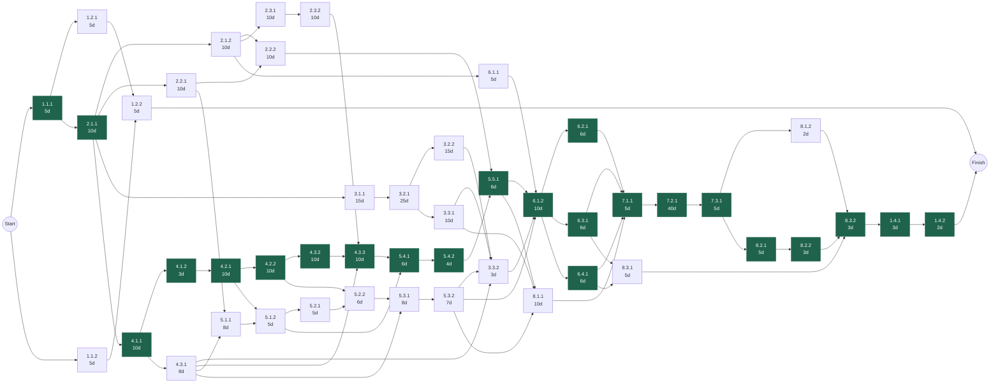
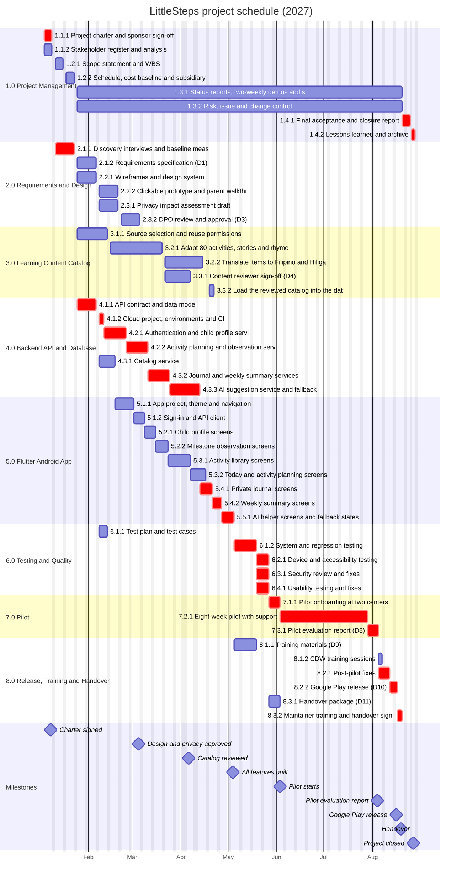

# 8. Schedule

**Plan section:** 8 ◆ (Checkpoint 3)  
**Version:** 1.0 draft, 23 October 2026  
**Status:** Draft for team review. Durations are in working days (Monday to Friday, excluding the holidays below).  
**Related Documents:** [Work Breakdown Structure](07-work-breakdown-structure.md), [Cost Estimate and Budget](09-cost-estimate-and-budget.md), [schedule data (CSV)](data/schedule-and-cost.csv)

---

> **Practice timeline.** This schedule is for the CIT 246 planning exercise. The team's real course build is in the [execution plan](../../../execution-plan.md).

## 8.1 Software and Calendar

- **Software:** the activity list, critical path (forward and backward pass) and costs were calculated with a short Python script, [schedule_model.py](data/schedule_model.py), and exported to [schedule-and-cost.csv](data/schedule-and-cost.csv), which opens in Excel or Google Sheets and can be imported into GanttProject or ProjectLibre. The network diagram and Gantt chart are drawn with Mermaid from the same data, so they always match the table. For the printed PDF, the Gantt chart may be redrawn in GanttProject from the CSV for readability.
- **Calendar:** 4 Jan 2027 to 27 Aug 2027, 166 working days. Non-working holidays: Maundy Thursday (1 April); Good Friday (2 April); Araw ng Kagitingan (9 April); Iloilo City Charter Day (25 August).
- **Resources:** two developers. Developer A builds the backend (4.1.2–4.3.3) and then the journal, weekly summary and AI helper screens (5.4–5.5). Developer B builds the catalog service (4.3.1) and then the remaining screens (5.1–5.3). The schedule never needs more than two developers on the same day.

## 8.2 Activity List

Each activity is a WBS work package. Total float is how many working days an activity can slip without delaying the finish date; activities with zero float form the critical path (**bold**). Work packages 1.3.1 and 1.3.2 are level-of-effort activities that run from the end of planning to the start of closing, so they have no float.

| WBS | Activity | Days | Basis of estimate | Predecessors | Start | Finish | Float |
|---|---|---|---|---|---|---|---|
| **1.1.1** | **Project charter and sponsor sign-off** | 5 | Analogous: charter work on past course projects | — | 4 Jan 2027 | 8 Jan 2027 | 0 |
| 1.1.2 | Stakeholder register and analysis | 5 | Analogous | — | 4 Jan 2027 | 8 Jan 2027 | 156 |
| 1.2.1 | Scope statement and WBS | 5 | Analogous | 1.1.1 | 11 Jan 2027 | 15 Jan 2027 | 151 |
| 1.2.2 | Schedule, cost baseline and subsidiary plans | 5 | Analogous | 1.2.1, 1.1.2 | 18 Jan 2027 | 22 Jan 2027 | 151 |
| 1.3.1 | Status reports, two-weekly demos and sponsor updates | 146 | Level of effort across monitoring and control | — | 25 Jan 2027 | 19 Aug 2027 | — |
| 1.3.2 | Risk, issue and change control | 146 | Level of effort across monitoring and control | — | 25 Jan 2027 | 19 Aug 2027 | — |
| **1.4.1** | **Final acceptance and closure report** | 3 | Analogous | 8.3.2 | 20 Aug 2027 | 24 Aug 2027 | 0 |
| **1.4.2** | **Lessons learned and archive** | 2 | Analogous | 1.4.1 | 26 Aug 2027 | 27 Aug 2027 | 0 |
| **2.1.1** | **Discovery interviews and baseline measures** | 10 | Parametric: 8 interviews at about 1 day each plus analysis | 1.1.1 | 11 Jan 2027 | 22 Jan 2027 | 0 |
| 2.1.2 | Requirements specification (D1) | 10 | Parametric: 6 features plus supporting functions, about 1.5 days each | 2.1.1 | 25 Jan 2027 | 5 Feb 2027 | 13 |
| 2.2.1 | Wireframes and design system | 10 | Analogous: the course prototype's design system | 2.1.1 | 25 Jan 2027 | 5 Feb 2027 | 17 |
| 2.2.2 | Clickable prototype and parent walkthrough (D2) | 10 | Analogous | 2.2.1, 2.1.2 | 8 Feb 2027 | 19 Feb 2027 | 43 |
| 2.3.1 | Privacy impact assessment draft | 10 | Expert judgment (consultant quote assumption) | 2.1.2 | 8 Feb 2027 | 19 Feb 2027 | 13 |
| 2.3.2 | DPO review and approval (D3) | 10 | Assumed DPO turnaround of two weeks | 2.3.1 | 22 Feb 2027 | 5 Mar 2027 | 13 |
| 3.1.1 | Source selection and reuse permissions | 15 | Parametric: about 12 candidate sources | 2.1.1 | 25 Jan 2027 | 12 Feb 2027 | 11 |
| 3.2.1 | Adapt 80 activities, stories and rhymes | 25 | Parametric: 80 items at about 3 hours each | 3.1.1 | 15 Feb 2027 | 19 Mar 2027 | 11 |
| 3.2.2 | Translate items to Filipino and Hiligaynon | 15 | Parametric: per-item translation rate | 3.2.1 | 22 Mar 2027 | 14 Apr 2027 | 11 |
| 3.3.1 | Content reviewer sign-off (D4) | 10 | Parametric: per-item review honorarium | 3.2.1 | 22 Mar 2027 | 6 Apr 2027 | 16 |
| 3.3.2 | Load the reviewed catalog into the database | 3 | Analogous | 3.3.1, 3.2.2, 4.3.1, 5.3.2 | 19 Apr 2027 | 21 Apr 2027 | 9 |
| **4.1.1** | **API contract and data model** | 10 | Analogous: course API contract; drafted alongside the requirements | 2.1.1 | 25 Jan 2027 | 5 Feb 2027 | 0 |
| **4.1.2** | **Cloud project, environments and CI** | 3 | Analogous: reuses the course project's setup scripts | 4.1.1 | 8 Feb 2027 | 10 Feb 2027 | 0 |
| **4.2.1** | **Authentication and child profile service** | 10 | Analogous: course M1 | 4.1.2 | 11 Feb 2027 | 24 Feb 2027 | 0 |
| **4.2.2** | **Activity planning and observation services** | 10 | Analogous: course M2 | 4.2.1 | 25 Feb 2027 | 10 Mar 2027 | 0 |
| 4.3.1 | Catalog service | 8 | Analogous: course M2 | 4.1.1 | 8 Feb 2027 | 17 Feb 2027 | 9 |
| **4.3.2** | **Journal and weekly summary services** | 10 | Analogous: course M3 | 4.2.2 | 11 Mar 2027 | 24 Mar 2027 | 0 |
| **4.3.3** | **AI suggestion service and fallback** | 10 | Analogous: course M4 | 4.3.2, 4.3.1, 2.3.2 | 25 Mar 2027 | 12 Apr 2027 | 0 |
| 5.1.1 | App project, theme and navigation | 8 | Analogous: course Flutter setup | 2.2.1, 4.3.1 | 18 Feb 2027 | 1 Mar 2027 | 9 |
| 5.1.2 | Sign-in and API client | 5 | Analogous | 5.1.1, 4.2.1 | 2 Mar 2027 | 8 Mar 2027 | 9 |
| 5.2.1 | Child profile screens | 5 | Analogous | 5.1.2 | 9 Mar 2027 | 15 Mar 2027 | 9 |
| 5.2.2 | Milestone observation screens | 6 | Analogous | 5.2.1, 4.2.2 | 16 Mar 2027 | 23 Mar 2027 | 9 |
| 5.3.1 | Activity library screens | 8 | Analogous | 5.2.2, 4.3.1 | 24 Mar 2027 | 6 Apr 2027 | 9 |
| 5.3.2 | Today and activity planning screens | 7 | Analogous | 5.3.1 | 7 Apr 2027 | 16 Apr 2027 | 9 |
| **5.4.1** | **Private journal screens** | 6 | Analogous | 4.3.3, 5.1.2 | 13 Apr 2027 | 20 Apr 2027 | 0 |
| **5.4.2** | **Weekly summary screens** | 4 | Analogous | 5.4.1 | 21 Apr 2027 | 26 Apr 2027 | 0 |
| **5.5.1** | **AI helper screens and fallback states** | 6 | Analogous | 5.4.2, 2.2.2 | 27 Apr 2027 | 4 May 2027 | 0 |
| 6.1.1 | Test plan and test cases | 5 | Parametric: about 60 test cases | 2.1.2 | 8 Feb 2027 | 12 Feb 2027 | 54 |
| **6.1.2** | **System and regression testing** | 10 | Parametric: 60 cases, two passes, plus fixes; features are also tested as each is finished | 5.3.2, 5.5.1, 3.3.2, 6.1.1 | 5 May 2027 | 18 May 2027 | 0 |
| **6.2.1** | **Device and accessibility testing** | 6 | Parametric: 3 devices × core flows | 6.1.2 | 19 May 2027 | 26 May 2027 | 0 |
| **6.3.1** | **Security review and fixes** | 6 | Expert judgment | 6.1.2 | 19 May 2027 | 26 May 2027 | 0 |
| **6.4.1** | **Usability testing and fixes** | 6 | Parametric: 6 sessions plus fixes | 6.1.2 | 19 May 2027 | 26 May 2027 | 0 |
| **7.1.1** | **Pilot onboarding at two centers** | 5 | Parametric: two centers, two sessions each | 6.2.1, 6.3.1, 6.4.1, 8.1.1 | 27 May 2027 | 2 Jun 2027 | 0 |
| **7.2.1** | **Eight-week pilot with support** | 40 | Fixed by the pilot design: 8 weeks | 7.1.1 | 3 Jun 2027 | 28 Jul 2027 | 0 |
| **7.3.1** | **Pilot evaluation report (D8)** | 5 | Analogous | 7.2.1 | 29 Jul 2027 | 4 Aug 2027 | 0 |
| 8.1.1 | Training materials (D9) | 10 | Parametric: 2 guides × 3 languages | 3.3.1, 5.3.2, 5.5.1 | 5 May 2027 | 18 May 2027 | 6 |
| 8.1.2 | CDW training sessions | 2 | Parametric: two half-day sessions | 7.3.1 | 5 Aug 2027 | 6 Aug 2027 | 6 |
| **8.2.1** | **Post-pilot fixes** | 5 | Expert judgment: top issues only; smaller fixes are made during the pilot | 7.3.1 | 5 Aug 2027 | 11 Aug 2027 | 0 |
| **8.2.2** | **Google Play release (D10)** | 3 | Analogous | 8.2.1 | 12 Aug 2027 | 16 Aug 2027 | 0 |
| 8.3.1 | Handover package (D11) | 5 | Analogous; prepared during the pilot and updated at handover | 6.3.1, 6.4.1 | 27 May 2027 | 2 Jun 2027 | 53 |
| **8.3.2** | **Maintainer training and handover sign-off** | 3 | Parametric: 3 days of paired sessions | 8.2.2, 8.3.1, 8.1.2 | 17 Aug 2027 | 19 Aug 2027 | 0 |

## 8.3 Network Diagram and Critical Path

Activity-on-node diagram. Each box shows the WBS number and duration; arrows are finish-to-start dependencies. Critical-path activities are drawn with a dark fill.

*Figure 8.1. Network diagram. Dark boxes are on the critical path.*

**Critical path:** 1.1.1 → 2.1.1 → 4.1.1 → 4.1.2 → 4.2.1 → 4.2.2 → 4.3.2 → 4.3.3 → 5.4.1 → 5.4.2 → 5.5.1 → 6.1.2 → (6.2.1, 6.3.1 and 6.4.1 in parallel) → 7.1.1 → 7.2.1 → 7.3.1 → 8.2.1 → 8.2.2 → 8.3.2 → 1.4.1 → 1.4.2 = 166 working days.

**Why this is the critical path.** The longest chain runs through the backend and app work of Developer A: the API contract, cloud setup, the four backend services, then the journal, weekly summary and AI helper screens. The AI service (4.3.3) cannot start until the Data Protection Officer approves the privacy impact assessment and the journal service exists, and the AI helper screens come last because they depend on everything else. After that, testing, the fixed eight-week pilot, its evaluation, release and handover follow one after another. The content catalog has 16 days of float and the design work 43, so delays there do not move the finish date unless they exceed that float. The two places a slip is most likely to hurt are the backend services and the pilot start, so these get the closest weekly tracking (Section 12).

## 8.4 Gantt Chart

*Figure 8.2. Gantt chart. Red bars are on the critical path; diamonds are milestones.*

## 8.5 Milestones

| Milestone | Date | Marks the end of |
|---|---|---|
| Charter signed | 8 Jan 2027 | 1.1.1 Project charter and sponsor sign-off |
| Design and privacy approved | 5 Mar 2027 | 2.3.2 DPO review and approval (D3) |
| Catalog reviewed | 6 Apr 2027 | 3.3.1 Content reviewer sign-off (D4) |
| All features built | 4 May 2027 | 5.5.1 AI helper screens and fallback states |
| Pilot starts | 3 Jun 2027 | 7.1.1 Pilot onboarding at two centers |
| Pilot evaluation report | 4 Aug 2027 | 7.3.1 Pilot evaluation report (D8) |
| Google Play release | 16 Aug 2027 | 8.2.2 Google Play release (D10) |
| Handover | 19 Aug 2027 | 8.3.2 Maintainer training and handover sign-off |
| Project closed | 27 Aug 2027 | 1.4.2 Lessons learned and archive |
