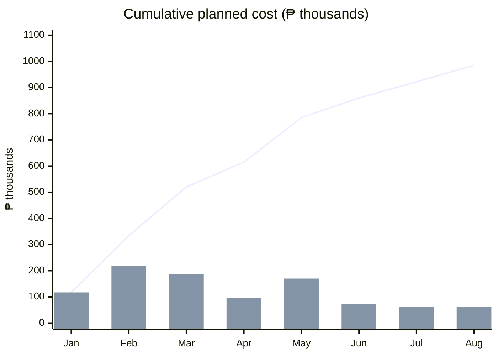

# 9. Cost Estimate and Budget

**Plan section:** 9 ◆ (Checkpoint 3)  
**Version:** 1.0 draft, 23 October 2026  
**Status:** Draft for team review. All amounts are in Philippine pesos.  
**Related Documents:** [Work Breakdown Structure](07-work-breakdown-structure.md), [Schedule](08-schedule.md), [cost data (CSV)](data/schedule-and-cost.csv), [monthly baseline (CSV)](data/cost-baseline-by-month.csv)

---

## 9.1 Estimating Method

The estimate is **bottom-up**: each work package's labour cost is its duration × the share of each role assigned × that role's daily rate, plus any quoted non-labour cost. Some durations were set **parametrically** (for example 80 catalog items at about 3 hours each) or **by analogy** with the team's course build; the basis for each is in the activity list (Section 8.2). Monitoring and control (1.3) is a level-of-effort cost over the whole execution period.

| Role | Daily rate | Basis |
|---|---|---|
| Project manager | ₱1,820 | ₱40,000/month ÷ 22 working days, rounded |
| Business analyst and quality lead | ₱1,365 | ₱30,000/month ÷ 22 working days, rounded |
| Stakeholder and content coordinator | ₱1,275 | ₱28,000/month ÷ 22 working days, rounded |
| Flutter and backend developer, each | ₱1,365 | ₱30,000/month ÷ 22 working days, rounded |
| UI/UX designer | ₱1,365 | ₱30,000/month ÷ 22 working days, rounded |
| QA tester | ₱1,135 | ₱25,000/month ÷ 22 working days, rounded |

## 9.2 Cost Estimate by WBS Item

| WBS | Item | Labour | Other costs | Total |
|---|---|---|---|---|
| **1.0** | **Project Management** | **₱186,512** | **₱0** | **₱186,512** |
| 1.1.1 | Project charter and sponsor sign-off | ₱12,512 | ₱0 | ₱12,512 |
| 1.1.2 | Stakeholder register and analysis | ₱8,195 | ₱0 | ₱8,195 |
| 1.2.1 | Scope statement and WBS | ₱12,740 | ₱0 | ₱12,740 |
| 1.2.2 | Schedule, cost baseline and subsidiary plans | ₱13,060 | ₱0 | ₱13,060 |
| 1.3.1 | Status reports, two-weekly demos and sponsor updates | ₱79,716 | ₱0 | ₱79,716 |
| 1.3.2 | Risk, issue and change control | ₱46,501 | ₱0 | ₱46,501 |
| 1.4.1 | Final acceptance and closure report | ₱7,508 | ₱0 | ₱7,508 |
| 1.4.2 | Lessons learned and archive | ₱6,280 | ₱0 | ₱6,280 |
| **2.0** | **Requirements and Design** | **₱98,020** | **₱50,000** | **₱148,020** |
| 2.1.1 | Discovery interviews and baseline measures | ₱30,040 | ₱0 | ₱30,040 |
| 2.1.2 | Requirements specification (D1) | ₱13,650 | ₱0 | ₱13,650 |
| 2.2.1 | Wireframes and design system | ₱17,745 | ₱0 | ₱17,745 |
| 2.2.2 | Clickable prototype and parent walkthrough (D2) | ₱24,300 | ₱0 | ₱24,300 |
| 2.3.1 | Privacy impact assessment draft (Privacy consultant: ₱50,000) | ₱10,465 | ₱50,000 | ₱60,465 |
| 2.3.2 | DPO review and approval (D3) | ₱1,820 | ₱0 | ₱1,820 |
| **3.0** | **Learning Content Catalog** | **₱69,436** | **₱108,000** | **₱177,436** |
| 3.1.1 | Source selection and reuse permissions | ₱19,125 | ₱0 | ₱19,125 |
| 3.2.1 | Adapt 80 activities, stories and rhymes | ₱38,700 | ₱0 | ₱38,700 |
| 3.2.2 | Translate items to Filipino and Hiligaynon (Translator: 160 item translations × ₱300: ₱48,000) | ₱5,738 | ₱48,000 | ₱53,738 |
| 3.3.1 | Content reviewer sign-off (D4) (ECCD content reviewer: 80 items × ₱750: ₱60,000) | ₱3,825 | ₱60,000 | ₱63,825 |
| 3.3.2 | Load the reviewed catalog into the database | ₱2,048 | ₱0 | ₱2,048 |
| **4.0** | **Backend API and Database** | **₱96,915** | **₱10,000** | **₱106,915** |
| 4.1.1 | API contract and data model | ₱27,300 | ₱0 | ₱27,300 |
| 4.1.2 | Cloud project, environments and CI (Cloud and AI services during build and testing, 2 months × ₱5,000: ₱10,000) | ₱4,095 | ₱10,000 | ₱14,095 |
| 4.2.1 | Authentication and child profile service | ₱13,650 | ₱0 | ₱13,650 |
| 4.2.2 | Activity planning and observation services | ₱13,650 | ₱0 | ₱13,650 |
| 4.3.1 | Catalog service | ₱10,920 | ₱0 | ₱10,920 |
| 4.3.2 | Journal and weekly summary services | ₱13,650 | ₱0 | ₱13,650 |
| 4.3.3 | AI suggestion service and fallback | ₱13,650 | ₱0 | ₱13,650 |
| **5.0** | **Flutter Android App** | **₱75,075** | **₱0** | **₱75,075** |
| 5.1.1 | App project, theme and navigation | ₱10,920 | ₱0 | ₱10,920 |
| 5.1.2 | Sign-in and API client | ₱6,825 | ₱0 | ₱6,825 |
| 5.2.1 | Child profile screens | ₱6,825 | ₱0 | ₱6,825 |
| 5.2.2 | Milestone observation screens | ₱8,190 | ₱0 | ₱8,190 |
| 5.3.1 | Activity library screens | ₱10,920 | ₱0 | ₱10,920 |
| 5.3.2 | Today and activity planning screens | ₱9,555 | ₱0 | ₱9,555 |
| 5.4.1 | Private journal screens | ₱8,190 | ₱0 | ₱8,190 |
| 5.4.2 | Weekly summary screens | ₱5,460 | ₱0 | ₱5,460 |
| 5.5.1 | AI helper screens and fallback states | ₱8,190 | ₱0 | ₱8,190 |
| **6.0** | **Testing and Quality** | **₱65,604** | **₱30,000** | **₱95,604** |
| 6.1.1 | Test plan and test cases | ₱5,675 | ₱0 | ₱5,675 |
| 6.1.2 | System and regression testing | ₱25,000 | ₱0 | ₱25,000 |
| 6.2.1 | Device and accessibility testing (Three entry-level Android test phones: ₱30,000) | ₱9,267 | ₱30,000 | ₱39,267 |
| 6.3.1 | Security review and fixes | ₱9,282 | ₱0 | ₱9,282 |
| 6.4.1 | Usability testing and fixes | ₱16,380 | ₱0 | ₱16,380 |
| **7.0** | **Pilot** | **₱78,740** | **₱40,000** | **₱118,740** |
| 7.1.1 | Pilot onboarding at two centers (Onboarding printing, venue and snacks: ₱20,000) | ₱9,105 | ₱20,000 | ₱29,105 |
| 7.2.1 | Eight-week pilot with support (Cloud and AI services during the pilot and release, 4 months × ₱5,000: ₱20,000) | ₱60,080 | ₱20,000 | ₱80,080 |
| 7.3.1 | Pilot evaluation report (D8) | ₱9,555 | ₱0 | ₱9,555 |
| **8.0** | **Release, Training and Handover** | **₱54,912** | **₱21,500** | **₱76,412** |
| 8.1.1 | Training materials (D9) (Printing training materials: ₱20,000) | ₱16,845 | ₱20,000 | ₱36,845 |
| 8.1.2 | CDW training sessions | ₱3,642 | ₱0 | ₱3,642 |
| 8.2.1 | Post-pilot fixes | ₱16,488 | ₱0 | ₱16,488 |
| 8.2.2 | Google Play release (D10) (Google Play developer registration (US$25): ₱1,500) | ₱3,140 | ₱1,500 | ₱4,640 |
| 8.3.1 | Handover package (D11) | ₱8,872 | ₱0 | ₱8,872 |
| 8.3.2 | Maintainer training and handover sign-off | ₱5,925 | ₱0 | ₱5,925 |
| | **Subtotal** | **₱725,214** | **₱259,500** | **₱984,714** |
| | **Contingency reserve (10% of subtotal)** | | | **₱98,471** |
| | **Total budget** | | | **₱1,083,185** |

The bottom-up total of **₱1,083,185** is 7.2% below the business case's rough order-of-magnitude estimate of ₱1,167,650, inside that estimate's −25% to +75% range. It replaces the rough estimate in the charter.

## 9.3 Cost Baseline

Each work package's cost is spread evenly over its working days. The contingency reserve is held by the sponsor and is not part of the time-phased baseline.

| Month | Planned cost | Cumulative cost |
|---|---|---|
| January 2027 | ₱116,592 | ₱116,592 |
| February 2027 | ₱217,168 | ₱333,760 |
| March 2027 | ₱186,524 | ₱520,284 |
| April 2027 | ₱94,536 | ₱614,820 |
| May 2027 | ₱170,445 | ₱785,265 |
| June 2027 | ₱74,250 | ₱859,515 |
| July 2027 | ₱62,881 | ₱922,396 |
| August 2027 | ₱62,318 | ₱984,714 |
| **Baseline (excluding contingency)** | | **₱984,714** |

*Figure 9.1. Cost baseline: bars are the monthly planned cost, the line is the cumulative cost (the S-curve).*

## 9.4 Assumptions

- Rates are the team's assumptions for contracted staff in Iloilo City in 2027, set from monthly pay of ₱25,000–₱40,000 and 22 working days a month. They are to be checked against local job postings before the plan is submitted to a sponsor.
- The three project-team roles are costed as if paid, so the budget shows the full cost of running the project.
- The content reviewer is paid ₱750 per catalog item and the translator ₱300 per item per language (80 items, 2 languages).
- The privacy consultant's fee of ₱50,000 is an estimate, not a quote.
- Cloud and AI services cost about ₱5,000 a month for 6 months of testing, pilot and release, at pilot scale and October 2026 prices.
- Three entry-level Android phones cost about ₱10,000 each. The Google Play registration is US$25 (about ₱1,500).
- No office space, computers or internet are costed: the team uses its own equipment, and sessions are held at the pilot centers.
- Costs after the handover date, such as hosting and maintenance, are outside the budget (see the scope statement).
- The 10% contingency reserve covers known risks in the risk register (Section 13). A management reserve for unknown risks is the sponsor's decision and is not included.
