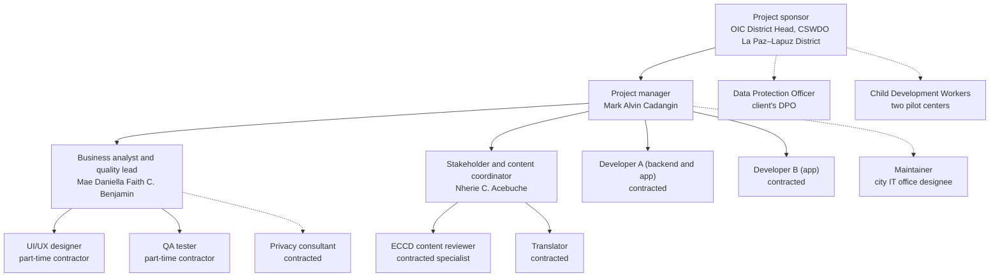

# 11. Resource and Responsibility Plan

**Plan section:** 11  
**Version:** 1.0 draft, 23 October 2026  
**Status:** Draft for team review. The organizational chart and responsibility assignment matrix follow Schwalbe, *Information Technology Project Management*, Chapter 9.  
**Related Documents:** [Project Charter](04-project-charter.md), [Work Breakdown Structure](07-work-breakdown-structure.md), [Procurement Plan](14-procurement-plan.md)

---

## 11.1 Project Organizational Chart

*Figure 11.1. Solid lines: reporting. Dotted lines: coordination with people outside the project team.*

## 11.2 Responsibility Assignment Matrix (RACI)

**R** responsible (does the work), **A** accountable (approves; one per row), **C** consulted, **I** informed. Every level-2 WBS item has one accountable person.

| WBS | Sponsor | PM (Mark) | BA/QA lead (Faith) | Coordinator (Nherie) | Dev A | Dev B | UX | QA tester | Content reviewer | DPO |
|---|---|---|---|---|---|---|---|---|---|---|
| 1.1 Initiation | A | R | C | R | | | | | | I |
| 1.2 Planning | I | A/R | R | C | C | C | | | | |
| 1.3 Monitoring and control | I | A/R | R | C | I | I | I | I | | |
| 1.4 Closing | A | R | R | C | I | I | | | | |
| 2.1 Discovery and requirements | C | A | R | R | C | C | C | C | | |
| 2.2 UI/UX design | C | I | A | C | C | C | R | | | |
| 2.3 Privacy | I | A | R | | C | | | | | R |
| 3.1 Sources and permissions | | I | C | A/R | | | | | C | |
| 3.2 Adaptation and translation | | I | C | A/R | | | | | C | |
| 3.3 Review and loading | | I | | A | R | | | | R | |
| 4.1 API foundation | | A | C | | R | R | | | | |
| 4.2 Core services | | A | C | | R | | | C | | |
| 4.3 Content, reflection and AI services | | A | C | C | R | R | | C | | C |
| 5.1–5.3 App foundation, child, library and planning screens | | A | C | | | R | C | C | | |
| 5.4–5.5 Reflection and AI helper screens | | A | C | | R | | C | C | | |
| 6.1 Functional testing | | I | A | | R | R | | R | | |
| 6.2 Device and accessibility testing | | I | A | | C | C | R | R | | |
| 6.3 Security review | I | A | C | | R | | | C | | C |
| 6.4 Usability testing | I | I | A/R | C | R | | R | | | |
| 7.1 Pilot preparation | C | A | C | R | | | | | | I |
| 7.2 Pilot operation | I | A | C | R | R | | | | | |
| 7.3 Pilot evaluation | A | R | R | C | | | | | | |
| 8.1 Training | I | C | C | A/R | | | R | | | |
| 8.2 Release | A | R | C | | R | C | | R | | |
| 8.3 Handover | A | R | C | C | R | C | | | | |

## 11.3 Resource Loading

| Resource | Allocation | When |
|---|---|---|
| Project manager | 30–100% (40% average) | Whole project |
| Business analyst and quality lead | 50–100% in discovery, design, testing and evaluation | Whole project, part-time between phases |
| Stakeholder and content coordinator | 100% during catalog work and the pilot | January–August |
| Developers A and B | 100% each, never more than two at once (Section 8.1) | February–August |
| UI/UX designer | Full time in design, 30–50% in testing and training | January–February, May |
| QA tester | Full time in testing | January (test plan), May, August |
| Content reviewer and translator | Per item | March–April |

## 11.4 Skills Required and Gaps

| Skill | Needed for | Team has it? | How the gap is covered |
|---|---|---|---|
| Project management (scope, schedule, cost, risk) | 1.0 | Yes (CIT 246) | — |
| Requirements and usability testing | 2.1, 6.4 | Partly | Quality lead uses the course's UI/UX specification and walkthrough guide |
| Flutter and Dart | 5.0 | Partly (CC 207B) | Contract experienced Flutter developers (Section 14) |
| Node.js, TypeScript and Firebase | 4.0 | Partly | Contracted developers; team reviews the code |
| Early-childhood development content | 3.0 | **No** | Contract an ECCD content reviewer |
| Filipino and Hiligaynon translation | 3.2.2, 8.1 | Partly | Contract a translator; team checks for plain language |
| Data privacy law (RA 10173) | 2.3 | **No** | Contract a privacy consultant; client's DPO approves |
| App store release and signing | 8.2 | No | Developer A, using the handover runbook |
