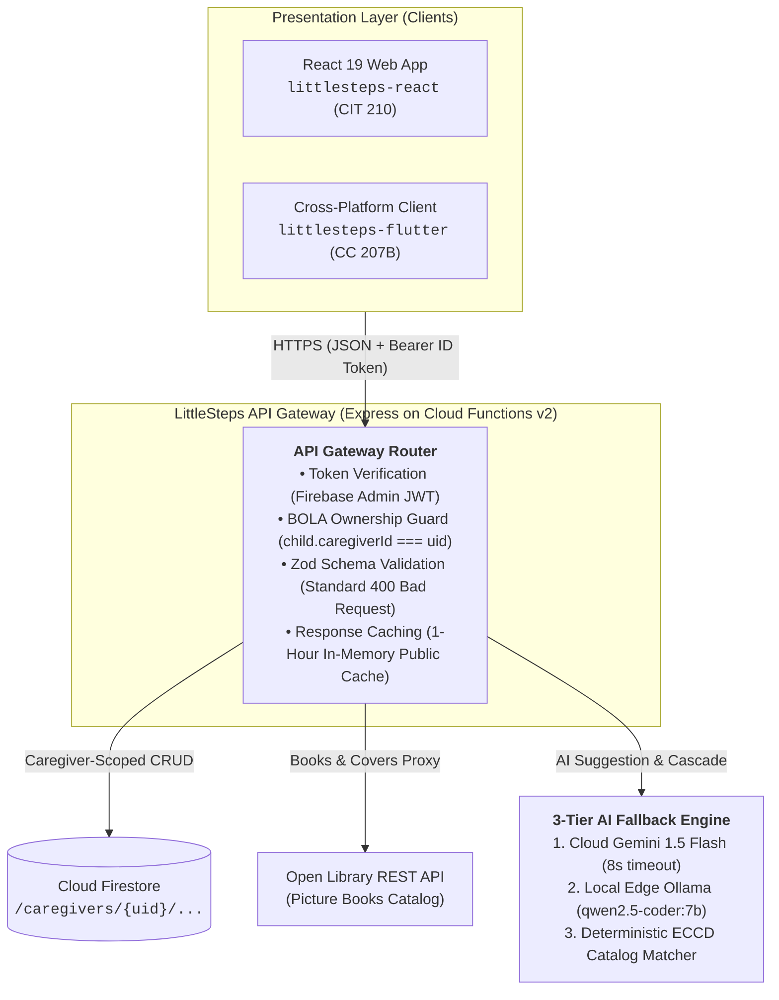
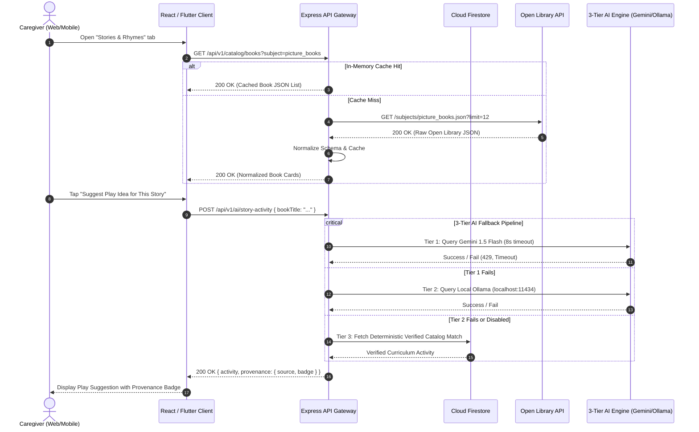

# LittleSteps API Reference & Integration Guide

**Status:** Canonical Interface Specification Baseline  
**Governing Standard:** OpenAPI 3.1.0 & ISO/IEC/IEEE 42010:2022 (Interface View)  
**Owner:** Mark Alvin Cadangin (Technical Lead) & Justin (Backend Lead)  
**Last Reviewed:** 2026-10-26  
**Related Documents:** [Architecture Decisions](architecture-decisions.md) (ADR-001, ADR-003, ADR-010), [Data Model Specification](data-model.md), [Security, Privacy, and AI Safeguards](security-privacy-ai.md), [CIT 210 Deliverables](academic/cit210/README.md)

---

## 1. System Overview & Architectural Purpose

The LittleSteps backend API (`littlesteps-api`) is an Express application written in TypeScript and hosted on **Google Firebase Cloud Functions (2nd Gen)**, backed by **Google Cloud Firestore** and **Firebase Authentication**.



### Why This Architecture Enhances Efficiency & Security (CIT 210 Presentation Focus)
1. **Unified Dual-Client Backend:** A single, client-neutral REST API powers both the **CIT 210 React web client** and the **CC 207B Flutter mobile client**, eliminating duplicate database logic.
2. **Strict Credential & Key Isolation:** Third-party credentials (Google Gemini API keys) and service account privileges remain strictly on the server. Client applications never possess external API keys.
3. **Defense Against Broken Object Level Authorization (BOLA):** The API derives user identity directly from the verified cryptographic payload of the Firebase ID token (`req.user.uid`). It rejects requests that attempt to modify someone else's child records by manipulating URL parameters.
4. **Resilient Data Augmentation Pipeline:** Combines real-world structured data from an external REST API (**Open Library**) with generative intelligence (**Google Gemini API**) through a multi-tier fallback that operates smoothly even offline.

---

## 2. Request & Response Lifecycle (Sequence Diagram)



---

## 3. Authentication, Authorization & Security Rules

### 3.1 Bearer Token Protocol (NFR-SEC-01)
All endpoints except `/health` and `/api/v1/catalog/*` require an HTTP `Authorization` header containing a valid Firebase ID Token:
```http
Authorization: Bearer <Firebase_ID_Token>
```
* The API middleware validates the token signature using the Firebase Admin SDK.
* If missing or invalid, the API returns `401 Unauthorized` with error code `UNAUTHENTICATED`.

### 3.2 BOLA Authorization Defense (NFR-SEC-02)
* When a client queries `/api/v1/children/:childId/...`, the server inspects Firestore at `/caregivers/{uid}/children/{childId}` using the token's authenticated `uid`.
* **Zero-Leakage Policy:** If the child does not exist, or belongs to a different caregiver, the server returns **`404 Not Found`** with error code `RESOURCE_NOT_FOUND`. It deliberately does not return `403 Forbidden`, preventing attackers from enumerating valid child IDs.

---

## 4. Canonical Endpoint Catalog

Base URL (Local Emulator): `http://127.0.0.1:5001/{projectId}/asia-southeast1/api`

### 4.1 System & Identity Endpoints

| Method | Path | Auth | Purpose | Success (Status / Body) | Error Codes |
| :--- | :--- | :---: | :--- | :--- | :--- |
| `GET` | `/health` | None | Public liveness probe | `200 OK`<br/>`{ "status": "ok", "timestamp": "..." }` | `500` |
| `GET` | `/api/v1/me` | Bearer | Return authenticated Firebase UID and profile metadata | `200 OK`<br/>`{ "uid": "abc", "email": "...", "createdAt": "..." }` | `401 UNAUTHENTICATED` |

### 4.2 Child Profile Management (FR-01)

| Method | Path | Auth | Purpose | Success (Status / Body) | Error Codes |
| :--- | :--- | :---: | :--- | :--- | :--- |
| `GET` | `/api/v1/children` | Bearer | List all children belonging to the authenticated caregiver | `200 OK`<br/>`{ "children": [ { "id": "c1", "firstName": "Maya", ... } ] }` | `401` |
| `POST` | `/api/v1/children` | Bearer | Register a new child profile (validates birth month/year) | `201 Created`<br/>`{ "id": "c1", "firstName": "Maya", ... }` | `400 INVALID_INPUT`<br/>`401` |
| `GET` | `/api/v1/children/:childId` | Bearer | Retrieve specific child details | `200 OK`<br/>`{ "id": "c1", "firstName": "Maya", ... }` | `401`<br/>`404 RESOURCE_NOT_FOUND` |
| `PATCH` | `/api/v1/children/:childId` | Bearer | Update child details | `200 OK`<br/>`{ "id": "c1", ... }` | `400`<br/>`401`<br/>`404` |
| `DELETE`| `/api/v1/children/:childId` | Bearer | Cascading deletion of child and observations | `204 No Content` | `401`<br/>`404` |

### 4.3 Milestone Observations (FR-01)

| Method | Path | Auth | Purpose | Success (Status / Body) | Error Codes |
| :--- | :--- | :---: | :--- | :--- | :--- |
| `GET` | `/api/v1/children/:childId/milestones` | Bearer | List caregiver observations for child | `200 OK`<br/>`{ "observations": [ { "milestoneId": "m1", "status": "observed" } ] }` | `401`<br/>`404` |
| `POST` | `/api/v1/children/:childId/milestones` | Bearer | Record milestone observation (`observed` or `not_yet_observed`) | `201 Created`<br/>`{ "observationId": "o1", ... }` | `400 INVALID_INPUT`<br/>`401`<br/>`404` |

### 4.4 Activity Planning & Scheduling (FR-02)

| Method | Path | Auth | Purpose | Success (Status / Body) | Error Codes |
| :--- | :--- | :---: | :--- | :--- | :--- |
| `GET` | `/api/v1/children/:childId/activities` | Bearer | List planned/completed activities | `200 OK`<br/>`{ "activities": [ { "activityId": "a1", "completed": true } ] }` | `401`<br/>`404` |
| `POST` | `/api/v1/children/:childId/activities` | Bearer | Schedule an activity for today | `201 Created`<br/>`{ "scheduledId": "s1", "completed": false }` | `400`<br/>`401`<br/>`404` |
| `PATCH`| `/api/v1/children/:childId/activities/:id` | Bearer | Toggle completion status | `200 OK`<br/>`{ "scheduledId": "s1", "completed": true }` | `400`<br/>`401`<br/>`404` |

### 4.5 Private Observation Journal (FR-03)

| Method | Path | Auth | Purpose | Success (Status / Body) | Error Codes |
| :--- | :--- | :---: | :--- | :--- | :--- |
| `GET` | `/api/v1/children/:childId/journal` | Bearer | List private observation journal entries | `200 OK`<br/>`{ "entries": [ { "id": "j1", "title": "First steps", ... } ] }` | `401`<br/>`404` |
| `POST` | `/api/v1/children/:childId/journal` | Bearer | Create a private journal note | `201 Created`<br/>`{ "id": "j1", ... }` | `400 INVALID_INPUT`<br/>`401`<br/>`404` |
| `DELETE`| `/api/v1/children/:childId/journal/:id`| Bearer | Permanently delete journal note | `204 No Content` | `401`<br/>`404` |

### 4.6 Weekly Summary (FR-05)

| Method | Path | Auth | Purpose | Success (Status / Body) | Error Codes |
| :--- | :--- | :---: | :--- | :--- | :--- |
| `GET` | `/api/v1/children/:childId/summary/weekly` | Bearer | Deterministic factual aggregation of completed activities | `200 OK`<br/>`{ "weekStarting": "2026-10-26", "totalActivities": 4, "domains": {...} }` | `401`<br/>`404` |

---

## 5. External Data API Integration: Open Library (FR-04)

To satisfy the CIT 210 requirement for a live external REST Data API, `littlesteps-api` integrates with the **Internet Archive's Open Library REST API**.

### 5.1 Endpoint Specification: `GET /api/v1/catalog/books`
* **Access:** Public read-only (unauthenticated).
* **Query Parameters:**
  - `subject` (string, optional, default: `"picture_books"`): Filter by book subject (e.g., `"children"`, `"animals"`, `"bedtime"`).
  - `limit` (integer, optional, default: `12`, max: `30`): Page size.
* **Upstream Service:** `https://openlibrary.org/subjects/{subject}.json?limit={limit}`
* **Server-Side In-Memory Cache:** Responses are cached in memory for **60 minutes** (`Cache-Control: public, max-age=3600`).
* **Client Response Format:**
  ```json
  {
    "subject": "picture_books",
    "totalCount": 16840,
    "books": [
      {
        "id": "OL7835968W",
        "title": "The Very Hungry Caterpillar",
        "authors": ["Eric Carle"],
        "coverUrl": "https://covers.openlibrary.org/b/id/7835968-M.jpg",
        "subjects": ["Caterpillars", "Metamorphosis", "Picture books"]
      }
    ],
    "provenance": {
      "source": "Open Library (Internet Archive)",
      "license": "Public Domain / Open Access"
    }
  }
  ```
* **Offline Resilience:** If Open Library times out or returns an error, the API returns a curated local backup JSON list with HTTP status 200 and `"provenance": { "source": "local-fallback" }`.

---

## 6. External AI Augmentation & 3-Tier Fallback Engine (FR-06)

LittleSteps integrates generative intelligence to enhance learning without relying on unsupported black-box models.

### 6.1 Endpoints Specification

#### `POST /api/v1/ai/recommendations`
Generates activity recommendations based on non-identifying developmental parameters (Age Band, Domain, Indoor/Outdoor setting).

#### `POST /api/v1/ai/story-activity`
Generates companion play and discussion activities based on a real book selected from the Open Library catalog.
* **Request Payload:**
  ```json
  {
    "bookTitle": "The Very Hungry Caterpillar",
    "subjects": ["Animals", "Counting"],
    "ageBand": "12-24m"
  }
  ```
* **Response Payload (Standard Enriched Format):**
  ```json
  {
    "bookTitle": "The Very Hungry Caterpillar",
    "suggestion": {
      "title": "Fruit Texture & Counting Game",
      "domain": "cognitive",
      "instructions": "Gather fruit from the kitchen (or toy fruit). Count along with the story as the caterpillar eats through each item.",
      "safetyNotice": "Ensure adult supervision with real fruit."
    },
    "provenance": {
      "tier": 1,
      "source": "gemini-1.5-flash",
      "badge": "Generated by AI",
      "disclaimer": "Observational play suggestion only. Not developmental assessment."
    }
  }
  ```

### 6.2 The 3-Tier Fallback Hierarchy

```
[Tier 1: Cloud LLM]  ──(Fails: Timeout > 8s, HTTP 429)──>  [Tier 2: Local AI]  ──(Fails: Offline)──>  [Tier 3: Catalog Rule]
Google Gemini API                                            Ollama (localhost:11434)                   Pre-reviewed JSON
```

1. **Tier 1 (Google Gemini 1.5 Flash - Cloud Primary):**
   - Called using server-side `@google/genai` or REST endpoint.
   - Timeout bounded at **8 seconds** via `AbortSignal.timeout(8000)`.
   - Rate limit guard: 10 requests / hour per IP.
2. **Tier 2 (Ollama - Local Offline AI Fallback):**
   - Active when `LOCAL_AI_ENABLED=true` in development/demo environments.
   - Pings `http://localhost:11434/api/generate` with model `qwen2.5-coder:7b`.
   - Enables complete, offline AI demonstration during in-person academic evaluations if campus WiFi is degraded.
3. **Tier 3 (Deterministic Rule-Based Catalog - Guaranteed Safety Net):**
   - If Tier 1 and Tier 2 fail, the backend matches the domain and age group to pre-reviewed activities in [`docs/philippine-content-provenance.md`](philippine-content-provenance.md).
   - Zero latency, 100% deterministic, never crashes.
   - For `/ai/story-activity`, Tier 3 returns a reviewed catalog activity matched on age band and the book's subjects, with `"tier": 3`, `"source": "catalog"` and no AI badge. A Tier 1 or 2 response that fails schema or non-diagnostic validation is also replaced this way.

---

## 7. Standardized Error Handling & HTTP Status Matrix

All error responses strictly follow the standardized JSON error envelope:
```json
{
  "error": {
    "code": "INVALID_INPUT",
    "message": "Field 'birthYear' must be an integer between 2019 and 2026.",
    "details": [
      {
        "field": "birthYear",
        "issue": "Expected integer <= 2026"
      }
    ]
  }
}
```

### Complete HTTP Status to Error Code Mapping Table

| HTTP Status | Error Code | Trigger Scenario | Handling Strategy |
| :---: | :--- | :--- | :--- |
| **`400`** | `INVALID_INPUT` | Zod validation failure, missing required fields, malformed body | Client highlights field errors |
| **`401`** | `UNAUTHENTICATED` | Missing or invalid Bearer token | Client redirects to sign-in |
| **`403`** | `FORBIDDEN` | Valid user token attempting an administrative action | Client shows access denied alert |
| **`404`** | `RESOURCE_NOT_FOUND` | Child ID, activity, or journal note does not exist OR belongs to another caregiver (BOLA) | Client shows item not found; prevents resource existence leakage |
| **`422`** | `UNPROCESSABLE_ENTITY` | Business logic violation (e.g. child age outside 0–71 months range) | Client displays business rule explanation |
| **`429`** | `RATE_LIMITED` | AI request quota exceeded (>10 requests/hour) | Client triggers Tier 3 fallback; includes `Retry-After: 3600` header |
| **`500`** | `INTERNAL_SERVER_ERROR` | Unhandled server exception | Client displays generic error toast; hides internal stack traces |
| **`502`** | `UPSTREAM_SERVICE_ERROR`| Open Library or Gemini API unreachable | Server automatically triggers internal cached or deterministic fallback |
| **`504`** | `GATEWAY_TIMEOUT` | Upstream provider exceeds 8-second timeout | Server automatically triggers fallback response |

---

## 8. CIT 210 Presentation Script (10-Point Explanation Guide)

When presenting the API Integration during the **CIT 210 Code Defense / Presentation**, deliver the following narrative:

> 1. **Decomposition & Responsibility:** *"Our backend is an Express Node.js API hosted as a serverless Firebase Cloud Function. It serves as an authoritative gateway between the React frontend and Cloud Firestore. We enforce strict server-side validation using Zod and maintain a clean OpenAPI 3.1 contract."*
> 2. **Authentication & BOLA Defense:** *"Every protected request carries a Firebase ID token. Our auth middleware cryptographically decodes the token on the server and derives the caregiver's UID directly from the verified signature. To prevent Broken Object Level Authorization (OWASP API1:2023), accessing an unowned child record returns HTTP 404, preventing attackers from learning whether an ID exists."*
> 3. **Dual-API Layering:** *"In response to our course requirements, we implemented a dual-API integration pipeline. First, we query the **Open Library REST API** to fetch authentic children's storybooks, managing query parameters, pagination, and server-side response caching. Second, we layer **Google Gemini AI** on top of the fetched book metadata to generate contextual, screen-free toddler play activities."*
> 4. **Resilience & Fallbacks:** *"Our AI architecture implements a 3-tier fallback hierarchy: Cloud Gemini with an 8-second timeout $\to$ Local Ollama for offline demo resilience $\to$ Deterministic Philippine curriculum catalog. If any network or quota failure occurs, the application degrades gracefully without breaking the user experience."*
