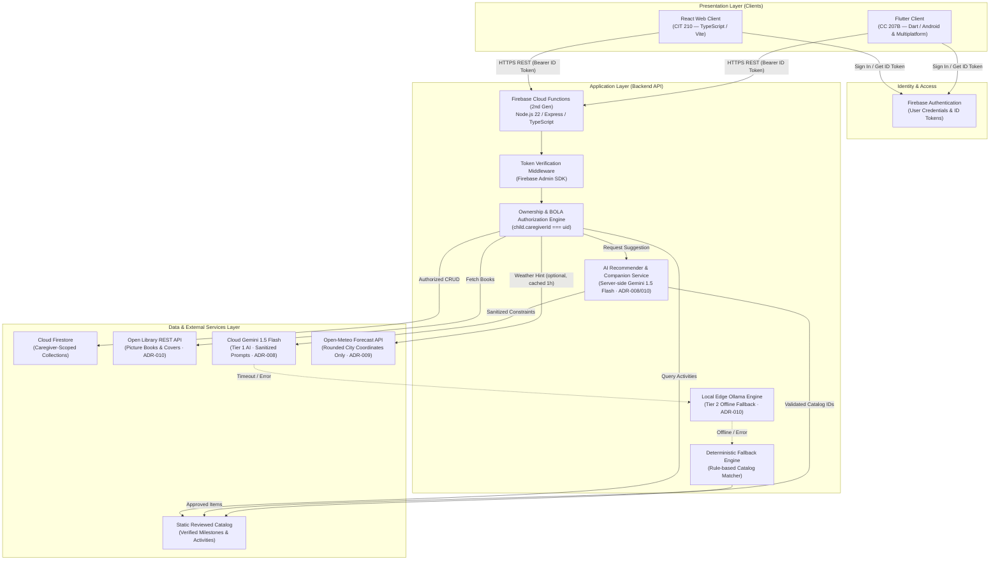

# LittleSteps Architecture Decisions

**Status:** Canonical Architecture Baseline  
**Governing Standard:** ISO/IEC/IEEE 42010:2022 (Software Architecture Description)  
**Owner:** Mark Alvin Cadangin (Technical Lead)  
**Last Reviewed:** 2026-10-26  
**Related Documents:** [API Reference & Integration Guide](api-reference.md), [Data Model Specification](data-model.md), [OpenAPI Specification](https://github.com/Thesis-Titans/littlesteps-api/blob/main/openapi/openapi.yaml), [Product Scope](product-scope.md)

---

This document records architectural decisions for LittleSteps using the Michael Nygard ADR format (*Status, Context, Options Considered, Decision, Consequences*).

---

## 1. Architectural Component Topology

Component layout and request flow across clients, backend services, and datastores:

---

## 2. Architecture Decision Records (ADRs)

### ADR-001: Unified Shared Backend Architecture
- **Status:** Accepted
- **Context:** LittleSteps encompasses both a web client (evaluated under CIT 210) and a mobile client (evaluated under CC 207B). Maintaining divergent backends, duplicate databases, or inconsistent business rules would double maintenance overhead and introduce security divergences.
- **Options Considered:**
  1. *Independent Backends:* Separate Firebase projects and data models for mobile and web.
  2. *Client-Direct Firebase Access:* Clients querying Firestore directly via client SDKs.
  3. *Unified Shared REST API:* Single server-side API managing all data persistence, business logic, and security rules for both clients.
- **Decision:** Implement a single shared HTTP REST API, unified data model, and centralized authorization layer serving both web and mobile frontends.
- **Consequences:**
  - *Positive:* Enforces single source of truth for business logic; ensures consistent security enforcement; satisfies CIT 210 (API integration) and CC 207B (cloud persistence & AI integration) concurrently.
  - *Trade-off:* Requires client-neutral API contract management (OpenAPI 3.1) and coordinated versioning.

---

### ADR-002: Backend Runtime & Framework Selection
- **Status:** Accepted
- **Context:** The shared backend requires static typing, modular Express routing, and deterministic local emulation for testing.
- **Options Considered:**
  1. *Python FastAPI:* Strong data science libraries, but complicates Firebase integration.
  2. *Go HTTP Service:* High performance, but higher boilerplate for the project schedule.
  3. *Node.js 22 + TypeScript + Express on Cloud Functions (2nd Gen):* Native Firebase SDK support, familiar TypeScript typing shared with React web client, managed HTTP hosting.
- **Decision:** Use Node.js 22, TypeScript, and Express hosted as a 2nd Gen HTTP Cloud Function.
- **Consequences:**
  - *Positive:* Type checking across API routes and schemas; Express middleware; integration with the Firebase Emulator Suite.
  - *Constraint:* Cold start latency on 2nd Gen functions must be managed; local emulation requires Java 21 runtime.

---

### ADR-003: Authentication & Broken Object Level Authorization (BOLA)
- **Status:** Accepted
- **Context:** Child profiles and qualitative observations constitute sensitive personal data requiring strict tenant isolation per caregiver.
- **Options Considered:**
  1. *Custom JWT Auth:* Full control, but high cryptographic implementation risk.
  2. *Client-Direct Firestore Security Rules:* Standard Firebase pattern, but Admin SDK in Cloud Functions completely bypasses Firestore rules.
  3. *Firebase Authentication with Server-Side Admin SDK Verification & Application-Level BOLA Checks:* Firebase handles identity tokens; server decodes tokens and enforces data ownership programmatically.
- **Decision:** Firebase Authentication manages identity; the backend API verifies ID tokens via the Firebase Admin SDK and programmatically validates that `child.caregiverId === authenticatedUid` on every child-scoped operation.
- **Consequences:**
  - *Positive:* Uses verified identity tokens and requires server-side ownership checks to mitigate forged-identity and broken-object-level-authorization risks. These controls must be verified with negative authorization tests.
  - *Trade-off:* Every API endpoint must explicitly call the ownership verification service before reading or mutating records.

---

### ADR-004: Primary Persistence Layer (Cloud Firestore)
- **Status:** Accepted
- **Context:** The system requires a flexible, document-oriented datastore supporting hierarchical child-caregiver relationships, offline-ready local emulation, and scalable cloud hosting.
- **Options Considered:**
  1. *Relational Database (PostgreSQL / Cloud SQL):* Strict schemas, but higher operational cost and more complex emulator setup.
  2. *Cloud Firestore:* Serverless NoSQL document database, local Firebase Emulator integration, fast document lookups by ID.
- **Decision:** Adopt Cloud Firestore as the primary datastore, organized with top-level caregiver and child-scoped subcollections.
- **Consequences:**
  - *Positive:* Zero infrastructure management; full local emulation via Firebase CLI; low latency for document CRUD.
  - *Trade-off:* Complex relational queries or multi-table joins are unsupported; aggregation (e.g., weekly summaries) must be calculated in application code.

---

### ADR-005: Canonical API Contract via OpenAPI 3.1
- **Status:** Accepted
- **Context:** Coordinating the Flutter client, React client, and backend requires a version-controlled, machine-readable interface contract to reduce integration drift.
- **Options Considered:**
  1. *Ad-hoc Markdown Route Lists:* Informal and prone to drift from actual implementation.
  2. *Code-First Documentation (Swagger JSDoc):* Scattered across controllers and difficult to review in isolation.
  3. *Contract-First OpenAPI 3.1 Specification (`openapi/openapi.yaml`):* Single source of truth in the API repository governing request/response envelopes, status codes, and schemas.
- **Decision:** Maintain `openapi/openapi.yaml` in `littlesteps-api` as the authoritative contract. Both frontends must implement client models strictly aligned with this contract.
- **Consequences:**
  - *Positive:* Unambiguous API expectations; automated contract validation; enables mock generation and schema testing.
  - *Constraint:* API modifications must be committed to `openapi.yaml` before or alongside endpoint implementation.

---

### ADR-006: Server-Side AI Recommender with Deterministic Fallback
- **Status:** Accepted
- **Context:** CC 207B requires an AI-powered core feature (§2a–d). However, generative AI introduces hallucination risks, non-deterministic outputs, latency spikes, and potential child privacy violations if unconstrained.
- **Options Considered:**
  1. *Client-Direct AI SDK Calls:* Client calls Gemini directly using client-side API keys. (Rejected: violates CC 207B §2b credential isolation; exposes keys).
  2. *Open-Ended Child Diagnostic Chatbot:* Conversational bot answering questions about developmental milestones. (Rejected: high liability, violates clinical non-diagnostic boundary).
  3. *Constrained Server-Side Activity Recommender with Deterministic Fallback:* Cloud Function maps caregiver constraints to approved catalog item IDs, sanitizes prompts, labels outputs with AI badges, and falls back to deterministic rule matching on provider failure.
- **Decision:** Implement the AI helper exclusively server-side, constrained strictly to approved catalog IDs, with an 8-second timeout and automatic deterministic catalog fallback.
- **Consequences:**
  - *Positive:* Keeps provider credentials on the server and limits suggestions to reviewed catalog entries. The deterministic fallback can return suggestions when the AI provider fails, provided the API and catalog are available. It does not guarantee offline availability or eliminate all model risks. Course criteria must be verified against the implementation and evaluation rubric.
  - *Trade-off:* Recommender cannot invent entirely novel activities on the fly; all suggested activities must exist in the curated catalog.

---

### ADR-007: Docs-as-Code & PR-Gated Change Control
- **Status:** Accepted
- **Context:** Coordinating five team members across four repositories (`littlesteps-docs`, `littlesteps-api`, `littlesteps-react`, `littlesteps-flutter`) requires strict change control and branch management to prevent merge conflicts and preserve codebase integrity.
- **Options Considered:**
  1. *Direct Commits to Main:* Fast, but high risk of breaking shared builds and introducing unreviewed code.
  2. *Feature Branching with Mandatory Peer Review & CI Verification:* All work occurs on topic branches (`feat/*`, `docs/*`, `fix/*`), requires passing automated CI checks, and requires at least one teammate review.
- **Decision:** Enforce branch protection on `main` across all repositories. Changes require a pull request, passing CI checks, and peer approval.
- **Consequences:**
  - *Positive:* Clean git audit trail; satisfies CC 207B collaboration and peer review criteria.
  - *Trade-off:* Requires team discipline in opening PRs and conducting timely code reviews. Branch protection is active on `littlesteps-docs`, `littlesteps-api`, and `littlesteps-react`. `littlesteps-flutter` operates under procedural peer review prior to official course fork setup.

---

### ADR-008: Gemini API as the AI Provider, and the Free-Tier Data Decision
- **Status:** Accepted (23 October 2026)
- **Context:** ADR-006 needs a model provider for the AI helper (FR-06). The team has no budget for paid AI usage during the course. The Gemini API free tier (Google AI Studio) costs nothing, but under Google's terms for unpaid services, prompts and responses may be used to improve Google's products and may be read by human reviewers. On the paid tier they are not.
- **Options Considered:**
  1. *Gemini API paid tier or Vertex AI:* prompts are not used for training. (Deferred: needs billing the course project does not have.)
  2. *Gemini API free tier with strict prompt minimization:* no cost; Google may use prompt content. (Chosen for the course.)
  3. *No external model; deterministic matching only:* no data leaves the system, but it would not meet the CC 207B AI-powered feature requirement.
- **Decision:** Use the Gemini API free tier, called only server-side, for development, testing and the 2 December 2026 course demonstration, under these conditions:
  - Prompts carry only the coarse age band, time available, indoor or outdoor setting, a cleaned materials list and the language. Never a child's name, caregiver identifiers, location (including the weather city in ADR-009), observation notes or journal text (NFR-AI-02, NFR-PRIV-02).
  - The materials text is cleaned on the server before it is sent: it is cut to a short length and reduced to recognized household-material words, so anything else a caregiver types (such as a name) is dropped.
  - Only synthetic accounts and data are used while the free tier is in place (NFR-PRIV-03).
  - The API key stays in server configuration (emulator environment or Functions secrets), never in a client.
  - Free-tier rate limits are low, so a rate-limited (planned; rate limiting is not implemented) or failed call uses the deterministic fallback (NFR-AI-03, UI/UX spec §7 J6).
  - The model is a current Gemini Flash-class model, chosen and pinned in configuration at M4.
- **Revisit trigger:** Before any real caregiver uses the AI helper (a pilot or production), move to the paid tier or Vertex AI, whose terms exclude training on prompts, and repeat the provider review.
- **Consequences:**
  - *Positive:* Meets the CC 207B AI requirement at no cost; the data at risk is limited to non-identifying activity constraints.
  - *Trade-off:* Google may retain and review those constraints. Free-tier limits and terms can change, so recheck the terms at M4 and before the demonstration.

---

### ADR-009: Open-Meteo for Weather-Aware Indoor and Outdoor Ideas
- **Status:** Accepted (23 October 2026)
- **Context:** Rain and heat in Iloilo often decide whether an activity can happen outdoors. FR-02 (Today) and FR-06 (AI helper) already use an indoor or outdoor setting. A free weather source can suggest the right setting without the caregiver checking separately.
- **Options Considered:**
  1. *No weather data:* simplest; the caregiver always chooses the setting.
  2. *Open-Meteo forecast and geocoding APIs:* open source, no API key, free for non-commercial use (limit 10,000 calls a day), data licensed CC BY 4.0. (Chosen.)
  3. *Commercial weather APIs:* need keys and paid plans or accounts. (Rejected for the course.)
- **Decision:** Use Open-Meteo for an optional weather hint, under these conditions:
  - **Optional and coarse:** off by default. A caregiver can choose a city or municipality in Settings (looked up with Open-Meteo's geocoding API). The app stores only the place name and coordinates rounded to two decimal places. No device GPS is ever used, and the setting can be cleared at any time.
  - **Server-side only:** our API calls Open-Meteo, so caregiver devices never contact it directly. Open-Meteo receives only the rounded coordinates, never account or child data. Responses are cached per rounded location for one hour to stay far below the daily limit.
  - **What it changes:** on Today, when rain or strong heat is likely in the next few hours, a hint such as "Rain likely this afternoon · Indoor ideas" applies the Indoor filter. The AI helper preselects the matching setting, and the caregiver can change it. It is an enhancement to FR-02 and FR-06, not a seventh core feature.
  - **Failure:** if Open-Meteo is slow (3-second timeout) or unavailable, the hint is simply not shown. No error state.
  - **Attribution and terms:** wherever the hint appears, show "Weather data by Open-Meteo.com" with a link (CC BY 4.0). Use stays non-commercial; revisit if the project becomes commercial.
  - **Scope:** planned in M4 and the first item dropped if the schedule slips.
- **Consequences:**
  - *Positive:* A visible, privacy-respecting third-party integration that fits the caregiver's real constraint.
  - *Trade-off:* One more external dependency. Deployed Cloud Functions need the Firebase Blaze plan to make outbound calls; local emulator use is unaffected, and deployment is already gated on the billing review.

---

### ADR-010: Open Library REST Integration and 3-Tier AI Fallback Engine
- **Status:** Accepted (26 October 2026)
- **Context:** CIT 210 evaluation criteria require integrating an external REST Data API that demonstrates real-world query parameters, pagination, JSON deserialization, and error handling, rather than relying solely on a generative LLM prompt. Additionally, CC 207B (§56c) requires resilient, graceful AI degradation under network failure or rate limits.
- **Options Considered:**
  1. *Generative AI Only (Gemini):* Vulnerable to rate limits, internet drops during live presentations, and criticized in web development evaluations for lacking structured REST data querying.
  2. *Gutendex (Project Gutenberg REST API):* Public domain literature, but tests showed high latency and connection timeouts under load.
  3. *Open Library Subject API + 3-Tier AI Fallback (Chosen):*
     - Use Open Library REST API (`openlibrary.org/subjects/picture_books.json`) to dynamically fetch children's picture books and covers.
     - Implement a 3-tier fallback engine: Cloud Gemini 1.5 Flash (Tier 1) -> Local Ollama (`localhost:11434`, Tier 2 offline dev/demo fallback) -> Deterministic Curriculum Catalog (Tier 3 safety net).
- **Status of implementation (30 October 2026):** the catalog books proxy with its fallback list ([API PR #20](https://github.com/Thesis-Titans/littlesteps-api/pull/20), [#25](https://github.com/Thesis-Titans/littlesteps-api/pull/25)) and `POST /api/v1/ai/recommendations` with its deterministic fallback and no AI provider configured ([API PR #28](https://github.com/Thesis-Titans/littlesteps-api/pull/28)) are implemented. A real AI provider, the Ollama tier and `POST /api/v1/ai/story-activity` are planned, not implemented, and are not in `openapi.yaml`.
- **Decision:**
  - Implement `GET /api/v1/catalog/books` in `littlesteps-api` as a server-side proxy to Open Library with an in-memory 1-hour cache.
  - Implement `POST /api/v1/ai/story-activity` to generate screen-free play ideas based on the fetched book metadata.
  - Standardize 3-tier AI fallback: if Gemini fails or times out (8 seconds), fall back to local Ollama (if running) or immediately to the verified deterministic curriculum activity catalog.
- **Consequences:**
  - *Positive:* Fully satisfies CIT 210's 25-pt API integration requirement by demonstrating real REST data integration alongside modern AI augmentation; guarantees 100% offline demo resilience via Ollama and deterministic catalog fallback.
  - *Trade-off:* Requires maintaining the proxy endpoint and mapping Open Library book schemas into LittleSteps card formats.

---

### ADR-011: Error Envelope and Status Codes
- **Status:** Accepted (30 October 2026); implemented for existing routes in [API PR #20](https://github.com/Thesis-Titans/littlesteps-api/pull/20), extended to child routes by the contract in [API PR #21](https://github.com/Thesis-Titans/littlesteps-api/pull/21). Rate limiting is planned, not implemented.
- **Context:** Every route needs one predictable error shape and a consistent split between malformed and rule-breaking input, and error responses must not be cached by shared caches.
- **Options Considered:**
  1. *RFC 9457 problem details (`application/problem+json`):* a standard format.
  2. *Project `ErrorEnvelope`:* `{ "error": { "code", "message", "details"? } }`, where `details` is an optional array of `{ "field", "issue" }`. (Chosen.)
- **Decision:**
  - Use the `ErrorEnvelope`. It is a deliberate deviation from RFC 9457; section 4 of that RFC allows an application to carry errors in a format it already defines. Moving to `application/problem+json` later is the cheapest migration.
  - `400 INVALID_INPUT` for shape or validation errors and `400 INVALID_JSON` for malformed JSON (RFC 9110 section 15.5.1).
  - `422 UNPROCESSABLE_ENTITY` for a well-formed value that breaks a business rule. The status is named "Unprocessable Content" in RFC 9110 section 15.5.21. The 400/422 split is a project convention.
  - `404 RESOURCE_NOT_FOUND` for missing resources.
  - `Cache-Control: no-store` by default on every route except the public catalog, and on all error responses (RFC 9111 section 5.2.2.5), because RFC 9110 section 15.1 lists 404 as heuristically cacheable.
  - `429 RATE_LIMITED` with `Retry-After` (RFC 6585 section 4) is the planned shape for rate limits. It is not implemented.
- **Consequences:**
  - *Positive:* one error parser for the React and Flutter clients; no cached error responses.
  - *Trade-off:* generic problem-details tooling will not understand the envelope without a mapping.

---

### ADR-012: Child Profile Age Rules and Ownership Responses
- **Status:** Accepted for the contract (decisions D1 and D4 recorded 30 October 2026 in [API PR #24](https://github.com/Thesis-Titans/littlesteps-api/pull/24); D2 and D3 were decided in the contract review and Mark may still review them; D2 and D3 decided in the contract review). The child routes are not implemented ([API #8](https://github.com/Thesis-Titans/littlesteps-api/issues/8)). D5 (deletion execution) and D6 (production retention) are open.
- **Context:** The child profile stores a nickname and a birth month, not an exact birth date. Age bands drive catalog navigation and must not go stale. Ownership failures must not reveal whether another caregiver's child exists. Source: `docs/child-profile-contract.md` in `littlesteps-api`.
- **Options Considered:**
  1. *Store the age band only:* simple, but the band goes stale and cannot be corrected from a birth month.
  2. *Store the birth month and derive the band on read.* (Chosen.) A caregiver may instead pick a band, which is returned as stored.
  3. *Return 403 for another caregiver's child:* tells the caller that the ID exists. (Rejected.)
- **Decision:**
  - Age is the number of months between the birth month and the server's current UTC calendar month. The band is derived on read; the bands are `0-5m` through `60-71m`.
  - A birth month in the future or more than 71 months old is rejected on create and edit with `422 UNPROCESSABLE_ENTITY` (0 to 71 months inclusive is accepted). Shape errors such as `2025-13` stay `400`.
  - A stored child who passes 71 months stays at `60-71m` on read. There is no error, no new field and no clamping on write.
  - Create takes a nickname plus exactly one age source (`birthMonthYear` or `ageBand`). PATCH takes `nickname` and/or exactly one age source; both sources is `400`, nulls are rejected.
  - The nickname is trimmed and internal whitespace is collapsed (D4). The API names `nickname` and `birthMonthYear` map to stored `name` and `birthMonth`, and `caregiverId` is never returned (D1).
  - A missing child and another caregiver's child return the same `404 RESOURCE_NOT_FOUND` (same status, body and headers). This is a project design choice built on per-object authorization ([OWASP API1:2023](https://api-security.owasp.org/editions/2023/en/0xa1-broken-object-level-authorization)); that page does not itself prescribe 404 over 403.
- **Consequences:**
  - *Positive:* no stale bands, no exact birth dates stored, no ownership disclosure through status codes.
  - *Trade-off:* a caregiver cannot tell a mistyped ID from a foreign one; a child older than 71 months keeps the last band until the profile is edited.
  - *Open:* D5 and D6 block deletion implementation and production retention policy.
