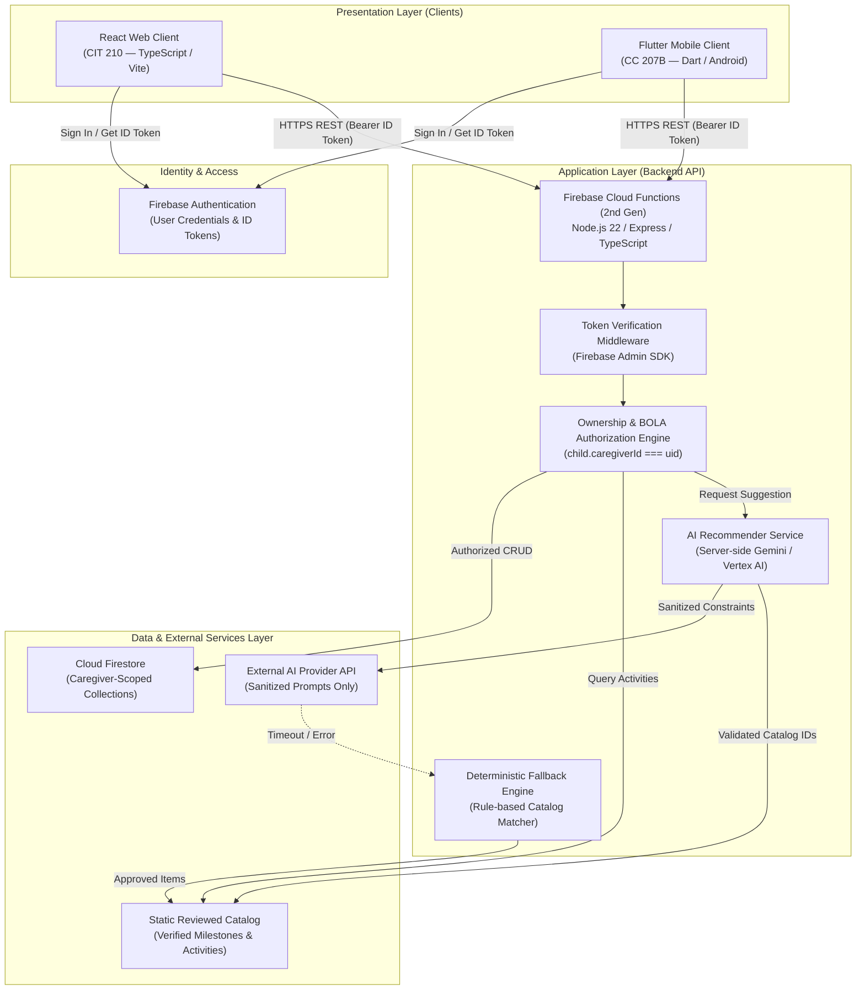

# LittleSteps Architecture Decisions

**Status:** Canonical Architecture Description Baseline  
**Governing Standard:** ISO/IEC/IEEE 42010:2022 (Software Architecture Description)  
**Related Documents:** [Data Model Specification](data-model.md), [OpenAPI Specification](https://github.com/Thesis-Titans/littlesteps-api/blob/main/openapi/openapi.yaml), [Product Scope](product-scope.md)

---

This document records architectural decisions for LittleSteps using the Michael Nygard ADR format (*Status, Context, Options Considered, Decision, Consequences*).

---

## 1. Architectural Component Topology

Component layout and request flow across clients, backend services, and datastores:

---

## 2. Architecture Decision Records (ADRs)

### ADR-001: Unified Shared Backend Architecture
- **Status:** Accepted
- **Context:** LittleSteps encompasses both a web client (evaluated under CIT 210) and a mobile client (evaluated under CC 207B). Maintaining divergent backends, duplicate databases, or inconsistent business rules would double maintenance overhead and introduce security divergences.
- **Options Considered:**
  1. *Independent Backends:* Separate Firebase projects and data models for mobile and web.
  2. *Client-Direct Firebase Access:* Clients querying Firestore directly via client SDKs.
  3. *Unified Shared REST API:* Single server-side API managing all data persistence, business logic, and security rules for both clients.
- **Decision:** Implement a single shared HTTP REST API, unified data model, and centralized authorization layer serving both web and mobile frontends.
- **Consequences:**
  - *Positive:* Enforces single source of truth for business logic; ensures consistent security enforcement; satisfies CIT 210 (API integration) and CC 207B (cloud persistence & AI integration) concurrently.
  - *Trade-off:* Requires client-neutral API contract management (OpenAPI 3.1) and coordinated versioning.

---

### ADR-002: Backend Runtime & Framework Selection
- **Status:** Accepted
- **Context:** The shared backend requires static typing, modular Express routing, and deterministic local emulation for testing.
- **Options Considered:**
  1. *Python FastAPI:* Strong data science libraries, but complicates Firebase integration.
  2. *Go HTTP Service:* High performance, but higher boilerplate for the project schedule.
  3. *Node.js 22 + TypeScript + Express on Cloud Functions (2nd Gen):* Native Firebase SDK support, familiar TypeScript typing shared with React web client, managed HTTP hosting.
- **Decision:** Use Node.js 22, TypeScript, and Express hosted as a 2nd Gen HTTP Cloud Function.
- **Consequences:**
  - *Positive:* Type checking across API routes and schemas; Express middleware; integration with the Firebase Emulator Suite.
  - *Constraint:* Cold start latency on 2nd Gen functions must be managed; local emulation requires Java 21 runtime.

---

### ADR-003: Authentication & Broken Object Level Authorization (BOLA)
- **Status:** Accepted
- **Context:** Child profiles and qualitative observations constitute sensitive personal data requiring strict tenant isolation per caregiver.
- **Options Considered:**
  1. *Custom JWT Auth:* Full control, but high cryptographic implementation risk.
  2. *Client-Direct Firestore Security Rules:* Standard Firebase pattern, but Admin SDK in Cloud Functions completely bypasses Firestore rules.
  3. *Firebase Authentication with Server-Side Admin SDK Verification & Application-Level BOLA Checks:* Firebase handles identity tokens; server decodes tokens and enforces data ownership programmatically.
- **Decision:** Firebase Authentication manages identity; the backend API verifies ID tokens via the Firebase Admin SDK and programmatically validates that `child.caregiverId === authenticatedUid` on every child-scoped operation.
- **Consequences:**
  - *Positive:* Uses verified identity tokens and requires server-side ownership checks to mitigate forged-identity and broken-object-level-authorization risks. These controls must be verified with negative authorization tests.
  - *Trade-off:* Every API endpoint must explicitly call the ownership verification service before reading or mutating records.

---

### ADR-004: Primary Persistence Layer (Cloud Firestore)
- **Status:** Accepted
- **Context:** The system requires a flexible, document-oriented datastore supporting hierarchical child-caregiver relationships, offline-ready local emulation, and scalable cloud hosting.
- **Options Considered:**
  1. *Relational Database (PostgreSQL / Cloud SQL):* Strict schemas, but higher operational cost and more complex emulator setup.
  2. *Cloud Firestore:* Serverless NoSQL document database, local Firebase Emulator integration, fast document lookups by ID.
- **Decision:** Adopt Cloud Firestore as the primary datastore, organized with top-level caregiver and child-scoped subcollections.
- **Consequences:**
  - *Positive:* Zero infrastructure management; full local emulation via Firebase CLI; low latency for document CRUD.
  - *Trade-off:* Complex relational queries or multi-table joins are unsupported; aggregation (e.g., weekly summaries) must be calculated in application code.

---

### ADR-005: Canonical API Contract via OpenAPI 3.1
- **Status:** Accepted
- **Context:** Coordinating the Flutter client, React client, and backend requires a version-controlled, machine-readable interface contract to reduce integration drift.
- **Options Considered:**
  1. *Ad-hoc Markdown Route Lists:* Informal and prone to drift from actual implementation.
  2. *Code-First Documentation (Swagger JSDoc):* Scattered across controllers and difficult to review in isolation.
  3. *Contract-First OpenAPI 3.1 Specification (`openapi/openapi.yaml`):* Single source of truth in the API repository governing request/response envelopes, status codes, and schemas.
- **Decision:** Maintain `openapi/openapi.yaml` in `littlesteps-api` as the authoritative contract. Both frontends must implement client models strictly aligned with this contract.
- **Consequences:**
  - *Positive:* Unambiguous API expectations; automated contract validation; enables mock generation and schema testing.
  - *Constraint:* API modifications must be committed to `openapi.yaml` before or alongside endpoint implementation.

---

### ADR-006: Server-Side AI Recommender with Deterministic Fallback
- **Status:** Accepted
- **Context:** CC 207B requires an AI-powered core feature (Item 12). However, generative AI introduces hallucination risks, non-deterministic outputs, latency spikes, and potential child privacy violations if unconstrained.
- **Options Considered:**
  1. *Client-Direct AI SDK Calls:* Client calls Gemini directly using client-side API keys. (Rejected: violates CC 207B Item 14 credential isolation; exposes keys).
  2. *Open-Ended Child Diagnostic Chatbot:* Conversational bot answering questions about developmental milestones. (Rejected: high liability, violates clinical non-diagnostic boundary).
  3. *Constrained Server-Side Activity Recommender with Deterministic Fallback:* Cloud Function maps caregiver constraints to approved catalog item IDs, sanitizes prompts, labels outputs with AI badges, and falls back to deterministic rule matching on provider failure.
- **Decision:** Implement the AI helper exclusively server-side, constrained strictly to approved catalog IDs, with an 8-second timeout and automatic deterministic catalog fallback.
- **Consequences:**
  - *Positive:* Keeps provider credentials on the server and limits suggestions to reviewed catalog entries. The deterministic fallback can return suggestions when the AI provider fails, provided the API and catalog are available. It does not guarantee offline availability or eliminate all model risks. Course criteria must be verified against the implementation and evaluation rubric.
  - *Trade-off:* Recommender cannot invent entirely novel activities on the fly; all suggested activities must exist in the curated catalog.

---

### ADR-007: Docs-as-Code & PR-Gated Change Control
- **Status:** Accepted
- **Context:** Coordinating five team members across three repositories requires strict change control and branch management to prevent merge conflicts and preserve codebase integrity.
- **Options Considered:**
  1. *Direct Commits to Main:* Fast, but high risk of breaking shared builds and introducing unreviewed code.
  2. *Feature Branching with Mandatory Peer Review & CI Verification:* All work occurs on topic branches (`feat/*`, `docs/*`, `fix/*`), requires passing automated CI checks, and requires at least one teammate review.
- **Decision:** Enforce branch protection on `main` across all repositories. Changes require a pull request, passing CI checks, and peer approval.
- **Consequences:**
  - *Positive:* Clean git audit trail; satisfies CC 207B collaboration and peer review criteria; protects frozen `littlesteps-mobile` repository from unintentional mutations.
  - *Trade-off:* Requires team discipline in opening PRs and conducting timely code reviews.
