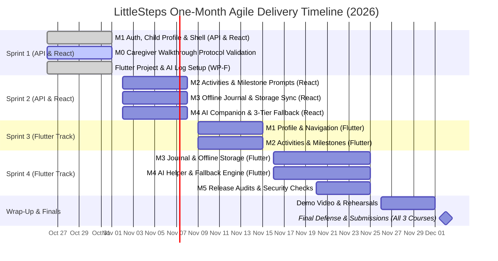

# LittleSteps Execution Plan

**Status:** Canonical Delivery Baseline & Work Breakdown Structure  
**Governing Standard:** PMBOK 7th Edition / ISO 21500 & Agile Scrum Baseline  
**Owner:** Mark Alvin Cadangin (Technical Lead)  
**Last Reviewed:** 2026-10-26  
**Related Documents:** [API Reference & Integration Guide](api-reference.md), [Product Scope](product-scope.md), [Traceability Matrix](traceability-matrix.md), [Academic Deliverables](academic/README.md)

---

This plan defines the proposed delivery sequence for LittleSteps across three coordinated courses. Milestones describe intended outcomes; they do not indicate completion unless linked evidence confirms the exit criteria.
- **CC 207B — Applications Development and Emerging Technologies:** Flutter mobile application with 6 core features, user-facing AI, live demo, and individual code defense.
- **CIT 210 — Web Systems and Technologies:** React web client using shared API & database, local demo, and documentation.
- **CIT 246 — IT Project Management Plan:** 25–40 page Project Management Plan governing the proposed production delivery of the Flutter mobile client and shared backend infrastructure, with Checkpoint 1 due October 14, 2026 and final defense on December 2, 2026.

Canonical product requirements remain in [Product Scope](product-scope.md), architecture decisions in [Architecture Decisions](architecture-decisions.md), security requirements in [Security, Privacy, and AI Safeguards](security-privacy-ai.md), and the client/server contract in the API repository's [OpenAPI specification](https://github.com/Thesis-Titans/littlesteps-api/blob/main/openapi/openapi.yaml).

## 1. Academic Calendar & Delivery Approach

### 1.1 Hard Academic Deadlines
- **October 14, 2026:** **CIT 246 Checkpoint 1** (One-page project concept covering Organization, Problem, Proposed System, and Possible Sponsor; A4, Arial 11). Documented in [CIT 246 Checkpoint 1 Concept](academic/cit246/checkpoint-1-concept.md).
- **December 2, 2026:** **Final Submission & Demonstrations for All Three Courses:**
  - **CC 207B:** LMS submission, 5–10 min presentation, live demo + backup video, and **Individual Code Defense** (2–3 min/member with live code modification). Self and peer assessment follows the day after. See the [CC 207B requirements](academic/cc207b/README.md).
  - **CIT 210:** Presentation, local live demo of React app reading/writing shared data, and shared documentation.
  - **CIT 246:** Final 25–40 page Project Management Plan for a 6–12 month project (one PDF on Google Drive plus a printed copy), 15 min presentation + 5 min Q&A by the three-member CIT 246 team. Checkpoint 2 and 3 dates are still to be announced. See §1.4.

**Build window:** the API, React and Flutter work for CIT 210 and CC 207B is built in one month, **October 26 to November 25, 2026**, followed by a wrap-up week before the December 2 finals.

### 1.2 Delivery Approach
Use **lightweight Scrum with a visible GitHub issue backlog** and one-week sprints.

- **Product scope:** The six features in Product Scope remain the target scope. This plan orders delivery; it does not silently remove features.
- **Execution order:** **React first, then Flutter.** In weeks 1–2 each milestone (M1–M4) is built through the shared API and the React web client (CIT 210). In weeks 3–4 the Flutter mobile client (CC 207B) mirrors the finished React screens on the same API, milestone by milestone. Keep the API contract client-neutral so the Flutter client needs no API changes. React is where the team practises the features, since everyone already knows React; Flutter applies what was built there. See §1.3 for the Flutter track.
- **Iteration length:** one-week sprints, as in the calendar below. Team capacity: all five members are available for the whole build window.

| Sprint | Dates | Track | Milestones | Sprint goal |
|---|---|---|---|---|
| 1 | Oct 26 – Nov 1 | API + React | M1, start M2 | Sign-in, child profile and account pages work end to end; catalog API started. Caregiver walkthrough of the Figma prototype and low-fidelity wireframes done this week. Flutter project set up in the background. |
| 2 | Nov 2 – Nov 8 | API + React | M2, M3, M4 | Catalog, activity planning, milestone observations, private journal, "This week" and the AI helper with its fallback work in React. |
| 3 | Nov 9 – Nov 15 | Flutter | M1, M2 | Flutter sign-in, child profile, account pages, catalog, activity planning and milestones on the shared API. |
| 4 | Nov 16 – Nov 25 | Flutter | M3, M4, M5 audits | Flutter journal, "This week" and AI helper; API, React and Flutter release audits. |
| Wrap-up | Nov 26 – Dec 1 | All | M5 | Android demo build and backup video, CC 207B documentation package, CIT 210 documentation, code-defense practice, CIT 246 final PDF. |

- **AI use:** AI tools may assist engineering workflows on the API and React client for scaffolding, test generation, and debugging. Flutter code is authored by team members, and any AI-generated code snippets, text content or assets used in the Flutter app are recorded in the AI Usage Log per CC 207B requirements (§1.3). Every member must understand and be prepared to defend all logic during the individual code defense.
- **Planning unit:** Small, independently reviewable issues with a clear outcome, acceptance criteria, dependencies, and verification steps. Split issues further only when implementation details are known.
- **Review:** Every change goes through a pull request. At least one teammate must review each PR (graded in CC 207B collaboration criteria). API, Web and Flutter checks must pass; security and privacy acceptance criteria apply to child-scoped features.
- **No speculative implementation:** Resolve product/data-contract questions before coding dependent features. Use synthetic fixtures for engineering work when reviewed catalog content is unavailable.

### 1.3 Flutter track (CC 207B)

CC 207B grades a Flutter application built on the same API and data as the web client. Its rules shape how the whole team works:

- **Everyone writes Flutter.** CC 207B requires meaningful commits from all five members and a 2–3 minute individual code defense with a live edit. Every member therefore owns at least one Flutter feature slice end to end (screen, state, API calls, validation and tests). Each member owns the same feature in the API, React and Flutter, so the Flutter slice mirrors React work they already understand:

| Feature | Backend (API) | Frontend (React) | Flutter (Sprints 3–4) |
|---|---|---|---|
| App shell, design tokens, navigation | — | Nherie (react #18) | Mark (flutter #2, project setup) |
| Sign-in and protected API client | Mark | Mark (react #5) | Justin (flutter #3) |
| Account, settings, privacy, help, your data | Justin (api #17) | Faith (react #16) | Faith (flutter #4) |
| Child profile (FR-01) | Justin (api #7, #8) | Nherie (react #6) | Vincent (flutter #5) |
| Learning catalog (FR-04) | Vincent (api #9) | Faith (react #7) | Vincent (flutter #6) |
| Activity planning (FR-02) | Vincent (api #10) | Nherie (react #8) | Nherie (flutter #7) |
| Milestone observations (FR-01) | Justin (api #16) | Faith (react #17) | Faith (flutter #8) |
| Private journal (FR-03) | Faith (api #11) | Nherie (react #9) | Nherie (flutter #9) |
| "This week" summary (FR-05) | Vincent (api #12) | Nherie (react #10) | Justin (flutter #10) |
| AI helper (FR-06) | Mark (api #13) | Justin (react #11) | Mark (flutter #11) |
| Weather hint (optional stretch) | — | Unassigned (react #19) | — |
| Release checks and submission | Justin (api #14) | Vincent (react #13) | Faith (flutter #12), Mark (flutter #13) |

  Each member owns **two Flutter screens of similar size**, matched to their strengths, built after the React work on the finished API. Docs: Vincent (content sources docs #3, CIT 210 docs and demo docs #56), Nherie (wireframes docs #44), Faith (parent walkthrough docs #15), Mark (AI Usage Log flutter #14). Agreed by the team on 26 October 2026 (docs #55).

  **Roles.** Everyone is full-stack; these are leanings. **Mark:** project lead and **technical lead**, owning the API contract, data model, sign-in, security rules and the AI service; reviews across features and merges. **Justin:** backend lead. **Nherie:** frontend lead. **Vincent:** backend and docs lead. **Faith:** frontend, backend support and QA. Mark, Faith and Nherie also carry CIT 246. GitHub teams: `@Thesis-Titans/littlesteps` (everyone), with `littlesteps-backend`, `littlesteps-frontend` and `littlesteps-docs` under it, plus `@Thesis-Titans/cit246`.

  **Feature pairs.** The backend and frontend owners of a feature agree the API request and response shape in the feature issue first, and Mark approves it. Partners review each other's pull requests; changes to the API contract, sign-in or the AI service also need Mark's review.
- **Repository:** Flutter work happens in `Thesis-Titans/littlesteps-flutter` for now. If the course instructor provides a repository to fork, move the work there by pushing the full Git history (all branches and tags), never by copying files, so each member's commits survive. Pull-request reviews do not move with Git history, so ask the instructor early whether reviews in `littlesteps-flutter` count, or start using the course repository as soon as it exists.
- **Platform:** Android phones (the [architecture](architecture-decisions.md) targets Dart on Android, and the personas use Android). Flutter stable channel with Material 3.
- **Design source:** the reviewed 375px mobile-web frames, adapted to Material 3 widgets as listed in the [UI/UX Design Specification](ui-ux-design-specification.md) §9. Flutter screens are not prototyped separately.
- **Collaboration is graded from history.** CC 207B grades the commit and pull-request history, and peer ratings (20% of each member's score) must cite contributions visible in GitHub. From now on each member commits their own work from their own account, including docs and planning, and reviews teammates' pull requests.
- **AI Use Policy.** Members write their own Flutter code. AI-generated code snippets, text content and image assets used in the Flutter app must be recorded in the AI Usage Log; generating the application wholesale is not allowed; reflections and self and peer assessments are written without AI. See [CC 207B requirements](academic/cc207b/README.md) §3. This rule applies to the CC 207B Flutter app; the API and React work may use AI freely (§1.2).
- **UI must follow the presented prototypes.** CC 207B requires the app's UI to follow most of the low- and high-fidelity prototypes the group presented in class. Confirm with the instructor which prototypes count. The Figma file has high-fidelity frames but no low-fidelity wireframes yet (see §8).
- **Course requirements mapped to the plan:**

| CC 207B requirement | Where it is met |
|---|---|
| Six core user-facing features (sign-in, splash, About and Settings do not count) | FR-01 to FR-06, delivered in M1–M4 |
| Async operations with visible loading, empty and error states | UI/UX spec §7 state matrix, built in every Flutter screen |
| At least one validated form with clear error feedback | Child profile form (J1), plus the observation and journal forms |
| Data persistence (local storage or Firebase) | The shared API and Firestore, plus local storage for drafts and the dismissed advisory |
| User-facing AI feature with graceful failure and data minimization | FR-06 AI helper, M4 |
| Folders organized by purpose, with comments on significant code | littlesteps-flutter #2: `lib/screens`, `lib/widgets`, `lib/models`, `lib/services`, `assets/` and the comment convention |
| README with setup and run steps; secrets excluded through `.gitignore` | littlesteps-flutter #2 |
| Libraries and packages with their purpose; technology stack with versions | The README packages table from littlesteps-flutter #2, compiled into the documentation in M5 |
| Low- and high-fidelity prototypes | High-fidelity Figma frames exist; low-fidelity wireframes still to create (§8) |
| Documentation package (overview, functional requirements, Topic Coverage Matrix, AI Feature Specification, future enhancements and roadmap, AI Usage Log, individual reflections) | Prepared during M5 (littlesteps-flutter #13) |
| Self and peer assessment (30% of each member's score) | Contributions visible in the commit and pull-request history |
| Forked repository, feature branches, teammate-reviewed pull requests | This section and §5 |

- **Repository setup:** tracked in littlesteps-flutter #2 (folders, comment convention, `.gitignore`, README, packages list, contributor guide, templates and a CI check running `flutter analyze` and `flutter test`). Milestones M1–M5 exist. The repository is private, and branch protection on a private repository needs a paid GitHub plan, so either make it public like the other repositories or enforce teammate review by team agreement until it moves.

### 1.4 CIT 246 Project Management Plan

CIT 246 is a separate deliverable from this execution plan. This plan schedules the one-month course build; the CIT 246 plan is the document the three-member CIT 246 team (Mark, Faith and Nherie) writes as the project management team for a proposed IT project.

- **Practice timeline:** the 6–12 month schedule in the CIT 246 plan is a planning exercise, not the team's real schedule. The real build is compressed into the one month above. The CIT 246 work still feeds this project: its risk register, stakeholder analysis, quality plan and communication plan are used here.
- **What system it plans:** because CIT 246 is coupled with CC 207B, the plan describes the **Flutter Android app** on the shared Node.js/TypeScript API with Firebase Authentication and Firestore. The React web client (CIT 210) is not part of the CIT 246 plan.
- **Where it is written:** Markdown in [`docs/academic/cit246/`](academic/cit246/README.md), reviewed through pull requests so each member's work is visible, then exported to the A4, Arial 11 PDF for submission.
- **What it plans:** a **6–12 month** project for the proposed client (the City Social Welfare and Development Office [CSWDO] La Paz–Lapuz District office in Iloilo City), covering build, pilot, training and handover, with a defensible budget **in pesos**. Production costs that the course build avoids belong there, for example the paid Gemini tier or Vertex AI required before real caregivers use the AI helper ([ADR-008](architecture-decisions.md)) and the Firebase Blaze plan for deployment.
- **No code:** the group plans the project and does not build it for this course.
- **Structure:** the instructor's 17-section template, the 12 key deliverables and the course and Schwalbe formats, as listed in the [CIT 246 requirements](academic/cit246/README.md).
- **Checkpoints:** Checkpoint 1 (concept) was due 14 October; its approval is not yet recorded. Checkpoint 2 (sections 3–6) and Checkpoint 3 (sections 7–9) dates are to be announced.
- **Client:** the plan's client is the CSWDO La Paz–Lapuz District office, researched from public sources and not contacted, by team decision. The plan says so openly in Appendix 17 instead of the evidence of contact the brief asks for, and uses sourced facts and labelled estimates.
- **Reusable inputs:** product scope (in and out of scope), architecture decisions, the security and privacy safeguards, and the work packages in §4, rewritten in the course formats rather than copied.

## 2. Product Target & Team Sizing Derivation

Under CC 207B requirements, the minimum number of core features scales with team size: **5 members require at least 6 core features** ($5 \rightarrow 6$), where the AI-powered feature counts as one core feature. A core feature must be a user-facing flow taking input, performing processing/state change, and producing a meaningful result (auth, splash, About, and Settings do not count).

The six core capabilities (formally specified in [Product Scope](product-scope.md)) are:

1. **FR-01: Child Profile and Milestone Tracking** (Caregiver input $\rightarrow$ profile persistence $\rightarrow$ observation display).
2. **FR-02: Daily Activity Planning and Tracking** (Activity selection $\rightarrow$ scheduling/completion state $\rightarrow$ calendar/timeline update).
3. **FR-03: Private Observation Journal** (Caregiver observation input $\rightarrow$ secure storage with encryption at rest and BOLA access control $\rightarrow$ chronological journal display).
4. **FR-04: Story, Rhyme, and Learning Activity Library** (Search/filter criteria $\rightarrow$ catalog query $\rightarrow$ filtered learning resource view).
5. **FR-05: Weekly Progress Summary** (Activity/milestone records $\rightarrow$ non-diagnostic aggregation $\rightarrow$ weekly reflection report).
6. **FR-06: AI Activity Suggestion Helper** (Caregiver constraints $\rightarrow$ constrained catalog match $\rightarrow$ recommended activities with fallback).

Deliver these in dependency order, not as six parallel projects.

## 3. Milestones and exit criteria

### M0 — Project execution readiness
**Scope Traceability:** Governs preparation and validation for all six features (**FR-01** to **FR-06**) and baseline security/privacy policies.

**Outcome:** One agreed scope, an ordered backlog, a usable board, and clear acceptance rules.

Exit criteria:
- The documentation-standardization work is reconciled; stale governance tasks are closed only after their actual acceptance criteria are met.
- The product backlog is separated from repository-maintenance work.
- Each execution issue has acceptance criteria, dependencies, and a verification approach.
- Every execution issue has an owner and a milestone due date in the sprint calendar (§1.2).
- The OpenAPI contract and product-scope documents are identified as the requirements sources of truth.
- A navigable Figma prototype covering all six product capabilities (**FR-01** to **FR-06**) has been reviewed; findings and scope decisions are recorded.
- The caregiver walkthrough runs during Sprint 1 alongside M1; its findings are folded into the M2–M4 screens before they are built.

**Prototype gate:** Create and review a navigable **Figma** prototype covering desktop (1280px) and mobile-browser (375px) views. Because the build window is one month, the prototype no longer blocks M1: sign-in, child profile and the API foundation start on October 26 while the walkthrough runs in the same week. Follow the [UI/UX design specification](ui-ux-design-specification.md) and use synthetic data and simulated services. AI-assisted tooling is optional and does not replace design review or usability validation. Include key empty, loading, error, permission-denied, and deterministic AI fallback states, making privacy and non-diagnostic boundaries visible. Track this work in [Docs Issue #15](https://github.com/Thesis-Titans/littlesteps-docs/issues/15). The prototype is a validation artifact, not a substitute for API contract design or implementation tests. CC 207B also requires low-fidelity prototypes in its documentation, so sketch or wireframe the main journeys alongside the Figma prototype.

### M1 — Secure end-to-end foundation
**Scope Traceability:** Implements foundation for **FR-01** (Child Profile); enforces **NFR-SEC-01** (Token auth), **NFR-SEC-02** (BOLA defense), and **NFR-PRIV-01** (Data minimization).

**Outcome:** A signed-in caregiver can use the Web and Flutter clients to work with a child profile through the shared API and local Firebase emulators.

Planned work:
- Agree on the minimum caregiver/child data model, ownership relationship, validation rules, and deletion/retention questions.
- Extend the OpenAPI contract before implementing new endpoints.
- Implement and test child-scoped API operations with server-side ownership checks (**NFR-SEC-02**).
- Integrate Web sign-in, token handling, API error/loading states, and protected routes.
- Set up the Flutter project (Android target, Material 3 theme from the design tokens, lint, tests and CI), then integrate Firebase sign-in, token handling and the shared API client with the same loading and error states.
- Build the child profile form in both clients with birth month and year pickers and field-level validation (CC 207B validated form).
- Verify the end-to-end path with synthetic users/data using the emulator-first workflow.

Exit criteria:
- Requests without valid authentication are rejected (**NFR-SEC-01**).
- A caregiver cannot read or mutate another caregiver's child data, including by changing an identifier (**NFR-SEC-02**).
- Input validation and safe error responses are tested (**NFR-SEC-04**).
- API contract, implementation, and the Web and Flutter clients agree.
- Relevant API, Web and Flutter CI checks pass.

### M2 — Reviewed learning content and core activity loop
**Scope Traceability:** Implements **FR-02** (Activity Planning), **FR-04** (Learning Library), and observation prompts for **FR-01**; enforces **NFR-PRIV-03** (Synthetic fixtures).

**Outcome:** A caregiver can discover eligible content and plan/record activities.

Planned work:
- Define catalog item fields, age-band filtering, content lifecycle/status, and source metadata.
- Implement catalog read/list behavior and Web and Flutter browsing/filtering (**FR-04**).
- Implement activity planning, scheduling/recording, and completion history in the API and both clients (**FR-02**).
- Add milestone observation prompts (**FR-01**) only when the source and review gate permits their use.
- Cover empty, loading, error, invalid-input, and authorization states.

Exit criteria:
- API responses follow the OpenAPI contract.
- Content is age-filtered and shows source/limitations where applicable.
- No unreviewed or invented catalog items are presented as approved.
- Child-scoped activity records enforce ownership (**NFR-SEC-02**).
- Unit and emulator integration tests cover the principal success and failure paths.

**Content gate:** [Docs Issue #3](https://github.com/Thesis-Titans/littlesteps-docs/issues/3) remains a separate dependency for real Philippine milestone/activity content. Engineering can use clearly labelled synthetic fixtures, but must not treat those fixtures as reviewed production content.

### M3 — Private journal and weekly reflection
**Scope Traceability:** Implements **FR-03** (Private Journal) and **FR-05** (Weekly Progress Summary); enforces **NFR-PRIV-02** (Journal confidentiality & AI isolation).

**Outcome:** Caregivers can keep private observations and review a factual summary of recorded activity.

Planned work:
- Define journal privacy and retention/deletion behavior before exposing the feature (**NFR-PRIV-02**).
- Implement private journal create/read/update/delete behavior with ownership tests (**FR-03**).
- Define the summary calculation from recorded events before designing summary UI (**FR-05**).
- Implement weekly summaries that describe recorded activity without diagnostic scores or unsupported developmental conclusions.
- Build the journal and the "This week" summary in both clients.

Exit criteria:
- Unauthorized journal access is tested and denied (**NFR-SEC-02**).
- Private notes are excluded from logs and external AI prompts (**NFR-PRIV-02**).
- Summary calculations are deterministic and covered by tests.
- UI handles no-data and partial-data periods clearly.

### M4 — Constrained AI activity suggestions
**Scope Traceability:** Implements **FR-06** (AI Activity Suggestion Helper); enforces **NFR-AI-01** (Relevance), **NFR-AI-02** (Server credential isolation), **NFR-AI-03** (Deterministic fallback), **NFR-AI-04** (Visual labeling & non-diagnostic rule), and **NFR-REL-01** (Rate limits).

**Outcome:** Optional suggestions can be generated from approved catalog entries without sending unnecessary child data.

Planned work:
- Agree on the suggestion input/output schema and allowed catalog identifiers.
- Define provider selection, data handling, timeout (8s), rate/cost limits, and configuration.
- Validate every result against the schema and approved catalog.
- Provide a deterministic fallback for provider errors or invalid responses.
- Add tests for prompt-data minimization, invalid outputs, provider failures, and rate limits.
- Build the AI helper in both clients with all of its states: form, loading, suggestion, rate-limited and fallback.

Exit criteria:
- Suggestions only reference approved catalog IDs.
- No direct child identifiers or private journal entries are sent to the provider (**NFR-PRIV-01**, **NFR-PRIV-02**).
- Failure paths fall back safely to deterministic catalog matching and are observable without logging sensitive content.
- The Gemini free-tier conditions in [ADR-008](architecture-decisions.md) hold; the terms are rechecked at M4 and before the demonstration, and only synthetic data is used.
- If time allows: the optional Open-Meteo weather hint ([ADR-009](architecture-decisions.md)) on Today and in the AI helper, with attribution and silent failure. It is the first item dropped if the schedule slips.

### M5 — Release-readiness review
**Scope Traceability:** Full cross-cutting verification of **FR-01** through **FR-06**, all **NFRs**, and coordinated deliverables for CC 207B, CIT 210, and CIT 246.

**Outcome:** The team can demonstrate a coherent, tested API, Web and Flutter release without claiming production readiness prematurely.

Exit criteria:
- Cross-feature authorization and regression tests pass across all six core features.
- Keyboard access, responsive behavior, and common error states are checked.
- Privacy notice, retention/deletion approach, and appropriate faculty/course instructor review are addressed.
- Firebase billing, budget alerts, environment configuration, provider settings, and rollback are reviewed before any deployment.
- Known limitations are documented and accepted by the team and course instructor.
- The Flutter app runs on an Android phone for the CC 207B live demo, with a recorded backup video, and each member can explain and modify their own Flutter code.
- The React web client executes complete, stable live user journeys on local Firebase emulators for the CIT 210 demo (profile CRUD, routine plan, journal, catalog search, AI fallback), with API integration explanations rehearsed and a backup demo recording prepared.
- If the instructor provided a course repository, the Flutter work has been moved there with its full commit history.

## 4. Backlog structure

Use epics/work packages to group work. Create implementation issues only after the relevant acceptance criteria and dependencies are clear.

| Work package | Main deliverables | Traceability (Standards & Scope) | Depends on |
|---|---|---|---|
| **WP-0: Execution readiness** | Reconciled governance work, agreed backlog and board conventions | PMBOK Scope Baseline, M0 | Existing documentation PRs/issues |
| **WP-0.5: Prototype and journey validation** | Navigable Figma prototype, reviewed caregiver journeys, documented findings | ISO 9241, FR-01–FR-06 validation | Product scope, architecture, privacy; M0 |
| **WP-1: Shared contract and data model** | API schema, ownership model, validation/error conventions | IEEE 1016 Interface View, NFR-SEC-02 | M0 and prototype review |
| **WP-F: Flutter foundation** | Flutter project and repository setup, Material 3 theme from the design tokens, shared API client, sign-in | CC 207B, PRQ-01–PRQ-03 | WP-1 |
| **WP-2: Authenticated child-profile slice** | API endpoints, ownership tests, Web and Flutter auth/profile flows, emulator | FR-01, PRQ-01, NFR-SEC-01, NFR-PRIV-01 | WP-1 |
| **WP-3: Learning catalog** | Catalog schema/API and Web and Flutter discovery | FR-04, Philippine content provenance | Content metadata decision; Issue #3 |
| **WP-4: Activity planning and observations** | Planning, completion history, safe observation records | FR-02, FR-01 milestones | WP-2, WP-3 |
| **WP-5: Private journal** | Private notes and retention/deletion behavior | FR-03, NFR-PRIV-02 | WP-2, privacy decisions |
| **WP-6: Weekly summary** | Defined summary rules, API output, Web and Flutter presentation | FR-05 (deterministic aggregation) | WP-4; journal data only if approved |
| **WP-7: AI helper** | Catalog-grounded suggestions, validation, fallback, cost controls | FR-06, NFR-AI-01..05, NFR-REL-01 | WP-3, WP-4, privacy/provider review |
| **WP-8: Release readiness** | Cross-feature regression, accessibility, security/deployment gates | All FR-01–FR-06, all NFRs, Course Deliverables | Relevant feature work |

The work packages are a planning hierarchy, not a commitment to implement all work in a single sprint. Keep the first implementation slice small: WP-1 and WP-2 establish a secure vertical path before broad feature work.

## 5. Issue quality and team workflow

Every implementation issue should contain:
- **User or engineering outcome:** what becomes possible or safer.
- **Scope:** what is included and explicitly excluded.
- **Acceptance criteria:** observable, testable outcomes.
- **Dependencies:** linked blocking issues or decisions.
- **Verification:** exact tests or manual checks expected.
- **Security/privacy notes:** especially for child-scoped or private data.
- **Definition of done:** implementation, tests, contract/docs updates, and review.

### Definition of Ready

An issue is ready for sprint planning only when its goal is clear, dependencies are identified, acceptance criteria are testable, and the team can estimate it without guessing about unresolved product decisions.

### Definition of Done

An issue is done only when the acceptance criteria are met, relevant automated checks pass, the API contract and documentation are updated when behavior changes, security/privacy paths are tested where applicable, and the reviewed PR is merged. A green build alone does not mean the feature is complete.

## 6. Board and monitoring

Use one cross-repository board for Docs, API, and Web execution work. Keep governance/documentation maintenance separate from the product backlog after the related work is accepted.

Recommended columns:
- **Backlog** — captured but not ready for a sprint.
- **Ready** — refined, dependencies known, acceptance criteria agreed.
- **In progress** — actively being worked on.
- **Blocked** — cannot progress; blocker and next action must be recorded.
- **In review** — pull request opened and verification underway.
- **Done** — merged and acceptance criteria verified.

Monitor these at each weekly review:
- work completed against the sprint goal;
- work carried over and why;
- blocked issues and age of blockers;
- failed checks/reopened issues;
- scope changes and their impact on the next milestone.

Keep work in progress small. Do not start dependent feature work while a key contract or security decision is unresolved. Do not treat issue count or lines of code as progress; use working, tested vertical outcomes.

## 7. Current constraints and open decisions

- **Content provenance:** Issue #3 remains open until source editions, exact locators, reuse terms, and appropriate review are confirmed. This blocks approval of real catalog content, not unrelated scaffold work.
- **Data model and privacy lifecycle:** Agree on caregiver-child ownership, required profile fields, deletion behavior, and retention before implementing persistent child/journal records.
- **Authentication:** Firebase token verification exists in the API scaffold, but Web sign-in and child-level authorization are not complete.
- **Deployment:** Local emulator work comes first. Deployment is gated on billing, privacy, security, and configuration review.
- **Mobile:** Flutter mirrors the React client in Sprints 3–4 (§1.2, §1.3). Open: whether the course instructor will provide a repository to fork, and whether reviews in `littlesteps-flutter` count toward CC 207B.
- **Schedule and assignments:** set in §1.2 (sprint calendar) and §1.3 (feature owners). The schedule has no slack inside the build window; if a sprint slips, the optional weather hint is dropped first, then polish on the M5 audits, never the Flutter slices needed for the code defense.

## 8. Project setup cleanup and execution handoff

### Completed repository-governance work

- [Docs Issue #8](https://github.com/Thesis-Titans/littlesteps-docs/issues/8) is closed after the five governance stages and cross-repository audit were recorded as complete.
- [Docs PR #12](https://github.com/Thesis-Titans/littlesteps-docs/pull/12) added the scoped documentation CI verifier and is merged.
- [Docs PR #6](https://github.com/Thesis-Titans/littlesteps-docs/pull/6) established the content-provenance protocol and is merged.
- [Web Issue #12](https://github.com/Thesis-Titans/littlesteps-react/issues/12) is closed after correcting the emulator region in the Web README.
- [Docs Issue #3](https://github.com/Thesis-Titans/littlesteps-docs/issues/3) remains open intentionally as the evidence, reuse-rights, and subject-matter review gate for real content. It is not a general repository-setup issue.

### M0 status — Sprint 1 starts October 26

Checked against GitHub on 26 October 2026 (Sprint 1 kickoff).

**Done**

- **Execution plan:** reviewed and merged in [Docs PR #13](https://github.com/Thesis-Titans/littlesteps-docs/pull/13), then revised in Docs PRs #29–#32 (repository renames, the Flutter restriction lifted, the Figma prototype gate and the design system review).
- **Project board:** [Thesis-Titans LittleSteps Project #2](https://github.com/orgs/Thesis-Titans/projects/2) holds 30 items from `littlesteps-docs`, `littlesteps-api` and `littlesteps-react`, with a Status field of Backlog, Ready, In Progress, Blocked, In Review and Done.
- **Native milestones:** `littlesteps-docs` has M0–M5; `littlesteps-api` and `littlesteps-react` each have M1–M5, and their execution issues are assigned to them.

**In progress**

- **Figma prototype ([Docs Issue #15](https://github.com/Thesis-Titans/littlesteps-docs/issues/15)):** the file matches the reviewed UI/UX specification, has a high-fidelity pass and a heuristic review, and its flows are wired (seven mobile flows, one desktop flow). Still to do in Sprint 1: the caregiver walkthrough with recorded findings.

**Still open**

- **Flutter track:** planned in §1.3, with feature owners assigned. Milestones M1–M5 and issues #2–#13 exist in `littlesteps-flutter`. Next: ask the course instructor about the fork and review rules.
- **Low-fidelity prototypes:** CC 207B documentation requires low- and high-fidelity prototypes, and the app's UI must follow those the group presented. Create low-fidelity wireframes for the main journeys and confirm with the instructor which prototypes count.
- **Client and walkthrough:** no client contact is planned (team decision). The CIT 246 client is the researched CSWDO La Paz–Lapuz District office, which also serves as CC 207B's realistic client. The prototype is checked informally with three to five parents the team knows, using the [parent walkthrough guide](parent-walkthrough-guide.md) ([Docs Issue #15](https://github.com/Thesis-Titans/littlesteps-docs/issues/15)).
- **CIT 246 checkpoints:** record Checkpoint 1's submission and approval, get the Checkpoint 2 and 3 dates, and confirm that three names and signatures are correct for the three-member team (§1.4).
- **Backlog readiness:** before each sprint, review its API and Web issues against the Definition of Ready, add blocking links where supported, and make sure each has testable acceptance criteria and verification steps. The Web issues predate the reviewed UI/UX specification; owners update them to match it before starting.
- **Board hygiene:** verify that project-management setup work is kept separate from product-delivery work on the board.
- **Team capacity:** confirmed on 23 October 2026: all five members are available for the whole build window. Revisit at each sprint review.

The coordination tracker is [Docs Issue #14](https://github.com/Thesis-Titans/littlesteps-docs/issues/14). Keep it open until the open items above are verified, then close it with evidence and begin product execution through normal backlog refinement and sprint planning.

## 9. Change control

This plan is a proposed delivery baseline. Changes to product scope, acceptance criteria, or milestone order should be discussed in backlog refinement and recorded through an issue/PR. Do not add features, external services, or architectural complexity without a stated user need and acceptance criterion.
