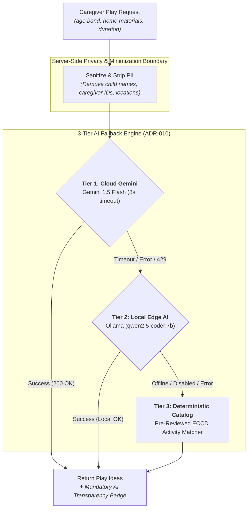

# LittleSteps Security, Privacy, and AI Safeguards

**Status:** Canonical Security & Non-Functional Requirements Baseline  
**Governing Standard:** ISO/IEC/IEEE 29148:2018 (Non-Functional Requirements) & RA 10173  
**Owner:** Mark Alvin Cadangin (Technical Lead)  
**Last Reviewed:** 2026-10-26  
**Related Documents:** [API Reference & Integration Guide](api-reference.md), [Product Scope](product-scope.md), [Data Model Specification](data-model.md), [Traceability Matrix](traceability-matrix.md)

---

This document defines proposed non-functional requirements (NFRs) and security/privacy controls informed by applicable guidance and law. It is an engineering specification, not legal advice or evidence of regulatory compliance. A requirement is not satisfied until implementation and verification evidence are recorded.

---

## 1. Statutory Context & Ethical Foundation

LittleSteps processes sensitive family and early-learning observations. System architecture and data management are designed to adhere to:
- **Republic Act No. 10173 (Data Privacy Act of 2012 / DPA):** Principles of transparency, legitimate purpose, proportionality, and strict data minimization.
- **Republic Act No. 12199 (Early Childhood Care and Development System Act of 2025 / ECCD System Act):** Amending and updating the national ECCD framework (previously RA 10410) for holistic child development, age-appropriate learning, and community-based support.
- **Republic Act No. 12080 (Basic Education Mental Health and Well-Being Promotion Act):** Ensuring developmental and emotional well-being activities are non-stigmatizing, age-appropriate, and non-clinical.
- **CC 207B AI & Security Criteria (§2a–d, §3):** Strict academic constraints governing server-side AI execution, zero client credential exposure, deterministic fallbacks, and ethical code authorship.

---

## 2. Security Non-Functional Requirements (NFR-SEC)

### NFR-SEC-01: Token-Based Identity & Verification
- **Requirement:** All authenticated API requests must supply a valid Firebase ID token via the standard `Authorization: Bearer <token>` HTTP header over HTTPS.
- **Verification Rule:** The backend Node.js API verifies tokens using the Firebase Admin SDK. The trusted caller identity is derived strictly from the decoded cryptographic token `uid`. The system must never trust or accept a client-supplied user identifier in URL parameters or request bodies as the authenticated identity.

### NFR-SEC-02: Broken Object Level Authorization (BOLA) Defense
- **Requirement:** Every child-scoped operation (child profiles, activity history, milestone observations, journal entries, progress summaries) must execute server-side authorization checks prior to performing any database read, mutation, or deletion.
- **Verification Rule:** The API checks that `child.caregiverId === authenticatedUid`. Any attempt to access, modify, or delete a resource belonging to another caregiver must result in a safe `404 Not Found` response with error code `RESOURCE_NOT_FOUND`. A `403 Forbidden` response must not be returned for cross-caregiver resource lookups because returning 403 confirms that the resource ID exists, leaking metadata to potential attackers.
- **Firestore Direct Access Boundary:** Firebase Admin SDK calls within Cloud Functions bypass Firestore Security Rules. Authorization checks must be implemented in API application code, while restrictive Firestore Security Rules must be deployed to block unauthorized direct client-SDK database access.

### NFR-SEC-03: Zero Secret Exposure & Credential Isolation
- **Requirement:** No API keys, Firebase service-account private keys, database credentials, AI provider keys, or signing secrets may be committed to Git repositories or exposed in frontend client bundles.
- **Verification Rule:** Frontend web and mobile builds must contain zero service secrets. Server secrets must be injected exclusively via Cloud Functions environment variables / Secret Manager. Local development must use the Firebase Emulator Suite and synthetic mock providers.

### NFR-SEC-04: HTTP Security, CORS Allowlist & Information Protection
- **Requirement:** The API must implement a restrictive Cross-Origin Resource Sharing (CORS) allowlist containing only explicitly registered frontend origins (for example, approved local development ports and verified staging domains). Wildcard origins (`*`) are strictly prohibited for authenticated endpoints.
- **Information Protection:** The API must strip stack traces, database schema details, and internal file paths from error responses. Standardized JSON error envelopes must return client-safe diagnostic codes and messages.

---

## 3. Privacy & Data Minimization Requirements (NFR-PRIV)

### NFR-PRIV-01: Proportionality & Data Minimization (RA 10173)
- **Requirement:** The system collects only the minimal data points necessary to deliver age-aware activity planning and milestone observation.
- **Specification:**
  - Avoid collecting exact birth dates; birth month and year (or coarse age band) are sufficient for milestone and activity navigation.
  - No biometric data, national ID numbers, or precise GPS coordinates are ever collected or stored.
  - The optional weather location is a city or municipality chosen by the caregiver, stored as a name and coordinates rounded to two decimal places, and sent only to Open-Meteo from the server ([ADR-009](architecture-decisions.md)). It is off by default and can be cleared.
  - A plain-language Privacy Notice must be presented to caregivers upon account registration, detailing data categories, processing purposes, retention periods, and deletion procedures.

### NFR-PRIV-02: Observation Journal Confidentiality & Isolation
- **Requirement:** Qualitative entries in the Private Observation Journal (FR-03) constitute private caregiver reflections and must be treated with maximum confidentiality.
- **Specification:**
  - Journal contents are strictly excluded from product analytics, telemetry, and error logging payloads.
  - Journal text is strictly prohibited from being passed into external AI prompts or shared across users.
  - Caregivers retain full data rights: edit, export, and hard deletion of journal entries must be supported.

### NFR-PRIV-03: Synthetic Data Policy for Evaluation & Testing
- **Requirement:** To completely eliminate accidental exposure of real children's data during academic evaluation, testing, and demonstrations, LittleSteps enforces an explicit synthetic data policy.
- **Specification:**
  - All test fixtures, automated integration tests, emulator seed data, and live demonstration accounts must use fictitious child profiles and synthetic caregiver names.
  - Live testing with real children's personal data is prohibited without documented institutional review and explicit parental consent.

---

## 4. Artificial Intelligence Safeguards & Governance (NFR-AI)

To satisfy the **CC 207B AI-Powered Feature Requirements (§2a–d, §3)**, the AI Activity Suggestion Helper (FR-06) operates under strict architectural and ethical constraints:

### NFR-AI-01: Relevance & Problem Fit (CC 207B §2a Relevance)
- **Caregiver Need:** Caregivers often have limited time, diverse home settings, and arbitrary materials on hand (e.g., "recycled boxes, plastic cups, spoons").
- **Technical Rationale:** Simple keyword matching often matches poorly when processing unstructured natural-language descriptions of household materials. The semantic helper matches caregiver constraints to eligible activity IDs from the reviewed catalog without rigid query rules. The storybook companion ([ADR-010](architecture-decisions.md)) is the one place the model writes new text: a short play idea for a public book, which the server validates before showing (NFR-AI-04).

### NFR-AI-02: Server-Side Execution & Credential Isolation (CC 207B §2b Security)
- **Execution Boundary:** All AI model invocations (Gemini API free tier under [ADR-008](architecture-decisions.md), deferring Vertex AI / paid tiers) execute exclusively server-side inside Cloud Functions.
- **Data Minimization in Prompts:** Prompts contain only sanitized constraint keywords: coarse age band, duration, environment, materials list and language. Zero child names, caregiver IDs, locations (including the weather city), or journal texts are ever included in prompts. The materials text is cleaned on the server before sending. Storybook companion prompts contain only the book title, its public subject tags and the age band.
- **Provider and free tier:** The provider is the Gemini API free tier, for development and the course demonstration only, with synthetic data. Google may use free-tier prompts to improve its products, which is why the minimization above is strict. Before any real caregiver uses the helper, move to the paid tier or Vertex AI. See [ADR-008](architecture-decisions.md).

### NFR-AI-03: Graceful Degradation & 3-Tier Fallback Hierarchy (CC 207B §2c Graceful failure)
- **Latency & Timeout:** AI calls are constrained to an 8-second execution timeout. Frontends render loading skeletons and progress indicators during inference.
- **3-Tier Fallback Hierarchy ([ADR-010](architecture-decisions.md)):**
  1. *Tier 1 (Cloud Primary):* Google Gemini API free tier with an 8-second bounded timeout.
  2. *Tier 2 (Local Edge AI Fallback):* Local Ollama (`http://localhost:11434/api/generate`) active in local dev/demo environments for network-independent demonstration.
  3. *Tier 3 (Deterministic Rule-Based Catalog):* If both cloud and local AI fail, timeout, or hit rate limits, the backend immediately executes deterministic rule-based catalog matching. The caregiver receives approved activities from the verified curriculum catalog without service interruption or application crashes.
- **Device offline:** If the caregiver's device is offline, it cannot reach the backend, so neither the AI helper nor the fallback can run. The app shows the offline state described in the [UI/UX Design Specification](ui-ux-design-specification.md) §7 instead of an error.

### NFR-AI-04: Ethical Transparency, Labeling & Non-Diagnostic Boundary (CC 207B §2d Responsible use)
- **Visual Labeling:** Every AI-generated suggestion must display an explicit AI badge, *"Suggested by AI"*, and the line *"You know your child best. Change it as you like, and stay close while you play."*
- **Caregiver Autonomy:** Caregivers can reject, regenerate, customize, or manually replace any suggestion.
- **Non-Diagnostic Rule:** The AI prompt system instructions strictly prohibit medical diagnosis, clinical developmental delay scoring, or pediatric treatment recommendations.
- **Generated Storybook Ideas:** Because storybook companion ideas are newly written rather than picked from the catalog, the server rejects any response that fails the schema, exceeds its length limits or contains a term from the non-diagnostic list (UI/UX Specification §8), and falls back to a reviewed catalog activity. Every generated idea shows its safety notice and the adult-supervision disclaimer.

### NFR-AI-05: Team Authorship & Code Defense Governance (CC 207B §3 AI Use Policy)
- Using generative AI to write the application wholesale without comprehension is strictly prohibited.
- AI-assisted development tools (e.g., IDE copilots for boilerplate or debugging) must adhere to course guidelines. For CC 207B (`littlesteps-flutter`), all AI use must be documented in the internal **AI Usage Log** per course requirement.
- Across all codebases, every team member must personally understand, explain, and defend their committed contributions during code reviews and the **CC 207B Individual Code Defense**.

---

## 5. Reliability, Performance & Rate Limiting (NFR-REL)

### NFR-REL-01: Performance & Operational Limits
- **API Response Latency:** Standard CRUD operations (profiles, activities, journal, summaries) must respond within 500ms under local emulator conditions.
- **Rate & Cost Limiting:** AI suggestion endpoints must enforce per-caregiver rate limits (e.g., maximum 10 requests per hour) to prevent API quota exhaustion and denial-of-wallet attacks. When rate limits are reached, the API responds with HTTP 429 `RATE_LIMITED` and a `Retry-After: 3600` header, and the client automatically triggers the Tier 3 deterministic catalog fallback.
- **Payload Constraints:** Request body parsers enforce a 100KB payload limit to prevent memory exhaustion attacks.

---

## 6. Pre-Deployment Release Gate

Prior to cloud production deployment, the team must complete and sign off on the following verification checklist:
1. Firebase project billing account active with budget alerts configured ($\le \$5.00$ threshold).
2. Production Firestore Security Rules deployed and verified against unauthorized client SDK read/writes.
3. CORS origin allowlist restricted to verified production web domain.
4. Privacy notice and data retention/deletion flows verified.
5. AI provider terms confirmed to ensure zero data retention for training on submitted prompt tokens.
6. Required local emulator integration and security tests pass, with failures resolved or explicitly documented before release.
