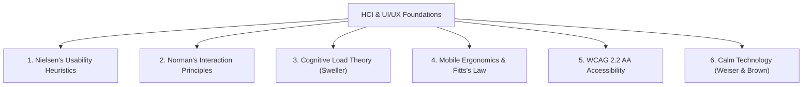
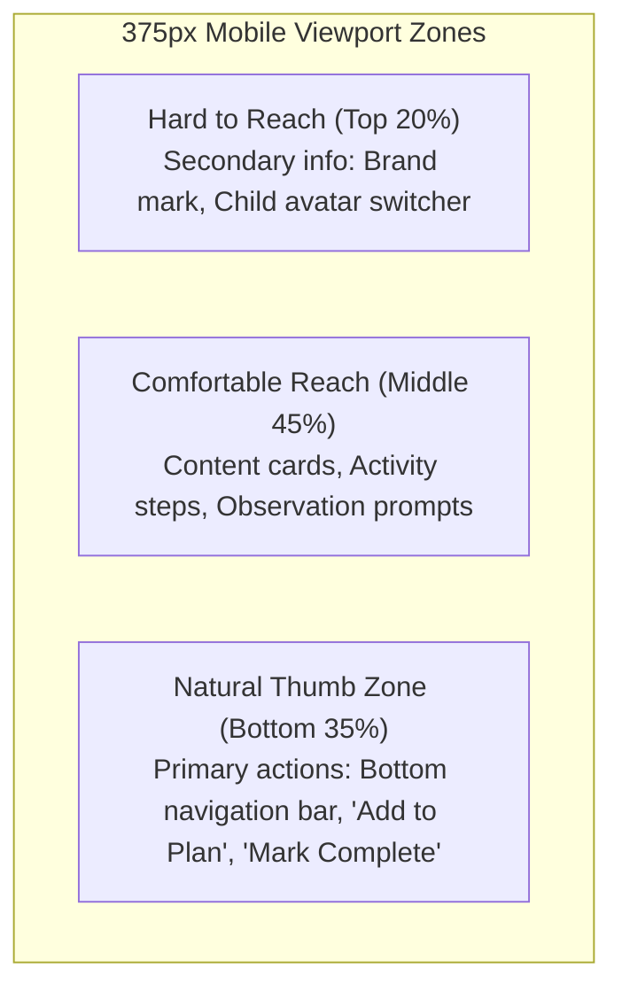
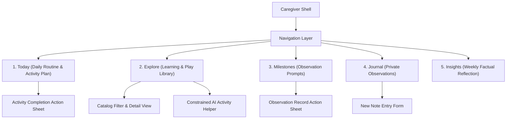

# LittleSteps UI/UX Design Specification & HCI Principles

**Status:** Canonical Design Specification for Prototype Validation  
**Governing Standard:** ISO 9241 (Ergonomics of Human-System Interaction) & WCAG 2.2 AA  
**Associated Gate:** [Docs Issue #15 — [M0] Plan and validate the LittleSteps UI prototype before implementation](https://github.com/Thesis-Titans/littlesteps-docs/issues/15)  
**Related Documents:** [Product Scope](product-scope.md), [Traceability Matrix](traceability-matrix.md), [Prototype Traceability & Storyboards](prototype-traceability-storyboards.md), [Philippine Content Provenance](philippine-content-provenance.md)  
**Repository Boundaries:** `littlesteps-mobile` (Flutter) and `littlesteps-api` remain strictly untouched.

---

## 1. Architectural Scope & Repository Boundaries

Before establishing interface specifications, the technical boundaries are explicitly affirmed:

1. **Gated Validation Before Implementation:** This document establishes the interaction and interface specification for the **Figma prototype and usability evaluation**. Feature implementation in code remains gated under [Docs Issue #15](https://github.com/Thesis-Titans/littlesteps-docs/issues/15).
2. **Mobile Experience via Responsive Web:** The mobile prototype experience is delivered exclusively via **responsive mobile browser layouts (375px–414px viewports) inside `littlesteps-web` (React + TypeScript)**.
3. **`littlesteps-mobile` (Flutter) is Strictly Frozen:** Under our agreed project boundary (CC 207B external course fork), `littlesteps-mobile` remains untouched on `main`. No Flutter code is planned or permitted for this prototype gate.
4. **Synthetic Data & Simulated Services Only:** The prototype operates entirely on in-memory mock client state and simulated latencies (`demo-littlesteps`). Zero live Firestore database writes or cloud billing.

---

## 2. Human-Computer Interaction (HCI) Framework & Design Principles

The LittleSteps interface is designed specifically for **caregivers of young children (0–71 months)**, a user population characterized by divided attention, physical multitasking (often holding an infant while operating a device), sleep deprivation, and high emotional vulnerability to developmental anxiety.

### 2.1 Nielsen’s Usability Heuristics Applied to Caregivers

| Heuristic | Caregiver Context & Friction | LittleSteps UI/UX Implementation |
|---|---|---|
| **1. Visibility of System Status** | Caregivers operating on spotty mobile data need immediate certainty that their observations are safe. | **Optimistic UI Updates:** 1-tap completion marks items immediately with a subtle status indicator (*"Saved locally ✓"* or *"Pending sync"*). Never freeze the screen or block interaction with full-page spinners. |
| **2. Match System with Real World** | Parents think in terms of daily family rhythms (morning playtime, naptime, wind-down), not database entities. | Information architecture mirrors household realities: *"Quick 10-min games"*, *"Kitchen items"*, *"Living room floor play"*. Avoid clinical terminology. |
| **3. User Control & Freedom** | Distracted caregivers holding infants frequently tap the wrong button. | **5-Second Undo Toast:** Destructive or state-changing actions (completing an activity, deleting a journal draft) trigger a floating, non-blocking undo toast rather than jarring modal confirmations. |
| **4. Consistency & Standards** | Caregivers must not re-learn interaction models between desktop and mobile. | Unified color semantics (Terracotta = primary actions; Amber = non-diagnostic advisory; Sage = outdoor/nature; Indigo = private lock). Standard bottom tab bar on mobile; persistent sidebar on desktop. |
| **5. Error Prevention** | Typing long notes while supervising toddlers leads to errors and frustration. | Constrained UI inputs: pickers and multi-select chips for materials and age bands. Simple **Parental Lock PIN** on mobile to prevent accidental toddler edits on shared family phones [P01 Evidence]. |
| **6. Recognition Over Recall** | Sleep-deprived caregivers have diminished working memory capacity. | Activity cards display required household items as visual pill tags at the top of the card. Step-by-step instructions chunked into a maximum of 3–4 concise bullet points. |
| **7. Flexibility & Efficiency** | Caregiver time availability varies wildly from day to day (5 minutes vs 30 minutes). | 1-tap quick filters on the home dashboard: *"Under 10 mins"*, *"No materials needed"*, *"Indoor"*. |
| **8. Aesthetic & Minimalist Design** | Visual clutter and dense text exacerbate parental stress. | Clean, spacious layouts with high whitespace. Soft neutral backgrounds (`#F8F7F4`, `#FFFFFF`). **Strictly zero gamification streaks, countdown timers, or guilt-inducing badges.** |
| **9. Help Recognize & Recover from Errors** | Technical error codes alienate non-technical caregivers. | Non-technical, reassuring error copy: *"We couldn't connect right now. Your note is safely stored on this phone and will save once you're back online."* |
| **10. Contextual Coaching & Help** | Parents need guidance on *how* to facilitate play, not just instructions. | Embedded **Caregiver Coaching Tips** on activity cards (*"Tip: Follow your child's lead. If they look away, it's okay to stop or switch games."*). |

---

### 2.2 Norman’s Interaction Principles
- **Affordances & Signifiers:** Interactive cards use subtle border elevation (`box-shadow: 0 1px 3px rgba(0,0,0,0.08)`) and distinct affordances (chevron icons, tap state scale transitions) so clickable areas are immediately unambiguous.
- **Constraints:** Forms use bounded selection (e.g. age-band selector restricted to the 7 canonical bands 0–71m) rather than arbitrary free-text entry, preventing invalid data entry.
- **Feedback & Mappings:** The relationship between controls and outcomes is direct: tapping a filter immediately adjusts the card list below it without requiring a secondary "Apply" button tap.

---

### 2.3 Mobile Ergonomics, Thumb-Zone & Fitts’s Law
Caregivers frequently operate their phones one-handed with their dominant thumb while holding a child or managing household tasks with their other arm:

- **Natural Thumb Zone Optimization:** The bottom 35% of the mobile screen contains all primary triggers: the 4-tab bottom navigation bar and sticky action sheets.
- **Fitts’s Law Touch Targets:** All primary mobile interactive elements have a **minimum touch target size of 44 × 44 CSS pixels** with at least 8px spacing between adjacent targets, preventing mis-taps.

---

### 2.4 Accessibility (WCAG 2.2 AA) & Calm Technology
- **Contrast Ratios:** Primary slate body text (`#1E293B`) against white cards (`#FFFFFF`) achieves a contrast ratio of **12.6:1**, significantly exceeding the WCAG 4.5:1 requirement. Secondary text (`#64748B`) achieves **4.6:1**.
- **Readable Typography:** Body text is constrained to a **minimum of 16px** with 1.5 line-height (`line-height: 24px`) to ensure rapid readability in low-light evening environments.
- **Calm Technology Principles (Weiser & Brown):**
  - No ambient push alerts that demand urgent attention.
  - No manipulative "daily streak" countdowns that induce parental guilt if an activity is skipped.
  - The interface remains quiet and respectful of caregiver time.

---

## 3. Illustrative Personas and Research Limitations

These personas are design aids, not validated user profiles. They combine secondary sources, project assumptions, and limited preliminary fieldwork (`P01`). P01 is one exploratory interview and does not support population-level conclusions. Do not attribute a persona detail to P01 unless the interview record directly supports it.

### Persona 1: "Maricel" — Working Mother / Primary Caregiver
- **Illustrative scenario:** A working caregiver in Western Visayas caring for a 14-month-old child. Demographic details are fictional and are not findings from P01.
- **Device & Environment:** Assumes a mid-range Android phone and prepaid mobile data as a design scenario; validate device-sharing and connectivity needs with intended users.
- **Possible Practices:** Storybooks, household-item play, and family discussion are examples for design exploration, not established facts about a representative caregiver.
- **Design Hypotheses to Validate:** Limited time, conflicting online advice, and data costs may affect activity selection; test these assumptions with intended users.
- **Design Response to Test:** Offer short activity filters, household-material options, and low-data browsing. Offline availability must be verified in the prototype and implementation.

### Persona 2: "Tatay Jun" — Solo / Hands-On Father
- **Illustrative scenario:** A hands-on caregiver with daytime responsibility for a four-year-old child. Details are fictional design assumptions.
- **Device & Environment:** Assumes a budget Android phone and a preference for limited child screen time; validate these assumptions.
- **Possible Practices:** A kitchen whiteboard, outdoor play, and board games are illustrative examples, not validated observations.
- **Design Hypotheses to Validate:** Some caregivers may find milestone checklists judgmental or have concerns about school readiness and advertising; validate these concerns directly.
- **Design Response to Test:** Use non-diagnostic observation prompts and activity suggestions; test whether the wording is clear and non-judgmental.

### Persona 3: "Teacher Lea" — Illustrative Child Development Worker Scenario
- **Illustrative scenario:** A child development worker supporting a community center. Age, center size, and work conditions are fictional and have not been validated with this stakeholder group.
- **Assumed Friction:** Families may encounter inconsistent online milestone information, and staff may need easy access to reviewed sources. Confirm these needs with child development workers.
- **Design Response to Test:** Show source attribution and non-diagnostic language; test whether caregivers understand and trust these explanations.

---

## 4. Requirements Traceability Matrix

This matrix records the evidence or policy that informs each design choice. Published guidance, statutory context, project constraints, and preliminary interview observations are different evidence types; the matrix does not establish that caregiver needs or design hypotheses have been validated.

| Feature / UX Requirement | Source Evidence / Policy Driver | User Problem Solved | Verification Criteria in Prototype |
|---|---|---|---|
| **Caregiver-Facing UI (Not Child Screen)** | WHO (2020) Responsive Caregiving; WHO (2019) Screen Limits | Keeps the product focused on caregiver guidance and adult-child interaction. | Interface designed exclusively for adult caregiver guidance; no child-direct game loops. |
| **Data-Minimized Child Model** | [Security, Privacy, and AI Guardrails](security-privacy-ai.md); NPC guidance | Reduces collection of unnecessary child personal data. | Stores **coarse age in months** (`ageMonths`) and nickname (`displayName`) only; **zero birth dates, surnames, or photos**. |
| **Non-Diagnostic Observation Prompts** | [Product Scope](product-scope.md); RA 12199; preliminary P01 interview (exploratory only) | Avoids presenting observations as clinical pass/fail judgments. | Replaces "Pass/Fail" with "Observed on [Date]" / "Not yet observed"; displays a clear non-diagnostic explanation. |
| **Provisional Content Attribution** | [Philippine Content Provenance](philippine-content-provenance.md) (Issue #3 Gate) | Avoids misleading claims of official government endorsement or clinical validation. | Catalog cards display: *"Provisional Academic Reference — Pending Review"*; no unreviewed claims. |
| **Household-Material Activity Catalog** | UNICEF Care for Child Development; preliminary P01 interview (exploratory only) | Tests whether activities using common household materials are practical for caregivers. | Prototype examples use common materials; caregiver usability testing checks availability, clarity, and suitability. |
| **Offline-Resilient Workflow** | PSA 2024 NICTHS (verify the cited statistic and its context before publication) | Explores access under intermittent connectivity or data constraints. | Prototype demonstrates only simulated offline behavior; real caching, persistence, and synchronization require implementation tests. |
| **Multilingual Support (EN / FIL / HIL)** | Product scope; RA 12027 and RA 12199 as context requiring careful interpretation; caregiver language needs remain unvalidated | Tests whether caregivers can understand instructions in their preferred language. | If included in the prototype, language selection and sample copy are illustrative; translation quality and user comprehension require review. |
| **Private Observation Journal (Zero AI / No Ads)** | NPC 2026 Child Data Advisory; UNICEF Privacy Criteria; A-04b | Eliminates fear of child data surveillance, ad tracking, or AI prompt leakage. | Prominent privacy lock badge (`🔒 Private to Caregiver`); notes excluded from external AI prompts. |
| **Constrained AI Helper with Fallback** | [Architecture Decisions](architecture-decisions.md) (ADR-006); project safety constraints | Limits suggestions to reviewed catalog items and provides a rule-based fallback when the AI provider fails and the API/catalog remain available. | Prototype uses simulated responses. Validate catalog-ID checks, timeout behavior, fallback behavior, and privacy boundaries in implementation tests. |
| **Parental Device Controls / Lock** | Shared-device risk hypothesis; validate with intended users | Explores whether an additional confirmation step would reduce accidental edits on shared devices. | Prototype demonstrates the proposed control; usability and security benefits are not yet established. |
| **Descriptive-Only Weekly Summary** | [Product Scope](product-scope.md); [Security, Privacy, and AI Guardrails](security-privacy-ai.md) | Prevents evaluative anxiety or misinterpretation as a clinical screening score. | Factual activity counts only ("4 activities completed"); **zero percentiles, scores, or pass/fail graphs**. |

---

## 5. Information Architecture & Navigation

### 5.1 System Sitemap

### 5.2 Responsive Layout Adaptations

| Screen Element | Desktop / Tablet Web (1200px+ / 768px–1024px) | Mobile Viewport (375px–414px) |
|---|---|---|
| **Primary Navigation** | Fixed left sidebar (240px) with brand mark, child switcher, and 5 navigation tabs. | Sticky top bar (brand + child avatar) + **Fixed bottom tab bar** (4 primary icons). |
| **Child Switcher** | Dropdown menu in sidebar showing Maya (14m) and Liam (48m). | Compact horizontal pills or header avatar toggle with active age band badge. |
| **Dashboard Layout** | 2-column grid: Left = Today's Plan & AI Helper; Right = Weekly Summary & Milestones. | Single-column stacked cards optimized for vertical thumb scrolling. |
| **Touch Targets** | Standard interactive buttons (min 36px height). | **Strict touch ergonomics: Minimum 44px × 44px touch targets** for one-handed operation. |
| **Advisory Banner** | Full-width dismissible banner at top of content area. | Compact collapsible notification banner with non-diagnostic disclaimer. |

---

## 6. Design System Tokens & Foundations

### 6.1 Color Palette (Calm, Approachable, WCAG 2.1 AA Compliant)
- **Primary / Brand:** Warm Terracotta (`#D9532F`) — warm, reassuring, non-clinical.
- **Secondary / Nature Accent:** Gentle Sage (`#4A7C59`) — for activity tags and outdoor play.
- **Neutral Background:** Warm Cloud (`#F8F7F4`) — soft on caregiver eyes in dim evening light.
- **Surface / Card Background:** Pure White (`#FFFFFF`) with subtle border (`#E5E7EB`).
- **Primary Text:** Deep Slate (`#1E293B`) — high contrast (**12.6:1** ratio against white).
- **Secondary Text:** Slate Neutral (`#64748B`) — for timestamps and helper labels (**4.6:1** ratio).
- **Status Accents:**
  - *Non-Diagnostic Advisory:* Warm Amber (`#FEF3C7` bg, `#92400E` text/border).
  - *Completed / Observed:* Olive Soft (`#DCFCE7` bg, `#166534` text).
  - *Privacy Lock Indicator:* Muted Indigo (`#EEF2FF` bg, `#4338CA` text).
  - *Offline / Local State:* Neutral Slate Badge (`#F1F5F9` bg, `#475569` text).

### 6.2 Typography Hierarchy
Use clean, highly readable modern sans-serif (**Inter** or **Plus Jakarta Sans**):
- **Display / H1:** 26px Bold (Desktop: 32px)
- **Section Headers (H2):** 20px SemiBold (Desktop: 24px)
- **Subheaders (H3):** 16px SemiBold
- **Body Regular:** **16px Regular** (line-height: 24px; strictly avoids sub-14px body text)
- **Small / Metadata:** 13px Medium

---

## 7. Mandatory 5-State Interaction Matrix

Every user journey in the Figma prototype must include all five interaction states:

| Journey / Screen | 1. Populated (Default) | 2. Empty State | 3. Loading (Skeleton) | 4. Error / Blocked (`{ error: { code, message } }`) | 5. Offline / AI Fallback |
|---|---|---|---|---|---|
| **J1: Child Profile** | Maya (14m) & Liam (48m) with age-band badges. | "No children added yet. Add a profile to get age-tailored ideas." | Profile card pulse skeleton. | `INVALID_INPUT`: "Name must be 1–50 characters; age must be 0–71 months." | Profile data retrieved from local cache; offline badge shown. |
| **J2: Daily Plan** | 2 scheduled activities with completion toggles. | "No activities planned for today. Tap below to pick a 10-minute game!" | Activity card pulse skeleton. | `NOT_FOUND`: "Activity not found. Reverted to cached schedule." | "Working offline: Activity marked complete. Will sync when connected." |
| **J3: Milestones** | Domain-grouped prompts with "Observed on [date]". | "No observations recorded yet. Look for small moments during play." | Milestone prompt pulse skeleton. | `INTERNAL_ERROR`: Safe error banner; zero stack traces exposed. | Observation saved to client storage; local checkmark displayed. |
| **J4: Private Journal** | Date-stamped notes with `🔒 Private` badge. | "Your journal is private to you. Jot down a memory or funny moment." | Note list pulse skeleton. | `PAYLOAD_TOO_LARGE`: "Note exceeds 100kb limit. Please shorten entry." | Note saved locally with pending sync icon; encrypted lock badge visible. |
| **J5: Learning Library** | Filterable catalog cards with provisional review chips. | "No activities found matching your filters. Try clearing 'Materials'." | Catalog grid pulse skeleton. | `SERVICE_UNAVAILABLE`: "Catalog temporarily unavailable. Tap to retry." | Offline catalog loaded from cache; full activity instructions accessible. |
| **J6: AI Activity Helper** | Tailored suggestion grounded in catalog ID #104. | Form with time, materials, and setting inputs. | Animated shimmering helper card. | `RATE_LIMITED`: "Suggestion limit reached. Please wait a moment." | **Deterministic Fallback:** "AI helper offline. Here are top recommended activities for Maya's age group." |

---

## 8. Figma Prototype Validation Checklist (For Docs Issue #15)

When preparing the prototype for course instructor and faculty review, the team must verify:

- [ ] **Viewport Parity:** Both Desktop (1280px) and Mobile (375px) frames are synchronized across all 6 core capabilities.
- [ ] **Ergonomic Verification:** All primary buttons and tabs in mobile frames meet minimum **44 × 44 CSS pixels**.
- [ ] **Advisory Banner Visible:** Global non-diagnostic disclaimer prominently displayed on Home and Profile screens.
- [ ] **Provisional Attribution Displayed:** Sourced catalog cards include *"Provisional Academic Reference — Pending Review"*.
- [ ] **Private Journal Isolation Demonstrated:** Visual lock icon and privacy notice confirm notes are excluded from AI prompts.
- [ ] **Deterministic Fallback Clickable:** Walkthrough demonstrates what occurs when the AI helper is offline.
- [ ] **Zero Clinical Language:** UI audit verifies absence of words like *"delayed"*, *"score"*, *"pass/fail"*, or *"screening"*.
