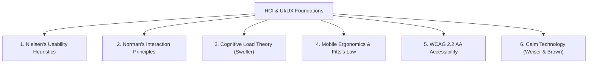
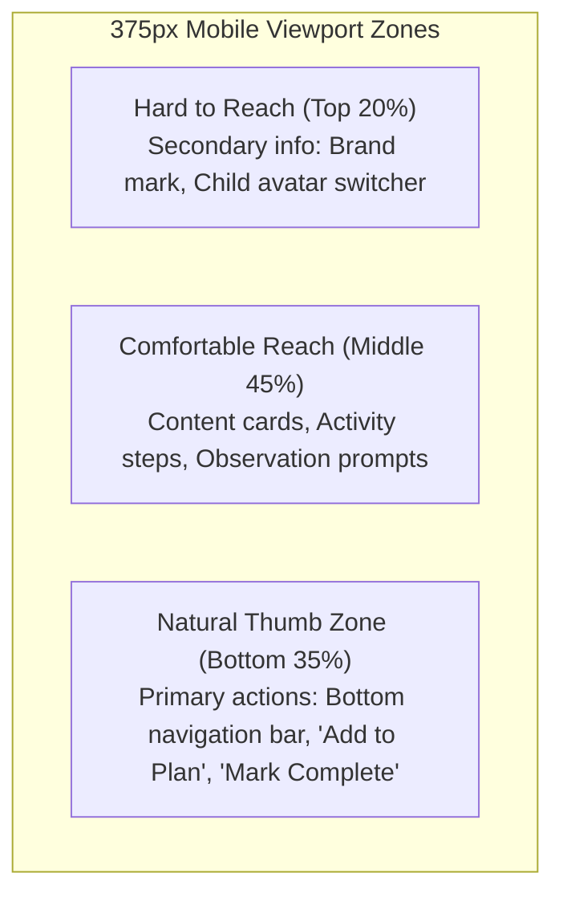
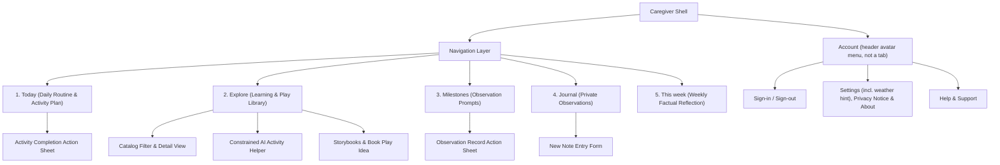

# LittleSteps UI/UX Design Specification & HCI Principles

**Status:** Canonical Design Specification for Prototype Validation  
**Governing Standard:** ISO 9241 (Ergonomics of Human-System Interaction) & WCAG 2.2 AA  
**Owner:** Nherie (Frontend Lead) & Faith (Usability Lead)  
**Last Reviewed:** 2026-10-26  
**Associated Gate:** [Docs Issue #15 — [M0] Plan and validate the LittleSteps UI prototype before implementation](https://github.com/Thesis-Titans/littlesteps-docs/issues/15)  
**Related Documents:** [Product Scope](product-scope.md), [Traceability Matrix](traceability-matrix.md), [Prototype Traceability & Storyboards](prototype-traceability-storyboards.md), [Philippine Content Provenance](philippine-content-provenance.md)  
**Prototype Medium:** Figma, shared by the React and Flutter clients (§1, §9). This gate changes no code in `littlesteps-api`, `littlesteps-react`, or `littlesteps-flutter`.

---

## 1. Architectural Scope & Repository Boundaries

Before establishing interface specifications, the technical boundaries are explicitly affirmed:

1. **Prototype Validation & Parallel Execution:** This document establishes the interaction and interface specification for the **Figma prototype and usability evaluation**. Per the execution plan (§1.2, §3), Sprint 1 engineering (M1 foundation) runs alongside the prototype walkthrough, with usability findings iteratively incorporated into M2–M4 screens ([Docs Issue #15](https://github.com/Thesis-Titans/littlesteps-docs/issues/15)).
2. **Mobile Experience as Responsive Web Frames:** Mobile is prototyped as **375px Figma frames** of the responsive browser layout, and desktop as **1280px frames**. `littlesteps-react` implements these responsive layouts, with caregiver walkthrough feedback feeding iterative refinements. Tablet behavior (768px–1024px) is specified in §5.2 but does not need its own frames.
3. **One Prototype for Both Clients:** The Figma frames are the design source for **both** `littlesteps-react` and `littlesteps-flutter`. React implements the 1280px and 375px layouts; Flutter implements the reviewed **375px frames**, mapping each element to a Material 3 widget as listed in §9. There is no separate set of Flutter frames, so a change to a 375px frame applies to both apps.
4. **Synthetic Data Only:** Frames use the synthetic profiles Maya (14 months) and Liam (48 months) and sample catalog entries. Loading, error, permission-denied, offline, and AI-fallback behavior are shown as separate frames or component variants linked by prototype interactions; nothing connects to Firestore, the API, or an AI provider.

---

## 2. Human-Computer Interaction (HCI) Framework & Design Principles

The LittleSteps interface is designed specifically for **caregivers of young children (0–71 months)**, a user population characterized by divided attention, physical multitasking (often holding an infant while operating a device), sleep deprivation, and high emotional vulnerability to developmental anxiety.

### 2.1 Nielsen’s Usability Heuristics Applied to Caregivers

| Heuristic | Caregiver Context & Friction | LittleSteps UI/UX Implementation |
|---|---|---|
| **1. Visibility of System Status** | Caregivers operating on spotty mobile data need immediate certainty about whether their observations were saved, and caregivers of more than one child need to know which child they are recording for. | **Clear Save Status:** 1-tap completion shows an immediate, non-blocking status (*"Saved ✓"*, or *"Not saved — you're offline"* with Retry). Never freeze the screen or block interaction with full-page spinners. Offline queuing of changes is not yet in scope (see §7). **Current child always visible:** every child-scoped screen header and form shows a "For Maya · 14 months" chip that opens the child switcher. |
| **2. Match System with Real World** | Parents think in terms of daily family rhythms (morning playtime, naptime, wind-down), not database entities. | Information architecture mirrors household realities: *"Quick 10-min games"*, *"Kitchen items"*, *"Living room floor play"*, and a weekly tab called *"This week"* rather than an analytics term. Ask for a birth month and year, never an age the caregiver must calculate. Avoid clinical terminology. |
| **3. User Control & Freedom** | Distracted caregivers holding infants frequently tap the wrong button. | **Undo for reversible actions, confirmation for permanent ones** (see §2.5): marking an activity complete or removing it from the plan shows an undo toast; leaving a note or observation with unsaved text asks before discarding it; deleting a note, a child's records or the account asks for confirmation in a dialog that names exactly what will be deleted. |
| **4. Consistency & Standards** | Caregivers must not re-learn interaction models between desktop and mobile. | One meaning per color (§6.3 semantic color map). Every page title matches the tab or menu item that opened it, with any slogan moved to the subtitle. Standard bottom tab bar on mobile; persistent sidebar on desktop. |
| **5. Error Prevention** | Typing long notes while supervising toddlers leads to errors and frustration; recording for the wrong child is easy when two children share an account. | Constrained UI inputs: month and year pickers for the child's birth month, and chips for materials, time and setting. The "For [child]" chip on every child-scoped form prevents recording against the wrong child. Shared-phone protection (for example a lock) is a hypothesis to test, not a requirement (§4). |
| **6. Recognition Over Recall** | Sleep-deprived caregivers have diminished working memory capacity. | Activity cards display required household items as visual pill tags at the top of the card. Step-by-step instructions chunked into a maximum of 3–4 concise bullet points. Form fields keep their labels and hints visible outside the field; placeholders hold only short examples. |
| **7. Flexibility & Efficiency** | Caregiver time availability varies wildly from day to day (5 minutes vs 30 minutes). | 1-tap quick filters on the home dashboard: *"Under 10 mins"*, *"No materials needed"*, *"Indoor"*. |
| **8. Aesthetic & Minimalist Design** | Visual clutter and dense text exacerbate parental stress. | Clean, spacious layouts with high whitespace. Soft neutral backgrounds (`#F7F7ED`, `#FFFFFF`). **Strictly zero gamification streaks, countdown timers, or guilt-inducing badges.** |
| **9. Help Recognize & Recover from Errors** | Technical error codes alienate non-technical caregivers. | Non-technical, reassuring error copy that never overstates what was saved: *"We couldn't connect right now. Your note hasn't been saved yet. Keep this screen open and tap Retry when you're back online."* |
| **10. Contextual Coaching & Help** | Parents need guidance on *how* to facilitate play, not just instructions, and a known place to turn when they have a question or a worry. | Embedded **Caregiver Coaching Tips** on activity cards (*"Tip: Follow your child's lead. If they look away, it's okay to stop or switch games."*). A **Help and support** item in the account menu, always in the same place, covers how LittleSteps works, what to do if you're worried about your child, and how to contact the team. |

---

### 2.2 Norman’s Interaction Principles
- **Affordances & Signifiers:** Interactive cards use subtle border elevation (`box-shadow: 0 1px 3px rgba(0,0,0,0.08)`) and distinct affordances (chevron icons, tap-state feedback) so clickable areas are immediately unambiguous. Tap-state scale transitions are removed when the user prefers reduced motion (§2.5).
- **Constraints:** Forms use bounded selection rather than free-text entry: the child's age is given as a birth month and year from two pickers limited to the last six years, and the app derives the age band (one of the 7 canonical bands, 0–71 months). Caregivers who prefer not to give a birth month can choose a band directly.
- **Feedback & Mappings:** The relationship between controls and outcomes is direct: tapping a filter immediately adjusts the card list below it without requiring a secondary "Apply" button tap.

---

### 2.3 Mobile Ergonomics, Thumb-Zone & Fitts’s Law
Caregivers frequently operate their phones one-handed with their dominant thumb while holding a child or managing household tasks with their other arm:

- **Natural Thumb Zone Optimization:** The bottom 35% of the mobile screen contains all primary triggers: the 5-tab bottom navigation bar and sticky action sheets.
- **Fitts’s Law Touch Targets:** Frequent and primary mobile controls (tabs, chips, list rows, back links, form buttons) have a **touch target of at least 48 × 48 CSS pixels**, following Material Design for representative Android mobile devices commonly used by caregivers in community settings. Secondary links may go down to **44 × 44**, never lower. Adjacent targets keep at least 8px apart. (WCAG 2.5.8 requires only 24 × 24; these larger sizes are for one-handed comfort.)

---

### 2.4 Accessibility (WCAG 2.2 AA) & Calm Technology
- **Contrast Ratios:** Primary text (`#1A2B29`) against white cards (`#FFFFFF`) achieves **14.8:1**, exceeding the WCAG 4.5:1 requirement. Secondary text (`#63756E`) achieves **4.9:1** on white and **4.5:1** on the canvas; do not place it on Soft Green (4.2:1). White button text on Forest (`#1F634D`) achieves **7.1:1**.
- **Readable Typography:** Body text is constrained to a **minimum of 16px** with 1.5 line-height (`line-height: 24px`) to ensure rapid readability in low-light evening environments.
- **Calm Technology Principles (Weiser & Brown):**
  - No ambient push alerts that demand urgent attention.
  - No manipulative "daily streak" countdowns that induce parental guilt if an activity is skipped.
  - The interface remains quiet and respectful of caregiver time.

### 2.5 Accessibility and Interaction Rules

These rules come from the design system review of 23 October 2026 and apply to every component and screen.

- **Visible focus (WCAG 2.4.7):** Every interactive component has a Focus state: a 2px `color/focus` ring with a 2px offset (7.1:1 on white, 6.6:1 on canvas), plus a 2px white inner ring on Forest-filled controls.
- **Focus not hidden (WCAG 2.4.11):** Scrolling content reserves room for the fixed mobile bars (`scroll-padding-top: 60px`, `scroll-padding-bottom: 72px`) so a focused element is never covered.
- **Recognizable fields (WCAG 1.4.11):** Text fields, selects and unselected chips use `color/border/input` (3.5:1 on white). Entered values use `color/text/primary`; only placeholders use secondary text.
- **Undo or confirm:** Reversible actions show an undo toast that stays until the next action or for at least 10 seconds, pauses while hovered or focused, and is announced politely (WCAG 2.2.1). Irreversible actions (deleting a note, a child's records or the account) open a confirmation dialog whose button names the action, such as "Delete Maya's records".
- **Unsaved drafts:** Cancelling or navigating away from a note or observation that has typed text opens a "Discard this note?" dialog with "Keep editing" as the safe default and "Discard note" as the destructive action. An empty form closes without asking.
- **Status messages (WCAG 4.1.3):** Loading lines, saves and undo toasts use `role="status"`; errors use `role="alert"`.
- **Reduced motion (WCAG 2.3.3):** With `prefers-reduced-motion: reduce`, skeletons are static, the AI loading shimmer stops and tap-scale transitions are removed.
- **Resize and reflow (WCAG 1.4.4, 1.4.10):** Screens stay usable at 200% text size and at 320px width without horizontal scrolling.
- **Readable line length:** Running text is capped at about 70 characters per line, including inside wide desktop cards.
- **Sign-in (WCAG 3.3.8):** Email and password fields allow paste and password managers (`autocomplete="email"`, `autocomplete="current-password"`), with no CAPTCHA or memory test. A session that ends keeps any unsaved draft and returns the caregiver to it after signing in again.
- **Room for translation:** Labels, tabs and chips must fit text 30% longer than English (Tagalog runs about 28% longer); tab labels may wrap to two lines.

---

## 3. Illustrative Personas and Research Limitations

These personas are design aids, not validated user profiles. The primary users are parents, so the main personas are a mother and a father; other caregivers such as grandparents are secondary users. They combine secondary sources, project assumptions, and limited preliminary fieldwork (`P01`). P01 is one exploratory interview and does not support population-level conclusions. Do not attribute a persona detail to P01 unless the interview record directly supports it.

### Persona 1: "Maricel" — Working Mother (parent)
- **Illustrative scenario:** A working mother in Western Visayas caring for a 14-month-old child. Demographic details are fictional and are not findings from P01.
- **Device & Environment:** Assumes a mid-range Android phone and prepaid mobile data as a design scenario; validate device-sharing and connectivity needs with intended users.
- **Possible Practices:** Storybooks, household-item play, and family discussion are examples for design exploration, not established facts about a representative caregiver.
- **Design Hypotheses to Validate:** Limited time, conflicting online advice, and data costs may affect activity selection; test these assumptions with intended users.
- **Design Response to Test:** Offer short activity filters, household-material options, and low-data browsing. Offline availability must be verified in the prototype and implementation.

### Persona 2: "Tatay Jun" — Solo / Hands-On Father (parent)
- **Illustrative scenario:** A hands-on father with daytime responsibility for a four-year-old child. Details are fictional design assumptions.
- **Device & Environment:** Assumes a budget Android phone and a preference for limited child screen time; validate these assumptions.
- **Possible Practices:** A kitchen whiteboard, outdoor play, and board games are illustrative examples, not validated observations.
- **Design Hypotheses to Validate:** Some caregivers may find milestone checklists judgmental or have concerns about school readiness and advertising; validate these concerns directly.
- **Design Response to Test:** Use non-diagnostic observation prompts and activity suggestions; test whether the wording is clear and non-judgmental.

### Persona 3: "Teacher Lea" — Illustrative Child Development Worker Scenario
- **Illustrative scenario:** A child development worker supporting a community center. Age, center size, and work conditions are fictional and have not been validated with this stakeholder group.
- **Assumed Friction:** Families may encounter inconsistent online milestone information, and staff may need easy access to reviewed sources. Confirm these needs with child development workers.
- **Design Response to Test:** Show source attribution and non-diagnostic language; test whether caregivers understand and trust these explanations.

---

## 4. UI/UX Design Evidence & Traceability Matrix

This matrix records the evidence or policy that informs each design choice. Published guidance, statutory context, project constraints, and preliminary interview observations are different evidence types; the matrix does not establish that caregiver needs or design hypotheses have been validated.

| Feature / UX Requirement | Source Evidence / Policy Driver | User Problem Solved | Verification Criteria in Prototype |
|---|---|---|---|
| **Caregiver-Facing UI (Not Child Screen)** | WHO (2020) Responsive Caregiving; WHO (2019) Screen Limits | Keeps the product focused on caregiver guidance and adult-child interaction. | Interface designed exclusively for adult caregiver guidance; no child-direct game loops. |
| **Data-Minimized Child Model** | [Security, Privacy, and AI Guardrails](security-privacy-ai.md); NPC guidance; [Data Model](data-model.md) §2.2 | Reduces collection of unnecessary child personal data. | Stores a nickname (`name`), the derived age band (`ageBand`) and an optional birth month (`birthMonth`, `YYYY-MM`) only; **no exact birth dates, surnames or photos**. |
| **Non-Diagnostic Observation Prompts** | [Product Scope](product-scope.md); RA 12199; preliminary P01 interview (exploratory only) | Keeps the interface from presenting observations as clinical pass/fail judgments. Whether the wording is clear and reassuring requires testing. | Replaces "Pass/Fail" with "Observed on [Date]" / "Not yet observed"; displays a clear non-diagnostic explanation. |
| **Provisional Content Attribution** | [Philippine Content Provenance](philippine-content-provenance.md) (Issue #3 Gate) | Avoids misleading claims of official government endorsement or clinical validation. | Catalog cards display: *"Provisional Academic Reference — Pending Review"*; no unreviewed claims. |
| **Household-Material Activity Catalog** | UNICEF Care for Child Development; preliminary P01 interview (exploratory only) | Tests whether activities using common household materials are practical for caregivers. | Prototype examples use common materials; caregiver usability testing checks availability, clarity, and suitability. |
| **Offline-Resilient Workflow** | PSA 2024 NICTHS (verify the cited statistic and its context before publication) | Explores access under intermittent connectivity or data constraints. | Prototype demonstrates only simulated offline behavior; real caching, persistence, and synchronization require implementation tests. |
| **Multilingual Support (EN / FIL / HIL)** | Product scope; RA 12027 and RA 12199 as context requiring careful interpretation; caregiver language needs remain unvalidated | Tests whether caregivers can understand instructions in their preferred language. | If included in the prototype, language selection and sample copy are illustrative; translation quality and user comprehension require review. |
| **Private Observation Journal (No External AI Use)** | Privacy requirements in [Security, Privacy, and AI Safeguards](security-privacy-ai.md); project data-minimization rules | Makes the journal's access and AI-processing boundaries visible to caregivers. Whether this increases trust must be tested. | Show a clear privacy explanation; implementation tests and request inspection must verify journal text is excluded from external AI payloads. |
| **Constrained AI Helper with Fallback** | [Architecture Decisions](architecture-decisions.md) (ADR-006); project safety constraints | Limits suggestions to reviewed catalog items and provides a rule-based fallback when the AI provider fails and the API/catalog remain available. | Prototype uses simulated responses. Validate catalog-ID checks, timeout behavior, fallback behavior, and privacy boundaries in implementation tests. |
| **Storybooks & Book Play Ideas** | [Architecture Decisions](architecture-decisions.md) (ADR-010); [API Reference](api-reference.md) §5–6; WHO/UNICEF guidance on shared reading | Connects reading time to a screen-free activity using public book data; the play idea is AI-written, so it carries the same labels and fallback as the helper. | Prototype uses sample book cards and a simulated idea. Whether parents want book-based ideas, and whether the covers suit Philippine families, requires walkthrough feedback. |
| **Parental Device Controls / Lock** | Shared-device risk hypothesis; validate with intended users | Explores whether an additional confirmation step would reduce accidental edits on shared devices. | Not prototyped. The walkthrough asks whether anyone else uses the caregiver's phone before any control is designed; usability and security benefits are not established. |
| **Descriptive-Only Weekly Summary** | [Product Scope](product-scope.md); [Security, Privacy, and AI Safeguards](security-privacy-ai.md) | Reduces the risk that a summary is mistaken for a clinical screening result; caregiver interpretation requires usability testing. | Show factual activity counts (for example, "4 activities completed"); exclude percentiles, developmental scores, and pass/fail graphs. |

---

## 5. Information Architecture & Navigation

### 5.1 System Sitemap

Explore has two sections, **Activities** (the reviewed catalog, filterable by domain, type — activity, story, rhyme or game — time, setting and language: English, Filipino or Hiligaynon) and **Storybooks** (book cards from Open Library with cover, title, author and subject tags, credited "Books from Open Library"). Choosing a book opens its detail with a **"Get a play idea"** action. Milestone prompts show their 2–3 everyday indicators and source under the prompt title ([Data Model](data-model.md) §2.8).

Sign-in and the settings, privacy-notice, about and help views cover PRQ-01 and PRQ-03 from the [Traceability Matrix](traceability-matrix.md); they sit behind the header avatar so the navigation stays at five tabs. Offline-cache controls appear in Settings only if offline storage is adopted (see §7).

### 5.2 Responsive Layout Adaptations

| Screen Element | Desktop / Tablet Web (1200px+ / 768px–1024px) | Mobile Viewport (375px–414px) |
|---|---|---|
| **Primary Navigation** | Fixed left sidebar (240px) with brand mark, child switcher, and 5 navigation tabs. | Sticky top bar (brand + child avatar) + **Fixed bottom tab bar** with the same 5 tabs (Today, Explore, Milestones, Journal, This week), each at least 48 × 48px. |
| **Child Switcher** | Dropdown menu in sidebar showing Maya (14m) and Liam (48m), plus a "For Maya" chip in each child-scoped page header. | Header avatar opens the account menu with the child list; a "For Maya · 14 months" chip in each child-scoped header and form opens the switcher. |
| **Dashboard Layout** | 2-column grid: Left = Today's Plan & AI Helper; Right = Weekly Summary & Milestones. | Single-column stacked cards optimized for vertical thumb scrolling. |
| **Touch Targets** | Standard interactive buttons (min 36px height). | **48 × 48px for frequent and primary controls**, 44 × 44px floor for secondary links (§2.3). |
| **Advisory Banner** | Shown in full, in the neutral advisory style (§6.3), on the first visit to Today and Milestones. After it is dismissed, a persistent "Not a diagnostic tool" link stays in the page header and reopens it. | Same behavior; the link sits under the page title. |
| **Page Titles** | The H1 repeats the tab or menu label (Today, Explore, Milestones, Journal, This week); slogans such as "Notice, don't score" become the subtitle. | Same. |

### 5.3 Weather Hint (Optional)

Off by default. When a caregiver chooses a city in Settings ("Weather for activity ideas"), Today shows a hint such as "Rain likely this afternoon · Indoor ideas" that applies the Indoor filter, and the AI helper preselects the matching setting. It carries the attribution "Weather data by Open-Meteo.com" and disappears silently when weather data is unavailable. See [ADR-009](architecture-decisions.md).

---

## 6. Design System Tokens & Foundations

### 6.1 Color Palette (Calm, Approachable, WCAG 2.2 AA Contrast)
The canonical values are the variables in the Figma file's **LittleSteps · Design Tokens** collection; the names below are those variable names.

- **Primary / Brand:** Forest (`color/brand/forest`, `#1F634D`) — calm, reassuring, non-clinical. White text on it measures 7.1:1. (An earlier draft specified terracotta `#D9532F`, which measured 4.0:1 with white text and failed AA.)
- **Neutral Background:** Canvas (`color/surface/canvas`, `#F7F7ED`). That it is easier on the eyes in dim evening light is a hypothesis; the walkthrough asks about evening use before any dark theme is planned.
- **Surface / Card Background:** White (`color/surface/card`, `#FFFFFF`) with subtle border (`color/border/subtle`, `#E0E5DB`).
- **Primary Text:** `color/text/primary` (`#1A2B29`) — high contrast (**14.8:1** against white, **13.7:1** on canvas).
- **Secondary Text:** `color/text/secondary` (`#63756E`) — for timestamps and helper labels (**4.9:1** on white, **4.5:1** on canvas). Do not use it on Soft Green.
- **Status Accents:**
  - *Non-Diagnostic Advisory:* `color/status/caution` (`#FAE8A8` bg) with primary text (12.1:1).
  - *Completed / Observed and Privacy Lock:* `color/surface/soft-green` (`#E0F2E5` bg) with Forest text (6.1:1).
  - *Source Attribution and AI Label:* `color/status/info` (`#D9E8F7` bg) with primary text (11.8:1).
  - *Offline State:* `color/status/offline` (`#F1F5F9` bg) with `color/text/offline` (`#475569`, 6.9:1).
  - *Error:* `color/status/error` (`#FFF6F5` bg) with `color/text/error` (`#853029`, 8.1:1) and `color/border/error` (`#B83D33`, 5.3:1). Muted brick red: clearly an error, still calm.
- **Interaction:** `color/border/input` (`#7E8C86`, 3.5:1 on white, 3.3:1 on canvas) for fields, selects and unselected chips; `color/focus` (`#1F634D`) for focus rings.
- **Pairs to avoid:** secondary text on caution (3.99:1), on offline (4.46:1) or on Soft Green (4.2:1) fails WCAG AA.
- **To add in Figma:** the error, input-border and focus variables above, and rebinding the Text field and Secondary button, which still use hard-coded colors from the retired palette.

### 6.2 Typography Hierarchy
Use **Inter**, loading only the four weights in use (Regular, Medium, Semi Bold, Bold), subset to Latin, to limit data cost on prepaid plans:
- **Display / H1:** 26px Bold (Desktop: 32px)
- **Section Headers (H2):** 20px SemiBold (Desktop: 24px)
- **Subheaders (H3):** 16px SemiBold
- **Body Regular:** **16px Regular** (line-height: 24px; strictly avoids sub-14px body text)
- **Body small:** 14px Regular (line-height: 20px) — for any sentence a caregiver must read: privacy statements, disclaimers, helper text, alert bodies and error messages. Privacy and error copy uses primary text color.
- **Small / Metadata:** 13px Medium — only for timestamps, counts, badges and short labels, never for full sentences.

### 6.3 Semantic Color Map

Each color carries one meaning, and every status also carries an icon and words so meaning never depends on color alone (WCAG 1.4.1).

| Meaning | Treatment | Used for |
|---|---|---|
| Primary action and selection | Forest fill or Forest text with indicator | Primary buttons, selected chips, the active tab |
| A positive record | Soft Green with Forest text and a check icon | Completed activities, observed milestones |
| Warning | Caution yellow with an info icon | Conditions that need attention, such as the AI helper being offline |
| Error | Brick red (`color/status/error`) with an alert icon | Failed actions and validation errors |
| Connection | Offline slate with the wifi-off icon | Offline badge and offline alerts |
| Where content comes from | Pale blue | Source and review-status badges, the AI label |
| Guidance and privacy | Neutral: white or canvas surface, subtle border, icon | The non-diagnostic advisory, privacy notes (lock icon), coaching tips, the reflection prompt |

---

## 7. Mandatory 5-State Interaction Matrix

Every user journey in the Figma prototype must include all five interaction states. **Frame coverage:** the populated state is required at both 1280px and 375px for every journey; the other states are required at 375px and may be reused at desktop width when only the layout container changes.

| Journey / Screen | 1. Populated (Default) | 2. Empty State | 3. Loading (Skeleton) | 4. Error / Permission-denied (`{ error: { code, message } }`) | 5. Offline (Simulated) / AI Fallback |
|---|---|---|---|---|---|
| **J1: Child Profile** | Maya (14m) & Liam (48m) with age-band badges. | "No children added yet. Add a profile to get age-tailored ideas." | Profile card pulse skeleton. | `INVALID_INPUT`: "Name must be 1–50 characters. Choose a birth month and year within the last six years, or choose an age band." | Last-viewed profile shown with offline badge; editing disabled with "Reconnect to save changes." |
| **J2: Daily Plan** | 2 scheduled activities with completion toggles. | "No activities planned for today. Tap below to pick a 10-minute game!" | Activity card pulse skeleton. | `NOT_FOUND`: "Activity not found. It may have been removed from the catalog. Your plan is shown as it was last loaded." | "You're offline. This activity wasn't marked complete." with Retry. |
| **J3: Milestones** | Domain-grouped prompts with "Observed on [date]". | "No observations recorded yet. Look for small moments during play." | Milestone prompt pulse skeleton. | `INTERNAL_ERROR`: Safe error banner; zero stack traces exposed. | "You're offline. Your observation wasn't saved." Entered text stays on screen with Retry. |
| **J4: Private Journal** | Date-stamped notes with `🔒 Private` badge. | "Your journal is private to you. Jot down a memory or funny moment." | Note list pulse skeleton. | `INVALID_INPUT`: "Notes can be up to 2,000 characters. Please shorten this entry." (The 2,000-character limit comes from the [Data Model](data-model.md); the API's separate 100KB request-body limit is never the user-facing note limit.) | "You're offline. Your note wasn't saved." Draft stays on screen with Retry; `🔒 Private` badge still visible. |
| **J5: Learning Library** | Filterable catalog cards with provisional review chips. | "No activities found matching your filters. Try clearing 'Materials'." | Catalog grid pulse skeleton. | `SERVICE_UNAVAILABLE`: "The activity list didn't load. Check your connection, then choose Retry." | Only activities labeled "Available offline" open; others show "Needs a connection." |
| **J6: AI Activity Helper** | Tailored suggestion grounded in catalog ID #104. | Form with time, materials, and setting inputs. | Animated shimmering helper card. | `RATE_LIMITED`: "Suggestion limit reached. Please wait a moment." | **Deterministic Fallback:** "AI helper offline. Here are top recommended activities for Maya's age group." |
| **J7: Storybooks & Play Idea** | Book cards with covers; book detail with an AI play idea showing the AI badge, safety notice and disclaimer. | "No books found for this topic. Try another subject." | Book card pulse skeleton; shimmering idea card. | `RATE_LIMITED`: "Play idea limit reached. Please wait a moment." | **Fallbacks:** if Open Library is down, a saved book list shows without change; if AI is unavailable or its idea fails the checks, a reviewed catalog activity shows labeled "Catalog pick · not AI". |

**Permission-denied frames:** J1 also includes a signed-out frame (`UNAUTHENTICATED`: "Please sign in again to continue."), and J4 includes an access-denied frame for a profile or note that belongs to another caregiver (API returns 404 `RESOURCE_NOT_FOUND` per NFR-SEC-02 and the [API Reference](api-reference.md) §3: "This item isn't available to your account.").

**Error and status styling:** error frames use the brick-red error tokens, and undo toasts and confirmation dialogs follow §2.5.

**Offline frames are simulated.** They must never claim that data was saved or synced while offline. Whether the React app will store or queue changes offline is an open implementation decision; the prototype shows the no-queue behavior above until that decision is recorded.

---

## 8. Figma Prototype Validation Checklist (For Docs Issue #15)

When preparing the prototype for course instructor and faculty review, the team must verify:

- [ ] **Figma Link Recorded:** The [Figma file](https://www.figma.com/design/yqUHW4lOuuly4jDPNMkMVI/LittleSteps-%E2%80%94-Responsive-Caregiver-Prototype) is linked in Docs Issue #15, with view access for reviewers.
- [ ] **Viewport Coverage:** Populated frames exist at 1280px and 375px for all 6 core capabilities; other state frames follow the §7 coverage rule.
- [ ] **Navigation Consistency:** The same five tabs appear in the desktop sidebar and the mobile bottom bar; sign-in, settings, privacy notice, and about are reachable from the header avatar.
- [ ] **Permission-denied Frames:** J1 signed-out and J4 access-denied frames are present.
- [ ] **Ergonomic Verification:** Frequent and primary mobile controls are at least **48 × 48 CSS pixels**; nothing is below 44 × 44.
- [ ] **Focus States:** Every interactive component has a visible Focus variant (§2.5).
- [ ] **Field Boundaries:** Fields, selects and unselected chips use `color/border/input`; entered values use primary text.
- [ ] **Current Child Visible:** Every child-scoped screen and form shows the "For [child]" chip.
- [ ] **Titles Match Navigation:** Every page title matches the tab or menu item that opens it.
- [ ] **Help Reachable:** Help and support is in the account menu.
- [ ] **Readable Small Print:** No full sentence is set below 14px.
- [ ] **Advisory Banner Visible:** The non-diagnostic advisory shows in full on the first visit to Today and Milestones, then remains reachable from a persistent "Not a diagnostic tool" link.
- [ ] **Provisional Attribution Displayed:** Sourced catalog cards include *"Provisional Academic Reference — Pending Review"*.
- [ ] **Private Journal Isolation Demonstrated:** Visual lock icon and privacy notice confirm notes are excluded from AI prompts.
- [ ] **Deterministic Fallback Clickable:** Walkthrough demonstrates what occurs when the AI helper is offline.
- [ ] **Storybook Flow Present:** Explore shows Storybooks with Open Library credit, and a book's play idea shows the AI badge, safety notice and its catalog fallback.
- [ ] **Honest Offline States:** No offline frame claims data was saved or synced.
- [ ] **Contrast Checked:** Text and button colors match §6.1 and meet WCAG 2.2 AA (4.5:1 for normal text).
- [ ] **Zero Clinical Language:** UI audit verifies the absence of *"delayed"*, *"behind"*, *"late"*, *"on track"*, *"normal"*, *"should"*, *"at risk"*, *"red flag"*, *"score"*, *"pass/fail"*, *"screening"*, percentages and comparisons with other children. Filipino and Hiligaynon copy gets the same audit by a reviewer fluent in each language.

---

## 9. Flutter Adaptation of the 375px Frames

The Flutter app (CC 207B) uses the reviewed 375px mobile-web frames as its design source and maps each element to the Material 3 widget below. Tokens, copy, states (§7) and the rules in §2.5 apply unchanged; only the widget changes.

| Element in the 375px frames | Flutter (Material 3) | Notes |
|---|---|---|
| Design tokens (§6.1, §6.3) | `ThemeData` with a custom `ColorScheme`, plus a `ThemeExtension` for status colors | One source of truth; no hard-coded colors in widgets. |
| Type styles (§6.2) | `TextTheme` using Inter bundled as an app asset | Bundle the font rather than downloading it at runtime, to avoid data cost. |
| Bottom tab bar (5 tabs) | `NavigationBar` with five destinations | Labels always shown. |
| Top bar with child chip | `AppBar` with the "For [child]" chip and the account avatar as actions | The system back gesture and the `AppBar` back button replace the "‹ Back" text links. |
| Account menu | `showModalBottomSheet` | Same items, including Help and support. |
| Cards | `Card.outlined` | Borders use `color/border/subtle`. |
| Primary and secondary buttons | `FilledButton` and `OutlinedButton` | |
| Filter and choice chips | `FilterChip` and `ChoiceChip` | Unselected outline uses `color/border/input`. |
| Text fields | `TextFormField` with an outline border and a visible label | Error text through `InputDecoration.errorText`; error colors from the error tokens. |
| Selects (age band, week, dates) | `DropdownMenu`; month and year pickers for the birth month | |
| Inline error and offline alerts | A styled `Card` inside the scroll view | Not a `SnackBar`: these must stay until resolved. |
| Undo toast | `SnackBar` with an action and a duration of at least 10 seconds | Follows the undo rule in §2.5. |
| Confirmation for permanent deletes | `AlertDialog` whose confirm button names the action | |
| Loading skeletons | Placeholder shapes that stop animating when `MediaQuery.disableAnimations` is true | Reduced-motion rule in §2.5. |
| Status announcements | `Semantics(liveRegion: true)` on status and alert text | Screen-reader rule in §2.5. |
| Focus ring | Theme `focusColor` and outline from `color/focus` | Visible on every interactive widget. |
| Touch targets | `MaterialTapTargetSize.padded` (48dp) | Matches the 48px rule in §2.3. |
| Text size | Respect the system text scale (`MediaQuery.textScaler`) up to 200% | Layouts must not clip or overlap. |

Where a Flutter screen needs to differ from its 375px frame, record the difference and the reason in the Flutter pull request.
