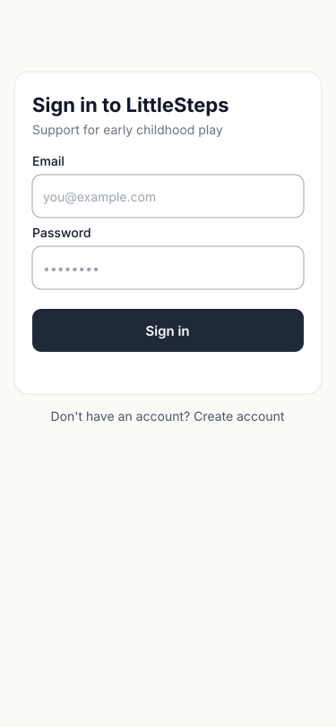
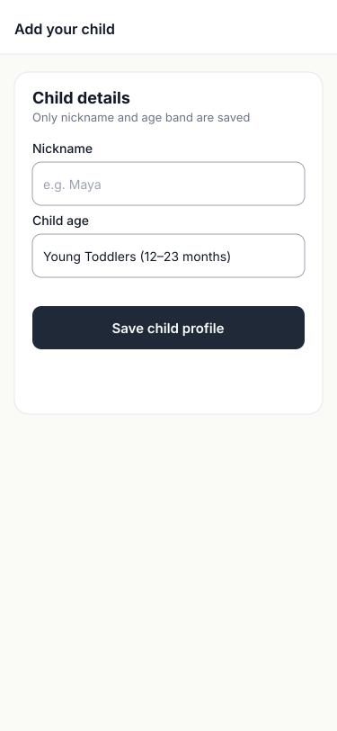
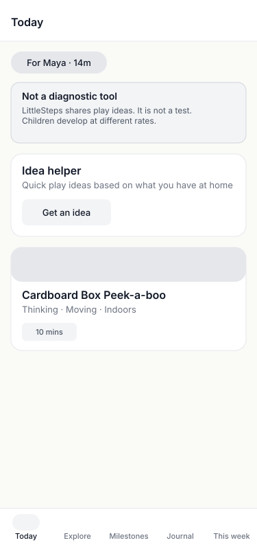
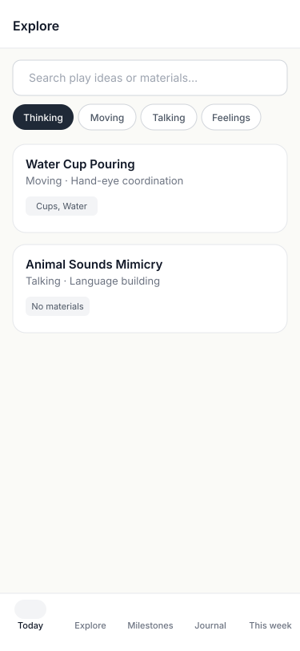
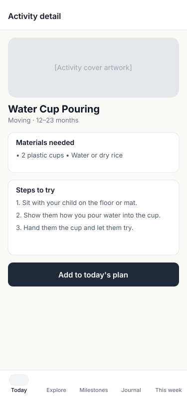
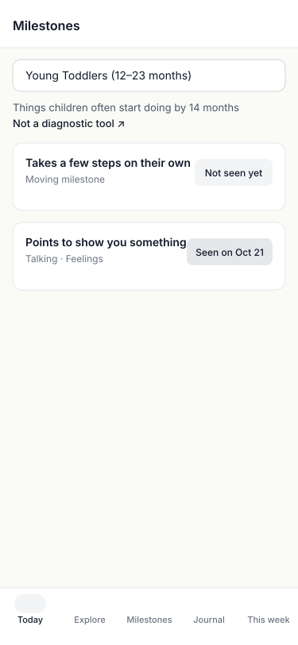
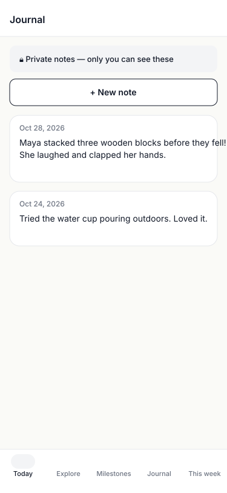
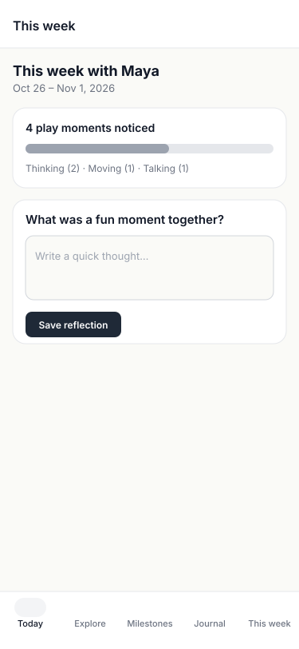

# Low-Fidelity Wireframes Gallery (Issue #44)

These wireframes represent the 9 essential mobile user journeys for LittleSteps at **375 × 812 px**, designed in accordance with **WCAG 2.2 AA**, **ISO 9241**, and the **LittleSteps Design Review Rubric** (`docs/design-review-rubric.md`).

They use grayscale boxes, intentional whitespace, a 60px top bar, a 72px bottom tab bar, and strict sentence case with zero clinical or AI buzzwords.

---

## 1. Journey Overview & Assets

| # | Journey & Name | Target Frame in Figma | SVG Asset |
|---|---|---|---|
| 1 | **Sign In** | `LoFi / Auth / Sign In – Default` | [01-lofi-auth-sign-in.svg](01-lofi-auth-sign-in.svg) |
| 2 | **Add Child** | `LoFi / Onboarding / Add Child – Form` | [02-lofi-onboarding-add-child.svg](02-lofi-onboarding-add-child.svg) |
| 3 | **Today Dashboard** | `LoFi / Today / Dashboard – Default` | [03-lofi-today-dashboard.svg](03-lofi-today-dashboard.svg) |
| 4 | **Explore Catalog** | `LoFi / Explore / Catalog – Default` | [04-lofi-explore-catalog.svg](04-lofi-explore-catalog.svg) |
| 5 | **Activity Detail** | `LoFi / Explore / Activity Detail – Default` | [05-lofi-activity-detail.svg](05-lofi-activity-detail.svg) |
| 6 | **Milestones Tracker** | `LoFi / Milestones / Tracker – Default` | [06-lofi-milestones-tracker.svg](06-lofi-milestones-tracker.svg) |
| 7 | **Private Journal** | `LoFi / Journal / Notes – Default` | [07-lofi-journal-notes.svg](07-lofi-journal-notes.svg) |
| 8 | **Weekly Reflection** | `LoFi / Reflection / Weekly – Default` | [08-lofi-reflection-weekly.svg](08-lofi-reflection-weekly.svg) |
| 9 | **Account Menu** | `LoFi / Account / Menu – Modal` | [09-lofi-account-menu.svg](09-lofi-account-menu.svg) |

---

## 2. Visual Previews

### 01. Sign In & 02. Add Child (Onboarding)

### 03. Today & 04. Explore Catalog

### 05. Activity Detail & 06. Milestones Tracker

### 07. Private Journal & 08. This Week Reflection

### 09. Account & Children Sheet

